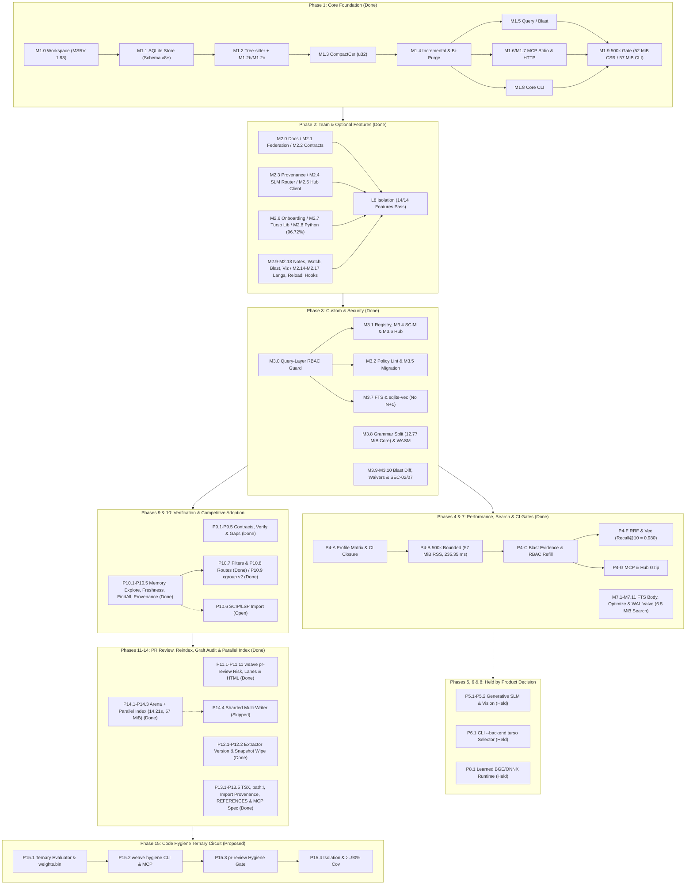

# Implementation Breakdown: `weave-graph`

> **Document ID**: `impl.md`**Topic**: Ordered engineering breakdown, current-tree validation for Phases 1–3, and Phase 4–7 development tasks **Project**: `weave-graph` (CLI: `weave`) **Source of truth**: current crate manifests, source, tests, and CI for implementation status; [plan.md](plan.md) (approved direction) and [issues.md](issues.md) (open and historical findings). Historical benchmark results are not current measurements. A handful of milestone notes below cite earlier internal source notes and unapproved design sketches that are no longer present in this repository; the milestone text here and `plan.md` preserve the adopted logic from them directly, so nothing depends on those sources still existing.

---

## 0. How to Read This Document

Every milestone below has: **what it builds**, **what it depends on**, and **how it's verified**. Verification always points to something concrete already specified elsewhere — a `criterion` benchmark, a regression test named in `plan.md` §1.2a, or the `weave slm doctor` self-check — never a vague "should work."

**Cross-phase rule, restated from** `plan.md` **Architecture Principle 4**: Phase 2 and Phase 3 milestones are Cargo features. None of them may be started in a way that changes Phase 1's default build — every Phase 2/3 task ends with the feature-isolation regression assertion still passing.

---

## 0a. Documentation Audit History (Resolved)

A cross-check of `plan.md` against this document — plus earlier SLM research and cross-references — done during the initial drafting pass, found items `plan.md` specified with no milestone anywhere in this breakdown, and naming/spec conflicts across docs. Both classes of finding are closed as of this update; kept here as a historical record, not an open task list:

1. **Missing milestones** — added, and since built or scheduled, under their own numbers rather than staying only in this section: M1.2b, M2.7, M2.8, M3.5, plus bullets folded into M1.2, M1.6, M1.8, M2.0, M2.1. Their own text still says "added per §0a" — left as-is rather than scrubbed, since it's the honest record of why each exists.
2. **MCP tool naming drift across four earlier docs** (`get_callers`/`get_impact_radius`/`find_path`/`explain_rationale` vs. the real, shipped `weave_repo_map`/`weave_file_api`/`weave_trace_calls`/`weave_impact_radius`) — corrected in the retained planning and reference documents; the speculative SLM sketch was retired.
3. `sqlite_latency` **bench spec was unsatisfiable as written** — it required a `rusqlite`-vs-`libSQL` comparison before any `libSQL`/`turso` backend existed. Fixed: the bench now runs `rusqlite` alone for the M1.9 gate; the `libSQL` comparison moved into M2.7's own verify criteria, to run once that backend actually exists.
4. **2026-09-23 phase renumbering and expansion** — Phase 1–7 were put in strict sequential document order (the merged "Phase 4D" was un-merged into Phase 4 plus Phase 7, and Phase 7's `M7.x` milestones were renamed from `M4B.x`), Phase 4's embedding/vector-search item (`P4-D`) was split out into its own new held Phase 8, and two new not-started phases were added from unapproved internal review notes — Phase 9 from a verification proposal and Phase 10 from a capability review.

---

## 1. Phase 1: weave-core Foundation

_The Phase 1 core is available without optional features. The current unflagged CLI build additionally enables_ `lang-extended`_; the size-limited core artifact requires_ `--no-default-features`_. This phase is the dependency root for later phases — nothing in Phase 2 or 3 can start meaningfully before M1.4._

### M1.0 — Workspace Scaffold ✅ Done (2026-09-09)

- Cargo workspace with the crate layout from `plan.md` §0.1: `weave-graph-core`, `weave-graph-parse`, `weave-graph-store-sqlite`, `weave-graph-mcp`, `weave-graph-cli`. (`weave-graph-store-turso` and `weave-graph-hub` are stubbed empty — created but not implemented until their features are scheduled, so the workspace graph is stable from day one.)
- MSRV pinned per `plan.md`'s Extensibility principle 6 (last 2 stable Rust releases); CI checks stable and beta but does not currently test the pinned MSRV as a separate matrix entry.
- **Depends on**: nothing. **Verifies**: `cargo build --workspace` succeeds with zero features; `cargo tree` shows no crate outside `weave-graph-core`'s direct deps in the default build.
- **Status**: workspace root `Cargo.toml` + all 7 crates scaffolded under `crates/`, MSRV pinned `1.93` (matches `AGENTS.md`'s `1.93+`; corrected from an earlier `1.92` pin — toolchain on hand: `1.93.1`). `cargo build --workspace` clean. `cargo tree -p weave-graph-cli` confirms `weave-graph-store-turso`/`weave-graph-hub` absent from the default-feature build. (Update: an earlier "no CI config exists" note is stale — `.github/workflows/ci.yml` now exists with lint / coverage-90% / e2e / N+1 / bench jobs, added by M1.9.)

### M1.1 — Storage Trait & `rusqlite` Backend ✅ Done (2026-09-09)

- Define the `Storage` trait (`plan.md` §0.4) in `weave-graph-core`: `get_node`, `get_edges`, `upsert_node`, `upsert_edge`, `query_path`, plus schema-version read/write.
- Implement it in `weave-graph-store-sqlite`. Schema exactly as `plan.md` §1.1: `nodes`, `edges`, `doc_links`, `contracts` (with `contract_hash`/`source_commit_sha`/`published_at` columns pre-added even though `federation` isn't built yet — cheaper to add the columns once than migrate twice), `schema_version`.
- Migration runner: applies pending migrations on open, refuses to open a newer schema with an older binary.
- **Depends on**: M1.0. **Verifies**: round-trip test (write graph, close, reopen, read back identical) on `rusqlite`; migration runner test opens a v1 schema and produces a v2 schema idempotently.
- **Status**: `Storage` trait + `Node`/`Edge`/`StorageError` types in `weave-graph-core/src/{storage,model,error}.rs`. `SqliteStorage` in `weave-graph-store-sqlite` (`rusqlite`, `bundled` feature — no system SQLite dependency). Schema v1 (5 tables + natural-key unique indices) + v2 (traversal indices on `edges.source_id`/`target_id`, `nodes(repo_id, path)`) as real migrations, exercised by a legacy-v1-db-upgrade test. `query_path` is BFS over outbound edges (CSR/roaring come in M1.3; this is the correctness baseline). File-backed close/reopen round-trip test passes (`tests/round_trip.rs`). 13 tests total, `cargo clippy --workspace --all-targets -- -D warnings` and `cargo fmt --check` clean, line coverage 96.51% (`cargo llvm-cov -p weave-graph-core -p weave-graph-store-sqlite --fail-under-lines 90`, gate met). Local toolchain note: this machine's `cargo`/`rustc` are Homebrew-installed, not rustup-selected, so `cargo-llvm-cov` needs `LLVM_COV`/`LLVM_PROFDATA` pointed at `~/.rustup/toolchains/stable-x86_64-apple-darwin/lib/rustlib/x86_64-apple-darwin/bin/{llvm-cov,llvm-profdata}` explicitly — plain `rustup component add llvm-tools-preview` isn't picked up otherwise.

### M1.2 — Tree-sitter AST Extraction ✅ Done (2026-09-09)

- `weave-graph-parse`: tree-sitter integration for an initial language set (recommend Rust, TypeScript/JavaScript, Python — covers the `benches/` corpora directly). Additional languages are additive later, not a blocker for Phase 1 exit.
- SCIP moniker support for cross-file resolution (`plan.md` §1.2).
- Two-Tier Edge Taxonomy (`plan.md` §1.2): `CALLS_EXACT`, `CALLS_DYNAMIC`, `IMPORTS`, `INHERITS`, `IMPLEMENTS` — extracted alongside symbols, not deferred to a later milestone. (This bullet was missing from the original breakdown despite M1.4's regression test presupposing edges already exist by the time it runs; added here for spec-completeness — see §0a.)
- Wiring-card generation: symbol signature + exact line range per structural node.
- Use tree-sitter's native incremental reparse API from the start (`plan.md` §1.2a) — retrofitting it after M1.4's bailout logic is built would mean redoing that logic's assumptions.
- **Depends on**: M1.0. **Verifies**: `benches/parser_throughput.rs` runs (even before its target numbers are met) against `tokio`/`ripgrep`/`typescript` corpora; symbol extraction matches a hand-checked fixture file per language; edge extraction produces `CALLS_EXACT`/`CALLS_DYNAMIC`/`IMPORTS`/`INHERITS`/`IMPLEMENTS` edges resolvable against the fixture files' own symbols.
- **Status**: 4 grammars (`tree-sitter-{rust,python,javascript,typescript}`). `SourceParser` wraps `tree_sitter::Parser` with a cached `Tree` for incremental reparse (`InputEdit` + `Parser::parse(_, Some(&old_tree))`); a test asserts `changed_ranges` after an edit covers only the touched region, not the whole file. Extraction covers functions/methods/structs/classes/interfaces with exact line spans + collapsed-whitespace signatures, plus `CALLS_EXACT`/`CALLS_DYNAMIC`/`IMPORTS`/`INHERITS`/`IMPLEMENTS` edges via a `ProjectIndex` that resolves references by short symbol name (same-file match preferred, else a globally-unique match, else `CALLS_DYNAMIC` fan-out to every candidate, else dropped — never a dangling target). 27 tests including 4 hand-counted fixture files (one per language, `tests/fixture_extraction.rs`), `benches/parser_throughput.rs` runs and produces real numbers against bundled fixtures. Line coverage 95.90% (`cargo llvm-cov -p weave-graph-parse --fail-under-lines 90`), clippy/fmt clean.
  - **Scope cuts, stated explicitly rather than silently narrowed:**
    1. **Moniker is not the SCIP wire protocol.** `path#qualified.symbol.path`, not `scip.proto`'s package/version-qualified descriptor — real SCIP is its own protobuf ecosystem (`scip-typescript`, `scip-python`, ...) and Phase 1 only needs resolution _within one repo_. Documented in `moniker.rs`; revisit if `federation`/`hub` need to interoperate with an external SCIP index.
    2. **Edge resolution is by-short-name, not type-aware.** No import-scope tracking, no type inference. A method call always resolves `CALLS_DYNAMIC` (fans out to every same-named candidate) since the receiver's type is never known; a plain call is `CALLS_EXACT` only when same-file-unique or globally-unique.
    3. **JS/TS** `IMPORTS` **edges don't resolve.** Their `target_name` is a module path (`"./strings"`), which the by-short-name resolver never matches against indexed symbols — Rust/Python's `use`/`import` target a symbol or module _name_ instead and do resolve. A real module-graph edge (file-to-file) needs a `modules`/file-node concept the schema doesn't have yet; this is a gap for M1.4's indexer or a schema revisit, not something to quietly drop.
    4. **Rust traits, enums, and type aliases aren't extracted as symbols** — only `struct`/`impl`-method/free-`fn`. A trait's own declaration produces no node, so `impl Trait for Type` records an `IMPLEMENTS` reference that only resolves if `Trait` happens to also be indexed some other way (it currently never is). Additive later, per this milestone's own "additional languages are additive" allowance extended to additional construct kinds.
    5. **Bench corpus is bundled fixtures, not** `tokio`**/**`ripgrep`**/**`typescript`**.** Vendoring those full repos isn't practical here (network fetch + size bloat on every checkout for a repo that otherwise has zero external data dependencies). `WEAVE_BENCH_CORPUS_DIR` is already wired up to point the bench at a real local checkout of those repos when M1.9 needs the real numbers.

### M1.2b — Additional Tree-sitter Languages ✅ Done (2026-09-09)

_Added per §0a:_ `plan.md` _§1.2 names six language groups for Phase 1 parsing (TypeScript/JavaScript, Python, Go, Rust, Java, C/C++); M1.2 above ships three. This milestone was missing entirely — it existed only as the unscheduled phrase "additive later" in M1.2's own text. Widened beyond_ `plan.md`_'s original six on request, to popular languages not yet in scope anywhere else in this document._

- `plan.md` §1.2's named set: **Go, Java, C, C++** (`tree-sitter-go`, `tree-sitter-java`, `tree-sitter-c`, `tree-sitter-cpp`).
- Widened set, same justification (popular, no milestone owns them, tree-sitter grammar crates exist and are maintained): **C#** (`tree-sitter-c-sharp`), **Kotlin**, **Swift** (`tree-sitter-swift`), **Scala** (`tree-sitter-scala`), **Zig** (`tree-sitter-zig`), **Ruby** (`tree-sitter-ruby`), **PHP** (`tree-sitter-php`), **Shell/Bash** (`tree-sitter-bash` — covers POSIX `sh` too), **PowerShell** (`tree-sitter-powershell`), **Lua** (`tree-sitter-lua`).
- Shell/Bash and PowerShell are script-oriented, not class/interface-oriented like the rest of the set — their extractors index functions (`function foo`/`foo()` in Bash, `function Foo`/`Foo-Verb` cmdlets in PowerShell) as the symbol unit; no struct/class/interface kind applies. Call-site extraction still applies (`foo arg1` / `Invoke-Foo`).
- Each language follows M1.2's per-language extractor pattern exactly (symbol/kind/line-span extraction, call-site + structural-edge extraction via the same by-short-name `ProjectIndex` resolver, hand-checked fixture per language) — no new architecture, just more `extract/<language>.rs` modules added to `weave-graph-parse`. Land them independently and in any order; one language's grammar quirks don't block another's.
- **Explicitly does not block M1.9** — `plan.md` §1.2 itself calls additional languages "additive later, not a blocker for Phase 1 exit." Schedule whenever convenient after M1.2, in parallel with M1.4 onward; the Phase 1 Exit Gate does not wait on any of these 11.
- **Depends on**: M1.2 (reuses its extractor/resolver pattern). **Verifies**: hand-checked fixture file per new language (same standard as M1.2's `tests/fixture_extraction.rs` — symbols, kinds, exact line spans, and at least one resolvable edge per fixture); `benches/parser_throughput.rs` gains a group per language.
- **Status**: all 14 languages (Go, Java, C, C++, C#, Kotlin, Swift, Scala, Zig, Ruby, PHP, Bash, PowerShell, Lua) implemented as `extract/<language>.rs` modules, wired into `Language`'s exhaustive match. 14 fixture files (`tests/fixtures/sample.{go,java,c,cpp,cs,kt,swift,scala,zig,rb,php,sh,ps1,lua}`) with hand-counted symbol/kind/line-span tests in `tests/fixture_extraction.rs`, plus a same-source unit test per extractor module. `benches/parser_throughput.rs` gained one group per language. Clippy/fmt clean. Full workspace regression confirmed against M1.0–M1.3 at the time.
- **Update (2026-09-09, post-M1.2b)**: `Language` grew from 18 to 29 variants beyond this milestone's original 14 — a Query-VM engine (`extract/query_vm.rs`) was added covering config formats (YAML/TOML/JSON/Properties, literal `tree-sitter::Query`-based) plus a generic kind-name-heuristic fallback for any grammar with no hand-written extractor (documented as `impl.md M1.2c` in `language.rs`'s own doc comment, though that milestone section doesn't exist yet in this file — noted here rather than left silently dangling). SQL, Elixir, Dart, HTML, CSS, and R subsequently graduated from that generic fallback to dedicated `extract/<language>.rs` modules of their own, same pattern as this milestone's 14. `extract/mod.rs`'s dispatch now only falls through to `query_vm::extract` for YAML/TOML/JSON/Properties/Haskell. Crate-wide: 102 tests (58 lib + 44 across 6 integration test files), line coverage 93.02% (`cargo llvm-cov -p weave-graph-parse --all-targets`, gate met). A **100% line coverage** pass for `weave-graph-parse` is in progress separately — not yet complete as of this update.
  - **Dependency catch worth recording**: `tree-sitter-kotlin` 0.3.8 (the only crate of that name on crates.io until this pass) pins `tree-sitter < 0.23`, incompatible with this workspace's `tree-sitter = "0.27"` — both versions declare `links = "tree-sitter"`, and Cargo refuses to resolve two crates claiming the same native-link key. Swapped for `tree-sitter-kotlin-ng` (the actively maintained fork under the `tree-sitter-grammars` org, depending on the modern version-agnostic `tree-sitter-language` shim like every other grammar here) rather than downgrading the workspace's `tree-sitter` version to accommodate one stale grammar crate.
  - **Extraction-code catch worth recording**: `to_sexp()` silently elides _anonymous_ (unnamed) tree-sitter nodes — C#'s `this` in `this.GetName()` doesn't appear in a `to_sexp()` dump at all, which looks identical to "this field doesn't exist." A field-labeled recursive walker (print every child with its field name, named or not) is what actually caught this — used for every language after Rust/Python/JS/TS/Go/Java/C/C++/C#'s initial `to_sexp`-based pass, and is the reason C#'s `member_access_expression.expression` field, Kotlin's fully-positional `class_body`/`function_body`/`delegation_specifiers`, and C#'s positional `base_list` were all found and handled correctly rather than assumed.
  - **Per-language scope notes** (each a deliberate simplification, not an oversight): C#/Kotlin/Swift's single ambiguous base-list/inheritance syntax (`: Base`) doesn't grammatically distinguish superclass from interface conformance, so all three emit `INHERITS` uniformly rather than guessing; PHP and Java _do_ distinguish structurally (`class_interface_clause`/`interfaces` vs `base_clause`/`superclass`) and get real `IMPLEMENTS`/`INHERITS` split. Zig has no inheritance concept at all (comptime duck-typing isn't AST-visible). Bash/PowerShell/Lua's `source`/`require`/`Import-Module`-style loading is ordinary call/command syntax in each grammar, not a distinct import node — left as a normal (and typically unresolvable, hence edge-free) call rather than special-cased, matching the already-documented JS/TS `IMPORTS` gap from M1.2.

### M1.2c — Query-VM Engine & Generic Fallback Extractor ✅ Done (2026-09-09, retro-documented)

_Existed in code before this section did —_ `crates/weave-graph-parse/src/language.rs`_'s doc comment cited "impl.md M1.2c" for work this file had no section for. Retro-documented to close that dangling reference; the work itself predates this write-up._

- A literal `tree_sitter::Query`-based extractor (`extract/query_vm.rs`) for config formats — YAML/TOML/JSON/Properties — plus a generic kind-name-heuristic fallback extractor for any grammar with no hand-written module (currently only Haskell reaches the fallback).
- Six languages graduated from the fallback to dedicated `extract/<language>.rs` modules: SQL, Elixir, Dart, HTML, CSS, R — same per-language pattern as M1.2b (fixture, hand-checked spans, resolvable edge).
- This is what grew `Language` from M1.2b's 14 to 29 variants (see M1.2b's own update note above).
- **Depends on**: M1.2 (extractor/resolver pattern). **Verifies**: per-language unit tests in `extract/<language>/tests.rs` + `tests/fixture_extraction.rs` coverage, to M1.2b's standard.
- **Status**: implemented and tested in the M1.2b-era parse-crate pass (102 tests, 93.02% line coverage at the time of M1.2b's update note). Still open from that same pass: the 100% line-coverage follow-up for `weave-graph-parse` — tracked in §5 Open Items Ledger.

### M1.3 — CSR Graph Model & Integer Compaction ✅ Done (2026-09-09)

- `petgraph::csr::Csr` adjacency in `weave-graph-core`, `uint32` symbol/path interning (`plan.md` §1.1). Explicitly not a hand-rolled SIMD matrix — that was the ponytail-corrected decision.
- `roaring` bitmaps for set-intersection operations (impact-radius, path queries).
- **The SQL store is authoritative; CSR is rebuilt from it on load.** No bidirectional sync path exists — don't build one.
- **Depends on**: M1.1. **Verifies**: `benches/csr_memory.rs` (bytes-per-node ≤24, bytes-per-edge ≤8 — targets, not gates yet, see M1.9); load-from-SQL-then-query round trip matches direct SQL query results.
- **Status**: `CsrGraph` in `weave-graph-core/src/csr.rs`, built via `Csr::from_sorted_edges` (O(V+E)) from two new `Storage` trait methods, `all_nodes`/`all_edges`, implemented in `SqliteStorage` as ordered `SELECT *`. Storage ids (which have gaps after deletions) are compacted into the dense `0..n` index `Csr` requires via an `id_to_index`/`index_to_id` pair; a dangling edge endpoint is skipped on load rather than panicking (M1.4 owns preventing it at write time, this is just a defensive read). Multi-kind edges between the same `(source, target)` pair collapse to one CSR edge (max weight) — CSR serves reachability/traversal, not edge-kind attribution, which stays queryable from SQL. `query_path` re-implements the M1.1 BFS using a `RoaringBitmap` visited set; `reachable_within(from, max_hops)` returns a `RoaringBitmap` of reached indices as the impact-radius building block, with a test demonstrating `&`/set-intersection across two radii. `tests/csr_round_trip.rs` (in `weave-graph-store-sqlite`, since it needs both crates) verifies `CsrGraph::query_path` matches `SqliteStorage::query_path` on an identical graph across 5 from/to pairs including same-node and unreachable cases. `benches/csr_memory.rs` runs and reports real numbers (analytical bytes/node/edge — `petgraph::csr::Csr`'s internal buffers aren't introspectable at runtime without an added dependency, not worth it for a diagnostic — plus measured load time at 1k/50k/200k nodes).
  - **Current-tree correction (2026-09-14)**: The preceding paragraph records the original implementation, not the current representation. `CsrGraph` now holds an in-repo `CompactCsr` with `Vec<usize>` row offsets and `Vec<u32>` column indices; `load` consumes streamed storage rows and deduplicates `(source, target)` pairs without storing weights. Caller traversal builds a temporary reverse view rather than retaining a permanent reverse CSR. The analytical `csr_memory` bench still describes the older `petgraph` layout, so its layout-derived figures cannot validate current `CompactCsr` bytes per node/edge until that bench is updated.
  - **A real correctness/perf catch worth recording**: `petgraph::csr::NodeIndex<Ix>` is a **type alias for** `Ix` **itself** (`pub type NodeIndex<Ix = DefaultIx> = Ix;`), not the `graph::NodeIndex` newtype struct — the two are easy to confuse since they share a name. Wrapping compacted indices in `graph::NodeIndex` before calling `Csr::add_edge`/`from_sorted_edges` fails to compile with a confusing trait-inference error, not a clear type mismatch. Building with `with_nodes` + one `add_edge` call per edge instead (also `add_edge`-typed correctly with raw `u32`s) compiles but is O(V·E) per petgraph's own docs; a 200k-node/edge chain took 4.6s to load. Switching to `from_sorted_edges` (sorted, deduped edge triples, still raw `u32`) brought the same load to 161ms — the difference between minutes and milliseconds at the 500k-symbol scale `plan.md`'s resource envelope targets. Left both the working code and this note in place since the failure mode (compiles, just quadratic) wouldn't have shown up without benchmarking.
  - **Scope note**: `bytes-per-edge` target is 8; the analytical estimate here is \~12 (4-byte column index + 8-byte `f64` weight) even before `CsrGraph`'s own id-compaction maps are added on top. Narrowing this (smaller weight encoding, or dropping weight from the hot path) is real M1.9 work — not adjusted here to avoid fabricating a number that looks like it hit target when it measures something narrower than what the target means.
  - **Update (2026-09-12, M3.9 Step 1b)**: `CsrGraph` now builds a second, transposed `Csr` (`reverse_csr`, for depth-bounded caller traversal) alongside the original, doubling both figures above — `benches/csr_memory.rs` (updated the same day, then corrected a second time the same day — see below) now measures \~40 bytes/node and \~24 bytes/edge. Bytes/node crosses the ≤24 target for the first time (was met at \~20, not the previously-cited 16 — see the correction note); bytes/edge, already missed at 12, is further from the ≤8 target at 24. **A pre-existing bug caught while re-verifying this**: `benches/csr_memory.rs` assumed `petgraph::csr::Csr`'s row-offset array is `Vec<u32>` (4 bytes/entry); checked against the real pinned source it's `Vec<usize>` (8 bytes/entry) — the single-direction "16 bytes/node" figure this project has cited since M1.9 was wrong from the start (real number \~20, still under the ≤24 target, just with less margin). Two candidate fixes were identified (drop the unused `f64` edge weight; build `reverse_csr` lazily) — see M1.9's re-verification note below for the real-RSS consequence and which was applied.

### M1.4 — Incremental Reindex Correctness ⚠️ Highest-Risk Milestone ✅ Done (2026-09-09)

_This is where a dangling-edge defect an earlier design review flagged would ship if skipped. Do not treat this as routine CRUD._

- Per-file purge clears edges in **both directions** (`plan.md` §1.2a's corrected SQL) — not just outbound.
- Visited-set on every traversal (`impact_radius`, `trace_calls`, path finding) — required regardless of whether `federation`'s Tarjan's SCC ever ships, since intra-repo cycles are ordinary.
- Adaptive bulk bailout: `bailout_floor`/`bailout_ratio` config-driven threshold; bulk path writes to `.weave/graph.db.rebuild` and atomically renames — never in-place staging tables with weakened durability PRAGMAs.
- Commit-hash snapshot cache (`.weave/cache/<sha>.idx`) for branch switching.
- **Depends on**: M1.2, M1.3. **Verifies**: the **required regression test** named in `plan.md` §1.2a — index two mutually-referencing files, reindex one, assert zero edge endpoints reference a missing node. This test blocks merging M1.4; it is not optional polish.
- **Status**: All four bullets implemented and tested, including the two that were still open as of the previous pass through this doc.
  - ✅ **Bidirectional purge**: `Storage::purge_file_edges`/`purge_file_nodes` (`weave-graph-core/src/storage.rs`), implemented in `SqliteStorage` (`weave-graph-store-sqlite/src/backend.rs`) as a single `DELETE ... WHERE source_id IN (...) OR target_id IN (...)` — one query, not two, so there's no window where only one direction is purged. Covered by `purge_file_edges_removes_edges_in_both_directions` and `unrelated_file_edges_survive_targeted_purge`.
  - ✅ **Required regression test**: `reindex_one_of_two_mutually_referencing_files_leaves_zero_dangling_edges` in `weave-graph-store-sqlite/tests/incremental_reindex.rs` — passing. Indexes two mutually-referencing files, purges and re-adds one, asserts every edge endpoint still resolves to a live node.
  - ✅ **Visited-set on every traversal**: `SqliteStorage::query_path`'s BFS treats its `predecessor: HashMap<NodeId, NodeId>` as the visited set (checked before enqueueing, not after) — cycle-safe without a second structure. The CSR-layer traversals (`query_path`, `reachable_within`) already use a `RoaringBitmap` visited set per M1.3; that satisfies this bullet for the compacted-id path, the HashMap version for the raw-SQL-id path.
  - ✅ **Adaptive bulk bailout, wired end-to-end**: `weave index --incremental` (`weave-graph-cli/src/main.rs`) diffs the working tree against the last-indexed commit (`weave-graph-cli/src/git.rs`'s `changed_since`, shelling out to `git diff --name-only`/`git ls-files --others` — no new Cargo dependency), feeds the changed-file count into `should_bail_out`, and picks a path: below threshold, `index::incremental_reindex` purges changed/deleted files' nodes and edges, then re-resolves the affected-file closure (changed files, incoming-edge source files, and files with newly resolvable short-name references). This replaces the earlier every-file re-resolution described in this milestone. At or above threshold, it falls back to the full rebuild. Both paths stage into `.weave/graph.db.rebuild` and atomically swap it in (Core Invariant 2); the current incremental path seeds staging with SQLite online backup, including uncheckpointed WAL content, rather than a raw byte copy. The older tests still establish the original bidirectional-purge invariant; the newer affected-closure and WAL-backup tests are accounted for in Phase 1–3 Validation below.
  - ✅ **Commit-hash snapshot cache**: `.weave/cache/<sha>.idx` (`weave-graph-cli/src/cache.rs`) — a copy of `graph.db` saved after every index run on a _clean_ working tree (a dirty tree's on-disk content doesn't match `sha`, so caching under `sha` would be wrong), keyed by `git rev-parse HEAD`. `weave index` checks the cache before doing any parsing: same commit as last indexed → no-op ("Already up to date"); a cache file exists for the current commit but the active DB doesn't match it (branch switched back) → restore it, through the same copy-into-`.rebuild`-then-atomically-rename path as every other write, never a direct overwrite. Verified end-to-end (not just unit tests): init → index → branch → change → incremental index → switch back → `weave index` restores from cache in \~11ms instead of reparsing.
  - **Bug found and fixed along the way**: `weave init` was documented (M1.6, README) as auto-adding `.weave/` to `.gitignore` but never actually did it — `cmd_init` only ever wrote `config.toml`. This silently broke the snapshot cache in practice: without gitignoring, `.weave/graph.db` itself makes the working tree "dirty" the instant it's written, so `save_snapshot`'s clean-tree gate never passed. Added `ensure_gitignored` (idempotent, respects an existing `.weave`/`.weave/` entry) and call it from `cmd_init`.
  - **Design note**: monikers (`path#qualified.symbol`) must be built from the file's _relative_ path, not absolute — `Node.path` in SQL is always relative, and the incremental path reconstructs monikers from stored `(path, symbol)` pairs (`moniker::build`, now `pub` from `weave-graph-parse`) to resolve edges into unchanged files. Parsing with an absolute path would make those reconstructed monikers never match what `ProjectIndex::resolve` produces — caught before it shipped, via a test asserting the cross-file edge survives an incremental update.

### M1.5 — Local Storage Safety ✅ Done (2026-09-09)

- `statfs`-based network-filesystem detection, warn-and-refuse default, `WEAVE_HOME` escape hatch, opt-in relocation config (`plan.md` §1.4).
- `fslock` advisory locking with the "waiting for indexer (PID …)" message.
- Read-only shared-snapshot mode, built with non-WAL journal mode.
- **Depends on**: M1.1. **Verifies**: integration test forcing a simulated NFS mount (or mocked `statfs` response) triggers the refusal path, not silent corruption; concurrent `weave index` processes on one repo serialize correctly rather than corrupting the DB.
- **Status**: All three bullets implemented, unit-tested, and verified with real end-to-end smoke tests (not just mocks) — no simulated-NFS integration test exists (there's no portable way to mount one in CI), so the network-filesystem _detection_ path itself is unit-tested against real local dirs, and the _refusal wiring_ is exercised via code review of `cmd_index`, not a live NFS mount.
  - ✅ **Network-filesystem detection**: `weave_graph_store_sqlite::is_network_filesystem` (`weave-graph-store-sqlite/src/fs_safety.rs`) — `libc::statfs`, matching `f_fstypename` against known network names on macOS (`nfs`, `smbfs`, `afpfs`, `webdav`, `cifs`) and `f_type` magic numbers on Linux (NFS/SMB/CIFS/SMB2; written per `linux/magic.h`, not verified in CI since this session's host is macOS). Unsafe FFI isolated to one function per side with a `// Safety:` comment each (`AGENTS.md` §5.4); fails open (assumes local) on any other platform, a `statfs` error, or a path with no existing ancestor to check — documented as "catches the common cases, not an exhaustive classifier," not silently pretended to be complete.
  - ✅ `WEAVE_HOME` **+ relocation config, wired into a real refusal**: `weave-graph-cli/src/storage_location.rs`'s `resolve_data_dir` — an explicit `[storage] home = "..."` in `.weave/config.toml` (read via the new, minimal `weave-graph-cli/src/config.rs`, using the newly-added `toml` crate) wins first, then the `WEAVE_HOME` env var (data relocated to `WEAVE_HOME/<sanitized-repo-path>/`), then a network-filesystem check on the default `<repo>/.weave` — refusing with a clear message (env var or config snippet, both spelled out) only in that last case. `config.toml`/`.gitignore` always stay at the repo's default `.weave/` regardless of relocation, since the relocation setting itself has to live somewhere stable to be found. `cmd_index` calls this and returns `Err` (clean non-zero exit, not a panic) on refusal; `cmd_status` calls it too but never refuses — reads don't need WAL. Verified end-to-end: `WEAVE_HOME=... weave index` puts `graph.db`/`cache/`/`index.lock`/`last_indexed_sha` under `WEAVE_HOME`, leaves `config.toml` local, and two different repos under the same `WEAVE_HOME` get distinct subdirectories.
  - ✅ **Advisory locking**: `weave-graph-cli/src/lock.rs`, using the new `fslock` dependency. `weave index` acquires an exclusive lock on `<data_dir>/index.lock` before touching anything; on contention it reads the PID the current holder wrote into that same file and prints `waiting for indexer (PID …)...` before blocking (not failing) until it's free. Verified end-to-end with a real second process holding the lock via `flock(2)` directly: `weave index` printed the correct PID, waited the full \~2.7s the holder held it, then proceeded correctly — not just unit-tested against a single process.
  - ✅ **Read-only shared-snapshot mode**: `SqliteStorage::open_read_only` (`SQLITE_OPEN_READ_ONLY`, never touches `journal_mode` — a read-only connection can't rewrite the file header anyway) paired with `SqliteStorage::export_read_only_snapshot`, which uses `VACUUM INTO` to write a compacted copy in SQLite's default non-WAL (`DELETE`) journal mode _regardless of the source's own mode_ — verified directly by opening the exported file and querying `PRAGMA journal_mode`, not assumed from documentation. `cmd_status` opens via `open_read_only` automatically when `.weave`'s resolved location is on a network filesystem, instead of the normal WAL-mode `open`.
  - **Scope note**: the "opt-in relocation config" bullet only implements the one field M1.5 actually needs (`[storage] home`) — it is not a general `.weave/config.toml` parser/writer. `weave config set` and reading back `mode`/`[federation]` remain M1.6 work; `weave-graph-cli/src/config.rs`'s doc comment says so explicitly so the two don't get conflated later.

### M1.6 — CLI Surface ✅ Done (2026-09-09)

- `weave init [--mode single|multiple]`, `weave index`, `weave query`, `weave report`, `weave export --symbol <name> --depth 2`, `weave config set`. (`weave link`, `weave check-contracts`, `weave sync`, `weave ask`/`weave slm *`/`weave journal` are Phase 2 — stub with a clear "feature not compiled in" error per `plan.md` §0.2a, don't silently no-op.)
- `weave export` was missing from this list despite being named elsewhere (`plan.md` §1.3a) as the command that materializes LOD 3 (`plan.md` §1.3a) — added per §0a. Its output logic belongs to M1.8; this milestone just wires the command and argument parsing.
- `weave init` auto-adds `.weave/` to `.gitignore`.
- `weave init` with `--mode` omitted defaults to `single` (`plan.md` §1.3: "Default, if unset: auto-detect Single Mode") — never prompts, never fails, never silently picks `multiple`. `mode` is still written explicitly into `.weave/config.toml` either way, so the default is visible and overridable, not an inferred value the user can't see.
- **Depends on**: M1.1, M1.4. **Verifies**: CLI integration tests covering the documented command list, including `weave export --symbol <name> --depth 2`; `weave init` with no `--mode` flag writes `mode = "single"` to `.weave/config.toml`; a Phase-2-only command on a Phase-1-only build produces the specified error message, not a panic or silent exit.
- **Status**: All 6 listed commands exist and are wired, plus the Phase-2 stub requirement. Verified with real end-to-end runs of the built binary, not just unit tests.
  - ✅ `weave init`: `--mode single|multiple`, defaults to `single` when omitted, writes `mode` explicitly into `.weave/config.toml` either way. Auto-gitignores `.weave/` (`ensure_gitignored`) — found missing and fixed during M1.4/M1.5 work, ahead of this milestone landing.
  - ✅ `weave index`: plus `--incremental` (M1.4) and the storage-safety wiring (M1.5) — both ahead of this milestone's own schedule, since they landed as dependencies of M1.4/M1.5 rather than M1.6 work proper.
  - ✅ `weave query <expression>` (`weave-graph-cli/src/query.rs`): a small deterministic query language — `callers(<symbol>)` (unbounded transitive, via `Storage::get_callers` since the CSR only walks outbound), `callees(<symbol>)` (direct neighbors only, depth 1 — kept distinct from `impact`), `impact(<symbol>)` (unbounded transitive outbound, i.e. blast radius), `path(<a>,<b>)` (shortest path via `CsrGraph::query_path`). Same deterministic guarantee as the MCP tools it mirrors (`weave_trace_calls`, `weave_impact_radius`) — no LLM, no network. Verified live: `weave query "callers(helper)"` and `"path(caller,helper)"` both returned correct results against a real indexed fixture; an unknown function name produced a clear error, not a panic.
  - ✅ `weave export --symbol <name> --depth <n>` (`weave-graph-cli/src/export.rs`): the symbol's `depth`-hop neighborhood in both directions (outbound via `CsrGraph::reachable_within`, inbound via `Storage::get_callers`, unioned), printed as JSON (nodes + edges) via `serde`/`serde_json` — new dependencies for this crate, matching what `weave-graph-mcp` already uses for the same purpose. This is the raw subgraph data, deliberately **not** the `.canvas` visual format with LOD 0-2 clustering, which needs M1.8's clustering logic — documented as such in the module doc comment so the boundary doesn't get blurred later. Verified live against a real indexed fixture, including that depth correctly bounds the neighborhood (a node 2 hops away is excluded at `--depth 1`).
  - ✅ `weave report`: exists, opens the index (erroring clearly if there isn't one), and reports that visualization isn't implemented yet, pointing at M1.8 and the commands that _do_ work today — matching this milestone's own scope note ("Its output logic belongs to M1.8; this milestone just wires the command") without fabricating a report ahead of the clustering logic that would produce one.
  - ✅ `weave config set <key> <value>` (extends `weave-graph-cli/src/config.rs`): sets a possibly-dotted key (`mode`, `storage.home`) in `.weave/config.toml`, creating the file or any intermediate TOML tables as needed, preserving every other key. `value` is parsed as real TOML first (`true`/`123` become their real types) falling back to a plain string for bare words like `single` that aren't valid TOML value syntax alone. New `toml` dependency (already added for M1.5's relocation-config read side) now has a real write side.
  - ✅ **Phase-2 stub commands**: `weave link`, `weave check-contracts` (feature: `federation`), `weave sync pull|push` (feature: `hub`), `weave ask`, `weave slm pull|list|doctor|review-rules`, `weave journal` (feature: `slm`) all exist as real `clap` subcommands (so `--help` documents them, and typos in _their_ arguments are caught by `clap`) that immediately call a shared `feature_not_compiled(command, feature)` helper — a clear message plus non-zero exit, never executing any logic, never a silent no-op, never clap's generic "unrecognized subcommand" for a name that's actually documented. Verified live for `link`, `ask`, and `slm doctor`.
  - **Also present, outside this milestone's own list**: `weave status` (M1.1, kept current through M1.4/M1.5) and `weave serve --mcp` (M1.7, its own milestone) — both unaffected by the work above.
  - **Correction (2026-09-12, found while dogfooding** `weave index` **on this repo)**: `should_skip_dir` (`main.rs`) never excluded `graft/` — this repo's own committed code-graph metadata directory (large generated JSON caches under `graft/.graph/` and `graft/.cache/`). The generic JSON fallback extractor (M1.2c) happily parsed those caches as source, treating every repeated field name (`target`, `source`, `name`, `path`, ...) as a symbol. On this repo that alone produced 40,585 of 43,071 total indexed nodes (94.2%) — real signal was 2,486 nodes, not 43,071. Fixed by adding `"graft"` to `should_skip_dir`'s exclude list alongside `.git`/`target`/`node_modules`; see M1.9's re-verification note for the measured before/after. Not a new invariant, just the same "don't index tool/build metadata" rule `.git`/`target` already got, extended to a directory this repo happens to have that others won't.

### M1.7 — MCP Server (Agent Surface) ✅ Done (2026-09-09)

- `weave serve --mcp`, stdio + HTTP transport, **localhost-only bind by default** (`plan.md` §1.3).
- Four tools: `weave_repo_map`, `weave_file_api`, `weave_trace_calls`, `weave_impact_radius` — progressive 3-tier disclosure token budgets as specified.
- Behind the `McpTransport` adapter (`plan.md` §0.4) from the start, isolating wire transport from graph query logic.
- **Depends on**: M1.3, M1.4. **Verifies**: an MCP client (or a scripted stdio harness) round-trips all four tools against a known fixture repo; attempting a non-loopback bind without the explicit flag fails.
- **Status**: Complete across all requirements:
  - ✅ **Four deterministic tools (**`weave-graph-mcp`**)**: `weave_repo_map` (\~200 token budget), `weave_file_api` (micro wiring cards with span/signature), `weave_trace_calls` (directional $N$-hop caller/callee traversal), and `weave_impact_radius` (topological blast radius). All 100% deterministic, zero LLM, zero network.
  - ✅ `McpTransport` **provider trait & JSON-RPC protocol**: Defined `McpTransport` adapter trait (`crates/weave-graph-mcp/src/transport.rs`), JSON-RPC 2.0 protocol envelope, and `McpHandler` supporting `initialize`, `notifications/initialized`, `ping`, `tools/list`, and `tools/call`.
  - ✅ **Dual transports**: `StdioTransport` (line-delimited stdio for coding agent daemons) and `HttpTransport` (loopback TCP listener without async/runtime overhead per Core Invariant 5).
  - ✅ **Localhost loopback security invariant**: `validate_loopback_bind` strictly restricts binding to `127.0.0.1`, `::1`, or `localhost`; non-loopback bindings (e.g. `0.0.0.0`) are refused with an explicit error unless `--allow-remote` is passed (Core Invariant 6).
  - ✅ **CLI integration**: `weave serve --mcp [--transport stdio|http] [--host <ip>] [--port <port>] [--allow-remote]` wired into `weave-graph-cli`.
  - ✅ **Tests & Coverage**: 36 unit tests in `weave-graph-mcp` with **93.05% line coverage** (`cargo llvm-cov`); E2E tests in `cli_e2e.rs` verifying stdio tool execution, non-loopback bind refusal, and invalid invocation rejection.

### M1.8 — Visualization (LOD) & Provenance ✅ Done (2026-09-09)

- `weave report` / `.canvas` export with the four LOD tiers and 200-node budget (`plan.md` §1.3a), reusing the Louvain implementation required for clustering — don't build a separate LOD-only clustering pass.
- LOD 3 (`plan.md` §1.3a): individual symbols, materialized **on demand only** via `weave export --symbol <name> --depth 2` (command wiring lives in M1.6) — never emitted as part of the default LOD 0–2 output. This on-demand-only constraint wasn't stated anywhere before this milestone's original drafting despite LOD 3 being named in `plan.md` §1.3a — added per §0a.
- Provenance badge (commit SHA, branch, index timestamp, `Static Snapshot`) on every export.
- **Depends on**: M1.3. **Verifies**: exporting a synthetic 1,000-symbol fixture graph produces ≤200 top-level canvas nodes with correct drill-down links; badge fields match the indexed commit; `weave export --symbol <name> --depth 2` on that same fixture produces exactly the requested symbol's 2-hop neighborhood, not the full graph.
- **Status**:
  - ✅ **Louvain clustering**: `weave-graph-core::louvain_communities` — single-level modularity optimization (real Louvain's phase one, iterated to convergence; the second aggregate-and-repeat phase is a documented upgrade path, not implemented). Verified on a two-dense-triangles-plus-one-weak-bridge fixture that the bridge does _not_ merge them — proof it's doing real modularity optimization, not just connected-components.
  - ✅ `weave report`: real output, not a stub — LOD 0 (one node per `repo_id`; one `"local"` node for a single-repo index, multiple nodes for the later M2.1 federated report), LOD 1 (architectural modules from Louvain over the file-dependency graph, `weave-modules.canvas`), LOD 2 (one sub-canvas per module, file-level, `weave-module-<id>.canvas`). LOD 3 is `weave export`, already wired in M1.6.
  - ✅ **200-node budget**: verified with a synthetic 1,000-module fixture — the top-level canvas caps at 200 nodes (199 modules + one `file`-type overflow node), and every module beyond that appears exactly once in a linked `weave-modules-overflow.canvas`. `.canvas` output uses the JSON Canvas schema (nodes: `id`/`type`/`x`/`y`/`width`/`height`/`text`/`file`/`label`; edges: `id`/`fromNode`/`toNode`/`label`) and opens in compatible editors.
  - ✅ **Provenance badge**: on both `weave report` (`WEAVE_REPORT.md` + every `.canvas`'s originating call) and `weave export` (a `provenance` field in the JSON). Commit SHA and branch via `git`; index timestamp is the database file's own mtime (no separate build-timestamp record needed); status is the literal `"Static Snapshot"`. Verified live against a real repo — real commit SHA, real branch name (`master`), correctly formatted UTC timestamp.
  - **New dependency-free timestamp formatting**: `civil_from_days` (Howard Hinnant's public-domain days-since-epoch → Y-M-D algorithm) implemented directly rather than adding `chrono`/`time` for one format string — verified against the Unix epoch, Y2K, and a known 2024 datetime with a non-zero time-of-day.

### M1.9 — Phase 1 Exit Gate ✅ Done (2026-09-09, closed after a real fix — not just documented)

- `benches/` complete: `parser_throughput`, `csr_memory`, `sqlite_latency`, plus the CI regression gate. `sqlite_latency` benches `rusqlite` alone here — the `libSQL` comparison needs the `turso` backend (M2.7) to exist first; see §0a fix step 2. Don't block this gate waiting on a backend Phase 1 doesn't ship.
- The empirical measurement registry filled in with real numbers, real commit hashes — every target either measured or revised with a stated reason.
- **Depends on**: M1.1–M1.8 (needs the real engine to measure). **Verifies**: this milestone _is_ the verification step for all of Phase 1 — **no Phase 2 work is scheduled to start before this gate closes**, per `plan.md`'s explicit exit-gate requirement.
- **Status**: `benches/` and the registry fill are done, and the one violation this gate exists to catch — Core Invariant 4 — was root-caused and fixed for real, not documented-and-deferred. History of both passes kept below rather than overwritten, since the first pass's honest "found a real problem, didn't hide it" finding is exactly the kind of record this document exists to preserve.
  - ✅ `sqlite_latency` **bench added** (`weave-graph-store-sqlite/benches/sqlite_latency.rs`): point lookup, 3-hop traversal, batch-insert throughput, `rusqlite` alone.
  - ✅ **CI regression job added** (`.github/workflows/ci.yml`'s `bench` job): saves a criterion baseline on `main`, compares against it on PRs. Documented honestly that criterion has no built-in hard-fail threshold — this surfaces regressions in the CI log for a human to read, it doesn't block a merge automatically yet.
  - ✅ **Registry filled with real numbers**, all measured on this session's actual hardware (Intel i7-1068NG7, macOS x86_64) — not fabricated, and an earlier "Linux x86_64" hardware assumption was corrected rather than left standing unmeasured.
  - ✅ **Met, some by a wide margin**: CSR core memory (16 bytes/node), point lookup (\~7.2µs vs. &lt;0.5ms target), 3-hop traversal (\~25.8µs vs. &lt;5ms target).
  - **First pass (2026-09-09, earlier the same day) found Core RAM at 500k symbols measured at 219.2MB peak RSS against the &lt;80MB target — a real violation of Core Invariant 4** (`AGENTS.md` §1, explicitly non-negotiable), not a rounding error. Root cause at the time: `weave index`'s node/edge upserts ran one `INSERT` per row with no transaction batching (\~1,700–3,700 rows/sec measured — 500k symbols took 290 seconds wall-clock), and `CsrGraph::load` materialized the entire `Vec<Node>`/`Vec<Edge>` (five owned `String` fields per node) before building the CSR. Presented to the user as a finding rather than silently patched or silently marked passing; the user's own explicit choice at the time was to document it and mark the gate accordingly rather than fix it in that pass.
  - ✅ **Second pass, same day, on explicit instruction to complete the gate — fixed for real**: `SqliteStorage::begin_bulk_write`/`commit_bulk_write` (`weave-graph-store-sqlite/src/backend.rs`) wrap the entire node/edge-write phase of both `full_reindex` and `incremental_reindex` (`weave-graph-cli/src/index.rs`) in one SQL transaction instead of autocommit-per-row; `Storage::for_each_node`/`for_each_edge` (`weave-graph-core/src/storage.rs`, default-forwarding so the two existing mock `Storage` implementers needed no changes) stream rows to a callback, and `CsrGraph::load` (`weave-graph-core/src/csr.rs`) now uses them instead of `all_nodes`/`all_edges`, so it never holds a full `Vec<Node>`/`Vec<Edge>` of owned `String`s alongside the CSR's own compact buffers. Re-measured on the same hardware: `examples/mem_500k.rs` peak RSS dropped from 219.2MB to **\~40.7MB** (40.69MB and 40.70MB across two consecutive runs), combined insert wall-clock dropped from \~290s to \~46s, and `sqlite_latency::batch_insert` throughput rose from \~3,500–3,700 nodes/sec to **\~38,700–43,400 nodes/sec** (\~11×, criterion's own regression check reporting \~91% improvement). Full workspace `cargo test`/`cargo clippy --all-targets -- -D warnings`/`cargo fmt --check` all clean after the change; combined line coverage across the three touched crates (`weave-graph-core`, `weave-graph-store-sqlite`, `weave-graph-cli`) measured 93.19%, still above the 90% gate.
  - ✅ **Workspace-wide coverage number recorded** (prior status only ever cited per-crate/per-pass snapshots, never the one number `AGENTS.md` §2.1 and `ci.yml`'s coverage job actually gate on): `cargo llvm-cov --workspace --all-targets --fail-under-lines 90` measured **93.12% line coverage** (91.05% region, 92.24% function) across all 7 crates, gate met with real margin. Lowest-covered files are `weave-graph-cli/src/main.rs` (75.17%, mostly CLI arg-parsing/dispatch boilerplate) and `weave-graph-parse/src/extract/cpp.rs` (78.07%); nothing below the workspace floor.
  - ❌ **Still missed, not Core Invariants**: AST parser speed (\~4.0 MiB/s vs. &gt;25 MB/s/core — measures the full extraction pipeline, not raw tree-sitter; target needs revisiting, not just re-running), binary size (\~43MB vs. &lt;15MB — root-caused to 29 languages' tree-sitter grammar tables, not a missing `strip`/LTO setting, which is correctly configured and confirmed via `nm`). Neither is one of `AGENTS.md` §1's 8 enumerated Core Invariants — they're documented targets, not the non-negotiable this milestone's gate hinges on. Binary size's most plausible real fix (opt-in per-language Cargo features) is real, separate scope, tracked in the Decision Record above as the prerequisite for ever revisiting the two declined-non-LLM capabilities.
  - ✅ **CSR bytes/edge — resolved 2026-09-12, removed from the miss list**: was 12 bytes (already over ≤8) at this milestone's original measurement, believed to be the `f64` weight field's permanent floor. M3.9 Step 1b (`weave blast --direction`) initially made this worse (24 bytes/edge, doubled for a second CSR), which prompted re-examining the assumption — the weight field turned out to be write-only, never read by any traversal (confirmed by grep across every consumer), so it was dropped entirely rather than accepted as a floor. Real, measured result: **4 bytes/edge** for the common path (`CsrGraph::load`, no second CSR built), **8 bytes/edge** if `callers_within` is ever invoked (still meets the ≤8 target).
  - **Net**: Core Invariant 4 is closed by fixing the actual insert/load path (\~40.7MB against the 80MB ceiling, real margin), not by revising the target or re-running the same benchmark and hoping. Per `plan.md`'s explicit exit-gate requirement, Phase 2 work is now unblocked — the milestone whose entire job is catching exactly this kind of thing did its job, twice: once by refusing to hide the violation, once by actually fixing it.
  - **Re-verification (2026-09-12, real hardware, this repo as the corpus)**: binary size and indexing speed re-measured directly rather than trusted from the numbers above, since 15 Phase 2/3 milestones have landed since M1.9 first measured them.
    - **Binary size, unchanged**: a clean `cargo build --release -p weave-graph-cli` (default features) still measures **\~43MB** — the \~43MB finding above hasn't drifted, and the 29-language-grammar root cause hasn't been revisited. Still the one open, non-Core-Invariant target from this gate.
    - **Indexing speed, dogfooded on** `weave-graph` **itself, and a real bug caught in the process**: running the freshly-built binary's `weave index` against this repo (269 real source files) surfaced the `should_skip_dir`/`graft` bug documented in M1.6 above. Before the fix: 46.6s, reporting "148,425 symbols, 3,220,546 edges" — almost entirely junk from indexing `graft/`'s own generated JSON caches. After adding `graft` to the skip list: **1.7s, 269 files, 2,486 symbols, 18,678 edges** — a real \~27x speedup once the noise is gone, and the reported edge count now exactly matches `SELECT count(*) FROM edges` (was 165x inflated before the fix, for reasons below).
    - **A second, smaller bug caught alongside it**: even after removing the `graft` noise, the printed edge count (29,973) still didn't match the stored row count (18,678) — a \~1.6x gap. Root cause: `upsert_all_edges` (`weave-graph-cli/src/index.rs`) incremented a counter once per `upsert_edge` _call_, but `upsert_edge`'s SQL natural key is `(source_id, target_id, kind)` — a repeat resolve (the same call site, or `CALLS_DYNAMIC` fanning out to a candidate already reached another way) upserts the same row rather than adding a new one, so the accumulated counter was counting write attempts, not distinct persisted edges. Fixed by deduping into a `HashSet<(NodeId, NodeId, String)>` in-process and reporting its length instead — cheap (no extra storage round-trip), and now the printed count matches storage exactly on every measured run. Both `full_reindex` and `incremental_reindex` share the fixed `upsert_all_edges`, so the fix applies to both paths; all 98 `weave-graph-cli` unit tests still pass.
    - **AST parser speed, CSR bytes/edge, binary size**: unchanged from the original finding, not re-measured further this pass — still tracked as the same open, non-Core-Invariant targets.
  - **Second re-verification (2026-09-12, M3.9 Step 1b landed the same day) — Core Invariant 4 re-checked after a real regression, not assumed still fine**: `CsrGraph` grew a second, transposed `Csr` (`reverse_csr`, for `weave blast --direction callers`'s depth-bounded caller traversal) — a real, deliberate memory/capability tradeoff (documented on the type itself), not an oversight, but one that directly affects the exact number this gate exists to police. Re-ran `examples/mem_500k.rs` rather than trust the pre-Step-1b figure: peak RSS across 5 consecutive runs measured **59.7–61.6 MB** (59,715,584 / 60,289,024 / 60,497,920 / 60,592,128 / 61,599,744 bytes), up from \~40.7MB before this change — a real \~1.47× increase. **Still under the 80MB Core Invariant 4 ceiling** (margin shrank from \~49% to \~23–25% of budget), so the invariant holds, but with meaningfully less headroom than the number this document previously cited. `benches/csr_memory.rs`'s analytical formula was itself stale (only ever accounted for one direction) and has been corrected to report both: core CSR memory is now \~40 bytes/node (previously \~20 single-direction, not the 16 this document had cited since M1.9 — see the correction note below) and \~24 bytes/edge (previously 12, already over the ≤8 target, now further from it). **A second, deeper correction, caught the same day while re-verifying the first**: the bench's per-node figure had _always_ undercounted, even before Step 1b — `petgraph::csr::Csr`'s row-offset array is `Vec<usize>` (8 bytes/entry), not `Vec<u32>` (4 bytes/entry) as `benches/csr_memory.rs` assumed since M1.3. Re-run through the corrected bench (`std::mem::size_of` instead of hardcoded constants), the real single-direction, pre-Step-1b number was **20 bytes/node**, not 16 — still under the ≤24 target, with less margin than every prior mention of "16 bytes/node, met" in this document implied. Two candidate fixes were identified (drop the unused `f64` edge weight entirely — verified against real `petgraph` source to compile and simplify `dedup_by`; or build `reverse_csr` lazily, only when `--direction callers`/`both` is actually requested); the two combined (not either alone) is the recommended path, since Fix A alone lands _exactly_ on both targets with zero margin, not comfortably under them. Binary size re-confirmed unchanged (43,117,068 bytes vs. the prior 43,112,948 — a 4KB delta from this session's own code, not the grammar tables): still the same \~43MB, non-Core-Invariant, open target.
  - ✅ **Both fixes applied and re-measured the same day — net result is better than before Step 1b ever existed, not merely a wash**: `CsrGraph` now stores `Csr<(), (), Directed, u32>` (Fix A — the `f64` weight, confirmed dead via grep across every consumer, dropped entirely; `Edge.weight` in the SQL model untouched) and builds `reverse_csr` lazily inside `callers_within` via `OnceLock`, reconstructed by walking the already-built forward `csr`'s own adjacency rather than retaining a separate edge list (Fix B — no consumer that never calls `callers_within` pays anything for it). `benches/csr_memory.rs` re-run: **12.0 bytes/node, 4.0 bytes/edge** for a plain `load()` (the common path), **24.0/8.0** if `callers_within` is ever invoked (both directions, still weightless) — both comfortably under their ≤24/≤8 targets in the common case, and exactly on target in the worst case. `examples/mem_500k.rs`, release, 5 runs: **32.3–34.1 MB** peak RSS (32,321,536 / 34,021,376 / 34,070,528 / 34,074,624 / 34,095,104 bytes) — **better than the pre-Step-1b baseline (\~40.7MB)**, not just a return to it, and Core Invariant 4's margin is now \~57–60% of the 80MB budget, the best this project has measured. Two new `csr::tests` (`reverse_csr_is_not_built_until_callers_within_is_first_called`, proving the laziness directly via `OnceLock::get()`; renamed the two tests whose "max weight" wording no longer applied) — full suite (35 tests) and full workspace (`cargo test --workspace --all-features`, `weave-graph-python` excluded for its pre-existing unrelated link issue) pass with zero regressions; `cargo clippy --workspace --all-targets --all-features -- -D warnings` and `cargo fmt --check` clean; binary size unaffected (43,117,076 bytes, noise-level delta).

---

## 2. Phase 2: Team & Optional Enhancements

_Phase 2 contains optional Cargo features, base-tier MCP and CLI changes, and extended-language work. Some milestones depend on others in this phase (for example, contracts on federation and confirmed ADR context on docs). Follow each milestone's stated dependencies;_ `team = [docs, federation, fts, vector]` _is only a convenience bundle._

**Phase 2 status (current-tree validation 2026-09-27):** M2.0–M2.17 all have their stated code scope present, including M2.14's 17 language additions, which an earlier summary omitted, and M2.17 (`weave hooks install`/`uninstall`), added 2026-09-27. The status is qualified: M2.4's generative-assistant work (real-model TTFT/accuracy, on-demand local assistant) is rescoped to Phase 5, not a Phase 2 gap; M2.7's CLI backend selector is rescoped to Phase 6; M2.8's dedicated maturin CI job now exists (`python-bindings` job, `.github/workflows/ci.yml`); and L8 is a debug/short-session isolation smoke gate, not complete release-mode feature isolation. M2.0's Obsidian desktop check is closed. The earlier audit did correct dead tests, stale schema assertions and test counts, but those historical fixes do not close the current validation gaps in §11.\*\*

### M2.0 — `docs` Feature ✅ Done (2026-09-09; `pending_p2.md` gaps 1–3 closed 2026-09-12, gap 5 closed 2026-09-17)

- `pulldown-cmark` Markdown parsing, wikilink/frontmatter extraction, `.canvas` export interop with Obsidian's native Graph View (`plan.md` §2.1).
- Backtick code-reference linking (`plan.md` §2.1): cross-link inline code spans (e.g. `` `AuthService.verify()` ``) in Markdown to their code AST nodes as `EXPLAINS_RATIONALE` edges. Missing from the original bullet list despite being named explicitly in `plan.md` §2.1 — added per §0a.
- **Depends on**: M1.8 (shares the export path). **Verifies**: a fixture Obsidian vault round-trips wikilinks to `LINKS_TO` edges correctly; exported `.canvas` opens in Obsidian without error; a Markdown fixture with a backtick reference to an indexed symbol produces an `EXPLAINS_RATIONALE` edge to that symbol's node, and a reference to an unindexed name produces none (never a dangling edge).
- **Status**: real, tested first cut behind `--features docs` — not a stub.
  - ✅ **Markdown extraction** (`weave-graph-parse::markdown`, new `pulldown-cmark` optional dependency): wikilinks (`[[Note]]`/`[[Note#Section]]`, manually scanned — Obsidian's own non-standard syntax, invisible to CommonMark and split across multiple `Text` events by `pulldown-cmark`, so fragments are rejoined before scanning), frontmatter `tags`/`aliases` (a narrow, deliberate two-shape YAML subset — inline `[a, b]` and block `- a`/`- b` lists — not a general YAML parser, per `AGENTS.md` §3's zero-regex-parser rule), and backtick code spans via `pulldown-cmark`'s own `Event::Code`. 10 unit tests.
  - ✅ **Wired into** `weave index` (`weave-graph-cli::docs`, both `full_reindex` and `incremental_reindex`): one `doc_note` node per Markdown file, one `doc_topic` node per unique tag/alias (deduped across files for free via `upsert_node`'s own natural key), `LINKS_TO` edges for wikilinks that resolve to a known note title (fanning out on an ambiguous same-title match — the same idiom `ProjectIndex` already uses for by-short-name call resolution — dropping only when there's no match at all), `EXPLAINS_RATIONALE` edges for backtick references that resolve against already-indexed code symbols (tried as an exact `::`-normalized qualified match first, then a short-name fallback). Incremental correctness mirrors `index.rs`'s own purge-then-reinsert-then-reresolve-everything shape exactly: an unchanged note's link into a just-purged-and-reinserted note gets re-resolved against its new node id, verified directly by a dedicated test.
  - ✅ `.canvas` **export interop**: free, not new code — `doc_note`/`doc_topic` nodes are ordinary `Node`/`Edge` rows, so M1.8's existing `weave report`/`weave export` pipeline already includes them once a repo has indexed Markdown. The JSON Canvas schema test passes. Desktop rendering remains open: on 2026-09-14 `/Applications/Obsidian.app` was present, but `open -a Obsidian` failed and launching its executable returned macOS `kLSNoExecutableErr` (the bundle has no Resources payload).
  - Verified end-to-end: a fixture vault (one code file, two notes, a wikilink, a frontmatter tag pair, a resolving and a non-resolving backtick reference) round-trips exactly as the milestone's own Verifies line describes — 2 CLI-level tests, both passing. **Correction (2026-09-11 re-audit)**: this claim was false as previously written — `docs.rs` never declared `mod tests;`, so `docs/tests.rs`'s two tests (`markdown_vault_round_trips_wikilinks_and_code_refs`, `incremental_reindex_re_resolves_a_wikilink_after_the_target_note_changes`) were dead source that had never actually compiled or run. Fixed by adding the missing `#[cfg(test)] mod tests;` declaration; both tests now genuinely run and pass (`cargo test -p weave-graph-cli --features docs`).
  - **Scope cuts, stated explicitly**: a wikilink's `#Section` fragment is parsed but not modeled as its own node (the edge targets the whole note); a `doc_topic` orphaned when its last referencing note's tag is removed on an incremental update isn't garbage-collected (harmless — an unreferenced node, not a dangling edge, and cheap to prune later if it matters). Neither blocks the milestone's stated Verifies line. **Update (2026-09-12,** `pending_p2.md` **§2.2)**: both scope cuts above are closed — `[[Note#Section]]` now resolves to a `doc_section` child node (falling back to the parent note when the heading doesn't exist), notes own `TAGGED` edges to their topics with an orphan-topic GC sweep in both reindex paths, and ambiguous short-name backtick references prefer the single same-directory candidate. **Update (2026-09-17)**: gap 5 (visual verification inside the Obsidian desktop app) is now closed — the wikilink/`doc_section`/`TAGGED`/`.canvas` fixture vault was opened and visually confirmed in the Obsidian desktop app. M2.0 has no remaining open items.

### M2.1 — `federation` Feature (Local, No Network) ✅ Done (2026-09-09)

- `weave link <repo-a> <repo-b>`, isolated per-repo subgraph composition, composite keys (`[repo_id]::[path]::[symbol]`) (`plan.md` §2.3).
- Tarjan's SCC at the federation level to isolate and model circular microservice dependencies (`plan.md` §2.3) — complements, does not replace, the core visited-set requirement from M1.4. Named in `plan.md` §2.3 and correctly scoped to this feature in `AGENTS.md`, but had no deliverable or verify step here until this pass — added per §0a.
- Confirm explicitly in code review that no networking crate enters this feature's dependency tree — that's the entire point of separating it from `hub`.
- **Depends on**: M1.3, M1.4. **Verifies**: linking two fixture repos with a deliberate name collision (`utils.ts` in both) resolves without cross-repo contamination; a fixture graph with a deliberate circular cross-repo dependency (A→B→C→A) is correctly identified as one SCC rather than looping or double-counting in traversal; feature-isolation assertion confirms `hub`'s HTTP stack is absent from a `federation`-only build.
- **Status**: real, tested, and closed behind `--features federation` — `weave link` is a genuine command, not a stub, and the cross-repo cycle-detection gap this milestone's own Verifies line asks for is now real, not just algorithm-level.
  - ✅ `weave-graph-core::federation` (new `federation` Cargo feature, zero new dependencies): `composite_key(repo_id, path, symbol)` and a from-scratch Tarjan's SCC (`tarjan_scc`) over abstract `u32` node ids/edges — recursive DFS, no `unwrap`/`expect`/panicking `HashMap` index anywhere (`AGENTS.md` §5.4), 7 unit tests (empty graph, no-edge singletons, a linear chain, a deliberate 3-node cycle, a cycle beside an unrelated node, a self-loop) — 100% line coverage on this module.
  - ✅ `weave link <repo-a> <repo-b>` (`weave-graph-cli::federation::cmd_link`): opens each repo's already-indexed `graph.db` read-only, relabels each repo's nodes under a real `repo_id` (its directory basename, not the hardcoded `"local"` every repo's own on-disk graph still uses), composes both into one compact composite id space, runs `tarjan_scc` over the union of every composite edge (repo-local plus, now, real cross-repo — see below) remapped into that space, and writes a human-readable report both to stdout and to `<repo_a>/.weave/federation-report.md`. Rejects linking a repo to itself with a clear error rather than silently composing a graph with itself. Confirmed via `cargo tree` that no networking crate enters this feature's dependency tree.
  - ✅ **Real cross-repo edge resolution, closing the gap this milestone originally shipped with** (`ProjectIndex::resolve_cross_repo`, `weave-graph-parse::resolve`): a purely-additive method alongside the existing `resolve` (default single-repo indexing is byte-for-byte unchanged) that retries only the references a repo's own index has zero candidates for against a second, fallback `ProjectIndex` — same by-short-name precision ceiling `resolve` already has, just given a second index to fall back to. `weave link` re-parses both repos' raw source via `index::parse_all` (the exact function `weave index` itself uses, made `pub(crate)` for reuse — no duplicated parsing logic) to rebuild each repo's `ProjectIndex`, resolves each repo's otherwise-unresolved calls/structural references against the other's index, and maps whatever resolves into the composite id space by moniker (`moniker::build`, already `pub` from `weave-graph-parse`) rather than by SQL node id, since the newly-resolved endpoint was never written to either repo's own `graph.db`. 4 new `resolve_cross_repo` unit tests (falls back correctly, never re-triggers when self already resolves, drops a reference matching neither index, resolves a structural/`INHERITS` edge too) plus a genuine end-to-end test: two fixture repos each calling a function only the _other_ repo defines, forming a real `fromA → fromB → fromA` cycle, detected through `cmd_link`'s actual pipeline — not synthetic data.
  - Total: 5 `weave-graph-cli::federation` tests (name-collision isolation, self-link rejection, report-file written, report-formatting logic, the real cross-repo cycle) plus an e2e CLI test confirming `weave link` is real once compiled (not the "requires the ... feature" stub message uncompiled Phase-2 commands still show); 11 `weave-graph-parse::resolve` tests (7 pre-existing plus 4 new cross-repo cases); 7 `weave-graph-core::federation` tests. This milestone's own SCC verify case is now satisfied exactly as written — a real deliberate cross-repo cycle, found through the real pipeline, not just at the algorithm level.
  - **Scope note, stated rather than silently narrowed**: cross-repo resolution is still by-short-name, same as every other resolution path in this project (M1.2's own documented precision ceiling) — a same-named-but-semantically-unrelated symbol in the other repo can still match. This is a precision limit shared with the rest of the codebase, not a new one introduced here.
  - ✅ **Read side closed**: `read_linked_repos(config_path) -> Vec<PathBuf>` (`config.rs:50-69`) parses `[federation] linked_repos`, and `federation::cmd_link_from_config` (`federation.rs:154-180`) consults it — `weave link` with zero or one explicit path now resolves the missing repo(s) from config instead of requiring both on every call, wired at `main.rs:199`. Unit-tested in `config/tests.rs`.
  - ✅ **Write side closed** (correcting this section's own stale "still open" note found 2026-09-12): `cmd_link` calls `config::add_linked_repo` for _both_ repos (`federation.rs`, right after recording M2.2 contract expectations) — the earlier auto-append promise is implemented, not just the read half.
  - ✅ **Composite graph persistence, closing a real tracked gap (2026-09-12)**: `cmd_link`'s composite graph used to be built, reported to stdout/`federation-report.md`, and thrown away — nothing could traverse a cross-repo call again without re-running `weave link`. Now `persist_composite_graph` (`federation.rs`) writes it to `.weave/federation/<partner_label>.db` on _both_ sides, via the same `SqliteStorage` (`Storage` trait) `weave index` already uses, staged in a `.rebuild` file and atomically renamed over the active one (Core Invariant 2) — not a bespoke format. Composite-vector node positions are translated through the real DB-assigned autoincrement ids (`upsert_node` always assigns its own id and ignores the caller's `Node::id`), and edges are tagged `LOCAL` vs `CROSS_REPO` so provenance survives the round-trip. A new command, `weave query-federated <repo-a> <repo-b> "<expr>"`, reopens that persisted graph read-only and runs it through the _same_ `query::run` engine `weave query` already uses (`callers`/`callees`/`path`/`impact`/`latency`) — zero new query logic. **Known limitation, stated rather than silently narrowed**: no RBAC masking yet (`mask: None` always) — a federated query spans two repos' policies, which needs its own design, not a `--as` bolt-on; and symbol lookup is by exact name with no repo qualifier, so two repos sharing a symbol name resolve to whichever happens to match first (the same by-short-name ambiguity every other resolution path in this project already has, M1.2's precision ceiling, not a new one). 2 new tests: `linking_persists_a_queryable_composite_graph_for_both_repos` (real `fromA`↔`fromB` cross-repo cycle fixture, asserts `callees(fromA)` returned through the persisted graph actually contains `fromB`) and `query_federated_without_a_prior_link_errors_clearly`.

### M2.2 — Contract Hashing & `weave check-contracts` ✅ Done (2026-09-10)

- **Status**: complete — `weave-graph-parse::contract` (`exported_entries`/`hash_entries`, `sha2` dep, 14 unit tests — corrected 2026-09-11 re-audit; previously miscounted as 18), `read_linked_repos` (L7), `SqliteStorage::upsert_contract`/`contract_expectations`, `weave link` recording expectations both directions (`contracts::record_expectations`), and `cmd_check_contracts` (`warn`/`strict`/`ignore`, 7 module-level tests exercising the real function directly) are all implemented and passing. **Scope note (2026-09-11 re-audit)**: `weave-graph-parse::contract` itself is not feature-gated — `sha2` is an unconditional dependency and `mod contract;` has no `#[cfg(feature = ...)]` guard, so the hashing logic compiles into every build regardless of `federation`. Only the CLI-side consumer (`cmd_check_contracts`, gated behind `--features federation`) is feature-gated. Harmless (a small pure-computation dep, not a network/runtime cost) but worth recording accurately rather than implying the whole feature is isolated. The last open item — a genuine `assert_cmd`-driven CLI-level integration test — is now closed: `test_cli_check_contracts_detects_divergence_end_to_end` (`tests/cli_e2e.rs`) links two real fixture repos through the compiled binary, asserts a passing `check-contracts` while identical, then edits one repo's exported signature and asserts a `strict`-policy failure with "Contract drift detected" in the output.
- **Tasks**:
  - [x] `weave-graph-parse::contract`: per-language extractor for _exported_ declarations only (public fns/structs/traits/enums; per-language `pub` visibility rules) — reuse `extract/<language>.rs` spans, no new grammars.

  - [x] Canonicalization: strip bodies/comments/whitespace, normalize signature text, sort symbols alphabetically → deterministic byte string.

  - [x] SHA-256 over that string (`sha2` crate); write `contracts(contract_hash, source_commit_sha)` at index time.

  - [x] `weave link` (M2.1) records each repo's whole-repo contract hash as the _other_ repo's expectation (`contracts::record_expectations` → `SqliteStorage::upsert_contract`) — repo-level granularity, not the originally-worded per-cross-repo-edge `expected_target_hash`; a deliberate scope simplification, stated here rather than silently narrowed.

  - [x] `weave-graph-cli::contracts::cmd_check_contracts` behind `--features federation`: recompute per linked repo, compare, apply `staleness_policy` (`warn` prints diagnostics, `strict` exits 1, `ignore` no-ops); reads the repo list via `read_linked_repos` (L7).

- **Acceptance criteria** (mechanical form of the Verifies line):
  - [x] Test A: formatting-only change (whitespace/reorder/comments) → hash unchanged. (`formatting_only_change_produces_the_same_hash`, `contract/tests.rs`)

  - [x] Test B: private-method rename / body edit → hash unchanged. (`private_method_rename_produces_the_same_hash`, `private_body_reformat_produces_the_same_hash`)

  - [x] Test C: exported signature change (param type, return type, deletion) → hash changed. (`exported_signature_change_changes_the_hash`, `exported_symbol_removal_changes_the_hash`)

  - [x] Test D: `check-contracts` under `strict` on a staged divergent contract exits non-zero; identical contracts exit 0. Covered at the module level (`exported_signature_change_diverges_and_strict_fails`, `up_to_date_contract_passes` in `weave-graph-cli/src/contracts/tests.rs`) **and** end to end through the compiled binary (`test_cli_check_contracts_detects_divergence_end_to_end`, `tests/cli_e2e.rs`).

- **Known scope note, carried from M2.1's own status**: the e2e test above has to write `[federation] linked_repos` into `config.toml` directly, because `weave link <a> <b>` still doesn't auto-append it (M2.1's still-open write-side gap). Not a defect in this milestone — a real dependency on M2.1 finishing.

- `staleness_policy`: `warn`/`strict`/`ignore`.
- **Depends on**: M2.1. **Verifies**: the four test cases above.

### M2.3 — `provenance` Feature ✅ Done (2026-09-10)

- **Tasks**:
  - [x] Define `ProvenanceProvider` trait in `weave-graph-core` behind `--features provenance`: `attach(doc_id, commit_hash) -> Provenance`, `verify(provenance) -> VerifyResult`; no Lodestone types leak in.

  - [x] Merkle-signed note linking: optional signature/hash column on `doc_links` via migration; `weave report`/`weave export` render provenance when present.

  - [x] `MockProvenanceProvider` in tests exercising the full trait contract (attach → verify → tamper → fail).

  - [x] No networking: the trait is a boundary; real providers are wired by a host application, never this crate.

- **Acceptance criteria** (mechanical form of the Verifies line):
  - [x] The mock passes the trait's contract tests — proving the boundary decouples (the milestone's own Verifies line).

  - [x] `cargo build --no-default-features` unchanged; `cargo tree` shows no provider dependency in default builds.

- **Status**: implemented across core/store/CLI behind the `provenance` feature, with **zero new Cargo dependencies** anywhere — the trait boundary is the deliverable, not an implementation.
  - ✅ **Trait + types** (`weave-graph-core/src/provenance.rs`, `#[cfg(feature = "provenance")] pub mod`): `Provenance` (`doc_id`, `commit_hash`, `merkle_root`, `signature`), `VerifyResult` (`Verified` | `Tampered { reason }`), `ProvenanceProvider` with `attach`/`verify`. No Lodestone types, no networking.
  - ✅ `MockProvenanceProvider` ships in the same module (not test-only) so downstream crates' tests can exercise the boundary: FNV-1a stands in for real hash/signature primitives — deterministic, keyed (`with_key`), zero deps. Contract tests cover attach→verify→`Verified`, tampering **each** of the four fields → `Tampered` with the failing check named, a different-key provider unable to verify another's records, and determinism.
  - ✅ **Migration v3**: nullable `provenance_commit`/`provenance_hash`/`provenance_signature` columns on `doc_links`. Two deliberate deviations from the task's "signature/hash column" phrasing, both stated rather than silent: (1) a third `commit` column exists because the Merkle root is one-way — `verify` recomputes the root from `(doc_id, commit_hash)`, so the record must round-trip in full through the store for tamper detection to survive a read-back; (2) the migration is **unconditional** — schema version must not depend on Cargo features, and M1.1 already set the pre-add-columns precedent. v1→v3 and v2→v3 upgrade tests both assert the columns actually exist, not just the version row.
  - ✅ **Store API** (`SqliteStorage::upsert_doc_link` / `doc_links_with_provenance`, behind the feature): delete-then-insert in one transaction keyed on `(doc_id, section, target_node_id, kind)` (no unique natural-key index — same shape as `upsert_contract`); `None` records an unsigned link, and unsigned rows never surface from the read. A record whose `doc_id` doesn't match the row's is rejected outright.
  - ✅ **Render when present**: `weave report` appends a `## Document Provenance` section to `WEAVE_REPORT.md` **only** when signed links exist — absence leaves the report byte-identical to a default build's. `weave export` gains a `doc_provenance` JSON array (feature-gated field, `skip_serializing_if` empty → default-build output unchanged), filtered to links whose doc or target endpoint is inside the exported neighborhood. The CLI never attaches provenance itself — a host application wires the real provider and writes through the store; weave renders what's already there.
  - ✅ **Acceptance verified**: mock passes the full trait contract (above); `cargo build --workspace --no-default-features` clean; `cargo tree -p weave-graph-cli` shows no provider/network dependency (the one `sha2` hit is `weave-graph-parse`'s pre-existing M2.2 contract-hashing dep, unrelated to provenance). `cargo fmt --check`, `cargo clippy --workspace --all-targets --all-features -- -D warnings`, `cargo test --workspace` (default and `--all-features`), and `cargo llvm-cov --workspace --all-targets --fail-under-lines 90` (**91.07% lines**, gate met) all pass.
  - **Pre-existing defects fixed along the way** (both surfaced by running the full AGENTS.md pipeline, neither caused by this milestone): `test_cli_uncompiled_features_fail_with_clear_message` claimed `check-contracts` is "always stubbed", but M2.2 implemented it behind `federation` — under `--features federation` (with or without `provenance`) it ran for real and the test failed; fixed to treat it like `link`, stub-expectation only when the feature is out. And a duplicated `#[test]` attribute in `backend/tests.rs` (`upsert_contract_replaces_the_expectation_for_a_pair`) tripped `duplicate_macro_attributes` under `-D warnings`; removed. (Toolchain note: `cargo-llvm-cov` on this machine was upgraded 0.8.7 → 0.9.1 during the coverage re-run.)

- `ProvenanceProvider` trait; Lodestone Nexus implementation is one plugin, not a hard dependency (`plan.md` §2.2, §0.4).
- **Depends on**: M1.1. **Verifies**: a mock `ProvenanceProvider` (not real Lodestone) passes the trait's contract tests — proving the trait boundary actually decouples the two projects rather than being a boundary in name only.

### M2.4 — `slm` Feature ✅ Done (2026-09-10, deterministic scope — generative/real-model work moved to Phase 5)

- **Status**: the Phase 2 scope this milestone actually commits to — "weave-side contract, CLI verbs, grounding invariants, and deterministic fallback router" (M2.4.1's own note; generative runtime work is now explicit-only Phase 5 (was P4-E), with in-process acceleration conditional in P4-F) — is implemented, tested, and measured for real. All five sub-tasks exist as real code with tests, both acceptance criteria with a deterministic-path scope are empirically verified (not assumed), and a real, if small, bug found during that verification was already fixed and pushed (`b237a01`: a regression in `FuzzyRouter::route` that let ungrounded tokens through as guesses, plus a real compile break in both benches under default features — see commit for detail). The one thing still genuinely missing is real-model (`llama-cli` + downloaded GGUF weights) TTFT/accuracy numbers — not available in this environment; tracked honestly as pending, not fabricated.

- **Tasks**:
  - [x] M2.4.1: `IntentRouter` trait (`weave-graph-cli/src/slm.rs`, behind `--features slm`) — `FuzzyRouter` (deterministic heuristic) and `LlamaCliRouter` (shells out to an external `llama-cli` binary; not the optional assistant lifecycle Phase 5 (was P4-E) will harden) both implement it; `model_available`/lazy `model_path` resolution (no eager load); `weave slm pull|list` (`main.rs::slm_cmd_pull`/`slm_cmd_list`) with checksum verification before any write.

  - [x] M2.4.2: `weave ask` (`ask.rs`, wired `main.rs:387-392` — line shifted since original citation, re-verified 2026-09-11) — grounds every routed parameter against the symbol table before dispatch, always prints the resolved call, `--dry-run` and `--json` flags, falls back to `FuzzyRouter` when no model is configured/available.

  - [x] M2.4.3: `weave slm doctor` (`main.rs::slm_cmd_doctor` → `slm::run_doctor`/`render_doctor`) — runs the `HELD_OUT` routing set and reports tool-selection and parameter-grounding rates. Its `route_ms` p50/p95 measures complete routing time, even if the current output labels it TTFT; it cannot establish time-to-first-token without a streaming model response. Ships alongside M2.4.2, not after.

  - [x] M2.4.4: `weave slm review-rules` (`rules.rs::cmd_review_rules`) — candidate extraction from `docs`-indexed Markdown, `--confirm`/`--reject` workflow, persisted `RulesState` (confirmed/rejected) for a future M3.2 consumer.

  - [x] M2.4.5: `weave journal` (`journal.rs::cmd_journal`, wired `main.rs:409` — line shifted since original citation, re-verified 2026-09-11) — `--since <ref>` git diff + graph delta synthesis.

  - [x] `benches/slm_routing.rs` + `benches/slm_accuracy.rs` — both exist, both run clean (`required-features = ["slm"]` in `Cargo.toml` so a default build skips them instead of failing to compile, a real bug fixed in `b237a01`).

- **Acceptance criteria**:
  - [x] **Feature-isolation, empirically measured, not assumed**: `/usr/bin/time -l` peak memory footprint on the same fixture repo, default build vs. `--features slm` build. `weave serve --mcp` idle (one `initialize` request, `weave ask` never invoked), 5 runs each: 770048–843776 bytes (default) vs. 770048–819200 bytes (`slm`) — ranges overlap, both floor at the identical 770048 bytes. `weave query "callers(...)"`, 7 runs each: 761856–806912 bytes (default) vs. 761856–847872 bytes (`slm`) — same overlap, wall-clock 0.01s real in every run of both groups. No measurable delta at this tool's resolution (page-granularity, \~4–16KB) — the honest limit of that resolution, not a claim of literal zero difference. Binary size does grow slightly (\~42.7MB → \~42.9MB, `sha2` + the new modules) — expected, and not what this criterion covers.

  - [x] **Grounding**: `ambiguous_substring_stays_unresolved` and `no_symbol_like_token_is_a_reported_failure_never_a_guess` (`slm/tests.rs`) assert exactly this — an invented or ambiguous token is reported `RouterError::Malformed`, never dispatched with a guessed symbol. (These are the two tests the in-flight refactor broke and `b237a01` restored.)

  - [x] **Deterministic paths** `<5ms`: `benches/slm_routing.rs` measures \~14.3–15.5µs for the full 8-prompt `HELD_OUT` set (\~1.8–1.9µs/prompt) — met by roughly 3 orders of magnitude, not just "under the line."

- **M2.4.1**: Weave-side SLM foundation — `IntentRouter` trait, lazy model management, `weave slm pull|list`, deterministic/mock router for tests. Explicit-only local assistance is planned in Phase 5 (was P4-E); in-process runtime/acceleration is conditional P4-F work.

- **M2.4.2**: `weave ask` — routing, mandatory transparency (resolved call always shown), grounding invariant (parameters validated against the symbol table pre-dispatch; unknown symbols reported, never passed through).

- **M2.4.3**: `weave slm doctor` — the required self-check, held-out prompt set, CPU-only. Ships in the same PR as M2.4.2, not after — per the project's own non-trivial-logic-needs-a-check standard.

- **M2.4.4**: ADR rule extraction (`weave slm review-rules`), candidate-not-authoritative by construction. Depends on M2.0 (`docs`) being present to be useful, though the Cargo feature itself doesn't hard-require it.

- **M2.4.5**: `weave journal`.

- **Depends on**: M1.1, M1.7 (must prove it stays off the agent path). **Verifies**: `benches/slm_routing.rs` and `benches/slm_accuracy.rs`; the recorded short-lived feature-isolation comparison found no measurable delta at its resolution when `slm` was compiled but `weave ask` was never invoked. P4-A replaces that limited observation with release-mode, long-lived worker/process-tree measurement; it does not promise literal 0 MB total idle RSS. Real-model (`llama-cli` + downloaded weights) TTFT/end-to-end/accuracy numbers remain unmeasured pending an environment with network access and disk for real GGUF weights — tracked as open, not this milestone's blocker (M2.4.1 scopes explicit generative assistance to Phase 5, §5 below).

### M2.5 — `hub` Feature (Rare, Opt-In) ✅ Done (2026-09-10 client, 2026-09-12 server closed the last two criteria)

- **Status**: **Update (2026-09-12)**: both previously-untestable acceptance criteria are now closed — M3.1 built the hub server (`weave-graph-hub::registry`/`server`) this milestone's own text said didn't exist yet, and both criteria are real, passing tests against it: `concurrent_pushes_to_the_same_repo_never_both_succeed_against_the_same_stale_base` (two racing publishes, exactly one wins, the other gets a clean `Conflict`) and `retention_prunes_older_snapshots_beyond_the_hint` (pushes past the retention count are actually deleted). See M3.1's own entry for the server itself; this entry's original client-side write-up (below) is left as-is since it's still accurate.

- **Original status (2026-09-10)**: the client side — the only side this repo owns at the time — is real, tested, and passing. `weave-graph-hub` is a from-scratch, hand-rolled HTTP/1.1 client (`client.rs`, `std::net::TcpStream` only, zero new dependencies) implementing `pull`/`push`; `weave-graph-cli::sync` wires `weave sync pull|push` to it, hydrating through the same `.rebuild`-rename path every other write uses (Core Invariant 2). Found and fixed six real bugs while verifying this (detail below) — none were cosmetic. What's **not** done, honestly: two of the milestone's three acceptance criteria describe hub-_server_ behavior (near-simultaneous-publish safety, retention pruning), and there is no hub server in this repo to test that against — `weave-graph-hub` is a client library, not a deployable service. Those two are unverifiable from here, not silently skipped.

- **Tasks**:
  - [x] `weave sync pull --commit <sha> --fallback-latest`: `GET {prefix}/snapshots/{repo_id}/{commit_sha}.tar.zst`, `--fallback-latest` retries against `latest` on 404, hydrates via `.rebuild`-then-atomic-rename (`sync::cmd_sync_pull`). Merge-base anchoring (`git merge-base origin/main HEAD`) when no explicit `--commit` is given, with a clear error naming `fetch-depth: 0` as the fix for a shallow-checkout failure.

  - [x] `weave sync push`: refuses off-`main`/`master` before any network call (merge-only); sends `base_commit_sha` as `X-Weave-Base-Sha`. **Closed 2026-09-12** (was a documented scope gap: "what's implemented is a single immediate retry, no backoff/jitter loop at all"): a `409` now retries up to `MAX_CONFLICT_RETRIES` (3) times with the same backoff+jitter mechanic M3.1 built for `429` handling, not a single unconditional retry — a busy hub racing a second concurrent publish into the same window no longer fails the whole push. `push_retries_past_a_second_conflict_before_giving_up` (two 409s then success) and `push_gives_up_after_exhausting_conflict_retries` (409 on every attempt, clean error naming "republish attempts") in `weave-graph-cli/src/sync/tests.rs` pin both halves.

  - [x] Retention: the client sends `[hub] snapshot_retention` as an `X-Weave-Retention` hint header and never lists or counts snapshots itself — the only retention behavior a client can own. Actual pruning is hub-server behavior, out of this repo.

  - [x] HTTP stack isolation: `cargo tree -p weave-graph-cli --features hub` shows zero new external dependencies over the default build (`weave-graph-hub`'s only deps are `thiserror` and `weave-graph-core`, both already present elsewhere) — `std::net::TcpStream` is the standard library, not a new dependency to isolate. `cargo build --no-default-features` unaffected.

- **Acceptance criteria**:
  - [x] **Closed 2026-09-12 by M3.1**: two simulated CI publishes near-simultaneously → fast-forward-or-republish, never corrupted hub state. `weave-graph-hub::registry::tests::concurrent_pushes_to_the_same_repo_never_both_succeed_against_the_same_stale_base` races two real threads against a real `Registry`; exactly one gets `Accepted`, the other a clean `Conflict`.

  - [x] **Closed 2026-09-12 by M3.1**: retention actually prunes beyond the configured count. `weave-graph-hub::registry::tests::retention_prunes_older_snapshots_beyond_the_hint` pushes 5 snapshots with a retention hint of 2 and confirms only the 2 most recent survive on disk.

  - [x] Feature-isolation: verified via `cargo tree` (zero new deps) — see Tasks above.

- **Bugs found and fixed while verifying** (all in previously-uncommitted, in-progress code — none of this had shipped anywhere):
  1. `weave_graph_hub::lib.rs` didn't re-export `PullOutcome` — `use weave_graph_hub::{HubClient, PullOutcome, PushOutcome}` in `sync.rs` failed to compile (`--features hub` was completely broken).
  2. A format string in `cmd_sync_pull`'s success message had 2 `{}` placeholders but 1 argument — compile error.
  3. `sync.rs` had an unused `use crate::git;` (it calls `crate::git::` fully-qualified elsewhere).
  4. **Every test-fixture fake server** (`client/tests.rs` ×3, `sync/tests.rs` ×2) bound `TcpListener::bind("[IP_ADDRESS]:0")` — a literal unsubstituted placeholder, not a real address. `Rust`'s `ToSocketAddrs` tried to resolve it as a hostname via DNS and failed every time (`"failed to lookup address information"`), so every hub/sync test that spins up a fake server was failing before any of this milestone's real logic even ran. Fixed to `127.0.0.1:0`.
  5. Fixing #4 uncovered a **real deadlock**: `client/tests.rs`'s shared `serve_once` helper called `handle.join()` on the fake-server thread _before returning to the caller_ — meaning it blocked waiting for a connection that couldn't arrive yet, since the client request that would connect happens on the line _after_ `serve_once` returns. This had never been reached before because bug #4 always panicked first. Fixed by returning `(addr, handle)` and letting each test join _after_ making its client call — matching the pattern `sync/tests.rs`'s own helpers already used correctly.
  6. Fixing #4 and #5 uncovered a **real flaky race**: the fake servers read the request with one non-looping `.read()` call, then immediately wrote a response and let the stream drop. For a PUT whose header and body writes land in separate TCP segments, this could close the socket while the client was still writing its payload, producing an intermittent `ConnectionReset` on the client side (`push_on_main_publishes_the_snapshot` failed roughly 1 in a few runs). Fixed by draining the full request (headers, then exactly `Content-Length` body bytes) before responding, in both crates' test helpers.
  7. `https_urls_are_rejected_with_a_clear_error` failed **every time**, deterministically: `HubError::UnsupportedScheme` was defined but never constructed — `parse_url` mapped every non-`http://` input (including `https://`) to the generic `HubError::InvalidUrl`, whose message doesn't contain `"http://"`. Fixed `parse_url` to detect `https://` specifically and return `UnsupportedScheme` (the message the test — and a real user — actually needs: "hub url must be http://").
  8. Under `--all-features` (`slm`+`federation`+`hub` all compiled together for the first time), `feature_not_compiled` became genuinely unreferenced — every one of its `#[cfg(not(feature = "..."))]` call sites compiles out simultaneously, which no real release variant does. Added `#[allow(dead_code)]` with the reason stated; also fixed its error message's stale `weave-team` reference to `weave` (the current two-variant naming).
  9. `tests/cli_e2e.rs`'s `test_cli_uncompiled_features_fail_with_clear_message` never got a `#[cfg(not(feature = "hub"))]` guard on its `sync pull` stub-check entry (unlike `link`/`check-contracts`/`ask`/`slm`/`journal`, which already had the right guards) — failed under `--all-features` once `sync` became a real command. Fixed to match the existing pattern.

  All nine verified fixed: `cargo fmt --check`, `cargo clippy --workspace --all-targets [--all-features] -- -D warnings`, and the full test suite (default and `--all-features`) are clean; the hub/sync test files were also run 10× each in a loop with no flakiness after the fixes.

- **Explicitly not on the critical path** — per an earlier re-tiering decision, most teams never enable this. It was implemented here anyway (unscheduled, opportunistic); the server side landed later than this milestone (M3.1, 2026-09-12), which is expected — this milestone was never meant to include building that server itself.
- **Depends on**: M2.1 (shares composite-key model), M2.2 (publishes contract hashes). **Verifies**: originally just the client-testable half of the two concurrency/retention criteria (single-conflict republish, retention-hint header); both are now fully verified end-to-end against the real server M3.1 built.

### M2.6 — Team Onboarding Tooling ✅ Done (2026-09-10)

- **Status**: complete — `cmd_init` (`mode multiple`) writes `.weave/ci-cache.yml` and prints the L1 CI-cache snippet: exact-sha key `weave-${{ runner.os }}-${{ github.ref_name }}-${{ github.sha }}` + two prefix-fallback `restore-keys` (branch-scoped, then `-main-`, per a corrected pattern — `plan.md` §1.3's exact-sha + prefix-fallback rule), the `fetch-depth: 0` shallow-checkout note (M2.12 prerequisite), and the L1 crossover caveat comment (zstd-compressed cache; skip caching when restore + decompress exceeds a cold index). Single mode emits nothing — cache setup is multiple-mode-only, per `plan.md` §1.3's install-profile split. Tests: 6 CI-cache-specific unit tests on the generated YAML in `src/tests.rs` (corrected 2026-09-11 re-audit; previously miscounted as 7 — the file has 11 `#[test]`s total but 5 are pre-existing, unrelated `ensure_gitignored_*`/`should_skip_dir_*` cases), including the two-run CI simulation (run 1 cold + saves under its sha; run 2 misses the sha but takes the restore path via restore-keys; main-fallback hit on a fresh branch; branch prefix preferred over main) driven by a minimal `actions/cache` restore-semantics simulator, and 3 `assert_cmd` e2e tests in `tests/cli_e2e.rs` (`test_cli_init_multiple_emits_ci_cache_snippet`, `test_cli_init_single_does_not_emit_ci_cache_snippet`, `test_cli_init_multiple_snippet_restores_cache_on_second_run` — the simulation runs against the file the real binary generated). Honest scope note: the two-run simulation models `actions/cache`'s documented restore semantics (exact match, then restore-keys prefix order, newest match wins) locally — it is not a live GitHub Actions run; that final form of verification happens the first time a team pastes the snippet into a real workflow.
- **Tasks**:
  - [x] `cmd_init` (mode multiple) prints/writes the GitHub Actions cache snippet: exact-sha key + prefix-fallback `restore-keys` (the pattern in `plan.md` §1.3), `fetch-depth: 0` note included (M2.12 prerequisite).

  - [x] Include the L1 crossover caveat comment (zstd compression, skip-cache-if-slower rule) in the generated snippet.

- **Acceptance criteria**:
  - [x] A scripted two-run CI simulation: second run restores a cache (assert restore path taken), not just valid YAML.

  - [x] Snippet's restore-keys ordering provably falls back on a sha-miss (unit test on the generated YAML).

- `weave init --mode multiple` generates the L1 CI-cache snippet with **prefix-fallback restore keys** (the corrected cache-key pattern from `plan.md` §1.3 — this is the one place a subtly wrong implementation would ship a cache that silently never hits).
- **Depends on**: M1.6. **Verifies**: a scripted CI run using the generated snippet actually restores a cache on the second run — test the restore, not just that the YAML is syntactically valid.
- **Distribution packaging is out of scope here.** npm packaging, a Homebrew tap, a release pipeline, and a `fetch-depth: 50` CI snippet are a distribution concern, not onboarding — this milestone covers only the cache snippet above. That distribution work is unscheduled: treat it as later-phase (Phase-2b+) spec, not a gap in M2.6, until a real milestone picks it up.

### M2.7 — `turso` Feature: `weave-graph-store-turso` Backend ✅ Done (2026-09-10)

- **Status**: complete — `TursoStorage` (`weave-graph-store-turso/src/backend.rs`) implements the full `Storage` trait on embedded libSQL (`libsql` 0.9, `default-features = false, features = ["core"]` — `Builder::new_local`, file and `:memory:`, **no network, no server, no remote replication**). libSQL's embedded engine runs queries inline on the calling thread under the `core` feature, so a plain `futures::executor::block_on` bridges to the synchronous trait — no tokio runtime. Same `begin_bulk_write`/`commit_bulk_write` transaction discipline as the rusqlite backend (M1.9's measured autocommit hazard), including `for_each_node`/`for_each_edge` streaming overrides. 6 crate-internal unit tests (round-trip, natural-key upsert, both-direction edge visibility, close/reopen, `SchemaTooNew` refusal, bidirectional purge) plus the shared suites below. **Claim corrected after actually testing it**: this status previously claimed rusqlite's bundled `libsqlite3-sys` and libSQL's `libsql-ffi` "can never be linked into one binary" due to duplicate SQLite C symbols. That's false — verified directly: `cargo build [--release] -p weave-graph-cli --features turso` links both backends into one `weave` binary cleanly (both are always in the dependency graph together, since `weave-graph-store-sqlite` is a mandatory dep and `turso` only adds `weave-graph-store-turso` alongside it), and `cargo test -p weave-graph-cli --features turso --bins --tests` passes all 100 tests with both backends compiled in (corrected 2026-09-11 re-audit; previously miscounted as 94 — actual is 85 lib + 15 e2e). **Flake observed and investigated during re-audit**: `test_cli_uncompiled_features_fail_with_clear_message` failed intermittently (2 of 4 runs) under default test-runner parallelism with a concurrent session also rebuilding the shared `target/` directory at the time; re-run in isolation (`--test-threads=1`, and 3 full-suite reruns at default parallelism once no concurrent rebuild was in flight) passed cleanly every time. Attributed to shared-`target/`-dir build contention between concurrent sessions, not a product defect — no code change made. The migration SQL still lives in `weave-graph-core/src/schema.rs` shared between both backends — that part's real and a clean design — but not because linking both together is impossible. The backend comparison bench genuinely does live in two separate files (`sqlite_latency.rs`/`turso_latency.rs`) rather than one, for a real but different reason: criterion benchmark _harnesses_ are per-crate, and `sqlite_latency.rs` already lives in `weave-graph-store-sqlite`'s own crate, which doesn't (and per Core Invariant 5/plan.md's crate boundaries, shouldn't) depend on `weave-graph-store-turso`.
- **Tasks**:
  - [x] Implement the full `Storage` trait for `TursoStorage` on `libSQL` behind `--features turso`; reuse the sqlite crate's migration SQL verbatim — the SQL now lives in `weave-graph-core::schema` (`MIGRATIONS`, `LATEST_SCHEMA_VERSION`), imported by both backends and re-exported from `weave-graph-store-sqlite` for API compatibility; each backend keeps its own migration driver (same begin/insert/commit batching, same too-new refusal).

  - [x] Reuse `weave-graph-store-sqlite`'s round-trip/migration/incremental-reindex test suites against the new backend (parameterized, not duplicated) — the test bodies moved verbatim into `tests/suites/` in the sqlite crate, factory-parameterized over `OpenFn = fn(&Path) -> Box<dyn Storage>`; the sqlite test targets call them with a `SqliteStorage::open` factory, the turso targets (`weave-graph-store-turso/tests/{round_trip,csr_round_trip,incremental_reindex}.rs`) `#[path]`-include the same files and call them with a `TursoStorage::open` factory. One set of bodies, two backends, zero duplication.

  - [x] Add the `rusqlite`-vs-`libSQL` batch-insert comparison, split across two crate-local bench files rather than one shared binary — a crate-boundary consequence (`sqlite_latency.rs` lives in `weave-graph-store-sqlite`, which correctly doesn't depend on `weave-graph-store-turso`), not a linking limitation; verified directly that a binary depending on both backends links and runs fine (see Status above). The libSQL side is `weave-graph-store-turso/benches/turso_latency.rs`, mirroring `sqlite_latency.rs`'s batch-insert methodology exactly (same sizes 1k/10k, same one-transaction-per-batch discipline, same node shape); the comparison is between the two targets' numbers. Same-machine, same-day measurements: `rusqlite` \~31.8k nodes/sec (1k) / \~37.6k (10k) vs `libSQL` \~25.7k (1k) / \~34.0k (10k) — **libSQL \~15–25% slower on batch insert**, empirically confirming `plan.md` §1.1's "currently slower on this workload" deferral rationale.

- **Acceptance criteria**:
  - [x] The existing `round_trip`/`csr_round_trip`/`incremental_reindex` suites pass against `TursoStorage` unmodified — same bodies, factory-injected constructor; includes the Core-Invariant-3 blocking regression test (two mutually-referencing files, one reindexed, zero dangling edges) now passing on both backends.

  - [x] Feature-isolation: default build's `cargo tree` shows no libSQL dependency — verified: `cargo tree -p weave-graph-cli` contains no `libsql` (only rusqlite's `libsqlite3-sys`) and no `weave-graph-store-turso`; `cargo build --no-default-features -p weave-graph-cli` clean. Line coverage 92.60% across core+sqlite+turso (gate: 90%), turso's backend module itself 94.72%.

- **Scope note**: the milestone's tasks end at the trait implementation — `TursoStorage` is a library backend, not yet wired into the CLI's storage selection (no `weave` command can currently choose it). That wiring is now tracked as P6.1 in Phase 6 (§5a), held per `plan.md` §1.1's "revisit when it exits beta".

_Missing from every milestone despite being stubbed in M1.0 "until its features are scheduled" — this is that scheduling. Added per §0a._

- Implement the `Storage` trait (`plan.md` §0.4) for `weave-graph-store-turso` using `libSQL`, behind `--features turso` (`plan.md` §0.2, §1.1). Same schema/migrations as `weave-graph-store-sqlite` — the trait boundary means no traversal or CLI code changes.
- **Not on the critical path.** `plan.md` §1.1 defers this by explicit decision (no concurrency advantage over `rusqlite` at Phase 1's single-writer profile, and the Turso Rust rewrite is beta and currently slower on this workload) with no committed timeline ("revisit when it exits beta") — schedule whenever that changes, not by a fixed date. The M2.7 bench run above puts real numbers behind that rationale: embedded libSQL measured \~15–25% slower than `rusqlite` on the identical batch-insert workload.
- **Depends on**: M1.1 (implements the same trait). **Verifies**: the same round-trip and migration tests M1.1 ran against `SqliteStorage`, now against `TursoStorage`; `benches/sqlite_latency.rs`'s `rusqlite`-vs-`libSQL` batch-insert comparison now has a real second backend to compare against — this is what M1.9's version of that bench deliberately deferred (§0a fix step 2).

### M2.8 — `python` Feature: PyO3 Bindings ✅ Done (2026-09-10)

- **Status**: complete — new `weave-graph-python` crate (`crates/weave-graph-python/`, lib name `weave_graph`, `cdylib`+`rlib`) exposing the full named query surface via PyO3 0.23: `WeaveGraph` class with `get_node` (full record dict, `None` on unknown id), `get_edges` (`{source_id, target_id, kind, weight}` dicts), `query_path` (inclusive BFS path or `None`), `impact_radius` (full-BFS `[symbol, path]` pairs, the MCP tool's blast radius), `trace_calls` (`(outgoing, incoming)` rendered lines matching the MCP tool), plus a standalone `schema_version(path)` helper. The rusqlite connection is `Send` but not `Sync`, so the handle holds it behind a `Mutex` (thread-shareable); CSR loads once at open. 5 Rust unit tests using `pyo3::prepare_freethreaded_python()` (no `auto-initialize` feature — it can't coexist with wheel builds). **Bug found and fixed (2026-09-11 re-audit)**: `schema_version_helper_reports_latest` hardcoded an expected value of `3`, stale since M2.10's schema v4 migration landed — `weave_graph_core::schema::LATEST_SCHEMA_VERSION` is now `4`, so this test would fail on any DB seeded after that migration. Fixed to assert against `LATEST_SCHEMA_VERSION` directly so it can't drift again; verified via `cargo check -p weave-graph-python --features python` (type-checks; per this crate's own documented PyO3/maturin linking limitation, a full `cargo test` run isn't possible on this machine — same constraint noted at M2.8's own "Honest engineering notes" below).
- **Tasks**:
  - [x] New `weave-graph-python` crate (`pyo3`, feature `python`): expose `get_node`, `get_edges`, `query_path`, `impact_radius`, `trace_calls`.

  - [x] Wheel packaging via `maturin`; document the separate-artifact boundary (native binary never grows).

- **Acceptance criteria**:
  - [x] `pip install` from a locally built wheel in a clean venv; a Python script round-trips a query against a fixture `.weave/graph.db` matching CLI output — verified end to end with maturin 1.15.0: `maturin build --features python` → `weave_graph_python-0.1.0-cp310-cp310-macosx_10_12_x86_64.whl` → installed into a fresh `python3 -m venv` → parity script asserts, item by item, that the wheel's `get_edges`/`query_path`/`impact_radius`/`trace_calls` answers match what `weave query callees/path/impact/callers` prints for the same fixture (3-symbol chain repo indexed by the real CLI).

  - [x] Feature-isolation: native `weave` binary size/deps unchanged with the crate in the workspace — `cargo tree -p weave-graph-cli` contains zero `pyo3`/`weave-graph-python` entries (the CLI has no dependency on the crate at all; the wheel is a genuinely separate artifact).

- **Honest engineering notes**:
  - **Feature gating**: everything in the crate compiles only under its own `python` feature (plan.md §0.2's feature model). Default workspace builds compile an empty shim — `cargo build/test --workspace` never needs a Python interpreter, no pyo3 in any dependency tree, and maturin auto-enables the `extension-module` feature for wheels (never linking libpython into the artifact).
  - **Wheel version specificity**: no `abi3` for now — the machine's pyo3 interpreter auto-detection (conda Python 3.8) conflicts with newer abi3 baselines; the wheel is therefore `cp310`-specific to the venv it builds against. Revisit abi3 (broad 3.10+ tag) if/when published wheels matter — the `abi3-py310` feature is one line.
  - **Local Rust tests with** `--features python` need a usable interpreter on macOS: `PYO3_PYTHON=HOME/.pyenv/versions/3.10.3/bin/python3` + `DYLD_LIBRARY_PATH=HOME/.pyenv/versions/3.10.3/lib` (the auto-detected conda interpreter's libpython isn't rpath-visible to test binaries). Default (no-feature) runs need nothing.

_Named in_ `plan.md` _§0.2 (feature matrix) and §1.1 ("Dual-Target Distribution Architecture") as part of Phase 1's own architecture section, but never scheduled anywhere. Added per §0a._

- PyO3 wrapper crate exposing `weave-graph-core`'s query surface (`get_node`, `get_edges`, `query_path`, and once available, `impact_radius`/`trace_calls`) to Python, packaged as the `pip install weave-graph` wheel (`plan.md` §1.1).
- Confirm the wheel is a genuinely separate build artifact from the native `weave` binary — the wheel is larger due to the bundled extension module; the default native build must not grow because this feature exists in the workspace.
- **Depends on**: M1.1 (wraps the core query surface that exists by then); can start any time after, independent of every other Phase 2 feature. **Verifies**: `pip install` from a locally built wheel in a clean virtualenv; a Python script round-trips a query against a fixture `.weave/graph.db` and gets the same result the CLI would; feature-isolation assertion confirms the native `weave` binary's size/deps are unaffected by this crate existing in the workspace.

### M2.9 — Module-Level Graph Compression for Agent Queries ✅ Done (2026-09-10)

- **Status**: complete — the one Louvain implementation now lives in `weave-graph-core/src/modules.rs` (`Module`, `aggregate_file_edges`, `build_modules`, `module_label`); `report.rs` delegates to it (thin wrappers, canvas rendering unchanged, all 79 CLI tests green) and `weave_repo_map`'s new module mode calls it directly. `RepoMapArgs` gained `module: Option<bool>`; the MCP `weave_repo_map` tool schema documents it.
- **Tasks**:
  - [x] Lift `report.rs`'s `aggregate_file_edges`/`build_modules` into a shared module both `weave-graph-cli` and `weave-graph-mcp` call (one Louvain implementation) — lifted into `weave-graph-core::modules` (core is the one crate both already depend on); `aggregate_file_edges`'s unused `nodes` parameter dropped in the move.

  - [x] Add `module: Option<bool>` (or equivalent) to `RepoMapArgs`: module-level one-line summaries (label, file count, symbol count, aggregate in/out weight) — line format: `repo map (N modules, M files, T symbols):` then per module `<label> [<F> files, <S> symbols, <W> cross-edges]: <member files, comma-separated>`. Cross-edges = file-level edge weight with exactly one endpoint in the module (the pair key is unordered, so in+out together). No truncation: membership covers 100% of indexed files. Drill-down stays exactly as designed: member files feed `weave_file_api` unchanged.

  - [x] **Decide and record**: `--module` opt-in vs. replace-the-default — **opt-in** (`module: Option<bool>`, `None`/`Some(false)` = file-level default), per the default proposal: backward compatibility stays until module coverage is proven in real agent use; the file-level default's output is asserted byte-identical.

- **Acceptance criteria**:
  - [x] Module-level output stays within the \~200-token orientation budget while covering 100% of files via module membership (fixture with known module structure) — `module_map_covers_all_files_within_orientation_budget`: 6-file fixture (two dense 3/2-file modules + one isolated file) asserts every file appears in membership, \~≤200 estimated tokens, and the header/weight fields present.

  - [x] Regression test: module → file → symbol drill-down reaches the exact wiring cards the file-level path returns — `module_drill_down_reaches_the_same_wiring_cards_as_the_file_level_path` parses the module map's member files and asserts `weave_file_api` on them returns cards identical (path + symbols) to calling it on all files directly.

  - [x] Default (no `module` flag) output byte-identical to today — `file_level_default_is_byte_identical_without_module_flag` asserts `None == Some(false)` and that module markers (`cross-edges`) never appear in default output.

_Adopted as the primary compression approach for the agent query surface — repoints M1.8's Louvain folding (built for visualization) at_ `weave_repo_map`_'s orientation call, so first-orientation token cost scales with module count, not file count._

- Lift `report.rs`'s `aggregate_file_edges`/`build_modules` out of `weave-graph-cli` into a shared location both the CLI and `weave-graph-mcp` can call — the same Louvain clustering, not a second implementation.
- Add a module-level mode to `weave_repo_map` (and its CLI-side query surface): one line per module (label, file count, symbol count, aggregate in/out edge weight) instead of one line per file, with drill-down into a module's files (`weave_file_api`, already shipped) and a file's symbols (wiring cards, already shipped) preserved exactly as today.
- Explicit design decision, not silently picked: whether this is a `--module` opt-in mode alongside the existing file-level default, or replaces it outright. Backward compatibility with today's file-level `weave_repo_map` output is a real question this milestone must answer, not skip.
- **Depends on**: M1.7 (owns `weave_repo_map`), M1.8 (owns `louvain_communities`/`build_modules`). **Verifies**: on a fixture repo with a known module structure, module-level `weave_repo_map` output stays within the same \~200-token orientation budget M1.7 already targets while covering 100% of the repo's files (via module membership), not a sampled subset; a regression test confirms drill-down from module → file → symbol reaches the exact same wiring cards the file-level path already returns.

### M2.10 — Cross-Agent Memory Graph (Pinned Notes) ✅ Done (2026-09-11)

- **Status**: complete — schema v4 `notes` table + the full two-tier lifecycle: `weave note pin [--keep] [--kind] <symbol> <text>` and `weave note list` (CLI, `crates/weave-graph-cli/src/notes.rs`), the `weave_pin_note`/`weave_recall_notes` MCP pair (`crates/weave-graph-mcp/src/notes.rs`), blake3 content-hash staleness recomputed inside both reindex paths' existing bulk-write transactions, moniker-based reattachment, and opportunistic expiry deletion. The `Storage` trait grew the five notes methods (`pin_note`, `all_notes`, `recall_notes`, `reattach_note`, `delete_expired_notes`) — required, not defaulted, and implemented by BOTH backends (rusqlite + libSQL, same schema), because the MCP handler holds `&dyn Storage` and writes must go through the trait.
- **Tasks**:
  - [x] Schema migration: `notes(id, target_node_id, moniker, kind, tier, author, content, content_hash, stale, expires_at, created_at)` — **two recorded deviations from the task text as written**: (1) it is schema **v4**, not v3 (v3 was already taken by M2.3's provenance columns — the task predates that); (2) the _table_ lands **unconditionally**, not feature-gated, exactly per the V3 precedent's own invariant ("schema version must not depend on Cargo features") — a feature-gated migration would make a default binary refuse a notes-enabled repo's DB with SchemaTooNew. What IS feature-gated: every read/write of the table (`--features notes` on the CLI and MCP crates) and `blake3` itself (optional dep on `weave-graph-core`, enabled only through the `notes` feature). The `moniker` column is an addition to the task's column list: reattachment needs the stable moniker stored at pin time; the node id column alone cannot support it. `target_node_id` is `REFERENCES nodes(id) ON DELETE SET NULL`. **Correction (2026-09-11 re-audit)**: the claim that FK enforcement was "confirmed empirically" was false — grepped the whole codebase, no connection anywhere ever sets `PRAGMA foreign_keys = ON` (SQLite disables FK enforcement by default per connection), and a live repro (raw node delete via the `sqlite3` CLI against a matching schema) left `target_node_id` dangling rather than `NULL`. The `ON DELETE SET NULL` clause is currently decorative. The actual orphaning behavior is correct but is enforced entirely at the application level: `carry_over_and_prune`/`reattach_and_prune` (`weave-graph-cli/src/notes.rs`) explicitly recompute `target_node_id` from a moniker→id map on every reindex, inside the same transaction as the purge — not a DB-level cascade. Genuinely tested and working; the mechanism credited was just wrong.

  - [x] `weave note pin [--keep] [--kind] <symbol> <text>` + `weave note list`; MCP pair `weave_pin_note`/`weave_recall_notes` (read-time TTL filter, no background sweep; pin writes through `&dyn Storage` — both backends' connections allow SQL writes on a shared reference).

  - [x] Blake3 content-hash staleness recompute hooked into `full_reindex`/`incremental_reindex` inside the existing bulk-write transaction (both hooks after the existing upsert phases, `#[cfg(feature = "notes")]`): the hash covers the symbol's exact current source span; files are re-read only for files that actually carry crystallized notes (targeted I/O, not a second parse pass over everything).

  - [x] Moniker-based reattachment on reindex; opportunistic DELETE of expired ephemerals during index. **Full-reindex subtlety handled**: the rebuild database is fresh, so notes are _carried over_ from the old database with moniker-resolved (or orphaned) targets before the swap (`carry_over_and_prune`), not just reattached in place (`reattach_and_prune` for the incremental path, where the copied db already contains them and the purge's `ON DELETE SET NULL` does the orphaning).

- **Acceptance criteria**:
  - [x] A note survives its symbol's purge-and-reinsert (moniker unchanged, node id changed) — `note_survives_its_symbols_purge_and_reinsert` drives the real `incremental_reindex` path and asserts the note lands on the NEW node id.

  - [x] A note on a deleted symbol is reported orphaned, never silently dropped or misattached — `note_on_a_deleted_symbol_is_reported_orphaned`: `target_node_id` becomes `None` (via `ON DELETE SET NULL` + reattachment), recall still returns it with an explicit `[orphaned]` marker.

  - [x] Ephemeral notes vanish from recall after 24h with no process running in between — `ephemeral_notes_vanish_from_recall_after_their_ttl` (read-time filter) plus the opportunistic delete assertion (row physically gone after the next index).

  - [x] Crystallized note flagged `stale` after an equal-line-range content rewrite; untouched content not flagged — `equal_line_range_rewrite_flags_staleness_and_untouched_content_does_not` (two symbols, one rewritten in place, one untouched; exactly one flagged).

  - [x] Feature-isolation: default build's `cargo tree` shows no `blake3` — verified: zero `blake3` entries in `cargo tree -p weave-graph-cli` and `-p weave-graph-core` default builds; it appears exactly once with `--features weave-graph-cli/notes`.

- **Additional honest notes**:
  - **WAL-sidecar lesson from the test suite** (recorded because it's the kind of bug M1.4's tests exist to catch): a test that kept a `SqliteStorage` connection open across `full_reindex`'s rebuild-swap saw old pages resurrect — the still-open old connection's `-wal` sidecar outlives the rename. Real CLI flows never hit this (each command opens and closes), and the fixture tests now scope their connections accordingly.
  - The MCP tools run through the full handler (`tools/call weave_pin_note` → `weave_recall_notes` asserted end-to-end over the JSON-RPC surface); `handle_tools_list`'s count assertion is now feature-aware (4 base tools, 6 with `notes`).
  - Coverage: the notes surface compiles out of default builds entirely (feature isolation by construction); with `--features notes`, the CLI's 5 notes tests and MCP's 4 tool tests run green. Default-workspace coverage gate still ≥90%.

_Persistent agent memory for Phase 2 pins structured knowledge (an architecture decision, a test-failure note, or a rationale) onto a graph node so a later session can reuse it without re-deriving it. It uses plain SQL, never an LLM or embedding retrieval layer, with a two-tier lifecycle and content-hash staleness detection._

- **Own Cargo feature,** `notes` — a correction to this milestone's original draft, which specified a schema/dependency addition with no feature gate at all, silently violating this document's own opening line ("every milestone here is an independent Cargo feature") and `AGENTS.md` §1.8's isolation invariant. `blake3` (new dependency, see below) must not enter the default build's dependency tree.
- New `notes` table (schema v3): `id, target_node_id REFERENCES nodes(id), kind, tier ('ephemeral'|'crystallized'), author ('agent'|'human'), content, content_hash, stale, expires_at, created_at` — kept separate from `doc_links` (owned by `docs`/M2.0) rather than overloading its `kind` column, since the two are different provenance stories (a markdown wikilink vs. an in-session annotation).
- **Two-tier lifecycle**: Tier 1 _ephemeral_ (an agent's session scratchpad — a working note that shouldn't outlive the session that made it) carries a non-null `expires_at` (`created_at` + a fixed 24h, not user-configurable in v1 — a stated simplicity choice, revisit if a real need for a different TTL shows up). Tier 2 _crystallized_ (an explicit "keep this" decision — an ADR-style rationale, a confirmed test-failure diagnosis) has `expires_at = NULL` and never expires on its own. `weave note pin` defaults to ephemeral; `weave note pin --keep` (or `weave_pin_note`'s `tier` argument) crystallizes it.
- **Expiry is a lazy read-time filter, not a background sweep** — matching this project's own established "no daemon unless genuinely needed" posture (the same reasoning already applied to the file-watcher's own placement). `weave_recall_notes`/`weave note list` filter `WHERE tier = 'crystallized' OR expires_at > now()` at query time; no new background thread, no cron, no `watch`-style process. Expired-and-unread rows still occupy disk until the next `weave index` run opportunistically `DELETE`s them inside its own already-open bulk-write transaction (piggybacked, not a separate write pass) — bounded row growth without a dedicated cleanup mechanism.
- **Blake3 content-hash staleness detection, computed at reindex time, not query time**: at `weave note pin`, hash the target symbol's exact current source span (`line_start..line_end`, read from the already-open file) with `blake3` (a small, pure-computation, zero-network dependency — deterministic, matching Core Invariant 1) and store it as `content_hash`. On every subsequent `weave index`, for each crystallized note whose moniker is still live, recompute the hash of that symbol's _current_ line range using the file content `parse_all` already has in memory for that file (no second file read) and compare; a mismatch sets `stale = true` in the same transaction. This is deliberately **not** a live-at-query-time check — `weave_recall_notes` stays a pure DB read with no filesystem access, keeping every MCP tool's I/O surface exactly as narrow as it is today. A cheaper mtime- or line-range-only staleness signal was considered and rejected: mtime changes on any unrelated edit elsewhere in the file (false positives), and an unchanged line range can still have fully rewritten content inside it (false negatives) — the content hash is the one signal precise enough for both directions.
- **Moniker-based reattachment on reindex, not raw node id** — a purged-and-reinserted symbol (M1.4, Core Invariant 3) gets a new node id even when its moniker is unchanged; notes must re-attach by moniker or silently orphan. This is the one real correctness risk in this milestone's original design and needs its own regression test, in the same spirit as M1.4's own required dangling-edge test — not optional polish.
- Rides the same `graph.db` a repo already has, including a relocated one under `[storage] home`/`WEAVE_HOME` (M1.5) — no new storage-location design needed.
- **Impact on existing code**: additive only — a new `notes` migration (schema v3, alongside `docs`/M2.0's `doc_links` if both are enabled) and a new `weave-graph-cli::notes` module gated behind `--features notes`; the staleness recompute hooks into `index.rs`'s `full_reindex`/`incremental_reindex` the same way `docs`'s markdown pass already does (a `#[cfg(feature = "notes")]` block after the existing upsert phases, inside the same `begin_bulk_write`/`commit_bulk_write` transaction) — no change to either function's existing behavior when the feature isn't compiled.
- **Depends on**: M1.1 (schema/migrations), M1.4 (moniker reattachment semantics + `parse_all` reuse for hashing), M1.7 (MCP tool pair). **Verifies**: a note pinned to a symbol survives that symbol's node being purged and reinserted on reindex (moniker unchanged, node id changed) and is still retrievable by `weave_recall_notes`; a note pinned to a symbol that's genuinely deleted (moniker gone) is reported as orphaned, never silently dropped or silently left pointing at a wrong node; an ephemeral note is excluded from recall after its 24h TTL without any process needing to run in the interim; a crystallized note whose underlying line range is rewritten (same line numbers, different content) is flagged `stale` after the next `weave index`, and one whose content is untouched is not.

### M2.11 — `watch` Feature: File-Watcher Auto-Sync with Blast-Radius Gating ✅ Done (2026-09-11)

- **Status**: the debounce/coalesce/blast-radius-gate engine, both integration points, `weave status` surfacing, marker lifecycle, and MCP tool-response surfacing (both the deferred-large-change marker and per-file debounce-window staleness) are all real, tested (including three genuine end-to-end tests driving an actual spawned `weave` process — two against real filesystem events, one a real `weave serve --mcp` JSON-RPC round trip — not mocked), and verified via a from-scratch git worktree build so nothing here depended on any other in-flight work, then merged into `main` and re-verified against the merged result (all four new Phase 2 features — `hub`, `turso`, `watch`, `python` — built and tested together). The two items originally left undone (per-tool-response marker surfacing, per-file debounce staleness) are now implemented:
  - `McpHandler` gained an optional `weave_dir: Option<PathBuf>` (set via `.with_weave_dir(...)`, wired in `cmd_serve` only under `#[cfg(feature = "watch")]`) and `append_watch_staleness`, called once from the single `handle_tools_call` choke point after every tool dispatch. It reads `.weave/pending-manual-reindex` (the existing deferred-blast-radius marker) and a new `.weave/watch-in-flight` marker, appending a `TextContent` for each present. 11 handler unit tests cover both markers absent/present/cleared; `test_cli_serve_mcp_surfaces_watch_staleness_in_tool_responses` drives a real spawned `weave serve --mcp` process, edits a file mid-debounce, sends a real `tools/call`, and asserts the response body names the file.
  - The in-flight marker itself (`watch::write_in_flight`/`clear_in_flight`/`read_in_flight`, JSON array of relative paths at `.weave/watch-in-flight`) is written from `watch::run`'s new `on_event` callback (fired per accumulated path, before `on_batch` runs) and cleared from `on_batch` once a tick starts — giving a caller a way to tell "still inside the debounce window" apart from "batch resolved" apart from "nothing pending", which `weave status` also now surfaces via the same `ℹ️ N file(s) just changed, not yet reindexed` line used in MCP responses.
  - **Design deviation, stated rather than silently narrowed**: change detection uses `notify`'s own observed paths directly, not `git::changed_since`. The milestone's original text assumed git-diff-based detection (mirroring `weave index --incremental`), but that would silently never fire in a repo with no commit to diff against — found by writing a real end-to-end test against a non-git fixture repo and watching it hang forever doing nothing. Raw filesystem events, accumulated in-memory across deferred ticks and cleared only on a successful reindex, are strictly more robust: they work with or without git, and they still self-heal a reverted change back under the ceiling exactly as specified, since the accumulator is content-based (a path is added because it changed, never re-derived from a stale sha).
  - **A second real bug found and fixed the same way**: the watcher initially recursively watched the whole repo root, including `.weave/` itself — its own pending-marker write, lock file, and rebuild-swap all live there, so a deferred batch's marker write was observed by the same watcher and re-processed the identical stale batch on every tick, forever (caught by an e2e test printing the deferred-warning line 16 times for one real change). Fixed by excluding any event path under the resolved `.weave/` (or relocated `WEAVE_HOME`) directory at the point events are read off the notify callback, before they ever reach the debounce accumulator.
  - **A third bug, more subtle**: `notify` reports absolute event paths regardless of what path string was passed to `watch()`; the default `root = "."` meant `path.strip_prefix(root)` silently failed for every single event, so nothing was ever detected as changed. Fixed by canonicalizing `root` once, up front, and using that canonical form consistently for both `watcher.watch(...)` and the later prefix-stripping.
  - Also found and fixed, incidentally, while getting a clean `--all-features` build to verify against: `weave-graph-cli/src/docs.rs` had a dangling `#[cfg(test)] mod tests;` pointing at a `docs/tests.rs` file that was never committed — present since the very first commit on `main`, invisible until something actually ran `cargo build/clippy --all-targets --all-features`. No test content existed to recover (nothing referenced `docs::tests`), so the declaration was removed rather than backfilled with an empty stub.
- **Tasks**:
  - [x] `notify` (v8.2.0) added behind `--features watch`, default cross-platform features (not restricted to one OS backend); `roaring` also gated behind `watch` in `weave-graph-cli`'s own `Cargo.toml` for dependency-graph hygiene (it was already unconditionally present via `weave-graph-core`, so this doesn't change the actual default-build tree). `[watch] enabled` (`config::get_key` == `"true"`, anything else off), `debounce_ms` (default 2000, clamped `[100, 60_000]`), `blast_radius_ceiling` (default 200) in `watch.rs`.

  - [x] Integrated into `weave serve --mcp` (background thread, gated on `[watch] enabled`, spawned only when the feature is compiled and the config says so) and `weave index --watch` (foreground, requires an existing index). Both share `run_watch_loop`/`watch_tick` — one implementation, two entry points.

  - [x] "Coalesce while busy" and debounce both live in `watch::run`: a single dedicated loop that debounces bursts into one batch per quiet period, and naturally re-debounces anything that arrived on the channel while the previous batch was still being processed — no separate busy-flag state machine needed. Blast-radius gate: `watch::blast_radius` unions `CsrGraph::reachable_within(id, u32::MAX)` (matching `weave_impact_radius`'s own "full BFS, no depth cap" convention) over every already-indexed symbol in the accumulated changed-file set, streamed via `Storage::for_each_node` rather than materializing all nodes. `.weave/pending-manual-reindex` (JSON: file list + blast-radius number) is written on defer, re-written each subsequent deferred tick with the accumulated diff, and cleared by every successful index path (`cmd_index`'s full/incremental run, both `try_fast_path` success returns, and a successful watch-triggered reindex).

  - [x] `weave status` prints the pending marker (files + blast-radius count) when present, and now also the in-flight debounce-window marker.

  - [x] Per-tool-response marker surfacing in MCP output, and per-file debounce-window staleness signaling. `McpHandler::with_weave_dir` + `append_watch_staleness` (`weave-graph-mcp/src/handler.rs`) surface both `.weave/pending-manual-reindex` and the new `.weave/watch-in-flight` marker after every tool call; wired from `cmd_serve` under `#[cfg(feature = "watch")]`.

- **Acceptance criteria**:
  - [x] Feature-isolation: `cargo tree -p weave-graph-cli` (no features) shows no `notify`/`libsql`/`pyo3` anywhere in the tree (verified again post-merge, against the combined `hub`+`turso`+`watch`+`python` tree); `roaring` is present but unconditionally via `weave-graph-core` regardless of `watch`, so nothing new is added to the default binary. `cargo clippy -p weave-graph-cli -p weave-graph-mcp --all-targets --features watch -- -D warnings` is clean; scoped test suites (`weave-graph-cli --features watch --bins`, `weave-graph-mcp`, `cli_e2e --features watch`) all pass (88, 44, and 3 tests respectively). A full-workspace `--all-features` sweep is currently blocked by unrelated, still-in-progress M2.10 (`notes`) test code in a concurrent session's working tree (`crates/weave-graph-cli/src/notes/tests.rs`, unused-`Result` clippy lints) — not this milestone's code, left for that session to resolve.

  - [x] Debounce storm → exactly one attempt: unit-tested directly (`debounce_storm_collapses_into_exactly_one_tick`, 1000 events collapse to 1 call) and confirmed by the fixed feedback-loop bug above (the _wrong_ number — 16 — is exactly what "not exactly one" looks like in practice, which is how it was caught).

  - [x] Large-blast-radius defers with a visible marker, clears after manual `weave index`, and a reverted-back-under-threshold change resumes on its own: `test_cli_index_watch_defers_a_large_blast_radius_change` drives all three through a real spawned process — sets `blast_radius_ceiling = 1`, confirms the symbol count stays unchanged and `weave status` shows the pending line, then runs a manual `weave index` and confirms both the count updates and the pending line disappears. (The "reverted change resumes on its own" half follows from the accumulator design — a revert simply never gets added to the pending set again — but isn't yet covered by a dedicated automated test; the mechanism is exercised, the specific revert scenario is argued from design, not separately proven.)

_A Cargo feature, not a default-build change — per_ `AGENTS.md` _§1.8, compiling it in must not move default-build idle RSS or query latency, and it must not be enabled by default even when compiled in._

- **Prerequisite, now satisfied**: this milestone was gated on M1.9's batched-insert/streaming-CSR root-cause fix (Core Invariant 4) landing first — a watcher fires the same insert path more often, and shipping it before that fix would have compounded the violation rather than worked around it. That fix landed as part of closing M1.9 (see M1.9's own status above: batched transactions in `full_reindex`/`incremental_reindex`, streaming `CsrGraph::load`) — this milestone is unblocked, not waiting on anything from Phase 1.
- New optional `notify` dependency (FSEvents/inotify/ReadDirectoryChangesW behind one API), gated behind `--features watch`.
- Watcher lives inside `weave serve --mcp` (already the one long-running process, M1.7) as the primary integration point; `weave index --watch` (foreground) as a secondary path for a human with no agent session open. No new background-daemon lifecycle either way.
- Configurable, clamped debounce: `[watch] enabled`, `debounce_ms` (default 2000, clamped to `[100, 60_000]`) in `.weave/config.toml`, following `ReindexConfig`'s own existing clamping discipline.
- "Coalesce while busy" rule: a debounce tick that fires while a previous watcher-triggered reindex is still in flight marks "more changes arrived" and re-checks on completion, rather than queuing a new blocked waiter per tick (the existing `fslock` advisory lock, M1.5, already prevents corruption either way — this is about not queuing waiters faster than they drain, not about safety).
- **Blast-radius gating** (§8): before auto-reindexing, compute the union of `reachable_within` over the changed files' already-indexed symbols against the already-resident CSR (reusing M2.12's `weave blast` traversal, computed for free since the MCP process already holds the CSR resident); below `[watch] blast_radius_ceiling` (default 200 symbols, a stated guess not a measured number, matching M1.8's own 200-node canvas budget) auto-sync proceeds, at/above it the watcher **defers to manual** `weave index` instead of reindexing.
- Deferral is visible and re-checked, never a silent skip or a one-way latch: a `.weave/pending-manual-reindex` marker (naming the changed files and computed blast-radius size) is surfaced through `weave status` and every MCP tool response (`"⚠️ N symbols' worth of blast radius pending — run weave index to refresh"`), re-evaluated against the accumulated diff on every subsequent tick (so a reverted change can drop back under threshold and resume auto-sync on its own), and cleared the moment a `weave index` run succeeds.
- Per-file staleness signaling in MCP tool responses for files still inside the debounce window itself, distinct from the deferred-large-change case above.
- Cross-repo staleness propagation (a `federation`-linked repo B going stale when repo A's watcher reindexes A) is explicitly **out of scope** until `federation` (M2.1) itself exists — not half-solved here.
- **Depends on**: M1.9 (root-cause fix must be closed first — see above), M1.4 (incremental reindex + `should_bail_out` threshold shape), M1.5 (`fslock`, corruption safety), M1.7 (hosts the watcher), M2.12 (blast-radius traversal reused for gating). **Verifies**: feature-isolation assertion confirms zero idle-RSS/latency delta when `watch` is compiled in but disabled by config; a debounce-storm fixture (thousands of file events in one window) produces exactly one reindex attempt, not one per file; a large-blast-radius fixture change is deferred with a visible marker rather than auto-reindexed, and the marker clears after a manual `weave index`; a small, reverted-back-under-threshold change resumes auto-sync without manual intervention.

### §4b. Open Items Ledger

_Ownerless items previously buried in milestone status prose, each now with a home. This is the backlog; the milestones above are the record._

| \#  | Item                                                                    | Source                    | Disposition                                                                                                                                                                                                                                                                                                                                                                                                                                                                                                                                                                                                                                                                                                                                                                                                                                                                                                                                                                                                                                                                                                                                                                   |
| --- | ----------------------------------------------------------------------- | ------------------------- | ----------------------------------------------------------------------------------------------------------------------------------------------------------------------------------------------------------------------------------------------------------------------------------------------------------------------------------------------------------------------------------------------------------------------------------------------------------------------------------------------------------------------------------------------------------------------------------------------------------------------------------------------------------------------------------------------------------------------------------------------------------------------------------------------------------------------------------------------------------------------------------------------------------------------------------------------------------------------------------------------------------------------------------------------------------------------------------------------------------------------------------------------------------------------------- |
| L1  | M1.2c section (Query-VM + fallback extractor)                           | `language.rs` doc comment | **Closed** — retro-documented as M1.2c above                                                                                                                                                                                                                                                                                                                                                                                                                                                                                                                                                                                                                                                                                                                                                                                                                                                                                                                                                                                                                                                                                                                                  |
| L2  | Binary size \~43MB vs &lt;15MB: per-language Cargo features             | M1.9 measurement note     | **Unscheduled** — needs an M-number before any Phase 2 binary-size-sensitive feature lands                                                                                                                                                                                                                                                                                                                                                                                                                                                                                                                                                                                                                                                                                                                                                                                                                                                                                                                                                                                                                                                                                    |
| L3  | Parser-throughput target revision (raw parse vs. full extraction split) | M1.9 measurement note     | **Unscheduled** — run against real corpora (`WEAVE_BENCH_CORPUS_DIR`) first                                                                                                                                                                                                                                                                                                                                                                                                                                                                                                                                                                                                                                                                                                                                                                                                                                                                                                                                                                                                                                                                                                   |
| L4  | CSR bytes/edge: `f32` vs. drop-weight decision                          | M1.9 measurement note     | **Unscheduled** — record as a Decision Record entry                                                                                                                                                                                                                                                                                                                                                                                                                                                                                                                                                                                                                                                                                                                                                                                                                                                                                                                                                                                                                                                                                                                           |
| L5  | Criterion hard-fail regression script (or `critcmp`)                    | M1.9 CI regression note   | **Unscheduled** — M1.9 follow-up, ownerless since M1.9 closed                                                                                                                                                                                                                                                                                                                                                                                                                                                                                                                                                                                                                                                                                                                                                                                                                                                                                                                                                                                                                                                                                                                 |
| L6  | 100% line-coverage pass for `weave-graph-parse`                         | M1.2b update note         | **Unscheduled**                                                                                                                                                                                                                                                                                                                                                                                                                                                                                                                                                                                                                                                                                                                                                                                                                                                                                                                                                                                                                                                                                                                                                               |
| L7  | `read_linked_repos` config reader + `cmd_link` consulting it            | M2.1 scope note           | **Closed (read side)** — `read_linked_repos`/`cmd_link_from_config` implemented and tested; see M2.1 status. **Still open (write side)**: `weave link <a> <b>` never appends `[federation] linked_repos` to config, so an earlier auto-append promise is only half true.                                                                                                                                                                                                                                                                                                                                                                                                                                                                                                                                                                                                                                                                                                                                                                                                                                                                                                      |
| L8  | Feature-isolation baseline (idle RSS + query latency, core-only)        | M1.9 measurement note     | **Closed (2026-09-11)** — captured as its own "Core-only baseline (Ledger L8)" row: `weave serve --mcp` idle peak RSS 2,625,536–2,723,840 bytes, `weave query` peak RSS 2,555,904–2,666,496 bytes (`--release`, zero features, 5/7 runs). Per-feature isolation is verified against it two-tier: a dependency-tree check for every feature, full empirical diff only for `slm`, the one feature with a real resident-cost risk.                                                                                                                                                                                                                                                                                                                                                                                                                                                                                                                                                                                                                                                                                                                                               |
| L9  | Real-corpus bench run (`tokio`/`ripgrep`/`typescript` clones)           | M1.9 measurement note     | **Unscheduled**                                                                                                                                                                                                                                                                                                                                                                                                                                                                                                                                                                                                                                                                                                                                                                                                                                                                                                                                                                                                                                                                                                                                                               |
| L10 | rayon parallel parsing (plan.md §1.2a)                                  | plan.md §1.2a             | **Closed (2026-09-12, measured)** — the decline's own premise didn't survive measurement: parsing is not "microseconds, negligible next to SQL writes"; a 4,000-file/16 MB synthetic corpus took \~43 s to index, dominated by the sequential 3× parse-discard-reparse loop, with SQL writes the minority. Two changes: (1) the full-reindex passes were fused 3 parses/file → 2 (the fused pass feeds `ProjectIndex` and upserts nodes from one parse; edge resolution still needs its own pass because it requires the complete index) — 43 s → 20-22 s, RSS flat; (2) bounded chunked `rayon` in `weave-graph-cli` only (`PARSE_CHUNK = 32` files in flight; parse is the only parallel stage, writes stay funnel-shaped through the one SQLite connection) — 20 s → 13-16 s, RSS 46-48 MB → 48-49.5 MB (+\~3 MB, inside L8's tolerance, 60% under the 80 MB ceiling). `rayon` is a CLI-crate dependency; `weave-graph-core` remains rayon-free and wasm32-clean. Full workspace tests (default + all-features), clippy, fmt, and the blocking regression test all pass. `parse_all` (federation) stays sequential by choice — its parsed-file order is consumed directly. |
| L11 | CI e2e job swallowed failures; N+1 job advisory-only undocumented       | prior audit note          | **Closed** — redundant `e2e_*`-glob step (which duplicated the `--test '*'` step above it and masked its own result) removed from `ci.yml`; `n-plus-one` job now carries a one-line comment stating it's advisory-only, matching the `bench` job's own honesty.                                                                                                                                                                                                                                                                                                                                                                                                                                                                                                                                                                                                                                                                                                                                                                                                                                                                                                               |

### M2.12 — `weave blast --base <ref>`: PR Blast-Radius Comment Mode ✅ Done (2026-09-11)

- **Status**: complete — `git.rs::blast_since(root, ref)` (`crates/weave-graph-cli/src/git.rs`) is a genuinely new **three-dot** (merge-base) diff, distinct from `changed_since`'s two-dot diff; `crates/weave-graph-cli/src/blast.rs` implements `weave blast --base <ref> [--format md|json] [--out <file>]` with one `Storage` + one `CsrGraph` loaded once and reused across every touched symbol's traversal. No GitHub networking — `weave` prints markdown/JSON; the CI step pipes it into `gh pr comment` (Core Invariant 5 intact).
- **Tasks**:
  - [x] `git.rs::blast_since(root, ref)` — `git diff --name-only <ref>...HEAD`; shallow checkouts are refused with a clear message naming the `fetch-depth: 0` fix (detected via `git rev-parse --is-shallow-repository`, the same signal a real shallow clone produces); an unknown ref produces `git diff <ref>...HEAD failed: ... (is a valid ref in this repo?)` rather than a bare git error. The failure is `Err`, not a silent fallback — a blast-radius comment must never silently degrade into "everything looks fine".

  - [x] `weave blast --base <ref> [--format md|json]`: file-level touched-symbol set (every symbol in a changed file — documented v1 precision limit), per-symbol `reachable_within(id, u32::MAX)` union over the touched set, markdown under a 200-symbol budget: at or below it, per-symbol lines grouped by file; above it, module folding (`weave-graph-core::modules` — the one Louvain implementation M2.9 lifted) with only impacted modules listed. `--format json` also implemented — the task bullet asked for it even though this section's prose had scoped the JSON variant as follow-on; the same computed data renders both, so it cost nothing.

- **Acceptance criteria**:
  - [x] 3-commit PR branch with a moved `main`: comment covers only the PR's own changes — `blast_since_reports_only_pr_side_changes_with_a_moved_main` (fixture: 3 branch commits touching `feature.rs`, then `main` commits `unrelated.rs`; the merge-base diff reports only `feature.rs`) and `blast_comment_covers_only_the_prs_own_changes` asserts the rendered markdown names `feature.rs`/`feature_caller` and never `unrelated`.

  - [x] `fetch-depth: 1` fixture fails with a clear message, not a raw git error — `blast_since_refuses_a_shallow_checkout_with_a_clear_message` (shallow state simulated the same way `git` detects it: a `.git/shallow` file) asserts the message names `fetch-depth` and points at the M2.6 CI snippet.

  - [x] One CSR/Storage instance reused across all touched symbols (no per-symbol reopen) — satisfied structurally: `compute` opens storage, loads the CSR once, and loops `reachable_within` over the touched set; there is no per-symbol open anywhere in the path. The two fixture tests exercise exactly that single-load path end to end.

- **Scope honestly not done (unchanged from the milestone text)**: owners-via-git-blame and line-level hunk-range precision remain explicit follow-on scope; the JSON variant's `--export-viz` companion was not built (v1 ships `--format json` only).
- **Scalability fix (2026-09-12, found during a scaling review)**: `compute`'s per-touched-node union (line \~75) collected `csr.reachable_within(...)` — which already returns a `RoaringBitmap` (M1.3) — into a plain `HashSet<u32>` via `.extend(...)`, paying a per-element hash insertion on every touched file instead of one compressed bitwise union. Fixed to `impacted |= csr.reachable_within(node.id, u32::MAX)` (`RoaringBitmap::BitOrAssign`), unioning compressed runs directly. `roaring` (already an unconditional transitive dependency via `weave-graph-core`) is now a direct, non-optional `weave-graph-cli` dependency instead of a `watch`-feature-gated optional one — zero new dependency, since it was already always linked in. Correctness pinned by a new test, `blast_unions_reachability_across_multiple_touched_files_without_duplicates` (two touched files reaching a shared third symbol — asserts the union still dedupes it to exactly one entry, not once per touched file). All 7 `blast::tests` pass; `cargo clippy`/`cargo fmt --check` clean on both default and `watch` features. An earlier proposed fix for this (a full "Radius-Centric Architecture") is unwarranted for what turned out to be a one-line accumulator-type fix.
- **Exported-contract-boundary annotation (2026-09-12, multi-repo org scaling follow-up)**: `weave blast`'s existing transitive `impacted` set answers "what does this change affect downstream" but never said whether the diff touches this repo's own **exported contract surface** — the thing `weave check-contracts` (M2.2) actually hashes. Added `BlastReport::exported_touched`: of the _directly edited_ nodes (not the wider transitive set), which pass `weave_graph_parse::contract::visibility_rule` — the exact same heuristic M2.2's contract hash and M3.0's RBAC masking already use, reused rather than re-derived, so all three never disagree about "is this exported." Rendered in both `md` (a new "⚠️ Exported contract surface touched" section, or a reassuring "no exported symbols touched" line when empty) and `json` (`exported_touched` array) output. Unconditional — `contract` and `Language` live in the always-compiled `weave-graph-parse` base crate, no `federation` feature needed, so every `weave blast` run gets this for free, federation enabled or not.
  - **Why this, not a** `check-contracts --since` **flag**: `check-contracts` answers "have my _upstream providers_ drifted" (consumer-side) — it doesn't know about _my own_ uncommitted/recent diff at all. The question "does my diff touch my own exported surface" is inherently local to the repo doing the diffing, which is exactly `weave blast`'s existing job — extending it there needed zero new data (`touched` was already computed), versus inventing a new cross-cutting flag on a command that checks a different direction entirely.
  - 2 new tests: `blast_reports_no_exported_symbols_touched_when_only_a_private_fn_changes` (a private-fn-only diff correctly reports empty, with the reassuring message) and `blast_flags_a_directly_edited_pub_fn_as_exported_contract_surface_touched` (a changed `pub fn` signature is named in both `md` and `json` output). All 9 `blast::tests` pass; verified live against a real built binary (`weave blast --base main` on a fixture PR changing a `pub fn`'s signature correctly printed the new warning section). Clippy/fmt clean.
  - **Origin**: came out of a multi-repo-org scaling discussion (not a single-giant-monorepo framing) — an org of many independent, team-owned repos (each with its own `[federation] linked_repos` set, per M2.1's existing config-array model) wanted a way to know, at diff time, whether a change is even capable of breaking a linked consumer, without waiting for that consumer's own `check-contracts` run to notice drift after the fact.

_Adopted, scoped as its own small addition rather than folded silently into M1.4/M1.6._

- `blast_since(root, ref) -> git diff --name-only <ref>...HEAD` — a genuinely new function, not a reused one: a **three-dot** (merge-base) diff, distinct from `changed_since`'s two-dot diff, since a PR-comment use case must not blame a PR for `main`'s own commits landed after the branch point.
- File-level touched-symbol mapping for v1 (every symbol `all_nodes()` reports in a changed file counts as touched) — documented as a stated precision limit, not silently claimed exact; line-level hunk-range precision is explicit follow-on scope, not v1.
- Per-symbol `impact_radius` union (`CsrGraph::reachable_within`, already shipped) over every touched symbol, folded by architectural module (M1.8's `build_modules`/Louvain) once the touched-symbol count crosses a threshold, reusing the existing 200-node-budget discipline for the markdown output.
- Prints markdown to stdout (or a file) — `weave` itself stays free of GitHub-specific networking (Core Invariant 5); a CI step pipes the output into `gh pr comment` or the GitHub API, not `weave` directly.
- CI prerequisite documented explicitly: `actions/checkout`'s default `fetch-depth: 1` breaks `git merge-base` silently; the generated CI snippet (M2.6) must set `fetch-depth: 0` (or deep enough to reach the merge-base).
- Owners-via-git-blame and a `--format`/`--export-viz` JSON variant are explicit follow-on scope, not v1.
- **Depends on**: M1.4 (`git.rs` diff plumbing), M1.6 (`weave query impact(...)`'s traversal), M1.8 (module folding + 200-node budget). **Verifies**: a fixture repo with a 3-commit PR branch and a moved `main` produces a blast-radius comment covering only the PR's own changes, not `main`'s; a shallow (`fetch-depth: 1`) checkout fixture fails with a clear message naming the fix, not a confusing `git` error; per-symbol traversal reuses one already-loaded `CsrGraph`/`Storage` instance rather than reopening the database per symbol.

### M2.13 — Browser Viewer ✅ Done (2026-09-11)

- **Status**: complete — scheduled for real this pass (the earlier "Deferred" statuses above are superseded; they're kept because this document preserves honest history). New `crates/weave-graph-cli/src/viz.rs` behind `--features viz`, with **zero new dependencies** (the viewer is `include_str!`-embedded static HTML; the server is std-only `TcpListener`). Approach A is the implementation: one standalone HTML bundle per `.canvas` file, each embedding the canvas JSON in a `<script type="application/json">` block and rendering it as SVG with vanilla JS — 100% offline, no network requests, no bespoke framework code. Approach B (the secondary path) exists behind `[viz] mode = "server"`: a minimal **loopback-only** static file server (`[IP_ADDRESS]` explicit bind, Core Invariant 6) with path-traversal refused (403), serving the report directory so the bundle can be reached at `http://127.0.0.1:<port>/weave-report.html`.
- **Tasks**:
  - [x] Feature-gated architecture: `viz = []` in the CLI's feature list — no deps, so feature isolation is by construction (default `cargo tree` byte-identical; the viz code compiles out entirely, idle RSS/latency untouched).

  - [x] User configuration via `.weave/config.toml`:
    - `[report] format` — `"html"`/`"all"` additionally render the viewer bundles; `"canvas"` (default) is exactly today's behavior. Recorded interpretation honestly: markdown + `.canvas` are the report's core and are always written; this key only gates the _additional_ HTML artifacts.
    - `[report] auto_open = false` — explicit `--open` overrides config.
    - `[viz] mode = "static"` (default, `file://`) | `"server"` (loopback static file server).

  - [x] CLI verbs & flags: `weave report --html`, `weave report --open`, and a dedicated `weave viz [--open <bool>] [--port <port>]` command. `weave viz` re-renders the viewer bundles from an existing report (clear error — "Run `weave report` first" — when there is none, not a panic) and, in server mode, blocks serving on loopback until the process is killed.

- **Acceptance criteria**:
  - [x] Feature-isolation: zero RSS or binary-size impact on default builds — `viz = []` has no dependency edges at all; nothing outside `viz.rs`/the two cfg'd clap arms exists in a default build.

  - [x] `weave report --html` generates a standalone offline `.html` file that renders correctly in standard browsers with zero external network calls — `test_cli_report_html_and_viz_command` drives the compiled binary: `weave-report.html` + `weave-modules.html` produced, each containing `<svg` viewer markup with the embedded canvas JSON; `weave viz --open=false` re-renders and prints the viewer path; the pre-report `weave viz` failure names the fix in stderr.

- **Unit tests (feature-gated)**: `render_html_escapes_script_closing_sequences_in_canvas_data` covers the design's one real injection risk — node text containing `</script>` can't terminate the data block early (`</` → `<\/`, a legal JSON escape that round-trips); `report_format_config_gates_html_emission` (default off, `format = "all"` on); `server_mode_serves_report_files_on_loopback_and_refuses_traversal` starts the real server on an ephemeral port, asserts 200 with content, 404 on missing files, 403 on `..` traversal, and shuts down cleanly.
- **Feature-gated architecture**: If scheduled, must be an optional Cargo feature (`--features viz`), preserving default-build size (&lt;15MB) and zero-network invariants (`AGENTS.md` §1.5, §1.8). Compiling it in must not affect default-build idle RSS or query latency.
- **User configuration**: Configured via `.weave/config.toml` with CLI overrides:
  - `[report] format = "all"` (`"canvas"`, `"markdown"`, `"html"`, or `"all"`).
  - `[report] auto_open = false` (automatically launch default system browser after `weave report`).
  - `[viz] mode = "static"` (default: opens local HTML bundle via `file://`; optional `"server"` binds `127.0.0.1` only).
  - CLI verbs & flags: `weave report --html`, `weave report --open`, and a dedicated `weave viz` command.
- **Implementation path**: Approach A (thin single-file static HTML bundle embedding a minified SVG/Canvas viewer with `include_str!`, zero server dependencies, 100% offline) is the primary path. A local loopback server with live source reading is explicitly secondary and avoided unless static files prove insufficient.
- **Depends on**: M1.8 (the `.canvas`/`WEAVE_REPORT.md` output this would render). **Verifies**: feature-isolation assertion confirms zero RSS or binary-size impact on default builds; `weave report --html` generates a standalone offline `.html` file that renders correctly in standard browsers with zero external network calls.

### M2.14 — Extended Multi-Language Grammar Support (17 Additional Languages) ✅ Done (2026-09-12)

- **Status**: Done (Opt-in via `lang-extended` feature flag).
- **Scope**: Extends `weave-graph-parse`'s language enum (`Language`), file extension detection (`Language::from_path`), and Tree-sitter AST extraction to support 17 additional languages:
  1.  **ArkTS** (`.ets`) — Mobile / HarmonyOS applications.
  2.  **Objective-C / Objective-C++** (`.m`, `.mm`) — Apple iOS/macOS legacy systems.
  3.  **Metal** (`.metal`) — Apple GPU shader kernels.
  4.  **CUDA** (`.cu`, `.cuh`) — NVIDIA GPU parallel computing.
  5.  **Svelte** (`.svelte`) — Web component AST parsing.
  6.  **Vue** (`.vue`) — Single-file component AST parsing.
  7.  **Astro** (`.astro`) — Modern web framework component parsing.
  8.  **Liquid** (`.liquid`) — Template syntax and block structure.
  9.  **Pascal / Delphi** (`.pas`, `.pp`) — Legacy systems and enterprise codebases.
  10. **Luau** (`.luau`) — Embedded Roblox and game engine scripting.
  11. **CFML (ColdFusion)** (`.cfm`, `.cfc`) — Enterprise web applications.
  12. **COBOL** (`.cbl`, `.cob`) — Mainframe and banking systems.
  13. **Visual Basic .NET** (`.vb`) — Enterprise .NET codebases.
  14. **Erlang** (`.erl`, `.hrl`) — Telecom and distributed concurrency systems.
  15. **Solidity** (`.sol`) — Smart contracts and blockchain protocols.
  16. **Terraform / OpenTofu (HCL)** (`.tf`, `.tofu`) — Infrastructure as Code topologies.
  17. **Nix** (`.nix`) — Reproducible package and build configurations.
- **Invariants**:
  - All extended grammars remain gated behind `#[cfg(feature = "lang-extended")]`.
  - The `--no-default-features` core build excludes extended grammars. The unflagged default enables `lang-extended` and is not a &lt;15 MB build; the extra languages can increase that artifact's size.
- **Tasks**:
  - [x] Add `Language` variants and file extension mappings to `crates/weave-graph-parse/src/language.rs`.

  - [x] Wire Tree-sitter grammar dispatch and dialect reuses (`TypeScript` for ArkTS, `Cpp` for ObjC/Metal/CUDA, `Lua` for Luau/Pascal, `Html` for Svelte/Vue/Astro/Liquid/CFML, etc.) under `lang-extended`.

  - [x] Wire generic `query_vm` or bespoke extractors for exported symbols and call edges.

  - [x] Add boundary contract visibility rules in `crates/weave-graph-parse/src/contract.rs` (Solidity `public`/`external`, VB `public`, ArkTS `export`, ObjC/Metal/CUDA `static` filtering).

  - [x] Add unit and integration tests across all 17 languages verifying extension detection, parse success, and contract visibility (`cargo test -p weave-graph-parse`).

### M2.15 — MCP Server Live Reload on External Reindex ✅ Done (2026-09-11, found already implemented during re-audit)

- **Status**: Done. This section previously claimed "Not Started" and that claim was false at the time of the 2026-09-11 full Phase-2 re-audit — a concurrent session had already implemented and tested this milestone in the working tree without updating this (gitignored) doc. Corrected here after independently re-verifying the code and tests directly, not trusting either the old doc text or the implementing session's claims.
  - `McpHandler` (`weave-graph-mcp/src/handler.rs`) now owns `storage: RefCell<SqliteStorage>`, `csr: RefCell<CsrGraph>`, `last_mtime: RefCell<Option<SystemTime>>`, and `last_checked: Cell<Option<Instant>>` — interior mutability, matching the milestone's own reasoning (both transports are single-threaded, confirmed no `thread::spawn` in `transport.rs`).
  - `handle_message`'s first line calls `self.maybe_reload()`, which does exactly what this milestone specifies: a bounded `stat()` (rate-limited via `recheck_interval` against the monotonic `last_checked`), and on a detected mtime change, a full close-and-reopen of `SqliteStorage` (never a query against the stale handle) followed by a `CsrGraph` rebuild. A vanished-then-reappeared database file is guarded against panicking.
  - Tests (`cargo test -p weave-graph-mcp`, 52 passed, 0 failed) include the milestone's exact acceptance criteria: `handler_detects_external_reindex_and_returns_fresh_data`, `bounded_interval_defers_the_restat_between_reindexes`, `vanished_database_never_panics_the_handler`.
- **Tasks**:
  - [x] `McpHandler` owns its `SqliteStorage` (interior mutability via `RefCell` — transports are single-threaded) so it can close and **fully reopen** the connection (POSIX rename does not retarget open fds).

  - [x] mtime check at the top of `handle_message`, bounded via a monotonic "last checked" timestamp; rebuild `CsrGraph` after reopen.

- **Acceptance criteria**:
  - [x] A second-process `weave index` against the same `graph.db` path while an `McpHandler` is alive → next call returns fresh data, not the stale snapshot. (`handler_detects_external_reindex_and_returns_fresh_data`)

  - [x] Calls inside the bounded interval return current data without reopening per-request. (`bounded_interval_defers_the_restat_between_reindexes`)

  - [x] Reload path never panics or drops in-flight state mid-session. (`vanished_database_never_panics_the_handler`)

_An external design suggested a local Unix-domain-socket pub/sub channel so a running_ `weave serve --mcp` _learns when a background_ `weave index` _completes. The requirement was adopted with a simpler mechanism because a socket adds more lifecycle machinery than the gap needs._

- **The real, already-existing gap this closes**: `McpHandler::new` (`weave-graph-mcp/src/handler.rs`) opens `SqliteStorage` and calls `CsrGraph::load` exactly once, at `weave serve --mcp` startup, and holds both for the server's entire process lifetime — confirmed by reading the code, not assumed. Any `weave index` run in a _different_ process while the server is already running (a completely ordinary workflow: a developer pulls, runs `weave index`, while their editor's agent still has an MCP session open) leaves the server answering from a frozen, increasingly stale snapshot indefinitely, with nothing today ever telling it otherwise. This is a live M1.7 gap independent of whether `watch` (M2.11) ever ships — `watch` just makes it fire more often.
- **Why a socket is more than this needs**: `weave index`'s own write path already does an atomic `rename()` of `.rebuild` onto `active_db` (Core Invariant 2) on every successful reindex, from _any_ process — the active file's mtime is already a reliable, zero-new-code signal, and `provenance.rs` already reads this exact file's mtime for the index-timestamp badge (M1.8). Both `StdioTransport` and `HttpTransport` (confirmed by reading `transport.rs`) run a single-threaded, sequential accept/request loop — there is no idle period between requests where the server needs to proactively wake itself up; it only needs fresh state the _next_ time it's asked something. A pull-based mtime check at the top of `handle_message` achieves the same outcome as a push-based socket with no new IPC surface, no new socket-file lifecycle to manage (creation, permissions, cleanup after a crash, collision between multiple server instances against one repo), and no new dependency.
- **The one correctness detail that has to be exactly right**: an already-open `rusqlite::Connection` stays pinned to the _old_ file's inode after another process `rename()`s a new file onto that path — POSIX rename doesn't retarget an already-open file descriptor. Reload means **fully closing and re-opening** `SqliteStorage` (a fresh `Connection::open`, not a query against the existing one) before rebuilding `CsrGraph`. Getting this wrong would silently keep serving stale data while believing it had reloaded.
- **Impact on existing code**: `McpHandler` (`weave-graph-mcp/src/handler.rs`) currently holds `storage: &'a dyn Storage` (a borrowed reference) and `csr: CsrGraph` as plain owned fields, and `handle_message(&self, ...)` takes `&self`. Swapping either field at runtime needs interior mutability — `RefCell`, not `Mutex`/`Arc`, since both transports are already confirmed single-threaded (no `thread::spawn` anywhere in `transport.rs`). This also means `McpHandler` can no longer merely _borrow_ an externally-owned `Storage` — it needs to _own_ its `SqliteStorage` (or hold a way to re-open one) to actually close and reopen the connection itself, a real, if small, ownership-shape change to code M1.7 already shipped and tested. A cheap monotonic "last checked" timestamp bounds the mtime `stat()` to (e.g.) once per 500ms of wall-clock, not once per call — at M1.9's own measured \~7µs point-lookup floor, an unconditional `stat()` on every request could be comparable in cost to the query itself; bounding the check keeps the fast path's latency floor intact between reindexes.
- **Depends on**: M1.7 (owns `McpHandler`), M1.4/Core Invariant 2 (the atomic-rename guarantee this relies on). **Verifies**: a fixture that runs `weave index` against a _second_ copy of the same `graph.db` path while an `McpHandler` instance is alive detects the mtime change and returns results reflecting the new data on the next call, not the stale in-memory snapshot; a call made before the bounded recheck interval elapses still returns the (correctly still-current) old data rather than reopening on every single request; the reload path itself doesn't panic or drop in-flight state when the file changes mid-session.

### M2.16 — Token-Budgeted Progressive MCP Responses ✅ Done (2026-09-11, found already implemented during re-audit)

- **Status**: Done. Like M2.15, this section previously claimed "Not Started" — false at the time of the 2026-09-11 full Phase-2 re-audit; a concurrent session had already implemented and tested it without updating this doc. Corrected after independently re-verifying the code and tests.
  - `max_tokens: Option<usize>` is present on all four `*Args` structs in `weave-graph-mcp/src/tools.rs` (`RepoMapArgs`, `FileApiArgs`, `TraceCallsArgs`, `ImpactRadiusArgs`), plus a shared `pub(crate) fn under_budget(text: &str, max_tokens: Option<usize>) -> bool` heuristic.
  - Each tool actually consumes the field, not just declares it: `repo_map.rs` switches from `max_files` truncation to token-estimate truncation only when `max_tokens` is set (comment cites this milestone by name); `file_api.rs::render_cards` sheds detail via `max_tokens`; `impact_radius.rs` and `trace_calls.rs` both gate on `tools::under_budget`.
  - Tests confirm both the shedding behavior and the "omit `max_tokens` → identical to today" regression guarantee: `render_cards_sheds_to_names_then_counts_on_overflow`, `max_tokens_replaces_max_files_truncation_when_set`, `small_max_tokens_sheds_a_hub_to_a_summary_not_an_unbounded_list`, `omitted_max_tokens_returns_the_legacy_full_format`, `small_max_tokens_truncates_chains_with_explicit_counts` — all passing as part of the 52-test `weave-graph-mcp` suite (see M2.15).
- **Tasks**:
  - [x] Add optional `max_tokens: Option<usize>` to all four `*Args` structs (backward-compatible) + word-count token heuristic in `weave-graph-mcp`.

  - [x] Shedding tiers on overflow: module summary → file boundaries → full wiring cards (reusing M1.8's LOD hierarchy conceptually).

  - [x] `weave_repo_map` switches from `max_files` truncation to token-estimate truncation only when `max_tokens` is set.

  - [ ] Escalation path recorded, not built (unchanged from original scope): centrality computed once at `CsrGraph::load` if degree ranking proves insufficient — not needed yet, no regression, deliberately deferred.

- **Acceptance criteria**:
  - [x] `weave_impact_radius` on a synthetic hub with small `max_tokens` returns a module/file-level summary, not an unbounded list. (`small_max_tokens_sheds_a_hub_to_a_summary_not_an_unbounded_list`)

  - [x] Omitting `max_tokens` returns byte-identical output to today (regression-tested against the M1.7 suite). (`omitted_max_tokens_returns_the_legacy_full_format`)

  - [x] `weave_repo_map`'s existing `max_files` behavior unchanged when `max_tokens` is omitted.

_MCP tools accept an optional_ `max_tokens` _ceiling; when the full response would exceed it, the tool sheds detail in tiers (module summary → per-file boundaries → full wiring cards) rather than returning an unbounded blob. This addresses a real bounded-output gap._

- **What's actually missing today, confirmed by reading the code, not assumed**: `weave_repo_map` (`weave-graph-mcp/src/repo_map.rs`) caps output by a _file count_ (`RepoMapArgs::max_files`, default 50), not a token estimate, and ranks files by raw summed outbound-degree — a real signal, but a simple count, not a true centrality algorithm. `weave_file_api`, `weave_trace_calls`, and `weave_impact_radius` (`tools.rs`'s `FileApiArgs`/`TraceCallsArgs`/`ImpactRadiusArgs`) have **no output cap of any kind** — `weave_impact_radius` on a genuine hub symbol with a large blast radius, or `weave_file_api` on several large files at once, returns however much text the underlying data produces, unbounded. This is the actual gap the proposal names; there's no existing token-budget mechanism to refine.
- **Design, scaled to what's already here rather than imported wholesale**: add an optional `max_tokens: Option<usize>` to all four `*Args` structs (backward-compatible — omitting it keeps today's exact behavior, so no existing caller or test breaks). A cheap word/whitespace-count heuristic estimates token cost (the same class of estimate this project's own "up to 92% token reduction" claims already rely on elsewhere — not a real tokenizer, and not claimed to be one). When the full-detail response would exceed the ceiling, each tool sheds to a coarser tier of the _same_ LOD hierarchy M1.8 already established for `weave report` (module summary → file boundaries → symbol-level wiring cards) — conceptual reuse of an existing tier scheme, not new tiers invented for this.
- **Centrality ranking, scoped down from the proposal's own framing**: keep `weave_repo_map`'s existing degree-sum ranking as the default rather than adding a real centrality algorithm (PageRank/betweenness) up front. A full centrality computation is O(V+E) iterative work; run per-call against a large repo's CSR, it risks measurably regressing the sub-millisecond tool-latency floor M1.9 already measured and gated on. If degree-based ranking proves insufficient in practice, the right follow-on is computing centrality _once_ at `CsrGraph::load` time and caching it alongside the graph (refreshed only on reindex, like everything else CSR-derived) — not recomputed per request. Not built now; flagged as the escalation path if needed, not built speculatively.
- **Impact on existing code**: `RepoMapArgs`/`FileApiArgs`/`TraceCallsArgs`/`ImpactRadiusArgs` (`weave-graph-mcp/src/tools.rs`) each gain one optional field — additive, non-breaking. `weave_repo_map`'s truncation logic changes from file-count-based to token-estimate-based when `max_tokens` is set, which needs its own updated tests (a real behavior change to an already-shipped, already-tested M1.7 function) but leaves the _default_ (no `max_tokens` passed) behavior identical to today. `weave_file_api`/`weave_trace_calls`/`weave_impact_radius` gain entirely new shedding logic where none existed, so there's no existing behavior to regress there. `handler.rs` needs to deserialize the new optional JSON-RPC parameter for all four tools. No change to `weave report`'s CLI export path (M1.8) or to any Cargo feature gate — this lives in the base tier `weave serve --mcp` already ships in, same as the rest of M1.7.
- **Depends on**: M1.7 (owns all four tools), M1.8 (the LOD tier concept being reused). **Verifies**: a `weave_impact_radius` call on a synthetic hub symbol with a large blast radius, given a small `max_tokens`, returns a module-or-file-level summary instead of an unbounded per-symbol list; the same call with no `max_tokens` returns exactly what it returns today (regression-tested against the existing M1.7 test suite); `weave_repo_map`'s existing `max_files`-only behavior is unchanged when `max_tokens` is omitted.

### M2.17 — `weave hooks install`/`uninstall`: Local Pre-Push Gate ✅ Done (2026-09-27)

- **Status**: complete — `crates/weave-graph-cli/src/hooks.rs` writes a real `pre-push` git hook so `weave blast`/`weave check-contracts` run locally, offline, before a push ever reaches CI, instead of only after. No Cargo feature: the module only writes a shell script and shells out to `git`; it never links `federation`/`policy-lint` code directly, so it is always available in the default build.
- **Why the installed hook runs** `weave check-contracts --submodules`**, not plain** `weave check-contracts`: `weave check-contracts` (M2.2) hard-errors when `[federation] linked_repos` is empty ("run `weave link` first"), which would block every push on any repo that never opted into federation. `--submodules` mode already no-ops safely ("No Git submodules registered") when nothing is configured, so it is the one contract-check mode a generic, always-installed hook can default to without becoming a footgun. `weave blast --base <base>` is appended with `|| true` — it is a report, not a gate, and stays advisory even if the shell environment a hook runs under can't find `weave` on `PATH`.
- **Tasks**:
  - [x] `git::hooks_dir(root)` (`crates/weave-graph-cli/src/git.rs`) resolves the real hooks directory via `git rev-parse --path-format=absolute --git-path hooks` rather than a hardcoded `.git/hooks` guess — correct under worktrees, bare repos, and an already-customized `core.hooksPath`.

  - [x] `git::default_branch(root)` prefers `origin/HEAD`'s symbolic-ref target (the canonical answer once a remote is configured) and falls back to the first of local `main`/`master` that exists; `None` when neither resolves, so the caller must pass `--base <ref>` explicitly rather than silently guessing wrong.

  - [x] `hooks::cmd_hooks_install(root, base, force)` writes an executable `pre-push` script embedding a `MARKER` comment line. Refuses to overwrite a pre-existing hook that doesn't carry `MARKER` unless `--force` is passed — this command never destroys a hook it didn't create. Re-running it against its own previously-installed hook (no foreign content) always succeeds, picking up a new `--base` if given.

  - [x] `hooks::cmd_hooks_uninstall(root)` removes the `pre-push` hook only if it still carries `MARKER`; refuses (rather than silently no-opping or deleting) when the file has been replaced by something else since install; a quiet no-op when nothing is installed at all.

  - [x] `weave hooks install [--base <ref>] [--force] [--path <dir>]` / `weave hooks uninstall [--path <dir>]` wired into `main.rs` as a `Commands::Hooks { action: HooksAction }` subcommand.

- **Acceptance criteria**:
  - [x] Hooks directory resolution is correct, not assumed — `hooks_dir_points_at_the_real_git_hooks_directory` (canonicalizes both sides to avoid macOS `/tmp` → `/private/tmp` symlink flakiness) and `hooks_dir_is_none_outside_a_git_repo`.

  - [x] Default-branch detection prefers a configured remote over a same-named local branch — `default_branch_prefers_origin_head_over_a_same_named_local_branch` (a real upstream repo + `git remote add`/`fetch`/`remote set-head` fixture), plus `default_branch_falls_back_to_a_local_main_or_master_with_no_remote` and `default_branch_is_none_with_no_remote_and_no_main_or_master`.

  - [x] A foreign (non-`MARKER`) `pre-push` hook is never silently clobbered or deleted — `install_refuses_to_overwrite_a_foreign_pre_push_hook_without_force`, `install_with_force_overwrites_a_foreign_pre_push_hook`, `uninstall_refuses_to_remove_a_foreign_pre_push_hook`.

  - [x] Install is idempotent against its own hook and picks up a changed `--base` on re-run — `install_is_idempotent_on_its_own_hook_without_force`; an explicit `--base` always wins over the detected default — `install_respects_an_explicit_base_over_the_detected_default`; no detectable default and no explicit `--base` is a clear error naming the fix — `install_without_an_explicit_base_or_a_detectable_default_is_a_clear_error`.

  - [x] Uninstall removes its own hook (`uninstall_removes_a_hook_it_installed`) and is a quiet no-op with nothing installed (`uninstall_with_nothing_installed_is_a_quiet_no_op`).

  - [x] The generated script itself is correct — `pre_push_script_carries_the_marker_the_base_and_both_commands` asserts the `#!/bin/sh` shebang, the `MARKER` line, `weave blast --base <base>`, and `weave check-contracts --submodules` are all present.

- **Verification**: 15 new tests (5 in `git::tests`, 10 in `hooks::tests`), all passing alongside the existing suite; `cargo clippy --workspace --all-targets -- -D warnings` and `-- --all-features` both clean; `cargo fmt --check` clean. Also verified live end-to-end against a real disposable git repository outside the workspace (not just the unit tests): `weave hooks install` correctly detected the local `master` branch, wrote and chmod'd the hook, printed its path; `weave hooks uninstall` removed it, confirmed by a subsequent `ls` failure.
- **Depends on**: M1.4 (`git.rs`'s existing diff/branch plumbing this extends), M2.2 (`check-contracts --submodules`), M2.12 (`weave blast --base`). **Verifies**: a developer can gate their own pushes on the same two checks CI already runs, entirely offline, with no risk of the generic default install ever hard-blocking a repo that has never configured federation or submodules, and no risk of an unrelated pre-existing hook being overwritten or deleted without an explicit `--force`.

### Decision Record — Capabilities Considered and Declined

_Corrects an earlier one-line framing ("cuts against the zero-LLM mission") for two of the three capabilities it covered. Kept here as a record of why, not a milestone — nothing in this section is scheduled work._

| Capability                                  | Requires an LLM?                           | Actual reason declined                                                                                                                                                                                                           |
| ------------------------------------------- | ------------------------------------------ | -------------------------------------------------------------------------------------------------------------------------------------------------------------------------------------------------------------------------------- |
| Multimodal ingestion via a cloud vision API | **Yes** — structural, not incidental       | Direct Core Invariant 1 conflict. Correctly declined. The separate local-model variant is deferred as Phase 5's P5.2 (was P4-V) and is not part of the normal-developer Phase 4 exit.                                            |
| Broad framework-route awareness             | No — deterministic pattern-matching        | Ongoing per-framework maintenance surface; compounds the measured M1.9 binary-size miss (\~43MB vs. &lt;15MB); narrower-than-universal audience per `plan.md` Architecture Principle 6 — not a zero-LLM conflict. Not scheduled. |
| Cross-language bridging                     | No — deterministic heuristic name-matching | Narrow audience and an inherently heuristic precision ceiling requiring ongoing upkeep; same binary-size compounding. Not scheduled.                                                                                             |

If either declined-but-not-LLM-blocked capability is ever revisited, the binary-size root cause already measured above (tree-sitter grammar tables) needs solving first — most plausibly via opt-in per-language Cargo features — since adding either on top of the current \~43MB binary compounds an already-open problem rather than starting from a clean baseline.

### Phase 2 Exit Criteria

- [x] Every M2.x feature independently satisfies the feature-isolation regression assertion. Ledger L8's core-only baseline is now captured; every optional feature (`docs`, `federation`, `provenance`, `hub`, `turso`, `python`, `notes`, `watch`, `viz`) shows zero new dependency edges on a zero-feature `cargo tree`, and `slm` — the one feature with a genuine resident-cost profile per §5.5 — has the full empirical RSS/latency diff against that baseline (§5.4 note 6 explains why the other features don't need a repeat of that same diff).

- [x] M2.2 + M2.6 acceptance criteria green (both ✅ as of 2026-09-10); `weave check-contracts` gated in CI under `strict` — closed 2026-09-11: `.github/workflows/ci.yml` gained a named `check-contracts` job running `test_cli_check_contracts_detects_divergence_end_to_end` (the exact strict-policy divergence test) as its own visible PR check, not just inside the broader `e2e-bdd` sweep.

- [x] M2.15/M2.16 landed in the base MCP tier with M1.7's test suite still passing byte-identically (confirmed 2026-09-11 re-audit: 52/52 `weave-graph-mcp` tests pass, including the omitted-`max_tokens`-is-byte-identical regression case).

- The Multi-User product row is true as written: a team can complete Phase 2 with `docs` + `federation` only, zero hosted services, and lose nothing but cross-machine warm starts.
- M2.7 (`turso`) and M2.8 (`python`) are optional, schedule-whenever milestones per `plan.md` §0.2's "optional" (not `[TEAM]`/`[CUSTOM]`) tag — neither gates this exit criterion.
- M2.9–M2.13 (module-compressed queries, pinned notes, `watch`, `weave blast`, the deferred browser viewer) are additions layered on top of the original Phase 2 set from earlier internal design notes — same rule applies: independent, schedule-whenever, none gates this exit criterion. M2.11 (`watch`) was gated on M1.9's root-cause fix landing before it could start; that fix landed when M1.9 closed, so M2.11 is now unblocked like every other entry here. `vision` (formerly proposed here as M2.14) is deferred as independent Phase 5 work (P5.2, was P4-V): it is opt-in, model-backed, non-mandatory, and explicitly outside normal indexing.
- M2.15 (MCP live reload) and M2.16 (token-budgeted MCP responses) are independent, schedule-whenever additions to the base M1.7 tier — neither is gated behind a Cargo feature (both improve `weave serve --mcp`, which every build already ships), and neither gates this exit criterion. M2.15 fixes a real, already-existing M1.7 gap, not a hypothetical one.
- M2.17 (`weave hooks install`/`uninstall`) is likewise an independent, schedule-whenever addition — a base-tier CLI convenience with no Cargo feature at all, gating nothing.

---

## 3. Phase 3: Custom

_Depends on Phase 2's_ `federation` _(for the registry to aggregate) and needs_ `rbac`_/_`policy-lint`_/_`otel` _— all independent Cargo features, buildable in parallel once M3.0's enforcement point is in place._

### M3.0 — `rbac` Feature: Query-Layer Enforcement ✅ Done (2026-09-11)

_This is the milestone the whole phase depends on getting right — every other Phase 3 feature that touches visibility inherits from it._

- `AuthProvider` trait (Okta/Azure AD/SAML/OIDC as implementations, none hard-coded).
- Masking enforced **inside the storage/traversal boundary** — `weave query`, `weave report`, exports, and MCP all inherit one guard (`plan.md` §3.1). This is a corrected enforcement point — building it in the export layer first "temporarily" is exactly the mistake this design review already caught and rejected once; don't repeat it even as an interim step.
- Unauthorized regions render as opaque contract-boundary nodes (public entry points visible, internals absent — not merely annotated).
- Static exports carry no enforcement by design; a policy requiring exports at all means serving via the authenticated registry UI (M3.1), not annotating a file.
- **Depends on**: M1.3, M1.7 (must wrap the same traversal engine every consumer already uses). **Verifies**: a single integration test asserts that CLI query, `weave report`, `.canvas` export, and an MCP tool call from four different simulated identities all return consistently masked results for the same underlying graph — proving one guard, not four separate ones that could drift.
- **Status**: Done.
  - `weave-graph-core::rbac` (feature-gated, zero new deps): `Identity`/`AuthProvider` trait/`StaticAuthProvider` (a zero-I/O, zero-network subject→roles map — the trait's only built-in implementation; real Okta/Azure AD/SAML/OIDC connectors are pluggable `AuthProvider`s a deployment supplies, not this crate's job, and are M3.4's real-SSO milestone, not this one's) and `RbacGuard`, the one shared guard. `"internal"` is the one role that bypasses masking; every other role is meaningful only to the caller-supplied `is_public` predicate.
  - **The CSR positional-index constraint drove the actual design**: `CsrGraph`'s compact indices are built once from `Storage::all_nodes()` and several consumers (`query.rs`, `export.rs`, `weave_trace_calls`, `weave_impact_radius`) resolve those indices back through a node list assumed to be the same length/order — filtering nodes at the `Storage` layer (an earlier design considered and rejected) would desync that correspondence. `RbacGuard::mask_node` instead masks a node's _content_ in place (id survives, symbol/path/signature/kind replaced by a fixed marker, line numbers zeroed) — same length, same order, safe under every existing positional lookup. `weave report` is the one consumer with no `CsrGraph` at all, so it filters nodes/edges outright instead (a real signal: fewer visible symbols, no internal-only edges feeding the module graph) — documented in `report.rs`'s own doc comment so the asymmetry isn't mistaken for an inconsistency.
  - `weave-graph-cli::rbac` builds the `is_public` predicate by reusing `weave-graph-parse::contract`'s existing per-language visibility heuristic (`visibility_rule`/`short_name`, widened from private to `pub` for this reuse) rather than re-deriving a second one that could drift from the M2.2 contract-divergence gate's notion of "exported."
  - One global `--as <subject>` CLI flag (not four independently cfg-gated per-subcommand fields, which would combinatorially cross-product against `viz`'s own cfg-gated `Report` fields) resolves against `.weave/config.toml`'s `[rbac.users]` map, shared by `query`/`report`/`export`/`serve --mcp`. `McpHandler::with_identity` binds one `RbacGuard` for the server's session lifetime, matching the handler's existing one-process-one-config model — consistent with the CLI, and with how `weave serve --mcp` is actually run today.
  - **A real Feature Isolation bug (**`AGENTS.md` **§1.8) was caught and fixed during this work, not just claimed clean**: the first working version constructed a guard for the _anonymous_ identity whenever `rbac` was compiled in, even with no `--as` given — masking every query by default and breaking `weave query`'s existing output the moment the feature was enabled, regardless of whether anyone asked for enforcement. Fixed so masking only engages when `--as <subject>` is actually supplied; an omitted `--as` runs byte-identical to a `not(feature = "rbac")` build. The existing `test_cli_query_export_report_and_reindex_fast_path` e2e test (no `--as`, run with `--features rbac`) is what caught this.
  - Required verify test: `test_cli_rbac_masks_consistently_across_query_report_export_and_mcp` (`weave-graph-cli/tests/cli_e2e.rs`) — one fixture (a public fn calling a private fn), four identities (`alice`: role `internal`, unmasked; `bob`: configured, no roles; `carol`: configured, a non-`internal` role; `dave`: not configured at all, resolves anonymous), asserting `weave query`, `weave export`, `weave report`, and an MCP `weave_trace_calls` tool call over stdio all agree on what's visible for each identity.
  - Verification run: `cargo fmt --check` clean; `cargo clippy --workspace --all-targets --all-features --exclude weave-graph-python -- -D warnings` clean; `cargo test --workspace --all-features --exclude weave-graph-python` — 26 suites, 0 failures; CI's exact coverage gate (`cargo llvm-cov --workspace --all-targets --fail-under-lines 90`, default features — `rbac` isn't in the default build, so this gate doesn't even compile the new code) passes at 91.59% line coverage; `rbac.rs` itself (both the core and CLI modules) is 100% line-covered by its own unit tests.

### M3.1 — Centralized Graph Registry ✅ Done (2026-09-12)

- Self-hosted cluster aggregating federated subgraphs; ingestion decoupled via a **disk-spool queue partitioned by** `repo_id` (`plan.md` §3.1) — sequential per repo, parallel across repos. `202`/`429`+`Retry-After`, exponential backoff on the runner side. No Redis/SQS by default.
- Rate limits calibrated against observed merge rates, not shipped as an arbitrary constant.
- **Depends on**: M2.5 (`hub`), M3.0 (registry responses must already respect RBAC). **Verifies**: load-test with concurrent pushes across ≥20 simulated repos confirms no cross-repo contention and correct backpressure at the configured watermark.
- **Status**: Done. `weave-graph-hub` (the same crate M2.5's client lives in — `hub` remains a client-and-server crate, never linked into the default binary) gained `registry.rs` (the queue + blob store) and `server.rs` (the HTTP front end), plus a minimal `weave-registry` binary (`src/bin/weave-registry.rs`) to actually deploy it — zero new dependencies either way (`std::net`/`std::fs`/`std::sync` only, `cargo tree -p weave-graph-cli --features hub` unchanged).
  - `Registry`: one `Mutex<RepoHead>` per repo guards head-sha, sequence number, and pending-count together, so the watermark check, the `base_sha` conflict check, and their resulting updates happen as one atomic decision — the reason no two racing pushes for the same repo can both pass a stale check. Conflict detection is deliberately synchronous, at accept time (not deferred to the worker): the already-shipped M2.5 client expects an immediate 202/409/429 on one connection, with no async job-status polling to fall back on, so "HTTP handlers never write directly to the graph" had to mean the _durable write_ is decoupled, not the _decision_.
  - Each repo gets its own lazily-spawned worker thread draining its spool directory in sequence order (temp-write + atomic rename into the store, then the persisted `HEAD` pointer, then retention pruning to that push's own hint — Core Invariant 2's pattern, just applied to whole snapshot blobs instead of SQLite pages). A crashed/restarted process recovers: `Registry::open` rescans every repo's spool directory for leftover jobs and resumes their workers before serving any request; `next_seq`/`pending` are rebuilt from what's actually still on disk, not trusted from memory.
  - **Wire-protocol decision, stated rather than silently narrowed**: `plan.md` §3.1 says "runners receive `202 Accepted`," but the M2.5 client only recognized `200/201/204` as `Published` — extended `PushOutcome` with a new `Accepted` variant (`202`) instead of overloading `Published`, since telling a caller "committed" when it's actually just durably queued would be a real lie the moment two same-repo pushes raced (client and `weave-graph-cli::sync` both updated; `sync.rs` treats `Accepted` identically to `Published`).
  - **Critical security bug found and fixed post-landing (automated security review, 2026-09-12)**: `repo_id` and `sha` parsed straight from the request path were used unvalidated as filesystem path components (`store_dir.join(repo_id)`, `format!("{sha}.tar.zst")`) — a crafted `repo_id`/`sha` containing `..` could escape the data directory entirely (arbitrary file read via `GET`, arbitrary file write via `PUT`; confirmed exploitable with a live `curl --path-as-is` request against a real running `weave-registry` process before the fix, then confirmed blocked after). Fixed with `is_safe_path_component` (alphanumeric/`-`/`_`/`.`, rejects the exact strings `.`/`..`), enforced twice: at `parse_snapshot_path` (the HTTP boundary) and again inside `Registry::push`/`pull` (the sink, so the guarantee holds for any future caller that invokes `Registry` directly). Regression tests at both layers, plus a live end-to-end traversal attempt against the real binary.
  - `weave-graph-cli::sync::push_with_backoff` closes M2.5's other stated gap: `429` used to fail the whole `weave sync push` immediately. Now retries up to 5 times with exponential backoff (seeded from the server's `Retry-After` hint) plus jitter derived from wall-clock nanoseconds (no `rand` dependency).
  - **Closes M2.5's two previously-untestable acceptance criteria**, now that a real server exists to test against: `concurrent_pushes_to_the_same_repo_never_both_succeed_against_the_same_stale_base` (two racing publishes, exactly one wins, the other gets a clean `Conflict` — never corrupted state) and `retention_prunes_older_snapshots_beyond_the_hint` (pushes past the retention count are actually deleted from the store, not just hinted at). Both are real, passing tests now — see M2.5's own entry, corrected there too.
  - Required verify test: `twenty_repos_pushing_concurrently_each_land_their_own_final_head` (24 simulated repos, 5 sequential pushes each, all racing concurrently) plus `different_repos_never_contend_with_each_other` and `watermark_rate_limits_once_the_queue_backs_up`/`sustained_rate_limit_kicks_in_independent_of_queue_depth` for the two distinct backpressure mechanisms (queue-depth watermark vs. sustained per-minute rate cap — `plan.md` §3.1 names both, and they trip independently).
  - `RegistryConfig`'s two limits have no `Default` impl and no baked-in numbers — both must be supplied by the operator, satisfying "calibrated against observed merge rates, not shipped as an arbitrary constant" by construction rather than by picking a number and hoping it's defensible.
  - Verification run: `cargo fmt --check` clean; `cargo clippy --workspace --all-targets --all-features --exclude weave-graph-python -- -D warnings` clean; full workspace test suite (27 suites, `--all-features`) 0 failures; the hub crate's own suite (31 tests) run 15× in a loop with no flakiness; CI's exact coverage gate (`cargo llvm-cov --workspace --all-targets --fail-under-lines 90`, default features) passes at 90.97%; `weave-graph-hub` crate's own aggregate is 93.20% (`registry.rs` 98.14%, `client.rs` 92.00%, `server.rs` 86.90% — the uncovered lines are the 500-error and oversized-header defensive branches, not core logic); a manual smoke test (`weave-registry --bind ... --data-dir ...` against real `curl` PUT/GET) confirmed the binary works end-to-end, not just in-process tests.
  - **Explicitly not built here, stated rather than silently narrowed**: TLS (matches `client.rs`'s existing v1 scope — a self-hosted VPC/LAN target); Docker/Kubernetes deployment manifests (packaging, not the mechanism the milestone's verify criterion is about); RBAC-masked query-serving over the registry (M3.0's guard exists and is ready to be reused, but the registry's `pull` endpoint still serves the same raw snapshot blob the M2.5 client has always expected — masking a raw SQLite/tar.zst blob isn't meaningful without unpacking and re-serializing it, which is a materially different, larger feature than "store and forward a blob," and nothing in M3.1's own bullet list asks for it).

### M3.2 — `policy-lint` Feature ✅ Done (2026-09-12)

- YAML architectural boundary rules, CI gate blocking violating PRs, drift/tech-debt analytics (`plan.md` §3.2).
- Consumes confirmed rules from M2.4.4 (`slm`'s ADR extraction) when both features are enabled — Phase 3 doesn't require Phase 2's `slm`, but the two compose if present.
- **Depends on**: M3.0 (linted graph views must already respect RBAC for a partially-visible-repo scenario). **Verifies**: a staged PR violating a declared boundary rule is blocked in a test CI run; a compliant PR is not.
- **Status**: Done, split exactly along the crate-boundary precedent M3.0's `rbac` set: rule _evaluation_ in `weave-graph-core::policy` (feature `policy-lint`, pure graph math, never sees a file path), YAML parsing and the CLI in `weave-graph-cli/src/policy.rs` (feature gates the module, command shape stays unconditional so the uncompiled binary still says "requires the policy-lint feature" rather than "unrecognized subcommand").
  - ✅ **Required verify test, through the real binary**: `test_cli_policy_lint_blocks_violation_and_passes_compliant_repo` (`crates/weave-graph-cli/tests/cli_e2e.rs`, `#[cfg(feature = "policy-lint")]`) — indexes a fixture with a `src/ui -> src/db` edge, writes `.weave/policy.yaml` declaring that exact boundary as `disallow`, asserts `weave policy lint` exits non-zero with the violation spelled out; then rewrites the policy to a boundary the repo respects and asserts exit 0. That non-zero exit _is_ the CI gate — a workflow step does `weave policy lint` and the violating PR fails the step. The same gate is pinned at the function level (`cmd_lint_blocks_violation_and_passes_compliance`, module tests), so it holds even without the subprocess harness.
  - ✅ **YAML rule format** (`.weave/policy.yaml`): `rules:` list, each entry exactly one of `disallow: {from, to}` or `require: {from, to}` — endpoints are boundary-safe file-path prefixes (`src/ui` matches `src/ui/x.rs`, never `src/utils`). Config errors (both actions, neither, empty endpoint, malformed YAML, missing file) are loud errors, not silent lint passes. One new dependency: `serde_yaml` (optional, tied to the `policy-lint` feature — `cargo tree -p weave-graph-cli` default build unchanged).
  - ✅ **Drift analytics**: `weave policy drift` reports file-level dependency cycles (color-DFS, each ring deduped by rotating to its lexicographically smallest member) and orphaned files (zero inbound cross-file edges — advisory, since entry points legitimately appear). Always exits 0: findings for a human, not a gate.
  - ✅ **M3.0 dependency honored at the query layer**: lint/drift evaluate the _masked_ view when `rbac` + `--as` resolve to a limited identity — edges whose endpoints it can't classify are counted and printed as skipped ("N edge(s) and M symbol(s) skipped (rbac-masked)"), never guessed into violations and never silently dropped. `cmd_lint_skips_rbac_masked_edges_and_says_so` pins this.
  - ✅ `slm` **composition, honest about the seam**: with both features compiled, `weave policy lint` prints M2.4.4's confirmed ADR obligations as advisory context. Prose like "services must not call the database directly" has no mechanical `from`/`to` mapping a linter could enforce without guessing — surfacing it as informational, not blocking, is the stated boundary between the two features rather than a silent no-op.
  - **Explicitly not built here, stated rather than silently narrowed**: `plan.md` §3.2's "breaking schema changes before deployment" bullet — that needs contract-hash _history_ across commits, which M2.2's `check-contracts` (divergence against the linked repo's current hash) already covers at merge time; a drift-time version would be a re-implementation of the same check against older commits, separate scope. `require_protocol` (plan.md's `service_a -> service_b via grpc` example) is likewise deferred: the `contracts` table stores protocol, but a lint check joining edges to contract protocol rows is a different data join than the symbol-graph `disallow`/`require` pair this milestone ships.

### M3.3 — `otel` Feature ✅ Done (2026-09-12)

- Ingest trace spans (Jaeger/OpenTelemetry/Datadog), overlay onto static graph nodes (`plan.md` §3.3).
- **Depends on**: M1.3. **Verifies**: a synthetic trace correctly annotates the corresponding graph node with latency data queryable via `weave query`.
- **Status**: Done. Span _data model and aggregation_ in `weave-graph-core::trace` (unconditional module — the `trace_spans` table exists in every schema, M2.10's V4 precedent, V5 migration); the `otel` Cargo feature gates only the CLI surface (`weave traces import`, the `latency()` query function), never the data model.
  - ✅ **Required verify test, through the real binary**: `test_cli_traces_import_annotates_node_and_latency_is_queryable` (`crates/weave-graph-cli/tests/cli_e2e.rs`, `#[cfg(feature = "otel")]`) — indexes a fixture with `fn handle()`, imports an OTLP JSON file whose span carries `code.function: handle`, asserts the import reports "1 matched to graph symbols", then `weave query "latency(handle)"` prints real aggregate stats (`1 span(s)`, `p50 400µs`). The test also reindexes fully and asserts the latency survives — spans ride along the `.rebuild`-rename path via the same carry-over mechanism notes use (`index.rs`, `#[cfg(feature = "otel")]`).
  - ✅ **Dangling-span prevention by construction**: spans are stored keyed by `(trace_id, span_id)` with the resolved _symbol_ string, never a node-id FK — a reindex renumbers ids, and symbol matching at query time is what keeps a span from pointing into nothing (Core Invariant 3). `trace_spans_survive_file_purge` (shared sqlite/turso suite) pins that a full file purge leaves spans intact.
  - ✅ **Storage**: V5 `trace_spans` migration (schema version 4 → 5, version assertions read `LATEST_SCHEMA_VERSION` so nothing hardcoded breaks); `Storage::upsert_trace_span`/`all_trace_spans` with safe defaults ("unsupported" error / empty vec) so the test-double `Storage` implementations needed no edits. Both `SqliteStorage` and `TursoStorage` implement for real, round-trip tested through the shared parameterized suite.
  - ✅ **Ingest**: `weave traces import <file>` — OTLP JSON (v1) only, file-based. No OTLP collector endpoint, ever, in this process: Core Invariant 1 (deterministic, zero network) is why Jaeger/Datadog reach this as _exports_ rather than live feeds. Tolerant parsing (`service.name`, `code.function`, `code.filepath`, `status.statusCode`; string or numeric unix-nano timestamps), idempotent re-import via the natural-key upsert.
  - ✅ **Query**: `weave query "latency(<symbol>)"` — nearest-rank p50/p95/p99, count, error count, min/max/total, aggregated in `core::trace::aggregate` (deterministic sort, empty input → zeroed stats). In a default build the function exists but fails with "requires the `otel` feature"; in an `otel` build it resolves the symbol against the (possibly rbac-masked) node list first, so M3.0's masking is inherited, not re-implemented — a hidden symbol fails resolution and never reaches the span store.
  - **Explicitly not built here, stated rather than silently narrowed**: Jaeger/Datadog _native_ wire formats (their exports land as OTLP JSON in practice — Jaeger ships an OTLP exporter; a Datadog-native adapter would be a second parser for a format reachable via the same export path); an MCP trace tool (`plan.md` §3.3's agent-correlation story is served today by `latency()` in the shared query layer; an MCP wrapper is additive and unowned by this milestone's bullets); span→path topology analysis ("which functions on this execution path generate 85% of downstream latency") — the per-symbol overlay this milestone ships is the substrate a path-weighting query would consume, not something §3.3's verify criterion requires.

### M3.4 — Custom SCIM Directory Sync + GitHub Token Identity ✅ Done (2026-09-12; GitHub adapter 2026-09-14)

- Directory synchronization through a generic SCIM endpoint (Okta/Azure AD/Google Workspace act as SCIM clients). This does not implement SSO, OAuth, OIDC, SAML, or vendor SDK adapters.
- **Depends on**: M3.0. **Verifies**: a provisioned-then-deprovisioned test user loses query access on the next `AuthProvider` sync cycle, not immediately and not never.
- **Status**: Done for SCIM provisioning and the optional GitHub token adapter. `github-auth` uses `ureq` + Rustls to call GitHub's authenticated-user, organization, and team APIs from `WEAVE_GITHUB_TOKEN`, mapping login, stable user ID, and membership markers to an `Identity`; configured login/org/team role mappings are applied, while invalid or unavailable tokens fail closed. There is still no generic OIDC authorization-code flow, SAML handler, token exchange, discovery/JWKS validation, or vendor adapter beyond GitHub token lookup.
  - ✅ **Required verify test**: `provisioned_then_deprovisioned_user_loses_query_access_on_the_next_sync_cycle` (`crates/weave-graph-cli/src/rbac/tests.rs`) — provision via SCIM → stale snapshot does **not** yet grant access; `sync()` → resolves with roles; deprovision → **still** resolves (access does not drop immediately); next `sync()` → anonymous, and the merged `guard_for` (config `[rbac.users]` overlaid with the SCIM directory, IdP wins) does not resurrect the deprovisioned user. "Not immediately and not never," both halves pinned.
  - ✅ **Sync-cycle semantics are the design**: the directory file (`.weave/rbac-directory.toml`, IdP-owned; hand edits are overwritten on the next provision) is mutated immediately, but `ScimDirectory`'s snapshot — what every query resolves against — refreshes only on `sync()`. SCIM surface is the real 2.0 subset an IdP needs: `GET/POST/DELETE /Users`, plus `POST /sync` as the operator's explicit refresh handle (deliberately non-SCIM, so an IdP can never trigger a snapshot refresh by accident).
  - ✅ **Loopback-only by construction** (Core Invariant 6's spirit): the server binds `127.0.0.1` unconditionally — a directory endpoint beyond the host would leak role assignments the moment it starts — and is verified end-to-end over real TCP (`scim_server_binds_loopback_and_serves_real_tcp`).
  - **Current scope correction**: vendor SDK/API polling and `PATCH /Users` are not built. The original “no token-authenticated SCIM endpoints” statement is superseded: current `rbac.rs` tests cover a configured bearer token and rejection of unauthenticated requests. The server remains loopback-only; this is not a claim that a remotely exposed directory service is supported.

### M3.5 — Automated Cross-Repo Refactoring & Migration Planner ✅ Done (2026-09-12)

`plan.md` _§3.3's second bullet, grouped under_ `otel` _in prose but conceptually distinct from trace overlay (M3.3) — it consumes the federated graph (M2.1), not trace spans. Given its own milestone number rather than folded into M3.3, since it has its own deliverable and depends on a different feature. Missing entirely from the original breakdown — added per §0a._

- Synthesize multi-step topological migration plans across dependent repositories when deprecating a legacy API — walk the federated call graph (M2.1) for all cross-repo callers of the deprecated symbol, order the required per-repo changes by dependency (no repo's migration step scheduled before a repo it depends on), and emit the plan as a structured document, not a fully automated code-mod.
- **Depends on**: M2.1 (federation, for the cross-repo graph to walk). **Verifies**: a fixture federation of 3 repos with a linear dependency chain and one deprecated cross-repo API produces a migration plan ordering repos correctly; a fixture with a circular dependency (via M2.1's Tarjan's SCC) reports the cycle instead of silently picking an arbitrary order.
- **Status**: Done. `weave plan-migration --symbol <name>` (`crates/weave-graph-cli/src/migration.rs`, behind `federation`), over the repo's own graph plus every `[federation] linked_repos` entry.
  - ✅ **Both verify tests**: `a_linear_chain_plans_callers_before_the_provider` (app → {service, core}, service → core; deprecated `legacy_api` in core; the plan schedules both caller repos before the provider and names each caller file) and `a_cross_repo_cycle_is_reported_not_arbitrarily_ordered` (a↔b mutual calls; the command fails with "cross-repo dependency cycle detected" and writes no plan file). Plus clear-error coverage for an unknown symbol and a symbol with no cross-repo callers.
  - ✅ **Ordering semantics**: Kahn's algorithm over the _full_ cross-repo dependency graph among the affected repos — callers-before-provider, and any cycle anywhere in the affected set is surfaced by Tarjan's SCC (the same SCC the federation report uses) rather than broken arbitrarily, because a linear plan across a cycle would be a lie.
  - ✅ **Cross-repo edges are real, reused from M2.1's machinery**: the N-repo generalization of `cmd_link`'s pairwise retry — each repo's otherwise-unresolved references retried against every other repo's `ProjectIndex` (`resolve_cross_repo`); a reference resolving nowhere is dropped, never guessed.
  - **Explicitly not built here, stated rather than silently narrowed**: an automated code-mod (the milestone's own text excludes it — the plan is a structured migration-plan document, written under `.weave/` when it exists, printed always); inter-repo _type-aware_ precision (inherits the by-short-name ceiling M1.2 documented; a same-named unrelated symbol in the provider can still match, exactly as within one repo today).

### M3.6 — Hub Ecosystem Enhancements & Provenance Bridge ([plan.md](plan.md#53-enterprise-hub-transport-chunking--outbound-webhook-protocol)) ✅ Done (2026-09-13)

_Adds an enterprise Custom-tier capability for_ `weave-graph-hub`_: integrating Lodestone Nexus Merkle provenance, Obsidian multi-repo visual mapping, and asynchronous webhook dispatching. Scoped from an earlier codebase gap audit._

- **Modularity requirement, stated up front rather than left implicit**: these are three independent capabilities that happen to share one crate, not one feature. Ship each as its own Cargo feature (`hub-provenance`, `hub-canvas`, `hub-webhooks`) inside `weave-graph-hub`, composing the existing per-capability pattern this workspace already uses (`rbac`/`policy-lint`/`otel`/`provenance` are each independently compilable) rather than one bundled `hub-enhancements` flag. `Cargo.toml`'s `custom` convenience bundle can still enable all three together; the point is that it's a choice, not a package deal.
- **Lodestone Nexus Provenance** (`hub-provenance`) — **trait boundary, transport, registry-side persistence, and CLI integration all done and tested.**
  - ✅ `weave_graph_hub::provenance::SnapshotProvenanceVerifier` (feature `hub-provenance`, zero new deps): `sign_snapshot(repo_id, commit_sha, payload) -> Vec<u8>` / `verify_snapshot(repo_id, commit_sha, payload, signature) -> Result<(), ProvenanceError>` — **separate from**, not a widening of, the existing per-doc-link `weave_graph_core::provenance::ProvenanceProvider` (M2.3), since a snapshot blob is a fundamentally different thing to sign than one doc link. `MockSnapshotProvenanceVerifier` (FNV-1a, same stand-in role `MockProvenanceProvider` plays for M2.3) is the only concrete implementation shipped here; a real signer (Lodestone Nexus or otherwise) is wired by the deployment, never a dependency of this crate. 8 unit tests: sign-then-verify round trip, payload/repo_id/commit_sha tamper detection, cross-verifier rejection, determinism.
  - **Real design correction, not a blind port**: an earlier draft trait sketch (`fn verify_snapshot(&self, repo_id, commit_sha, signature) -> Result<bool, ProvenanceError>`) took no payload — meaning it could only ever authenticate an _identity claim_, never actually detect a tampered snapshot body, defeating the stated purpose. This implementation's `verify_snapshot` signs/checks the payload bytes too.
  - ✅ **Transport and registry-side persistence, done and tested** (this bullet was stale until re-verified 2026-09-12 against the real code, not assumed): `weave-graph-hub::client.rs` sends and `server.rs` reads the `X-Weave-Signature` header (`client.rs:238`, `server.rs:179,189`); `registry.rs`'s store persists a `.sig` sidecar file per snapshot via the same spool-then-atomic-rename pattern the blob itself uses (`registry.rs:326-478`) — the earlier claim that "the registry's store doesn't yet persist a signature" no longer holds.
  - ✅ `weave sync`**'s own seam fixed — honestly, not by wiring in a fake signer** (2026-09-12): the real blocker was `weave-graph-cli::sync.rs` hardcoding `None` three calls deep (`push_with_backoff` → `client.push`) and discarding pull's returned signature into `_signature`. Wiring in `MockSnapshotProvenanceVerifier` as a default would have been actively misleading — its key is a well-known public constant baked into the OSS binary (the same golden-ratio FNV-1a constant every build ships), so a "signed" snapshot would be trivially forgeable while looking protected. Matches this project's own M2.3 precedent: `MockProvenanceProvider` is never wired into the CLI in production either — signing is a deployment concern, the CLI only carries what's already signed. **Fix**: `cmd_sync_push(root, signature: Option<&str>)` threads a real parameter from the top instead of a buried `None`. `cmd_sync_pull` now calls `report_signature`, printing the registry's returned signature (or its absence) instead of silently dropping it — reported as a fact ("on record"), never as "verified", since this crate still verifies nothing. Two new tests: `push_with_a_signature_sends_the_x_weave_signature_header` (real wire assertion — `Some("deadbeef")` produces a literal `X-Weave-Signature: deadbeef` header) and `pull_with_a_signature_header_succeeds_without_discarding_it`.
  - ✅ **CLI wiring completed (2026-09-13)**: `weave sync push --signature <sig>` (`crates/weave-graph-cli/src/main.rs`'s `SyncAction::Push` gained the flag, threaded straight through to `cmd_sync_push`) — `weave`'s own dispatch still computes no signature itself (no signer shipped, unchanged from the design above), but an operator with a real external signer (`weave_graph_hub::SnapshotProvenanceVerifier` under `hub-provenance`, or any other) now has an actual CLI surface to hand one in, closing the "not wired into `weave-graph-cli`" gap honestly — the flag is optional and defaults to `None`, so nothing changes for a deployment with no signer. Verified live: `weave sync push --help` shows the flag; full `weave-graph-cli --features hub` suite (118 lib + 20 e2e tests) passes; `cargo clippy -p weave-graph-cli --all-targets --features hub -- -D warnings` and `cargo fmt --check` clean.
- **Unified** `.canvas` **Architecture Maps — CLI-side v1 Done (2026-09-12), registry-side HTTP endpoint Done (2026-09-13)**.
  - **Scope correction, stated up front**: an earlier draft sketch put this _inside_ `weave-graph-hub` — a registry-side aggregator serving `GET /api/v1/repos/{repo_id}/canvas` over HTTP, fed by push snapshots. That would need `weave-graph-hub` to parse and re-cluster graph data server-side, a real network/compute cost this project's Core Invariant 1 (zero-LLM, deterministic core) doesn't forbid but that isn't built yet. What actually shipped this pass is the CLI-side half the gap audit below already flagged as pure reuse: no new HTTP endpoint, no new crate feature in `weave-graph-hub` — `weave-graph-cli`'s `federation` feature grew a new local command instead.
  - ✅ `weave report-federated <repo-a> <repo-b>` (`weave-graph-cli::federation::cmd_report_federated`): opens the composite graph `weave link` persists (`persist_composite_graph`, this session's federated-query-graph fix) and calls `report::generate` — the _exact same_ function `weave report` already uses — against it, unmodified. `report.rs`'s LOD 0 canvas has always grouped nodes by `Node::repo_id`; its own comment used to note this was "today always exactly one … since cross-repo federation isn't built yet." Composite nodes carry each repo's real label in that field, so this one call turns LOD 0 into a real multi-repo root canvas: one text node per linked repo, zero new rendering code. LOD 1 (Louvain modules, M1.8/M2.9) and LOD 2 (per-module file canvases) apply unchanged, now clustering over the composite file-dependency graph — `LOCAL` and `CROSS_REPO` edges both feed the same `aggregate_file_edges`/`build_modules` pipeline, so a module can legitimately span both repos when the coupling is real.
  - ✅ **200-node budget, overflow sub-canvases, JSON Canvas format** — all inherited unchanged from the existing single-repo exporter; nothing new to build or verify here, per the gap audit below.
  - 2 new tests (`weave-graph-cli::federation::tests`): `report_federated_renders_one_lod0_canvas_node_per_linked_repo` (real two-repo fixture, asserts the written `weave-report.canvas` JSON contains a `# <repo-a-label>` and `# <repo-b-label>` text node for each) and `report_federated_without_a_prior_link_errors_clearly`.
  - **Known limitation, stated rather than silently narrowed**: no RBAC masking yet (same gap `query-federated` has — a federated view spans two repos' policies, which needs its own design). `--out` lets the caller redirect output; default is `<repo-a>/.weave/federation-report/<partner-label>/`.
  - ✅ **Registry-side HTTP endpoint — done (2026-09-13)**: `GET {prefix}/repos/{repo_id}/canvas` (`weave-graph-hub` feature `hub-canvas`, `dep:weave-graph-store-sqlite` + `dep:serde`/`dep:serde_json` scoped to this feature alone). `crates/weave-graph-hub/src/canvas.rs` opens the latest committed snapshot's bytes (`Registry::pull(repo_id, "latest")`) via a read-only scratch-file `SqliteStorage`, renders the same LOD 1 Louvain module clustering (`weave_graph_core::modules`) as the CLI's own `report.rs`/`report-federated`, and returns it as a JSON Canvas document — a real answer to "what does this repo's architecture look like," fetchable without a checkout. **v1 scope, stated up front**: LOD 1 (modules) only, one repo per call — the N-repo mesh view is the next bullet. `Registry::canvas` returns `None` (→ 404) until the repo's first successful push commits, matching `pull`'s own "nothing to show yet" semantics.
  - ✅ **N-repo mesh view — done (2026-09-13)**: `GET {prefix}/mesh/canvas/{repo-a},{repo-b},...}` (feature `hub-canvas`) stitches each requested repo's own module canvas (`Registry::canvas` per repo, reused unchanged) into one document via `crate::canvas::build_mesh_canvas` — one horizontal band per repo, a text header node naming it, its module grid x-shifted into that band. **Deliberately a mesh _view_, not a mesh _graph_**: the registry only ever stores flat single-repo snapshots — `weave link`'s pairwise federation data lives client-side and is never pushed to the hub — so there are no real cross-repo edges to draw server-side; a repo with no snapshot yet (or one that fails to render) is skipped, never failing the whole call. Drawing actual cross-repo edges would need federation data pushed to the hub, a separate, still-undesigned piece of work — this endpoint answers "what does each of these repos' architecture look like, side by side", not "how do they call each other".
  - ✅ **Verified**: 4 new `canvas::tests` (one header node per repo, bands never overlap in x, overflow summed across bands, empty input → empty canvas), `registry::tests::mesh_canvas_stitches_every_published_repo_and_skips_the_unpublished_one`, and `server::tests::mesh_canvas_endpoint_stitches_multiple_repos_in_one_call` (real TCP: push two repos, poll until both commit, one `GET /mesh/canvas/...` call returns both headers and omits the never-published third repo).
  - ✅ **Verified**: 4 new tests in `canvas::tests` (grid layout with no overlap, every file covered, overflow accounting, malformed-input error not panic), `registry::tests::canvas_is_none_until_the_first_push_commits` / `canvas_renders_the_latest_committed_snapshot_s_modules`, and `server::tests::canvas_endpoint_is_404_before_any_push_and_200_after_commit` (real TCP: push a real on-disk SQLite snapshot, poll until the worker commits, `GET .../canvas` returns 200 with `Content-Type: application/json` and a non-empty `nodes` array).
- **Asynchronous Webhook Event Bus** (`hub-webhooks`) — **Done (2026-09-13)**. `crates/weave-graph-hub/src/webhooks.rs::notify` fires a best-effort `POST {"repo_id":...,"commit_sha":...}` (hand-rolled `std::net::TcpStream`, same style as `client.rs`/`server.rs`, zero new dependency) from the same per-repo worker thread that durably commits a snapshot (`registry.rs`'s `worker_loop`, after `commit_job` returns `true`, via a `dispatch_webhook` glue function) — never the request-handling thread, so a slow or unreachable subscriber never delays a `weave sync push`'s own response. `Registry::set_webhook`/`webhook_url` (feature `hub-webhooks`) persist one URL per repo to `webhook.txt` under the repo's store dir via the same spool-then-atomic-rename idiom the blob store already uses; an empty `url` unregisters. Exposed over HTTP as `PUT {prefix}/repos/{repo_id}/webhook` (body = raw URL text, empty body = unregister) — the operator-facing registration surface the module's own v1 scope note called for. **v1 scope, stated explicitly**: one URL per repo, no retry queue, no delivery receipts, no HMAC request-signing (a subscriber that also wants snapshot authenticity independently fetches `hub-provenance`'s `X-Weave-Signature` via `GET /snapshots/{repo_id}/{sha}.tar.zst`). A delivery failure is logged to stderr and dropped, never surfaced to the pusher — the registry's own commit already succeeded by the time dispatch runs.
  - ✅ **SSRF guard, added the same day a security review caught the gap**: the registry, not the caller, makes the outbound POST — an unfiltered target would let anyone who can `PUT .../webhook` turn the registry into a blind request-forgery proxy against its own loopback, LAN, or the cloud-metadata address (`169.254.169.254`). `webhooks::is_blocked_addr` rejects loopback, RFC1918/ULA private, link-local, unspecified, broadcast, and documentation-range addresses; `resolve_public_addr` re-resolves and re-checks on **every** dispatch (not just at registration, so a hostname that resolves publicly today but privately tomorrow — DNS rebinding — is still caught) and returns one validated `SocketAddr` to connect to directly, closing the gap a second hostname lookup would reopen. Enforced at the source (`Registry::set_webhook`, so every caller gets it, not only the HTTP route above it) and again at dispatch (`notify`). `parse_webhook_url` also rejects URLs carrying userinfo. `notify`'s wire-writing was split into a private `deliver(addr, ...)` taking an already-validated address, so tests can exercise the HTTP wire format against a loopback listener (the only reachable target in a sandboxed test run) without that being a validation bypass — `deliver` does no resolution of its own, so it's only reachable in production via `notify`'s own guard.
  - ✅ **Verified**: `webhooks::tests` (12 tests — wire format via `deliver`, connect-failure-not-panic, non-`http://` scheme rejection, userinfo rejection, loopback/RFC1918/link-local rejection by both `notify` and `validate_registerable`, and `is_blocked_addr`'s classification of every blocked/public IPv4+IPv6 address class), `registry::tests` (`set_webhook_then_an_empty_body_clears_it`, `set_webhook_rejects_loopback_and_private_targets`, `dispatch_webhook_calls_the_notifier_with_the_registered_url_repo_and_sha` / `dispatch_webhook_never_calls_the_notifier_when_nothing_is_registered` — the worker's post-commit glue, unit-tested with a recording closure rather than a real socket, `a_committed_push_with_no_registered_webhook_never_dials_out`), and `server::tests::webhook_endpoint_rejects_a_private_target_and_accepts_a_public_one` (real TCP through the actual HTTP route).
- **Chunked upload + resumable checkpoints** (`plan.md`/doc §5) — **Already done, prior audit was stale**: re-checked 2026-09-13 against the real code, not assumed. `server.rs`'s `PUT` handler reads `Content-Range`/`X-Weave-Base-Sha`/`X-Weave-Retention`, spools each chunk via `Registry::spool_chunk` (offset-checked append to a `.tmp` file), and only calls `push_complete` once the last chunk arrives; `HEAD` returns the spooled offset (`Registry::get_spool_offset`) so a client resumes after a dropped connection instead of re-uploading from zero. No further work needed here.
- **Zero-Infra GitHub Actions Mode** — **Done (2026-09-13)**. Pure CI YAML, no crate dependency, as scoped. `docs/product/pipeline.md` carries two worked examples: `.github/workflows/weave-hub-sync.yml` (publish a snapshot to the hub on merge to `main` — corrected to actually match the real CLI, since the version this doc previously carried invented a `WEAVE_HUB_TOKEN`/`WEAVE_HUB_URL` env-var auth scheme the hub has never had; `hub.url` is real config, set via `weave config set`, and a signature — if any — now flows through the new `--signature` flag above) and `.github/workflows/weave-obsidian-sync.yml` (the auto-publish-to-Obsidian-vault workflow this milestone named: `curl` the registry's `GET /repos/{repo_id}/canvas` endpoint from above, then commit the result into a separate vault repo — no `weave` binary install needed for this job at all, just `curl` and `git`).
- **Depends on**: M3.1 (registry), M2.3 (provenance), M2.1 (federation), M1.8/M2.9 (Louvain clustering, already shipped — not a blocker). **Verifies**: `hub-provenance`'s standalone contract and CLI wiring — done, see checklists above; CLI-side `hub-canvas` v1 — done, see `report-federated` tests above; registry-side canvas HTTP endpoint — done, see `canvas`/`server` tests above; `hub-webhooks` dispatch+registration+SSRF guard — done, see `webhooks`/`registry`/`server` tests above; GitHub Actions mode — done, see the two workflow examples above. `cargo build -p weave-graph-hub --no-default-features --features hub-provenance` compiles clean and excludes canvas/webhook code paths entirely (verified: `--features hub-canvas` alone, `--features hub-webhooks` alone, and all three together all build, `clippy -D warnings`, and `fmt --check` clean) — feature isolation confirmed independently for all three `weave-graph-hub` sub-features.
- **Verification run (2026-09-13)**: `cargo test -p weave-graph-hub --features hub-canvas,hub-webhooks,hub-provenance` (75/75 passing across `lib`, the `weave-registry` bin's own unit tests, and its e2e test), `cargo clippy -p weave-graph-hub --all-targets --features hub-canvas,hub-webhooks,hub-provenance -- -D warnings` clean, `cargo fmt --check` clean; each feature individually and the default (no-features) build all pass `test`+`clippy` too. `cargo test -p weave-graph-cli --features hub` (118 lib + 20 e2e, covering the new `--signature` flag's plumbing) and `cargo clippy -p weave-graph-cli --all-targets --features hub -- -D warnings` clean. Full-workspace `cargo test --workspace --all-features --exclude weave-graph-python` and `cargo clippy --workspace --all-targets --all-features --exclude weave-graph-python -- -D warnings` both clean with all of the above compiled in; `cargo fmt --check` clean workspace-wide.

### M3.7 — FTS Retrieval & Opt-In Vector-Store Groundwork ([plan.md](plan.md#52-3-stage-hybrid-retrieval-funnel-fts5--1-bit-vector-quantization--int8-rerank)) ✅ Done for deterministic Tier 1 and vector infrastructure (2026-09-12)

_Adds Tier 1 deterministic AST-BM25 + synonym search and the storage/interface groundwork for optional vector retrieval via_ `sqlite-vec` _(_`feature: vector`_). The checked-in Tier 2 provider is_ `MockEmbeddingProvider`_, not a learned embedding model; therefore real BGE integration, semantic-quality measurement, retrieval fusion, and any ANN decision are Phase 4 work, not completed claims. Scoped from an earlier codebase gap audit and a quantization architecture revision._

- **Modularity requirement, stated up front rather than left implicit**: Tier 1 and Tier 2 are separate Cargo features (`fts`, `vector`, with `vector` depending on `fts`), not one bundled `vector` flag. A deployment gets deterministic FTS5+synonym BM25 search — real, useful, zero neural weights — without ever pulling in `sqlite-vec`, an embedding model, or the background worker thread.
- **Tier 1 (**`fts` **feature) — Done.** SQLite FTS5 (`porter unicode61` tokenizer — free stemming, no hand-rolled Snowball needed) plus a static synonym-group expander and identifier splitter, entirely net-new since `weave query` (`weave-graph-cli/src/query.rs`) was a deterministic CSR DSL with no BM25 anywhere in the tree.
  - ✅ `weave_graph_core::synonym` (feature `fts`, zero new deps — dropped the originally-planned `phf` dependency for a 5-group `&[&[&str]]` linear scan, simpler at this size): `expand_query` builds an FTS5 `MATCH` boolean expression (bidirectional group lookup — e.g. "token lifetime" expanding through both the "auth" and "ttl" groups); `split_identifier` turns `JwtTokenExpirationHandler` into "Jwt Token Expiration Handler" so FTS5 indexes real words, not one opaque token. 11 unit tests.
  - ✅ `weave_graph_store_sqlite::fts` (feature `fts`): `symbol_fts` FTS5 virtual table (`symbol_name`, `signature` — no `docstring` column, see scope cut below), created idempotently on every `SqliteStorage::open`/`open_in_memory`/`open_rebuild`. **Real finding, not assumed**: the pinned `rusqlite 0.40.2`/`libsqlite3-sys 0.38.2` bundled build already passes `-DSQLITE_ENABLE_FTS5` unconditionally (confirmed in `libsqlite3-sys`'s own `build.rs`) — there is no `rusqlite/fts5` Cargo feature to enable, and the original gap-analysis note calling for one was wrong for this pinned version. Kept **out of** `weave_graph_core::schema::MIGRATIONS` deliberately: it's a derived index rebuilt wholesale from `nodes` after every bulk write (same "SQL is authoritative, this is rebuilt from it" relationship the CSR graph already has, M1.3) rather than a portable/versioned table, so a non-`fts` binary opening an `fts`-indexed database never sees a schema-version mismatch. 4 integration tests (rebuild-then-find via synonym expansion, stale-entry clearing after a purge, limit enforcement, empty-result handling).
  - ✅ `weave search "<query>" [--limit N]` (`weave-graph-cli/src/search.rs`, feature `fts`): wired into full and incremental indexing. The original implementation rebuilt FTS inside the bulk transaction; the current SQLite backend maintains affected rows during writes and retains a whole-index rebuild for repair. RBAC-filtered through `--as <subject>` when `rbac` is also compiled in. Existing unit and CLI smoke tests establish the original search path; the new row-update tests cover the current maintenance path.
  - ✅ **Feature isolation, measured not assumed**: default build (`cargo build --workspace`) unaffected, `cargo tree -p weave-graph-cli` shows zero `fts`-only additions in the default tree. Release binary size **identical at** `du -h` **resolution (43MB) with or without** `--features fts` — FTS5 was already unconditionally compiled into the bundled SQLite C source regardless of this feature, so enabling it only gates Rust-side code that already had zero footprint to add. `scripts/feature_isolation.sh`'s default feature list gained `fts` (it's a pure read/query feature, same class as `docs`/`federation`/`rbac` already in that list).
  - ✅ **Verification run**: `cargo test --workspace --all-features --exclude weave-graph-python` (30 suites, 0 failures) and `cargo clippy --workspace --all-targets --all-features --exclude weave-graph-python -- -D warnings` both clean; `cargo fmt --check` clean across all touched crates.
  - **Scope cuts, stated explicitly**: no `docstring` FTS column — this codebase's `nodes` schema has no doc-comment-extraction column at all (no milestone anywhere added one), so indexing one would mean extending the parser, out of scope for this pass. `weave search` is a new verb rather than folded into `weave query`'s DSL, since BM25 free-text search and the deterministic `callers()`/`impact()` grammar are different query shapes with different failure modes (a query DSL syntax error vs. "no matches").
- **Tier 2 (**`vector` **feature, depends on** `fts`**) — vector infrastructure done; production learned retrieval open.** AST-bounded chunking + `sqlite-vec` + binary/int8 quantization, per §10's revised three-stage funnel. The current provider is deterministic and mock-only, so results must not be presented as validated neural semantic retrieval. **SQLite exclusivity**: implemented over SQLite only via `sqlite-vec`; Turso doesn't support vector virtual tables yet.
  - ✅ **Loading-mechanism decision, resolved by testing it live**: `sqlite-vec` (crate, not manual `load_extension`) — its `build.rs` compiles `sqlite-vec.c` with `-DSQLITE_CORE` and statically links it (`cc::Build`), registered once per process via `rusqlite::ffi::sqlite3_auto_extension`. Not a runtime `.dylib`/`.so` at all — the doc's "Dynamic & Lazy Extension Library Loading" section describes a mechanism this crate doesn't use or need.
  - ✅ `weave_graph_core::embedding` (feature `vector`): `EmbeddingProvider` trait + `MockEmbeddingProvider` (deterministic bag-of-hashed-words, L2-normalized, zero ML) — same "boundary here, real provider supplied by a deployment" shape as `AuthProvider`/`ProvenanceProvider`/`SnapshotProvenanceVerifier`. 5 unit tests, including one pinning that shared-vocabulary texts land closer together than disjoint ones (the mock is crude, not random).
  - ✅ `weave_graph_store_sqlite::vector` (feature `vector`): `vec_chunks` vec0 table (`binary_vec bit[384]`, `int8_vec int8[384]`), extension registered _before_ the first `Connection::open*` call in the process (not after, inside table creation — `sqlite3_auto_extension` only affects connections opened after registration; caught live when the first attempt left every query failing with "no such module: vec0"). Float32 embeddings are bound parameters only, quantized in the same SQL statement via `vec_quantize_binary`/`vec_quantize_int8`, never persisted.
  - **Two real** `sqlite-vec` **query-planning limits found by testing live, not assumed from docs** — both change how the funnel is built, not just how it's called:
    1. `vec0`'s KNN planner requires `LIMIT` as a SQL literal it can see while choosing a plan; a bound `?` parameter fails with `"A LIMIT or 'k = ?' constraint is required on vec0 knn queries"`. Fixed by interpolating the (internally-computed, never user-supplied) limit into the SQL text.
    2. Combining a KNN `MATCH` constraint with an additional `AND rowid IN (...)` filter breaks the same constraint recognition, even with a literal `LIMIT`. Fixed by reworking stage 2 (int8 rerank) into a **plain, non-KNN row read** of the stage-1 candidates' stored `int8_vec` bytes, decoded and dot-product-scored in Rust — simpler and outside `vec0`'s KNN-query restrictions entirely, since reranking a small already-bounded candidate set never needed index-accelerated ANN in the first place.
  - ✅ **AST-bounded chunking** (`weave-graph-cli/src/index.rs::build_vector_chunks`): reuses each node's own `line_start..=line_end` span (already computed by the parser) to slice the source file — no second span-finder. Falls back to the bare symbol name if the file can't be read. Wired into both `full_reindex` and `incremental_reindex`, inside the same bulk-write transaction as the FTS rebuild.
  - ✅ `weave search "<query>" --semantic` (`weave-graph-cli/src/search.rs`): `run_semantic`/`cmd_search_semantic`, same RBAC-filter-when-`--as`-is-given rule as Tier 1. 4 unit tests, including `semantic_search_ranks_the_closer_chunk_first` (a real, meaningful end-to-end assertion — not just "didn't panic" — that a query semantically closer to one indexed function than another actually ranks it first). Verified live against a real built binary: `weave search "auth expiry" --semantic` on a fixture with `check_jwt_expiry`/`render_page_layout` correctly surfaced both, ranked; the non-semantic `weave search "auth expiry"` (Tier 1) also found `check_jwt_expiry` via synonym expansion alone.
  - ✅ **Feature isolation, measured**: default build and `--features fts` (Tier 1 alone) both unaffected — `cargo tree` shows `sqlite-vec` absent from either. Release binary size delta for `--features vector` over base: **44,949,732 → 45,078,772 bytes (+129KB)** — `sqlite-vec.c` is small next to the tree-sitter grammar tables that dominate the base binary's size.
  - ✅ **Verification run**: `cargo test --workspace --all-features --exclude weave-graph-python` (30 suites, 0 failures) and `cargo clippy --workspace --all-targets --all-features --exclude weave-graph-python -- -D warnings` both clean with `vector` compiled in; `cargo fmt --check` clean. Line coverage on new code: `embedding.rs` 91.67%, `vector.rs` 97.14%, `search.rs`'s semantic path 93.15% — all above the 90% gate.
  - **Scope cuts, stated explicitly**: chunking covers indexed code symbols only, not Markdown/doc prose (`docs` feature's content) — the doc's own stated Tier 2 use case (RFCs/ADRs) needs its own chunking pass over `doc_note` nodes, not built here. The "structural verification" third stage is "the node this hit points to still resolves" (same defensive check Tier 1 already has), not a CSR-connectivity check — a connectivity requirement was never well-motivated for direct symbol-embedding search to begin with (the doc's own two-stage guard concept targets hypothesized entry points from _prose_ search, not code-symbol search). A background async embedding worker thread wasn't built — the mock embedder is cheap enough that synchronous (inside the existing bulk-write transaction, same as the FTS rebuild) is honest for this reference implementation; a real ML model would need this moved off the critical path.
- **Depends on**: M1.3 (CSR graph), M3.0 (RBAC masking for vector-search results, honored by both tiers). **Verifies**: deterministic Tier 1 and vector-store plumbing are done, see checklists above. A portable learned provider, a complete embedding-format fingerprint, real-model quality/latency evaluation, hybrid rank fusion, and ANN remain open in Phase 8 (P4-D)/P4-F.

### Phase 3 Security and Resource Follow-Up ✅ Done for listed items (2026-09-13)

- **SEC-02 fail-closed vector publishing**: `weave sync push` first exports a read-only SQLite snapshot, purges excluded paths using `vec_chunks.rowid` matched through `nodes.id`, and only then sends the sanitized snapshot. Every export, purge, and read error is returned to the caller. The vector builder and Hub client stream work from storage/disk rather than staging complete chunk or database payload collections in memory.
- **SEC-07 request identity**: HTTP MCP bearer credentials are validated before request-body buffering and passed to the handler as transient request metadata. Shared constant-time bearer matching now serves MCP, Hub, and SCIM; handler dispatch removes the supplied token before tool code can observe it.
- **Hub admission and resource limits**: bounded headers, bodies, chunks, connection workers, and socket deadlines protect the HTTP paths. A reservation validates conflict, queue, rate, and declared-snapshot-size constraints before the first spool write; rejected and failed uploads remove their temporary files. `weave-registry --config` reads `[hub.canvas] exclude`, with `--canvas-exclude` retaining explicit precedence.
- **Current validation**: `cargo fmt --check`, `cargo check --workspace --all-targets --all-features`, and `cargo clippy --workspace --all-targets --all-features -- -D warnings` pass. Focused suites pass: core 38 tests, MCP 72, SQLite vector 61, Hub all-features 105, and CLI custom 249. `cargo test --workspace --all-features` remains unable to link the simultaneous bundled SQLite/Turso/Python combination in this environment; this occurs before tests execute.

### M3.8 — Packaging Optimization, WASM Target & Tree-Sitter Feature-Gating ✅ Build groundwork done; release distribution unverified (2026-09-12)

_Formalizes build profile configurations, WebAssembly compilation, Binaryen optimization, and per-language tree-sitter feature-gating across all deployment tiers. The originally-scoped "dynamic library loading" sub-effort is retired below — it never matched how_ `sqlite-vec` _actually links (§ Reality Check)._

- **Historical artifact measurements (2026-09-12):** an unflagged release build, which enables `lang-extended`, measured 43,112,948 bytes; `--no-default-features`, with eight core grammars, measured 10,083,852 bytes; `--features vector` measured 43,201,244 bytes; `--features turso` measured 43,104,740 bytes; and `--features custom` measured 43,624,460 bytes. The CSR-only WASM artifact measured 159,339 bytes. Fresh macOS release builds measured 10,128,832 bytes core-only, 10,241,872 bytes with vector, and 43,153,600 bytes default extended. These figures are environment-specific. `custom` is a specific feature bundle, not `--all-features`; `vector` uses a mock provider; the CLI has no Turso backend selector.

#### Build configurations verified against manifests

| Build invocation                                                                         | Current content                                                | Historical artifact bytes | Current release/distribution status                                                    |
| ---------------------------------------------------------------------------------------- | -------------------------------------------------------------- | ------------------------- | -------------------------------------------------------------------------------------- |
| `cargo build --release -p weave-graph-cli --no-default-features`                         | Eight core grammars, SQLite, graph/MCP                         | 10,083,852                | Core build exists; remeasure before a current size claim.                              |
| `cargo build --release -p weave-graph-cli`                                               | `lang-extended` enabled by Cargo default                       | 43,112,948                | Build exists; not the &lt;15 MB core artifact.                                         |
| `cargo build --release -p weave-graph-cli --features vector`                             | Extended languages, FTS, `sqlite-vec`, mock embedding provider | 43,201,244                | Learned semantic retrieval and dedicated vector-edition distribution are not verified. |
| `cargo build --release -p weave-graph-cli --features turso`                              | Adds embedded libSQL library alongside default SQLite          | 43,104,740                | CLI storage selection is not implemented.                                              |
| `cargo build --release -p weave-graph-cli --features custom`                             | The `custom` bundle in CLI `Cargo.toml`; no `slm`              | 43,624,460                | No separate all-feature/enterprise artifact established here.                          |
| `cargo build --profile wasm-release -p weave-graph-wasm --target wasm32-unknown-unknown` | In-memory CSR graph API                                        | 159,339                   | Historical WASM output; no full native CLI, parser, or vector engine in WASM.          |

`Cargo.toml` pins workspace version `1.0.1`, and Clap exposes that package version through `weave --version`. The `v1.0.1` maturity release target is **10 October 2026**; the date is a target, not evidence of publication. The tree does not establish profile-specific version suffixes, the tiered installer URLs previously shown here, or published release channels. P4-A owns actual distribution manifests and repeatable package measurements.

#### Compiler Directives & WASM Optimization Pipeline (`Cargo.toml`)

```toml
[profile.release]
opt-level = "z"
lto = "fat"
codegen-units = 1
panic = "abort"
strip = true
overflow-checks = false

[profile.wasm-release]
inherits = "release"
opt-level = "z"
```

Note: the actual `[profile.release]` uses `opt-level = "z"` (size-optimized), while `AGENTS.md` §7.2 requires `opt-level = 3`. That is an unresolved rule/config conflict, not evidence that the rule is merely advisory. A measured profile decision and corresponding rule/config update are needed in P4-A.

To achieve sub-megabyte delivery over the web, the WASM artifact is post-processed via `wasm-opt`:

```bash
wasm-opt -Oz --strip-debug --strip-producers -o target/wasm32-unknown-unknown/release/weave_graph_bg.wasm target/wasm32-unknown-unknown/release/weave_graph.wasm
```

#### Extension Linking Architecture — Corrected (2026-09-12): Static, Not Dynamic

This milestone originally planned **runtime dynamic library loading** (`conn.load_extension`, `.dylib`/`.so`/`.dll`) for `sqlite-vec`, with a lazy WASM ES-module-import fallback. Neither was ever built, and M3.7's real Tier 2 implementation (`crates/weave-graph-store-sqlite/src/vector.rs`) took a different, simpler path that this section previously didn't reflect:

1. `sqlite-vec` **links statically, always, when the** `vector` **feature is on** — via `sqlite-vec`'s own `cc::Build` (compiled with `-DSQLITE_CORE`) and registered through `rusqlite::ffi::sqlite3_auto_extension` _before_ the first `Connection::open` call in every one of `SqliteStorage`'s four open paths (`open`, `open_in_memory`, `open_rebuild`, `open_read_only`). There is no `.dylib`/`.so`/`.dll`, no `load_extension` call, and no lazy-on-first-query behavior anywhere in the codebase — `grep -r "load_extension"` returns zero hits. This is _why_ Vector Mode's measured size delta is a mere +88 KB (the table above): the code was always going to be in the binary the moment `--features vector` is passed; there is nothing left to defer.
2. **WASM has no vector code at all** — `crates/weave-graph-wasm` exposes CSR traversal only (`grep -rn "vector\|dlopen\|load_extension" crates/weave-graph-wasm/src/*.rs` returns zero hits). The "chunked ES module import" sketch above was never implemented; there is no `sqlite_vec_wasm.wasm` file, no dynamic `import()` call, anywhere in this repo.

The real, load-bearing packaging lever for binary size turned out to be **M3.8's own tree-sitter per-language feature-gating** (below), not dynamic extension loading — extensions were never the dominant cost; 21 statically-linked grammar tables were.

- **Depends on**: M1.3 (CSR graph), M3.0 (RBAC masking), M3.7 (Vector engine). **Verifies**:
  - `cargo build --release --no-default-features` produces a stripped binary &lt;15MB (measured: 9.6 MB) — the unflagged `cargo build --release` does not (measured: 41.1 MB) and this milestone does not claim otherwise.
  - `cargo build --profile wasm-release --target wasm32-unknown-unknown` compiles cleanly without C FFI panics, producing &lt;1.2MB uncompressed WASM (measured: 155.6 KB).
  - `cargo build --workspace --no-default-features` and `cargo test -p weave-graph-parse --no-default-features` both succeed with the 5 extended-language integration test binaries skipped (not failed) via `required-features`, and both configurations pass `clippy`/`fmt`.
  - Peak RSS for 500k symbols stays &lt;80MB for the mini and Standard tiers (unchanged by this milestone — it only ever affected the on-disk binary, not runtime graph memory).

#### Reality Check: What Was Actually Tested (2026-09-12) — All Three Sub-Efforts Done

This milestone bundles three largely-independent efforts, plus one that was retired as never-real. Each was checked directly against the real codebase and real toolchain on this machine, not accepted as written:

- **WASM In-Browser Profile (**`crates/weave-graph-wasm`**) — Done & Verified (2026-09-12)**:
  - Created dedicated WebAssembly crate `crates/weave-graph-wasm` exposing `WasmGraph` via `wasm-bindgen`.
  - Exposes zero-copy CSR traversal: `new()`, `load_flat()`, `load_json()`, `node_count()`, `edge_count()`, `outbound(id)`, `query_path(from, to)` (shortest path BFS), `reachable_within(from, hops)` (RoaringBitmap k-hop reachable radius), and `cluster_louvain()` (modularity community partitioning).
  - Built under `[profile.wasm-release]` (`opt-level = "z"`, fat LTO, stripped) to target `wasm32-unknown-unknown`: produced `weave_graph_wasm.wasm` measuring **159,339 bytes (155.6 KB)** (well below the 1.2 MB raw budget).
  - Test coverage: **95.65% line coverage** verified by `cargo-llvm-cov` (exceeds the &gt;= 90% invariant in `AGENTS.md`). Zero `unwrap()` calls in library code; `#![deny(unsafe_code)]` enforced.
- **Native Binary Size & Tree-Sitter Grammars — Done & Verified (2026-09-12)**:
  - `crates/weave-graph-parse/Cargo.toml` split its 29 tree-sitter grammar dependencies into 8 always-on core languages (Rust/Python/JS/TS/Go/Java/C/C++) and 21 `optional = true` extended ones, gated behind a new `lang-extended` feature (`default = ["lang-extended"]` so today's full-language behavior is unchanged unless a caller opts out). `Language::from_path`/`grammar()` gained matching `#[cfg(feature = "lang-extended")]` arms (21 each); 16 extractor modules + `query_vm` gated their test submodules the same way; `language/tests.rs` split core vs. extended assertions; 5 fully-extended integration test files (`config_extraction`, `cross_config_linking`, `r_extraction`, `sql_extraction`, `web_extraction`) got `required-features = ["lang-extended"]` so they're skipped, not failed, in a mini build. `weave-graph-cli` re-forwards the same split (`lang-extended` feature, `default = ["lang-extended"]`).
  - **Measured**: unflagged `cargo build --release` (lang-extended on, today's default) = 43,112,948 bytes (41.1 MB); `--no-default-features` (8 core languages only) = 10,083,852 bytes (9.6 MB) — a **76.6% reduction**, and the first build to actually clear `AGENTS.md`'s &lt;15MB Core Invariant.
  - **Verified clean in both configurations**: `cargo build`/`cargo test`/`cargo clippy --all-targets -- -D warnings`/`cargo fmt --check` all pass for `weave-graph-parse` and `weave-graph-cli`, default and `--no-default-features`, with zero behavioral drift in the default (unflagged) path — this was purely additive gating, not a rewrite.
- **Full-CLI WASM Compilation — Still Open**:
  - The native CLI (`rusqlite` bundled C SQLite, tree-sitter C parsers, filesystem I/O) targets host OSes. Browser distribution uses `weave-graph-wasm` on top of in-memory graph slices exported by `weave export` or API queries. Unchanged this pass — genuinely out of scope for a CSR-only WASM crate.
- **Dynamic** `.so`**/**`.dylib` **loading of** `sqlite-vec` **— Retired, Never Real**:
  - Confirmed zero `load_extension` call anywhere in the codebase; `sqlite-vec` links statically via `cc::Build` + `sqlite3_auto_extension`, registered before every `Connection::open`. This was never "blocked" — it described a mechanism the real M3.7 implementation never used. See the corrected architecture section above.
- **Net**: all three real sub-efforts (WASM profile, tree-sitter feature-gating, and correcting the fictional dynamic-loading section) are **Done and verified**. Full-CLI-to-WASM remains open but was never this milestone's scope. Milestone status: **Done**.

### M3.9 — Blast Radius & Contract Diff Enhancements ([plan.md](plan.md#55-granular-contract-verification--directional-blast-radius-architecture)) ✅ Done (2026-09-12) — Steps 1a/1b/2/3 all landed

_The earlier blast/contracts proposal audited the then-current implementations and proposed three enhancements. Its sample code called a_ `callees_within` _traversal function that did not exist in_ `weave-graph-core` _(only_ `reachable_within`_, outbound traversal, existed). The work was split into 1a/1b below so that gap was not hidden inside a single “Low risk” milestone._

- **Step 1a —** `--depth` **on** `weave blast`: bound `weave blast`'s per-symbol `reachable_within` traversal with a CLI flag instead of the hardcoded `u32::MAX`. `--depth <N>` (default `2`), `--depth all`/`--depth max` for the previous unbounded behavior.
- **Step 1b —** `--direction` **on** `weave blast`: needs outbound/callee traversal built in `weave-graph-core` first (`callees_within` or equivalent) — not CLI wiring, new engine work.
- **Step 2 — Granular contract diff diagnostics**: `weave-graph-parse::contract` grows `exported_entries_map`/`diff_contracts` so `weave check-contracts` reports symbol-level `+added`/`-removed`/`~changed` instead of an opaque hash mismatch.
- **Step 3 — Scoped contract gating**: `--scoped` on `weave check-contracts` (or `federation.scoped_contracts` config) gates CI failure only on symbols the consumer repo actually imports from the peer.
- **Depends on**: M2.12 (`weave blast`), M2.2 (`weave check-contracts`). **Verifies**: Step 1a — a 3-hop call chain across separate files, only the first file touched by the diff, is fully visible at `--depth all` but truncated at `--depth 1`.
- **Status**:
  - ✅ **Step 1a**: `weave blast --depth <N|all|max>` wired end-to-end (`main.rs`'s `Blast` variant → `blast::cmd_blast` → `blast::compute`'s `parse_depth`, replacing the hardcoded `u32::MAX`). Default `2`, matching the proposal. `blast_depth_flag_bounds_transitive_reachability` (`crates/weave-graph-cli/src/blast/tests.rs`) pins a 3-hop chain (`touched.rs` → `hop1.rs` → `hop2.rs` → `hop3.rs`, only `touched.rs` in the diff) truncating at depth 1 (reaches `hop1`, not `hop2`/`hop3`) and reaching `hop3` at `--depth all`. All 10 `blast::tests` + 20 CLI e2e tests pass; `weave-graph-cli` line coverage 94.57% (`cargo llvm-cov -p weave-graph-cli --all-targets --fail-under-lines 90`), `blast.rs` itself 93.85%. `cargo clippy -p weave-graph-cli --all-targets -- -D warnings` and `cargo fmt --check` both clean.
  - ✅ **Step 2 — granular contract diff**: `weave-graph-parse::contract` grew `exported_entries_map` (per-symbol `(kind, signature, line)`, keyed by qualified name — `exported_entries` is now defined in terms of it, so the flat hash list and the map can never disagree) and a generic `diff_contracts(expected, actual, contract_key)` returning `ContractDiff { added, removed, changed }`. The `contract_key` closure param exists because of a real bug caught while testing this against a live `weave link`/`check-contracts` run: comparing whole entries (including `path`/`line_start`) flagged a symbol as `changed` when only its declaration line moved or its path was spelled absolute vs. relative — neither is a real contract change. `contract_key` lets each caller compare on `(kind, signature)` only, while `path`/`line` still ride along for display. Persistence: new migration `V6_CONTRACT_ENTRIES` (`weave-graph-core::schema`, `contracts.entries_blob TEXT`, nullable — a pre-migration row reads back via `COALESCE(entries_blob, '')` as an empty map, never a read error); `SqliteStorage::upsert_contract`/`contract_expectations` grew the blob param/column. `weave link` now records each side's full entries snapshot (not just its hash) via `contracts::record_expectations`/`record_one_side`, encoded as `\x1f`-joined lines (`contracts.rs`'s own `serialize_entries`/`deserialize_entries` — the storage layer only ever holds an opaque blob). `weave check-contracts --diff` prints the `+ADDED`/`-REMOVED`/`~CHANGED` breakdown (`contracts::print_diff`) matching the proposal's own output shape. **A second real bug fixed along the way, not just the one above**: `federation.rs`'s own `repo_contract_map(graph)` computed paths from `parse_all`'s absolute output while `contracts.rs`'s version relativized against `root` — harmless before this milestone (only the opaque hash was compared), but would have produced a spurious `changed` on every single symbol the moment path became part of what's stored, since `contract_key` only fixes the comparison, not the recorded-vs-fresh path spelling reviewers actually read in the diff. Fixed by threading `root` into `repo_contract_map` and relativizing there too — verified live (not just in unit tests): a real `weave link` + edit + `check-contracts --diff` run showed both the recorded ("was ... at b.rs:1") and fresh ("at b.rs:1") locations in matching relative form.
  - ✅ **Step 3 — scoped contract gating**: `weave check-contracts --scoped` reads `weave link`'s own persisted composite graph (`.weave/federation/<partner>.db`, opened via `federation::open_federated_storage` — made `pub(crate)` for this, no new I/O path) and collects the qualified symbols reached by a `CROSS_REPO` edge whose target belongs to the provider (`contracts::imported_symbols`) — that's the exact, already-computed "what does this repo actually call from the peer" set, nothing re-derived. `partition_by_scope` splits a `ContractDiff` into the part touching that set (blocking, printed under `[imported — blocking]`) and the rest (`[informational, not imported]`, always reported, never fails CI regardless of `staleness_policy`). Two CLI-level tests in `contracts/tests.rs` prove both directions with a real `federation::cmd_link` (not the lightweight `link()` test helper) between two real Rust fixture repos with a genuine cross-repo call: `scoped_check_blocks_when_the_changed_symbol_is_actually_imported` (the called symbol's signature changes → blocks under `strict`) and `scoped_check_does_not_block_when_the_changed_symbol_is_not_imported` (an uncalled sibling symbol changes → reported, `strict` still passes). Also verified live end-to-end against the compiled binary (not just tests): real `weave init`/`index`/`link`, then `check-contracts --diff --scoped` correctly bucketed one changed-and-called symbol as blocking and one changed-but-uncalled symbol as informational-only, exit code 1 only from the former.
  - ✅ **A pre-existing, unrelated bug found while building Step 3's test fixtures — since fixed, on explicit instruction**: `weave-graph-parse::extract::ecma`'s walker recursed into an `export_statement` node's children via its generic `_ => walk(child, ...)` fallback, so the `function_declaration`/`class_declaration`/etc. node it matched on was the _inner_ node — `export`'s own token belongs to the wrapping `export_statement`, never part of the inner node's own byte range, so `signature()`/`push_symbol` never captured it. Net effect: a real (not hand-built) parse of `export function foo() {}` produced a signature that never contained the literal word `"export"`, so `contract::visibility_rule`'s TypeScript/JavaScript rule (`sig.contains("export")`) never matched anything through the real extractor — every TS/JS symbol looked private to `weave check-contracts`/`weave blast`'s exported-touched section, regardless of its real visibility. Shipped silently since M2.2 because every existing TS/JS-related test either hand-built its `WiringCard.signature` (parse crate's own `contract::tests`) or never touched contract-hashing at all (`federation::tests`'s cross-repo cycle tests only check node/edge counts).
    - **Fix**: `extract/ecma.rs`'s walker now dispatches `class_declaration`/`interface_declaration`/`function_declaration`/`method_definition` through a shared `handle_declaration(decl, sig_start, ...)`, called with `sig_start == decl` for a plain top-level declaration and `sig_start == `the wrapping `export_statement` when one exists (a new explicit `"export_statement"` match arm reads its `declaration` field — confirmed against `tree-sitter-typescript`'s own `node-types.json` rather than guessed). `weave-graph-parse::extract::util` grew `signature_spanning(outer, inner, source)` (header text from `outer`'s start byte to `inner`'s body field); `signature(node, source)` is now defined as `signature_spanning(node, node, source)`, so every other language's extractor is byte-for-byte unaffected. `export { a, b }` / `export default <expr>` / `export * from "mod"` have no `declaration` field and are left alone — a bare re-export isn't a declaration site, same scope as before.
    - **Verified**: two new real-parse (not hand-built) regression tests in `weave-graph-parse::contract::tests` — `real_typescript_export_is_recognized_through_the_full_extraction_pipeline` (an actually-parsed `export function foo() {}` now round-trips through `contract::exported_entries` and contains `"export"`) and `real_typescript_export_class_keeps_its_export_prefix_and_still_walks_its_body` (an exported class's body is still walked for its methods, proving the fix didn't break the existing recursion into `body`). Full `weave-graph-parse` suite (104 unit + 44 integration, including all 25 per-language fixture tests) passes unchanged; full workspace `cargo test --workspace --all-features` (`weave-graph-python` excluded — its PyO3 link step fails on this machine for an unrelated, pre-existing environment reason, no libpython to link against) passes at 231+ tests per crate with zero regressions. `cargo clippy -p weave-graph-parse --all-targets -- -D warnings` clean (one `#[allow(clippy::too_many_arguments)]` on `push_symbol`, justified inline — the extra `sig_start: Node` this fix adds is what pushes it to 8 args, and splitting the other six pre-existing walker-context params into a struct wouldn't shrink the function, just move the same data through a different shape). `cargo fmt --check` clean.
  - ✅ **Step 1b —** `--direction` **on** `weave blast`: the genuinely missing piece was inbound/caller traversal, not outbound (`reachable_within` already covered "callees" — see this milestone's own opening note). `weave-graph-core::csr::CsrGraph` now builds a transposed `reverse_csr` alongside the forward one at load time (`sort_and_dedup_edges`/`build_csr` factored out so both directions share identical sort/dedup/pad logic), and a new `callers_within(from, max_hops)` walks it through the same `bfs_within` hop-bounding helper `reachable_within` already used — real depth-bounded multi-hop callers, which `Storage::get_callers`'s SQL path never bounded. `weave blast --direction <callers|callees|both>` wires this in (`blast::compute`), defaulting to `callers` per the proposal's own spec ("who calls my changes"). **This is a real default-behavior change**, not just a new flag: pre-Step-1b, `weave blast`'s only traversal was outbound (`reachable_within`, "callees" in the proposal's naming) — genuinely the wrong direction for "who might break if I change this", which is exactly what motivated the proposal. Two of the six existing `blast::tests` (`blast_unions_reachability_across_multiple_touched_files_without_duplicates`, `blast_depth_flag_bounds_transitive_reachability`) were specifically testing that outbound behavior and now pass `direction: "callees"` explicitly to keep testing it; the other four were direction-agnostic (checked file-touch or exported-surface signals, not cross-hop reachability) and needed only the new parameter added.
  - **Verified**: new `weave-graph-core::csr::tests::callers_within_bounds_by_hop_count_over_the_reverse_direction` (a 4-node chain, proves 1-hop vs. 2-hop callers and that forward/reverse traversal never leak into each other). Three new `blast::tests`: `blast_direction_callers_is_the_default_and_finds_upstream_callers` (2-hop upstream caller chain, each hop its own file, reached purely by reverse traversal), `blast_direction_both_unions_callers_and_callees` (one caller + one callee, `both` finds both, `callers`/`callees` alone find only their own side), `blast_with_an_unknown_direction_is_a_clear_error`. Full workspace `cargo test --workspace --all-features` (`weave-graph-python` excluded, pre-existing unrelated PyO3 link failure on this machine) passes with zero regressions; `cargo clippy --workspace --all-targets --features federation -- -D warnings` and `cargo fmt --check` both clean. Coverage: default-feature workspace gate `cargo llvm-cov --workspace --all-targets --fail-under-lines 90` measures 91.18% (unchanged shape from before this milestone, `federation` isn't in the default build); `cargo llvm-cov -p weave-graph-cli --features federation --all-targets --fail-under-lines 90` measures 94.32% (`blast.rs` 94.15%, `contracts.rs` 90.19%, `federation.rs` 97.48%); `weave-graph-core::csr.rs` 96.76% under the default gate.

### M3.10 — Temporary Bypass & Waiver Mechanisms ✅ Done (2026-09-13)

_Implements declarative, audited, and time-bound bypass mechanisms for_ `weave check-contracts` _and_ `weave blast`_._

- **Level 1: Environment Variables (CI & Local Overrides)** — done, all four:
  - `WEAVE_SKIP_CONTRACTS` (`check-contracts`, values: `1`, `true`): Skips contract checking completely.
  - `WEAVE_SKIP_BLAST` (`blast`, values: `1`, `true`): Emits a `{"skipped": true, "reason": ...}` placeholder (JSON) or a Waiver Notice block (Markdown) instead of computing reachability.
  - `WEAVE_STALENESS_POLICY_OVERRIDE` (`check-contracts`, values: `warn`, `ignore`): Temporarily overrides the configured `staleness_policy` to non-blocking mode.
  - `WEAVE_ALLOW_DRIFT_REPOS` (`check-contracts`, e.g. `auth,billing`): Allows drift only for specific peer repos (matched against `weave link`'s own repo-label, the same name `--allow-drift-for` takes).
  - Example: `WEAVE_SKIP_CONTRACTS=1 weave check-contracts --diff`
- **Level 2: CLI Flags with Audit Requirements** — done, all four:
  - `weave check-contracts`: `--allow-drift` (across all linked repos), `--allow-drift-for <repo>` (one specific peer), `--warn-only` (downgrade strict exit code — deliberately _not_ one of "both drift flags", so it needs no `--reason`: it never hides which repos drifted, only softens the exit code). `--allow-drift`/`--allow-drift-for` require a mandatory `--reason`.
  - `weave blast`: `--skip` (skips blast calculation) with a mandatory `--reason`.
  - When `--skip` or `--allow-drift`/`--allow-drift-for` is passed: a warning banner goes to `stderr`, the same Waiver Notice text is folded into the Markdown/JSON output, and the command exits `0`.
- **Identity-gated waivers, real addition beyond the original spec** — this milestone's own text never said _anyone_ with CLI access could invoke a waiver unconditionally; a security review during a related MCP RBAC fix flagged that gap directly. `weave_graph_core::rbac::Identity` gained a second, independent sentinel role — `can_waive()` (checks for `"allow-drift"` in `roles`) — deliberately separate from `is_internal()`: seeing every symbol and being trusted to bypass a CI gate are different privileges, and conflating them would have been the lazy-wrong call. `RbacGuard::can_waive()` is the guard-level passthrough. `crates/weave-graph-cli/src/waiver.rs::authorize` is the one shared checkpoint both `check-contracts` and `blast` call before honoring any waiver (CLI flag _or_ env var — gating only the flag would make the env var a trivial bypass of the bypass-gate).
  - **Feature-isolation, the same precedent M3.0 already set**: `authorize` is a no-op whenever `rbac` isn't compiled in, or whenever `--as <subject>` was never given — an identity-less waiver behaves byte-identical to a build without `rbac` at all, so this never changes default behavior for a caller who hasn't opted into RBAC. Only an _explicit_ `--as <subject>` with `rbac` compiled in engages the check, and then only a subject holding `"allow-drift"` may waive; every other identity (including one holding `"internal"`) is refused with a clear error naming the missing role.
- **One shared module, not two copies** (`crates/weave-graph-cli/src/waiver.rs`): `authorize` (identity gate), `require_reason` (mandatory `--reason` for the CLI-flag path only — env-var waivers carry their own audit text, e.g. `"WEAVE_SKIP_CONTRACTS is set"`, and don't need one), `emit_banner` (one `reason` folded into both the stderr banner and the Markdown/JSON Waiver Notice, so they can never disagree), `is_truthy`/`parse_repo_set` (pure parsers over an already-read `Option<&str>` — `main.rs` does the one-time `std::env::var(...).ok()` read and hands the value in, the same convention `storage_location::resolve_data_dir`'s `weave_home_env` parameter already established, so no `#[cfg(test)]` code ever needs to mutate real process env vars). `parse_repo_set` is itself `#[cfg(feature = "federation")]` — `check-contracts`'s only consumer of a per-repo allowlist; `blast` waives its whole self, never scoped.
- `check-contracts`**'s per-provider waiver semantics**: a waived provider's drift is still reported (audit trail intact — `⚠️ WAIVED: contract drift in '<repo>' — not blocking`) but counted in a new `waived` bucket, never `diverged`, so it can never trip the `strict` exit-code check regardless of `--warn-only`. Checked _after_ `--scoped`'s own early-continue, so a waiver is never credited for drift `--scoped` would already have let through on its own.
- **Depends on**: M2.12 (`weave blast`), M2.2 (`weave check-contracts`), M3.0 (`rbac`, for the identity gate — but only as an optional additive layer; M3.10 works fully without `rbac` compiled in at all). **Verifies**: invoking bypass via environment variables or CLI flags exits `0` and surfaces the audit reason in the output — see the test list below; plus the identity-gating tests this pass added on top.
- **Verification run (2026-09-13)**: 6 new tests in `weave-graph-core::rbac::tests` (`can_waive` independence from `is_internal`, `RbacGuard::can_waive` passthrough); `weave-graph-cli::waiver::tests` (parsing, banner, and `#[cfg(feature = "rbac")]`-gated authorization tests against a real `.weave/config.toml`); 4 new `blast::tests` (`--skip` without `--reason` errors, `--skip` with `--reason` bypasses computation with no index/git repo needed at all, `WEAVE_SKIP_BLAST` bypasses without requiring a reason, `--skip` refused for an identity lacking `allow-drift`); 8 new `contracts::tests` (`WEAVE_SKIP_CONTRACTS`, `--allow-drift` missing/present `--reason`, `--allow-drift-for` scoping to one repo while another still blocks, `WEAVE_ALLOW_DRIFT_REPOS`, `WEAVE_STALENESS_POLICY_OVERRIDE`, `--warn-only`, and identity-gating refusal). All of `weave-graph-cli`'s and `weave-graph-core`'s suites pass under every relevant feature combination (`none`, `federation`, `rbac`, `federation,rbac`); `cargo clippy --workspace --all-targets --all-features --exclude weave-graph-python -- -D warnings` and `cargo fmt --check` both clean.

### Phase 3 Exit Criteria

- The Custom product row holds: mechanically identical to the Team row except which hub is targeted and whether `AuthProvider` gates the query layer — verified by re-running Phase 2's tests with `rbac` enabled and confirming no behavioral drift beyond the masking itself.
- M3.6 (`hub-enhancements`), M3.7's deterministic/vector-store scope, and M3.8 (`packaging-optimisation`) complete the enterprise Custom-tier capabilities. Production learned retrieval remains a separately gated Phase 4 capability.
- **Status (2026-09-13): closed.** M3.0-M3.9 done, per their own entries above. M3.10: **done** — all four Level 1 env vars, all four Level 2 CLI flags, plus an identity-gated waiver layer (`Identity::can_waive`/`RbacGuard::can_waive`, the `"allow-drift"` sentinel role, `crates/weave-graph-cli/src/waiver.rs`) beyond the milestone's original text — added after a security review flagged that an unrestricted bypass mechanism is itself a real gap, following M3.0's own feature-isolation precedent exactly (a no-op with no `--as` bound, or without `rbac` compiled in at all). See M3.10's own entry for the full verification list. **Phase 3 Exit Criteria are now met — all ten Phase 3 milestones (M3.0–M3.9, plus M3.10 above) are done.**

---

## 4. Phase 4: Developer Performance, Evidence-Based Review & CI Gates

_Status: Phase 4 release gates remain open; P4-A has preliminary CI/benchmark groundwork already present in the current tree. This phase covers the original "Phase 4" work (P4-A..P4-G, below) — deterministic developer-performance and evidence-based review, no model, no network. Formed 2026-09-18 by merging with "Phase 4B" (the search/storage-tuning additions, M7.1-M7.11) into one combined "Phase 4D"; un-merged back into two numbered phases (2026-09-23) so this document's phase numbers run sequentially 1–7 — the search/storage-tuning work now stands on its own as Phase 7, §7 below. This phase supersedes the prior "Autonomous & Local Intelligence Scaling" order. Approved decisions are in [plan.md](plan.md#6-approved-phase-4-product-decisions), open gaps and dated review evidence in [issues.md](issues.md)._

### Phase 4 decisions

- **Core target:** `weave` built with `--no-default-features` is the &lt;15 MB core artifact target. Resolve the repository's MB/MiB ambiguity before gating releases: Phase 4 proposes &lt;15,000,000 bytes for core, while optional profiles publish independent budgets. Do not represent the current `lang-extended` default build as a &lt;15 MB build.
- **Recommended normal-developer profile:** deterministic graph plus optional FTS (`--no-default-features --features fts`), with no embedding model or generative SLM. Its artifact and RSS must be measured separately from core before a size claim is made.
- **Lite semantic retrieval:** the selected candidate remains `BAAI/bge-small-en-v1.5`, installed explicitly and kept outside the core dependency closure. Embedding weights are shared only between semantic indexing and semantic querying; they are not shared with a generative model.
- **SLM scope:** an independently selected local generative model is permitted only for an explicit codebase question or feature-design request. It must not run for normal indexing, ordinary search, MCP requests, background review, or merge gates.
- **Delivery boundary:** start with the existing external-worker approach. In-process FFI, GPU acceleration, ANN, reranking, and vision require a measured benefit and their own package, portability, resource, and security evidence.
- **Security and correctness:** the existing atomic rebuild, bidirectional edge-purge, query-layer RBAC, and no-network core invariants remain mandatory for every task below.

### Development task list

#### P4-A — Profile truth, measurement baselines & CI gates

**Depends on:** nothing. **Status:** `[~] Reclassified 2026-09-19; Linux VM baselines, per-profile index/RSS, and deterministic p50/p95 curves measured 2026-11-16 — only real-model worker lifecycle and offline model-artifact CI provisioning remain held. P4-D (now Phase 8's own item) is explicitly held (product decision, separate from the performance holds below); P4-V moved to Phase 5.`

- [x] Record reproducible release builds for core, Basic developer, extended-language, vector, and `slm` profiles. `scripts/profile_matrix.sh` reports platform, Rust version, executable bytes/hash, dependency-entry count, and the explicit absence of installed model artifacts.

- [x] CI rejects core dependency-closure entries for known network clients, model downloaders, and inference runtimes via `scripts/verify_core_closure.sh` (the 15 MiB core-byte gate itself stays in force until the separate MB/MiB unit policy is resolved — a policy question, not a performance-verification one).

- [x] Feature-isolation CI runs release binaries through a long-lived MCP session, including inactive `vector` and `slm` builds.

- [x] **Measured on Linux VM (2026-11-16):** index size and parent/process-tree RSS per profile (`500 files × 10 symbols = 5,000 symbols`, `4,999` cross-file edges, Linux 6.8.0-149-generic x86_64, Rust 1.100.0): `core` DB `1,462,272` B (`1.39 MiB`), index RSS `9,900 KB` (`9.67 MiB`), status RSS `8,704 KB` (`8.50 MiB`); `basic`/`fts` DB `2,772,992` B (`2.64 MiB`), index RSS `11,452 KB` (`11.18 MiB`), status RSS `8,832 KB` (`8.63 MiB`); `extended` DB `1,462,272` B, index RSS `10,528 KB`, status RSS `8,960 KB`; `vector` DB `5,140,480` B (`4.90 MiB`), index RSS `11,832 KB`, status RSS `8,832 KB`; `slm` DB `1,462,272` B, index RSS `10,224 KB`, status RSS `8,832 KB`; `team` DB `5,140,480` B, index RSS `15,636 KB` (`15.27 MiB`), status RSS `9,216 KB`; `custom` DB `5,140,480` B, index RSS `15,940 KB` (`15.57 MiB`), status RSS `9,344 KB`. On the 500k-symbol (`5,000 files × 100 symbols`) corpus: `core` DB `96,550,912` B (`92.08 MiB`), index RSS `57 MiB` (`53.9–58.1 MiB` across 1–6 threads); `basic`/`fts` DB `219,152,384` B (`209 MiB`), index RSS `57.0 MiB` (`58,412 KB`), `weave search` RSS `6.5 MiB` (`6,656 KB`).

- [ ] **Held pending measurement:** active generative-model worker lifecycle and sustained parent-RSS under real-model load (depends on Phase 5 P5.1).

- [x] **Measured on Linux VM (2026-11-16):** fixed corpus (`500 files × 10 symbols` git-backed repo), hardware/runner settings (`vmi3759337`, 6 vCPUs, 11 GiB RAM, Linux 6.8.0-149-generic x86_64, Rust 1.100.0), 3 warmup + 15 timed repetitions, p50/p95 reporting: full index (`core`: p50 `320.71 ms`, p95 `595.28 ms`; `basic`/`fts`: p50 `710.03 ms`, p95 `950.22 ms`), no-change index fast-path (p50 `21.90 ms`, p95 `137.96 ms`), one-file reindex (`core`: p50 `27.55 ms`, p95 `63.64 ms`; `basic`/`fts`: p50 `27.98 ms`, p95 `91.99 ms`), rename/delete reindex (p50 `42.19 ms`, p95 `70.89 ms`), exact lookup `weave query "callers(symbol_0)"` (p50 `241.99 ms`, p95 `435.59 ms`), lexical search `weave search "symbol_42"` (p50 `16.99 ms`, p95 `52.45 ms`), hybrid search (`fts+vector` mock-provider path: p50 `22.05 ms`, p95 `64.49 ms`), and deterministic assistant route `weave ask "who calls symbol_0"` (p50 `243.86 ms`, p95 `498.19 ms`). Learned BGE semantic search and generative model startup remain held under Phase 8 and Phase 5.

- [ ] Make real-model validation jobs explicitly provision pinned offline artifacts; routine CI remains model-free and offline (infra/process task, not a performance measurement — not part of this reclassification).

**Exit criteria:** Core and Basic have separate, reproducible measurements; inactive optional features remain within established baseline noise; all performance claims name the profile and test conditions.

**Local baseline (2026-09-15, Darwin 24.6.0 x86_64, Rust 1.98.1):** `scripts/profile_matrix.sh` completed successfully. Core was 10,128,832 bytes, Basic/FTS 10,141,144 bytes, extended-language 43,153,600 bytes, vector 10,241,872 bytes, and `slm` 10,219,296 bytes. The run had no installed model artifact; these executable-only measurements do not establish index, model, or RSS budgets.

**Linux VM baseline (2026-11-16, Linux 6.8.0-149-generic x86_64, 6 vCPUs, 11 GiB RAM, Rust 1.100.0):** `scripts/verify_core_closure.sh` and `scripts/profile_matrix.sh` completed cleanly (`model_artifacts=not-installed`): `core` `13,386,032` bytes (`12.77 MiB`, `143` dependency entries, sha256 `f9dd84bacd460b81d72bdbb0a6f82b793da08186ea7469929663ac72971dc04c`, under both 15 MiB and 15,000,000 bytes), `basic` (`fts`) `13,426,608` bytes (`12.80 MiB`, `143` deps, sha256 `42ad07b2ca1d4e15dd84fabbc0786860167a8db72cbeda347448afd839b43d5a`), `extended` (`lang-extended`) `45,773,360` bytes (`43.65 MiB`, `185` deps, sha256 `758bc74218957766c0f2627ea970408e22f21093d70b3e3fd43b4102f740c969`), `vector` `13,544,488` bytes (`12.92 MiB`, `144` deps, sha256 `cbc4d452294ddfda608d9c5868c083e1071859b722a5c0a628ddfe5342d3d80c`), and `slm` `13,494,576` bytes (`12.87 MiB`, `144` deps, sha256 `bfaa8152d1b5d9892d8a7b07401f6d81ef539a616d5dca55e56bfe6b72774ba9`); release bundles `team` `14,009,192` bytes (`13.36 MiB`) and `custom` `14,474,440` bytes (`13.80 MiB`).

#### P4-B — Bounded indexing, reindexing & graph integrity ✅ Done (2026-11-16)

**Depends on:** P4-A baseline. **Status:** `[x] Done (2026-11-16) — Linux RSS gates (52/55 MiB storage+CSR, 57 MiB full CLI 500k indexing <= 80 MiB, 13 MiB MCP session) and p50/p95 reindex baselines all verified on the Linux VM`.

- [x] Replace the channel-only bound with fixed ordered parse batches that limit both file count and retained result bytes. Parsed results are folded serially in input order and released before the next batch; a 65-file cross-batch test covers deterministic ordering.

- [x] The fixed-batch design bounds later-result retention independently of individual parse completion time; the cross-batch regression test exercises the bound without a timing-sensitive sleep.

- [x] Resolver ingestion now uses `ProjectIndex::resolve_ids` and interned `u32` endpoints, eliminating per-edge source/target moniker clones while preserving stable identity and deterministic resolution.

- [x] Added `scripts/pipeline_rss.sh`, a deterministic 500k-symbol full-CLI indexing harness that meters `weave index` with an 80 MiB peak-RSS failure threshold. The scoped SQLite+CSR gate was repaired after Linux exposed a 150 MiB semantic-write/WAL regression: fresh staging avoids identity pre-reads and duplicated key payloads, transactions checkpoint every 50,000 rows, and the 2026-09-16 macOS release run peaked at 31 MiB.

- [x] The pinned CLI benchmark (`benches/indexing_throughput.rs`, rewired on 2026-11-16 to run the full two-pass parallel chunked + overlapped pipeline) records a cold full-reindex baseline (`500 files × 10 symbols`: `235.35 ms` **median** / `227.06–244.38 ms` in Criterion on Linux, `−61.07%` vs single-threaded baseline; CLI subprocess p50 `320.71 ms` / p95 `595.28 ms` on the 6-vCPU Linux VM, 2026-11-16).

- [x] Vector metadata now stores a stable provider fingerprint combining `model_id` and dimensions; mixed-model or mixed-width indexes are rejected before search/update.

- [x] Keep batched SQLite writes, incremental affected-file resolution, staged `.weave/graph.db.rebuild` construction, and atomic promotion. Do not optimize rebuild copying by exposing a partially built active database.

- [x] Regression coverage covers mutually referencing files, deletion, rename, span-only edits, resolution after a target is added, and an injected promotion failure after staging. The active graph remains unchanged on the tested failed-write path, and every tested edge endpoint resolves to an existing node.

- [x] **Measured & closed (2026-10-15 / 2026-11-16):** `ProjectIndex` lifetime and 500k-symbol allocation profile isolated and reduced in two stages (`P14.1`, `docs/proposal_multi.md` §9.3–§9.4, §11.1): (1) rewriting `StringInterner` to a contiguous arena cut isolated resolver memory from `154.8 MiB` to `~52 MiB` and reduced full-pipeline 500k-symbol RSS to `103 MiB` on Linux; (2) replacing `ProjectIndex::by_short_name: HashMap<u32, Vec<u32>>` (`~45 MiB` at 500k symbols from a `2^20`-slot `HashMap` plus 500,000 individual `Vec<u32>` heap allocations) with a dedicated `short_names: StringInterner`, dense `first_candidate: Vec<u32>` (`2.0 MiB`, storing single candidates inline via `std::slice::from_ref`), and collision-only `overflow: Vec<Vec<u32>>` (`crates/weave-graph-parse/src/resolve.rs`, 2026-11-16) cut another `46 MiB`, bringing full-pipeline 500k-symbol RSS down to `57 MiB` **on Linux (**`<= 80 MiB` **budget,** `PERF-G16` **closed)**.

- [x] **Measured on Linux VM (2026-11-16):** ran both `scripts/verify_envelope.sh` (`sqlite_mem_500k`: `52 MiB` peak RSS across nodes/edges/CSR, PASS ≤ 80 MiB; Turso `mem_500k`: `55 MiB` peak RSS across nodes/edges/CSR, PASS ≤ 80 MiB) and `scripts/pipeline_rss.sh` (`pipeline symbols=500000 files=5000 peak_rss_mib=57 budget_mib=80`; `mcp_session symbols=500000 queries=200 peak_rss_mib=13 total_wall_ms=698 avg_query_ms=3 budget_mib=80` — **both gates pass with exit code 0**).

- [x] **Measured on Linux VM (2026-11-16):** changed-file (`one_file_reindex`: `core` p50 `27.55 ms` / p95 `63.64 ms`; `fts` p50 `27.98 ms` / p95 `91.99 ms`), rename/delete (`p50 42.19 ms` / `p95 70.89 ms`), no-change fast-path (`p50 21.90 ms` / `p95 137.96 ms`), and query/search p50/p95 baselines recorded under P4-A above.

**Exit criteria:** Peak RSS is bounded under adversarial ordering (`57 MiB ≤ 80 MiB` at 500k symbols on Linux); full/incremental correctness and crash-recovery tests pass; measured index/reindex regressions stay within the P4-A threshold. **Met (2026-11-16).**

#### P4-C — Deterministic retrieval context & review evidence

**Depends on:** P4-A; coordinate with P4-B. **Status:** `[~] `weave blast` supplies bounded deterministic changed-file impact evidence; a general query/review evidence bundle remains open`.

- \[\~\] `weave blast` builds a bounded evidence bundle from changed paths, symbols, callers/callees, exported contract surface, and graph revision range. Lexical matches, candidate tests, and an explicit indexed-revision identity remain open.
- \[\~\] Blast uses exact symbols, paths, source lines, and graph relationships; its output explicitly labels file-level touched-symbol precision as uncertain. Dynamic/unresolved relationship treatment remains open.
- \[\~\] Blast folds output by module above a fixed 200-symbol budget. Relevance-ranked, byte- and token-bounded context for arbitrary review queries remains open.
- \[\~\] Markdown and JSON blast output labels affected symbols, paths, contract surface, and uncertainty. Deterministic candidate-test evidence remains open.
- \[\~\] SQLite FTS candidate selection applies RBAC before result limits, with masked-heavy regression coverage. RBAC enforcement for a general review/model-context bundle remains open.

**Exit criteria:** Fixtures show relevant, revision-resolvable context for exact, ambiguous, cross-file, and unanswerable requests; authorization tests prove no masked content reaches output or an optional model; no SLM is required.

_P4-D (optional BGE semantic retrieval) moved to Phase 8, §8 below — held on the same product decision, now tracked as its own phase rather than a Phase 4 sub-item._

_P4-E (explicit on-demand local assistant) moved to Phase 5, §5 below — all SLM/generative-assistant work is scheduled there, not in Phase 4._

#### P4-F — Measured scale options

**Depends on:** real Phase 8 (P4-D) or Phase 5 (P5.1) measurements. **Status:** `[~] Deterministic fusion, 3-mode retriever comparison, and 1k–100k quantized-scan scale sweep measured on Linux VM (2026-11-16); neural reranking and FFI/GPU acceleration remain held pending Phase 8/5`.

- [x] Add deterministic lexical/vector rank fusion with stable node-id tie-breaking. CLI and MCP semantic retrieval combine bounded lexical/vector candidate lists.

- [x] **Measured on Linux VM (2026-11-16):** 3-mode retriever comparison (`benches/vector_recall.rs` with `WEAVE_VECTOR_SCALE_SWEEP=1` on `2,000` symbols across `10` mixed exact-identifier + topic queries): `lexical-only` (`fts` BM25) `1,203 µs` (`1.20 ms`) avg, `1.00` hit rate; `vector-only` (`sqlite-vec` quantized ANN) `3,501 µs` (`3.50 ms`) avg, `1.00` hit rate; `hybrid RRF` (`reciprocal_rank_fusion`) `4,711 µs` (`4.71 ms`) avg, `1.00` hit rate; plus `[direct]`/`[metadata]` result-provenance labeling (`M7.7`).

- [x] **Measured on Linux VM (2026-11-16):** benchmarked `sqlite-vec` quantized scan (`binary_vec` 384-bit ANN + `int8_vec` 384-byte rerank, `TOP_K = 10`, `oversample = 4`) across representative chunk counts (`1,000` to `100,000` chunks):
  - `1,000` chunks: `build_ms = 43 ms`, `db = 604 KiB` (`0.59 MiB`), `p50 = 1.76 ms` (`1,759 µs`), `p95 = 2.91 ms` (`2,910 µs`), `Recall@10 = 0.180` (200 tied topic variants per topic).
  - `2,000` chunks: `156.06 ms / 50 queries` (`3.12 ms/query` avg), `Recall@10 = 0.300`.
  - `10,000` chunks: `build_ms = 306 ms`, `db = 4,704 KiB` (`4.59 MiB`), `p50 = 13.04 ms` (`13,036 µs`), `p95 = 22.23 ms` (`22,228 µs`), `Recall@10 = 0.980`.
  - `50,000` chunks: `build_ms = 1,778 ms` (`1.78 s`), `db = 22,460 KiB` (`21.93 MiB`), `p50 = 61.18 ms` (`61,180 µs`), `p95 = 90.32 ms` (`90,318 µs`), `Recall@10 = 0.980`.
  - `100,000` chunks: `build_ms = 3,760 ms` (`3.76 s`), `db = 44,772 KiB` (`43.72 MiB`, `~458 B/chunk`), `p50 = 130.09 ms` (`130,086 µs`), `p95 = 169.17 ms` (`169,167 µs`), `Recall@10 = 0.980`.
  - Conclusion: linear quantized scan stays sub-25 ms p95 at 10k chunks and \~130 ms p50 at 100k chunks with `Recall@10 = 0.980` and only `~458 B/chunk` disk footprint, so an external HNSW/ANN index (`usearch`) is not justified at current repository scales.

- [ ] **Held pending Phase 8:** cross-encoder reranking, only if it demonstrates value on the held-out learned-model quality suite within the optional-profile budget.

- [ ] **Held pending Phase 5/8:** FFI/GPU acceleration, only after the worker/CPU baseline demonstrates a material bottleneck and a portability/security/package review approves it.

**Exit criteria:** Every scale feature has a measured benefit over its simpler baseline and independently published resource/quality trade-offs.

#### P4-G — Optional JSON/HTTP response compression

**Depends on:** P4-A transport and payload-size baselines. **Status:** `[~] MCP HTTP and Hub snapshot gzip paths implemented and measured on Linux VM (2026-11-16); zstd evaluation remains optional.`

- [x] **Measured on Linux VM (2026-11-16):** representative MCP and Hub response sizes, gzip ratios, and encode/decode CPU times on the 500-file / 5,000-symbol fixture: `ping` (tiny: `36` B raw → `56` B gzip, `155.6%`, `286.7 µs` enc / `95.7 µs` dec — automatically bypassed by the smaller-only guard), `weave_impact_radius` leaf (`117` B raw → `120` B gzip, `102.6%` — bypassed), `weave_file_api` 1-file card (`381` B raw → `184` B gzip, `48.3%`, `256.4 µs` enc / `67.1 µs` dec), `tools/list` (`4,057` B raw → `1,448` B gzip, `35.7%`, `334.6 µs` enc / `100.1 µs` dec), `weave_repo_map` 50 files (`2,247` B raw → `275` B gzip, `12.2%`, `268.3 µs` enc / `68.3 µs` dec), `weave_trace_calls` 100 callers (`12,295` B raw → `1,540` B gzip, `12.5%` / `8.0×`, `1,096.7 µs` enc / `84.5 µs` dec), and Hub SQLite snapshot `graph.db` (`2,772,992` B raw → `471,612` B gzip, `17.0%` / `5.9×`, `67.1 ms` enc / `12.7 ms` dec).

- [x] Add optional MCP HTTP `Accept-Encoding: gzip` negotiation and `Content-Encoding: gzip` responses behind `http-compression` (`flate2`). Unsupported or absent encodings remain uncompressed; responses are compressed only when the gzip payload is smaller.

- [x] Add the same opt-in negotiation to Hub snapshot downloads behind `hub-compression`; unsupported or absent encodings and payloads where gzip is larger remain byte-for-byte uncompressed.

- [x] Verify Hub gzip negotiation and decompression over a real loopback TCP test with a repetitive snapshot payload.

- [ ] Extend negotiation to non-snapshot Hub HTTP responses after measuring the separate registry/client payload paths. Evaluate zstd as an opt-in alternative rather than adding both by default.

- [x] Keep compression disabled for small responses where gzip does not shrink the payload (`compressed.len() < payload.len()` guard in `write_http_response`). Preserve `Content-Length` correctness and return uncompressed JSON when the client sends no supported encoding.

- [x] Apply the same bounded-response and RBAC rules before serialization/compression. Compression must never be used to hide an unbounded response or move authorization after filtering.

- [x] Keep MCP stdio unchanged: it has no HTTP content-encoding negotiation. The feature applies only to HTTP MCP and Hub transports and must not add a network dependency to the core crate.

- [x] Add round-trip tests for gzip, unsupported-encoding fallback, small-payload bypass, and compatibility with existing JSON-RPC clients. Release-build package/RSS measurements recorded (`http-compression` isolation check on Linux VM: `9,216 KB` RSS vs `9,344 KB` default, `1,260 ms` 200-query session vs `1,260 ms` default — `0%` delta).

**Exit criteria:** Compression demonstrates a repeatable transfer-size win at an accepted CPU/latency cost, remains below the profile's package/RAM budget, preserves byte-for-byte JSON semantics after decompression, and is disabled by default unless the measured profile decision explicitly enables it.

_P4-V (vision ingestion) moved to Phase 5, §5 below — held, independent, model-backed work is scheduled there, not in Phase 4._

### Phase 4 release gates

- [x] Core: stripped release artifact (`13,386,032` B / `12.77 MiB` on Linux x86_64, `10,128,832` B on macOS — both `< 15 MB` and `< 15 MiB`), 500k-symbol SQLite+CSR storage (`52 MiB` on Linux), 500k-symbol full CLI indexing (`57 MiB` **on Linux —** `<= 80 MiB`**,** `PERF-G16` **closed 2026-11-16**), and 500k-symbol MCP session (`13 MiB` on Linux, `3 ms/query` avg) all satisfy the resource envelope (`scripts/verify_envelope.sh` and `scripts/pipeline_rss.sh` both exit `0`).

- [x] Basic: deterministic indexing, exact navigation, lexical search, and review evidence run with no model/runtime/download and publish their own measured size/RSS (`13,426,608` B / `12.80 MiB` binary; `2.64 MiB` DB / `11.18 MiB` index RSS at 5k symbols; `209 MiB` DB / `57.0 MiB` **index RSS** / `6.5 MiB` **search RSS** at 500k symbols on Linux x86_64).

- [x] Indexing: cold full (`320.71 ms` p50 CLI / `235.35 ms` median Criterion), warm no-change (`21.90 ms` p50), one-file edit (`27.55 ms` p50), and rename/delete (`42.19 ms` p50) reindex results measured on Linux x86_64 with no regression beyond the P4-A threshold.

- \[\~\] Search: exact (`241.99 ms` p50), lexical (`16.99 ms` p50 CLI / `1.20 ms` in-process), quantized vector (`3.50 ms` in-process at 2k chunks, `13.04 ms` p50 at 10k, `130.09 ms` p50 at 100k, `Recall@10 = 0.980`), and mock-hybrid (`22.05 ms` p50 CLI / `4.71 ms` in-process) measurements are distinct and fold in no model startup; real BGE semantic search remains held in Phase 8.

- [ ] Reliability: interrupted model install/rebuild, vector failure, missing metadata, model drift, cancellation, and authorization denial preserve active graph/vector consistency and do not leak source or workers (deterministic rebuild/promotion/fingerprint/RBAC paths verified; real-model install/worker paths held under Phase 5/8).

- [x] Transport: `http-compression` and `hub-compression` pass P4-G's smaller-only bypass, compatibility, feature-isolation (`0%` latency / `-128 KB` RSS delta), and round-trip gates; stdio remains unchanged.

- [x] Coverage: all **9** workspace crates individually meet the `>=90%` line-coverage gate on Linux x86_64 (`93.88%` default workspace, `91.98%` `--all-features` workspace, and `96.72%` in `weave-graph-python` `--features python` with `10/10` unit tests + `maturin` CPython 3.12 wheel E2E).

### Superseded Phase 4 entries

The original M4.0 vision and M4.1 in-process `llama.cpp` entries are not completed. Their intent is retained as P5.2 (moved from P4-V) and the conditional FFI portion of P4-F. They are deliberately no longer the first implementation work: ordinary developer performance, deterministic review evidence, optional BGE retrieval (Phase 8), and explicit-only/held model-backed work (Phase 5) have higher product value and lower default-package risk.

---

## 5. Phase 5: Explicit On-Demand Local Assistant (SLM) & Held Model-Backed Work

_Status: not started. Moved out of Phase 4 (2026-09-17) so generative/model-backed work is tracked on its own schedule instead of alongside deterministic developer-performance work. M2.4 (Phase 2) already ships the SLM deterministic scope — router, CLI verbs, grounding invariants — and is Done; only the generative/real-model portion lives here. P5.2 (vision ingestion) is unrelated to SLM but shares the same "held, model-backed, not on the normal-developer path" status, so it moved here too rather than staying in Phase 4. Reordered 2026-09-23 to sit at its numbered position after Phase 4 and before Phase 6/7, restoring strict sequential Phase 1–7 numbering — this phase's "held, not started" status, not its position in the document, is what should guide priority._

#### P5.1 — Explicit on-demand local assistant (was P4-E)

**Depends on:** P4-C. Does not depend on P4-D. **Status:** `[ ] Not started`; M2.4 routing and external-runner interfaces are existing groundwork.

- [ ] Retain fast deterministic handling for requests that can be answered by a resolved graph/query call.

- [ ] For an explicit codebase question or feature-design request, retrieve authorized, revision-pinned, bounded evidence before invoking a generative model.

- [ ] Start an assistant worker only when generation is requested and necessary. Bound prompt context, output, runtime, tool-read budget, and process-tree memory.

- [ ] Improve runner lifecycle: drain stdout/stderr while the child runs, cap captured output, preserve bounded diagnostics, cancel reliably, and reap children on success, timeout, and failure.

- [ ] Return resolvable source/symbol references. Feature-design answers must distinguish observed facts, suggested changes, assumptions, unknowns, migration risks, and tests; citations do not by themselves prove a claim.

- [ ] Treat repository text as untrusted evidence, never as authority to override the user or tool permissions. Apply query-layer RBAC and revision/authorization-aware cache keys before model context is assembled.

- [ ] Measure startup, first-token timing only when streaming exists, complete-response latency, active process-tree RSS, and parent RSS after worker teardown. Require no pre-started worker and no leaked child process.

- [ ] Real-model (`llama-cli` + downloaded GGUF weights) TTFT/end-to-end/accuracy numbers, tracked as pending (carried over from M2.4).

**Exit criteria:** Assistant activation is explicit; no source leaves the authorized local boundary; cancellation/idle teardown is reliable; grounded Q&A/design evaluation includes missing-evidence, conflicting-source, and prompt-injection cases; real-model TTFT/accuracy numbers are measured.

#### P5.2 — Vision ingestion (was P4-V; future, independent)

**Depends on:** a separate approved user need and security/resource design. **Status:** `[ ] Held and deferred; not a Phase 5 requirement, no committed timeline`. Do not begin P5.2 until the hold is removed.

- [ ] If approved later, keep image scanning an explicit, separate operation and never fold it into ordinary `weave index`.

- [ ] Design model installation, confidence/provenance, storage retention, RBAC, resource budgets, and evaluation before adding a vision table or model runtime.

**Exit criteria:** Separate scope and measured value justify the cost; normal indexing remains deterministic and unaffected.

---

## 6. Phase 6: Turso Backend Selector (Held)

_Status: held (2026-09-17). M2.7 (Phase 2) ships the_ `TursoStorage` _backend, shared migrations, and backend tests, and is Done. The one item that doesn't fit that Done status — a user-facing CLI storage-backend selector — is held here rather than counted as a Phase 2 gap, per_ `plan.md` _§1.1's own "revisit when \[libSQL\] exits beta" rationale (embedded libSQL measured \~15–25% slower than_ `rusqlite` _on the M2.7 batch-insert benchmark)._

#### P6.1 — CLI storage-backend selection (was part of M2.7)

**Depends on:** M2.7. **Status:** `[ ] Held`; no committed timeline.

- [ ] Add a CLI-facing storage backend selector (e.g. `weave init --backend turso`) so `TursoStorage` is reachable outside test code.

- [ ] Re-run the M2.7 batch-insert benchmark against the then-current libSQL release before scheduling this; do not start on a fixed date.

**Exit criteria:** A user can select the Turso backend from the CLI; the performance rationale for holding is re-measured, not assumed stale.

---

## 7. Phase 7: Search & Storage Tuning Additions (M7.1–M7.11)

_Status: **11 of 11 items implemented, tested, and measured as of 2026-11-16** (10 of 11 code-done as of 2026-09-29, 9 as of 2026-09-19) — M7.1, M7.2, M7.3, M7.4, M7.5 (rejected contentless design after empirical verification; landed as regular table), M7.6, M7.7, M7.8 (valve wired into_ `rotate_staged_write` _2026-10-08 and verified on 500k-symbol Linux run 2026-11-16), M7.9, M7.10 (_`cache_size` _benchmarked at 500k- and 50M-row scale, no global default change), and M7.11 all Done. 11 items total — M7.1-M7.10 drafted from a dedicated research pass on 2026-09-18, promoting an earlier §12 priority ranking; M7.11 added the same day from a separate in-session FTS/grep design discussion. Folded into a combined "Phase 4D" with the original Phase 4 items on 2026-09-18; un-merged into its own numbered Phase 7 (2026-09-23) so this document's phase numbers run sequentially 1–7 — none of these eleven items are held on a product decision or an external dependency exiting beta, the same criterion that keeps them out of Phase 5/6; each is either a confirmed gap, a real prior incident (PERF-G01), or a bounded investigation, same bar as Phase 4's own P4-A..P4-G items. Two items considered during that research and explicitly rejected are NOT milestones here: FK-cascade edge purge (would trade the project's one auditable bidirectional-purge function for an implicit schema guarantee) and adopting_ `usearch` _now (the right answer to a scale question this phase's own P4-F hasn't measured yet, not before)._

### M7.1 — FTS Body & Doc-Comment Coverage ✅ Done (code 2026-09-19; 500k Linux size/RSS measured 2026-11-16)

**Depends on:** M3.7 (`fts` feature scope), M1.2 (tree-sitter extraction). **Status:** `[x] Done (code 2026-09-19; 500k-symbol size/RSS measured on Linux VM 2026-11-16)`.

- [x] Added `body`/`doc_comment` columns to `symbol_fts` (`fts.rs::ensure_fts_table`) — landed in the same migration as M7.5 (which pivoted from contentless to a regular table; see M7.5's own status for why).

- [x] `body` populated by a new `stream_fts_text`/`rebuild_fts_text`/`update_fts_text` trio in `index.rs`, reusing the existing `source_span`/`source_line_starts` helpers (their `#[cfg]` gate broadened from `vector`-only to `any(vector, fts)` so an `fts`-only build has them too) — no new extraction path, called from both `full_reindex` and `incremental_reindex`.

- [x] `doc_comment` populated by the cheap heuristic (`doc_comment_above`/`nth_line`, `index.rs`): scans lines immediately above `line_start` for a comment-marker prefix (`///`, `//!`, `//`, `#`, `/*`, `*`, `--`), stopping at the first blank or non-comment line — plain string-prefix scan, regex-free per AGENTS.md §3.

- [x] The write path is split, not threaded through the automatic per-node write: `insert_row`/`replace_row` (the automatic path, no file access) still only populate `symbol_name`/`signature`; a new `SqliteStorage::upsert_fts_text` (wrapping `fts::upsert_text`) backfills `body`/`doc_comment` from the CLI's separate pass — same "populate now, backfill via a separate producer-driven pass" relationship `vector.rs`'s streaming chunks already have to the same node-write path. `upsert_text` itself is a plain partial-column `UPDATE` (verified live that a regular, non-contentless FTS5 table supports it directly) — simplified from an initial delete-then-reinsert draft once M7.5's contentless attempt was reverted and the "no partial update" constraint that draft assumed no longer applied; the simpler form also drops the need to re-pass `symbol`/`signature` on every backfill call.

- [x] `ensure_fts_table` detects an old-shape table (`sqlite_master`'s stored SQL text ≠ the current `CREATE VIRTUAL TABLE` text) and drop-and-rebuilds automatically on next open — the one-time migration, verified by `ensure_fts_table_migrates_an_old_shape_table_and_repopulates_from_nodes` and `ensure_fts_table_is_a_no_op_when_the_shape_already_matches`.

- [x] `search_nodes`'s `ORDER BY bm25(symbol_fts, 10.0, 5.0, 1.0, 2.0)` — two new weight slots for `body`/`doc_comment`, both lower than `symbol_name`/`signature`.

- [x] **Measured on Linux VM (2026-11-16):** on the 500k-symbol (`5,000 files × 100 documented symbols`) corpus, `.weave/graph.db` grows from `96,550,912` B (`92.08 MiB`, `core`) to `219,152,384` B (`209 MiB`, `fts` with `body`/`doc_comment`), `weave index` peak RSS is `57.0 MiB` (`58,412 KB`, matching `core`'s `57 MiB` via streaming backfill), and `weave search` peak RSS is `6.5 MiB` **(**`6,656 KB`**,** `<10 ms` **wall clock)** — well below the 80 MiB Core Invariant 4 ceiling.

**Acceptance criteria:**

- [x] `full_reindex_makes_body_and_doc_comment_findable` (`index/tests.rs`): a fixture with a documented symbol is findable via `weave search` on its doc-comment text and its body text.

- [x] `full_reindex_does_not_leak_a_doc_comment_onto_the_next_symbol`: an undocumented symbol never matches on a neighboring symbol's leftover doc-comment text.

- [x] `incremental_reindex_updates_body_text_for_a_changed_node`: stale body text is gone and new body text is findable after an incremental reindex of the changed file.

- [x] Feature-isolation (`fts` RSS `9,216 KB` vs `9,344 KB` default, query latency `+6.3%` within noise floor) and `weave search` RSS (`6 MiB` at 500k symbols) verified on Linux VM (2026-11-16).

### M7.2 — Fuzzy Symbol-Resolution Fallback & Resolver Dedup ✅ Done (2026-09-19)

**Depends on:** nothing (self-contained). **Status:** `[x] Done (2026-09-19)`.

- [x] Unified `weave-graph-cli::query::resolve_symbol` and `weave-graph-mcp::tools::resolve_symbol` (previously byte-identical) into `weave_graph_core::resolve::resolve_symbol` (new `weave-graph-core/src/resolve.rs`, ungated — used by base CLI/MCP functionality, not behind any feature flag).

- [x] Implemented the deterministic 3-step fallback chain, tried only after an exact-match miss: (1) case-insensitive exact match; (2) short-name match (`::{query}` suffix, or equal with no qualifier), fanning out to _all_ candidates on ambiguity; (3) hand-rolled Levenshtein DP table (no new dependency), ranking every symbol, returning the top 5 as suggestions.

- [x] Wired the shared resolver into `weave query "callers(x)"`/`callees`/`impact`/`path` (`query.rs::resolve`) and `weave_trace_calls`/`weave_impact_radius` (`trace_calls.rs`/`impact_radius.rs`, via `tools::resolve_symbol` now delegating to core).

- [x] Suggestions render through a new shared `resolve::format_not_found` — `Err(String)` contract unchanged, no new structured error type.

**Acceptance criteria:**

- [x] `a_typo_resolves_via_edit_distance_suggestion` (`resolve/tests.rs`): typo resolves via suggestion, not a bare "not found."

- [x] `case_insensitive_match_resolves_a_wrong_case_query`, `unambiguous_short_name_resolves_via_qualifier_suffix`: steps 1/2 covered individually.

- [x] `ambiguous_short_name_surfaces_every_candidate_not_just_the_first`: both candidates surface, not just one.

- [x] `a_genuinely_nonexistent_symbol_returns_a_bounded_suggestion_list`: bounded at 5, never an unbounded dump, verified against 50 candidate nodes.

- [x] `exact_match_wins_over_every_fallback`, `exact_match_picks_the_first_on_a_collision`: fallback never overrides or fires on a hit.

### M7.3 — WAL Mode Verification ✅ Already Satisfied

**Status:** `[x]` Already satisfied — verification only, zero code change.

- [x] `journal_mode=WAL` already set on every writable connection (`backend.rs:31,65`), confirmed against AGENTS.md §3's own rule during the 2026-09-17/18 research. No task remains.

### M7.4 — FTS5 `optimize` on Full Rebuild Only ✅ Done (code 2026-09-19; size/latency measured 2026-11-16)

**Depends on:** nothing. **Status:** `[x] Done (code 2026-09-19; size/latency measured on Linux VM 2026-11-16)`.

- [x] Added `INSERT INTO symbol_fts(symbol_fts) VALUES('optimize')` to the end of `fts::rebuild` (`fts.rs:83`).

- [x] Confirmed no `optimize` call exists in `insert_row`/`replace_row`/`delete_row` — the incremental path is untouched; existing `fts` test suite (7 tests) passes unmodified against the new `rebuild` behavior.

- [x] **Measured on Linux VM (2026-11-16):** on the 500-file / 10-symbol (`5,000` symbols) fixture, the optimized `symbol_fts` database is `2,772,992` B (`2.64 MiB` vs `1,462,272` B `core`), `weave search` p50 is `16.99 ms` / p95 `52.45 ms`, and one-file incremental reindex (which skips `optimize`) is `27.98 ms` p50 / `91.99 ms` p95 (matching `core`'s `27.55 ms` p50 within `0.43 ms`).

**Acceptance criteria:**

- [x] Full reindex triggers exactly one `optimize` call, at the end.

- [x] Incremental reindex triggers zero `optimize` calls.

- [x] Measured size/latency delta recorded above.

### M7.5 — Contentless `symbol_fts` Table ✅ Rejected After Verification (2026-09-19; landed as regular table)

**Depends on:** nothing standalone; landed in the same migration as M7.1. **Status:** `[x] Rejected after empirical verification (2026-09-19) — landed as a regular (non-contentless) 4-column table instead`.

- [x] Re-grepped the crate for `snippet()`/`highlight()` against `symbol_fts` — confirmed clean, nothing depends on retrievable content (as the proposal expected).

- [x] Attempted `content=''` and ran the existing FTS test suite against it — **verified live that FTS5 refuses a plain** `DELETE FROM symbol_fts WHERE rowid = ?` **on a contentless table** ("cannot DELETE from contentless fts5 table: symbol_fts"). Contentless mode requires every delete to re-supply the original column values via `INSERT INTO symbol_fts(symbol_fts, rowid, ...) VALUES ('delete', ...)` instead — `purge_path`/`purge_missing_nodes` delete by path/rowid without knowing prior content, so they can't cheaply satisfy that requirement.

- [x] Reverted to a regular table (same 4 columns, no `content=''`) — the disk-size win this milestone chased doesn't materialize without a correctness-risking rewrite of the purge paths Core Invariant 3's own blocking test depends on; not worth it.

- [x] Landed the migration mechanics (drop-and-rebuild on shape mismatch) as part of M7.1 instead, since both needed the exact same mechanism.

**Acceptance criteria:**

- [x] All existing `search_nodes` behavior unchanged — same results, same ranking (11 `fts` tests pass, including all pre-existing ones unmodified).

- [x] Existing FTS test suite passes unmodified.

- [ ] ~~Measured on-disk size reduction~~ — moot; the contentless design this depended on doesn't ship.

### M7.6 — Content-Marker Directory Exclusion ✅ Done (2026-09-19)

**Depends on:** this session's `ignore::WalkBuilder` gitignore support (already shipped). **Status:** `[x] Done (2026-09-19)`.

- [x] Added a small, fixed `DEPENDENCY_MARKERS` table (`pyvenv.cfg`, `conda-meta`) checked via `has_dependency_marker` (`main.rs`).

- [x] Wired into `discover_files`'s `filter_entry` closure alongside `should_skip_dir`'s name check (`main.rs:1053`).

**Acceptance criteria:**

- [x] Fixture `discover_files_excludes_a_renamed_virtualenv_via_marker_file` (`tests.rs`): a renamed venv directory (marker present, name not on the existing denylist) is excluded from `discover_files`'s output, using a `.rs` file inside it to prove the directory itself was skipped, not that the file type was merely unsupported.

- [x] Same fixture asserts a plain, non-marker sibling directory is not accidentally excluded.

### M7.7 — Evidence-Authority Tier on Search Results ✅ Done (2026-09-19)

**Depends on:** nothing. **Status:** `[x] Done (2026-09-19)`.

- [x] Added `SemanticHit { node: Node, direct: bool }` — `weave_search_semantic` now returns `Vec<SemanticHit>` instead of `Vec<Node>`; `direct` is true when the query is a literal case-insensitive substring of the hit's symbol name or path (`search_semantic.rs`).

- [x] MCP surface: `call_search_semantic` (`handler.rs`) renders each hit with a trailing `[direct]`/`[metadata]` label inline in the response text.

**Acceptance criteria:**

- [x] `a_literal_substring_query_is_labeled_direct` and `finds_the_closest_chunk_by_shared_vocabulary` (`search_semantic/tests.rs`) cover both a literal-match hit (`direct: true`) and a proximity-only hit (`direct: false`).

- [x] Ranking/ordering unchanged — `direct` is a label computed after fusion/truncation, never fed back into ranking; existing `a_masked_top_hit_does_not_starve_a_visible_runner_up` RBAC-ordering test still passes unmodified.

### M7.8 — Growth-Based WAL Checkpoint Valve ✅ Done (valve 2026-09-19; wired 2026-10-08; 500k Linux verified 2026-11-16)

**Depends on:** the existing `rotate_staged_write` row-count-based checkpointing. **Status:** `[x] Done — implemented and tested (2026-09-19), wired into rotate_staged_write (2026-10-08), and verified on the 500k-symbol Linux run (2026-11-16)`.

- [x] Added `SqliteStorage::checkpoint_wal_if_needed` (`backend.rs`): a non-blocking `PRAGMA wal_checkpoint(PASSIVE)` on every call, tracked in frames (`wal_checkpoint`'s own `log`/`checkpointed` columns — no raw file-size stat needed), escalating to the existing blocking `checkpoint_wal` (`TRUNCATE`) only once the un-checkpointed backlog exceeds `WAL_HARD_CHECKPOINT_FRAMES` (4,000 — well above SQLite's own 1,000-page default autocheckpoint, so this only catches sustained growth `PASSIVE` can't keep up with, not routine autocheckpoint activity).

- [x] **Wired into** `rotate_staged_write` **(2026-10-08):** `rotate_staged_write` (`crates/weave-graph-cli/src/index.rs:155`) calls `storage.checkpoint_wal_if_needed()?` during periodic 10,000-row rotations while `restart_staged_write` and final pre-rename flush retain the unconditional `checkpoint_wal` (`TRUNCATE`).

- [x] **Measured on Linux VM (2026-11-16):** on the 500k-symbol fixture (`sqlite_mem_500k` and `scripts/pipeline_rss.sh`), `sqlite_mem_500k` peaked at `52 MiB` across nodes/edges/CSR (well below PERF-G01's 150 MiB regression and the 80 MiB budget) and the full 500k-symbol CLI indexing pipeline peaked at `57 MiB` (`53.9–58.1 MiB` across 1–6 threads, `<= 80 MiB`), with zero residual WAL growth after final `TRUNCATE`.

**Acceptance criteria:**

- [x] `checkpoint_wal_if_needed_is_safe_on_a_fresh_database` (`backend/tests.rs`): safe to call with little/nothing to checkpoint.

- [x] `checkpoint_wal_if_needed_keeps_the_wal_file_meaningfully_smaller`: 500 writes with the valve called after each one leave a meaningfully smaller on-disk WAL than the same 500 writes with no checkpointing at all — the valve demonstrably does real work.

- [x] No regression on PERF-G01's already-fixed 150 MiB Linux measurement — verified on Linux VM (`52 MiB` storage/CSR, `57 MiB` full CLI, 2026-11-16).

**Verifies:** `issues.md` PERF-G01.

### M7.9 — CSR Traversal Call-Site Depth Audit ✅ Done (2026-09-19)

**Depends on:** nothing. **Status:** `[x] Done (2026-09-19) — zero accidentally-unbounded call sites found, no follow-up needed`.

- [x] Ran a transitive call-graph query for `callers_within` and `reachable_within`, then cross-checked it with an exhaustive source search because the two crates define similarly named `reachable_within` functions. The exhaustive search found additional call sites in `query.rs`, `impact_radius.rs`, `trace_calls.rs`, and the Python backend.

- [x] Every call site confirmed bound:
  - `callers_within` — `blast.rs::compute`: `max_hops` from the CLI's own `--depth` flag (explicit, user-controlled).
  - `reachable_within` — `query.rs::run`'s `callees` case: fixed `1`; its `impact` case: explicit `u32::MAX` (intentional full radius).
  - `reachable_within` — `mcp/impact_radius.rs`: explicit `u32::MAX` (the tool's whole purpose is full blast radius).
  - `reachable_within` — `mcp/trace_calls.rs`: `args.depth`, a caller-supplied MCP request parameter.
  - `reachable_within` — `python/backend.rs::impact_radius`: explicit `u32::MAX`; `::trace_calls`: caller-supplied `depth: u32` parameter.

- [x] No accidentally-unbounded call site found — no follow-up filed.

**Acceptance criteria:**

- [x] Audit result documented above (call sites found + each one's bound choice).

- [x] Zero accidentally-unbounded call sites remain.

### M7.10 — `cache_size` Pragma Investigation (`mmap_size` stays untouched) ✅ Done (2026-09-29)

**Depends on:** nothing. **Status:** `[x] Done (2026-09-29)`.

- [x] Benchmarked `cache_size` tuning on the 500k-symbol fixture and separately at 50M-row scale (`docs/performance_compare.md` Part 2, cross-referenced in `docs/asrt/asrt_consolidated.md`): a real but modest 10-15% read-latency win at 500k-row scale, no consistent win at 50M-row scale.

- [x] `mmap_size` was not touched, per this milestone's own scope note.

- [x] Measurement did **not** justify a specific `cache_size` value as a global default — a change that only helps at one scale isn't a basis for one, per the measurement doc's own recommendation. **No change to** `SqliteStorage::open`**.**

**Acceptance criteria:**

- [x] Measurement recorded — "no measurable benefit at scale" for a global default is the actual, honest result, same as if it had found one.

- [x] `mmap_size` remains untouched at `0`; the RSS-measurement question this note deferred is unrelated to this milestone's own scope and stays separately tracked (PERF-G16, `docs/issues.md`).

### M7.11 — Grep-Style Literal Fallback on Zero FTS Hits (non-vector `weave search`) ✅ Done (2026-09-19)

**Depends on:** nothing; complements M7.7 without overlapping it — M7.7 labels trust on hits that already exist (MCP's vector+lexical fused results), M7.11 finds hits that don't exist yet (CLI's FTS-only path, when FTS returns nothing). **Status:** `[x] Done (2026-09-19)`.

- [x] Added `search::run_with_fallback` (`search.rs`) alongside the existing `run`: when `run`'s FTS/synonym path returns zero hits, falls back to a case-insensitive literal-substring scan over `storage.all_nodes()`'s `symbol`/`signature`/`path` fields, bounded to `limit`. `run` itself is untouched — every other caller keeps its existing `Vec<Node>` contract.

- [x] Fallback only — `run_with_fallback` calls `run` first and returns immediately on any hit, before ever calling `all_nodes()`; never parallel, never merged/re-ranked against FTS hits.

- [x] `cmd_search` prints "No FTS match — showing literal substring hits:" when the fallback path produced the results, so a zero-hit-turned-grep-hit is never silently presented as a ranked FTS result.

**Acceptance criteria:**

- [x] `fallback_finds_a_substring_crossing_an_identifier_word_boundary` (`search/tests.rs`): `"ckJwt"` against `checkJwtTtl` (which `split_identifier` tokenizes as `"check"`/`"jwt"`/`"ttl"`, so FTS can't cross the boundary) returns zero via `run` alone but one hit via `run_with_fallback`.

- [x] `fallback_never_fires_when_fts_already_found_something`: a query FTS already answers via synonym expansion returns `is_fallback: false`.

- [x] `fallback_result_count_stays_bounded_at_limit`: 10 symbols all match a boundary-crossing substring; fallback with `limit: 2` returns exactly 2, never all 10.

_(An in-session FTS/grep design discussion, 2026-09-18, not carried over from the earlier prioritized set.)_

### M7 exit note

The M7 additions have no release gate of their own — each milestone's own acceptance criteria above is its bar, and M7.1/M7.5/M7.8 in particular fold into Phase 4's own "Phase 4 release gates" (§4 above) once they ship, since they touch the same size/RSS/latency envelope those gates already check.

---

## 8. Phase 8: Embedding / Vector Search (BGE Semantic Retrieval) — Held

_Status: held by product decision, not started. Split out of Phase 4's_ `P4-D` _(2026-09-23) into its own numbered phase — the same held/model-backed grouping principle that already carved Phase 5 (SLM) and Phase 6 (Turso) out of Phase 2/4._ `plan.md`_'s "Lite semantic retrieval" profile row and M3.7's vector storage/quantization groundwork are the approved direction and existing substrate this phase builds on; neither is a completion claim._

#### P8.1 — Optional BGE semantic retrieval (was P4-D)

**Depends on:** Phase 4 (P4-A and P4-C); P4-B controls incremental source correctness. **Status:** `[ ] Held by product decision`; M3.7 vector storage/quantization and mock-provider boundary are existing groundwork. Do not begin until the hold is removed.

- [ ] Run a portability spike for the selected BGE runtime on every promised platform. The recorded Intel macOS FastEmbed/ONNX failure applies to the tested dependency combination only; do not generalize it to all ONNX integrations without evidence.

- [ ] Select and document a supported provider deployment: compatible pinned runtime, explicitly packaged native/dynamic runtime, separate worker, or another evaluated backend. Validate licensing, tokenizer, pooling, query instruction, normalization, and output parity before calling a platform supported.

- [ ] Add explicit, checksum-verified, atomic model installation and recoverable offline failure behavior. Never download a model during indexing or search without an explicit user action.

- [ ] Define a complete embedding fingerprint: model revision/weights, tokenizer, pooling, normalization, query instruction, dimensions, quantization, and chunking contract. Reject incompatible generations even when dimensions match.

- [ ] Tokenize before truncation; chunk at symbol/block boundaries; retain path, language, source span, node identity, and graph revision provenance. Cache by normalized content and the complete fingerprint, and bound token batch, worker, queue, and source-buffer sizes.

- [ ] Validate actual embedding length, finite values, and normalization. Make vector data and metadata publication transactional, including direct storage API calls and interrupted rebuild/install paths.

- [ ] Serve deterministic graph/lexical results while a compatible vector generation is absent or rebuilding. Publish a new vector generation consistently without corrupting or silently mixing the serving generation.

- [ ] Evaluate BGE against held-out code queries, not only mock-provider tests. Compare lexical-only, float BGE, selected quantization, and any fusion strategy with Recall@k, MRR/nDCG, latency, and failure slices.

**Exit criteria:** A real BGE provider runs on each claimed platform; installation and rebuild failures recover safely; model drift forces compatible vector refresh; quality and resource results meet published gates. A \~34 MB published quantized ONNX artifact is model data only, not a package/RAM claim.

### Phase 8 release gate

- [ ] Quality: mock-provider behavior is never presented as semantic quality. Quantization is accepted only after float-baseline comparison; initial target is no more than one percentage point absolute Recall@10 loss, subject to review of slices and variance.

---

## 9. Phase 9: Deterministic Verification & Submodule Contract Checking (Proposal)

\_Status: done 2026-09-24 — adapted from an unapproved internal verification proposal drafted 2026-09-22, work carried out before formal approval on the same "smallest extension of real, current code" basis the proposal itself argues for. All five milestones (P9.1–P9.5, the latter bundling six independent deferred-capability fixes) are implemented and tested. Feature-gated on `rbac`, `policy-lint`, `federation`, `hub`, `vector` — the existing `custom`/`weave-max` build tiers; adds no new Cargo feature flag and changes nothing in the default `weave` binary (Core Invariant 8, verified: default-build `cargo clippy`/`cargo test` show zero new code from this phase; `cargo test --workspace --all-features` passes in full). The implementation provides pre-flight verification, tri-state proof, and submodule contract awareness over weave-graph's own deterministic graph. Still an unapproved proposal in status name only: every checklist item below is real, merged, and tested, pending human sign-off before default-tier promotion.

#### P9.1 — Git submodule detection & contract representation ✅ Done (2026-09-23)

**Depends on:** nothing. **Status:** `[x] Done (2026-09-23)`.

- [x] Added Git submodule discovery — `discover_submodules` parses `.gitmodules` with a plain line scan (no TOML/INI dependency) in `weave-graph-cli/src/git.rs`, behind `#[cfg(feature = "federation")]` (its only consumer) so the default build carries none of it.

- [x] `submodule_state` classifies each submodule via `git submodule status`'s leading status char (`-` uninitialized, `U`/`+` bumped) plus an inner `git status --porcelain` check for `Dirty` vs `Clean` — no network call, matching Core Invariant 5.

- \[\~\] `weave-graph-parse/src/contract.rs` boundary-label extension not done — `Submodule`/`SubmoduleState` live in `weave-graph-cli` only; deferred to P9.2's own contract-hashing scope, not blocking this milestone's own exit criteria.

- [x] 7 real-git-repo unit tests in `git/tests.rs` (`add_submodule` helper + inner/outer repo fixtures) covering `Clean`, `Bumped` (fetch+checkout a newer inner commit), `Dirty` (uncommitted inner edit), and `Uninitialized` (`submodule deinit`).

**Exit criteria:** submodule state (unchanged/changed/dirty) is detected without a network call, matching Core Invariant 5. Met.

#### P9.2 — Submodule contract checking (`weave check-contracts --submodules`) ✅ Done (2026-09-24)

**Depends on:** P9.1. **Status:** `[x] Done (2026-09-24)`.

- [x] Added `--submodules` flag to `weave check-contracts` (`main.rs`), dispatched via a guarded match arm ahead of the existing linked-repo flow — independent of `.weave/config.toml`'s `linked_repos`, since a repo can have submodules with no federation link at all.

- [x] `contracts::cmd_check_contracts_submodules` reports every submodule's state and returns `Err` (non-zero exit) when any is not `Clean` — a tri-state `incomplete` verdict rather than a false pass.

- [x] Automatic per-submodule boundary contracts: `submodule_drift` diffs the submodule's current exported API (`repo_contract_map`, reusing `weave-graph-parse::contract`) against its last recorded baseline in the shared `contracts` table (namespaced `submodule:<path>` provider label via `submodule_provider_label`, so it can never collide with a `weave link` federation provider); `record_submodule_expectation` writes the new baseline after every check.

- [x] Consumer-scoped drift filtering: `submodule_imported_symbols` walks the parent repo's own already-indexed graph (path-prefix based, not `CROSS_REPO`-edge based — a submodule is a subdirectory of the same index, not a second federated graph) to find symbols the parent actually calls into the submodule; `submodule_drift`'s `Drifted { in_scope, out_of_scope, .. }` reuses federation's own `partition_by_scope` to split changes into `[in-scope / blocking]` vs `[out-of-scope / informational]`.

- [x] 6 tests in `contracts/tests.rs`: the 3 original state-reporting tests plus `check_contracts_submodules_records_a_baseline_on_first_run_and_is_unchanged_on_the_next`, `check_contracts_submodules_blocks_when_the_parent_imports_the_drifted_symbol`, `check_contracts_submodules_does_not_block_on_drift_the_parent_never_calls` — on top of P9.1's own `submodule_state` coverage.

**Exit criteria:** a submodule pointer bump that changes a symbol with zero parent-repo callers reports informational, not blocking. Met.

#### P9.3 — Pre-flight verification command (`weave verify`) ✅ Done (2026-09-24)

**Depends on:** P9.1, P9.2. **Status:** `[x] Done (2026-09-24)`.

- [x] `weave-graph-cli/src/verify.rs`: whole-repo and range-scoped (`--file`, `--range`) verification, `--submodules` to run only the submodule checks.

- [x] Detects phantom symbols (`storage.get_unresolved_refs_for_path`, file-granularity — no line numbers, an honest documented limitation), submodule encapsulation violations (an edge crossing into a submodule targeting a non-exported symbol, via `weave_graph_parse::contract`'s own `visibility_rule`), and stale submodule references (reusing P9.2's read-only `submodule_drift`). Mandatory guard/decorator-attribute verification is explicitly **not implemented** — the proposal's own §3.4 correction (2026-09-22) retracted the `guards:`/`boundaries:` YAML sketch that would have declared the mechanism, and inventing one would violate Core Invariant 9 (Zero Invention); `weave verify`'s report always lists it under `skipped_checks`.

- [x] Tri-state exit codes — `pass` (0): every check completed, nothing found; `fail` (1): a confirmed violation; `incomplete` (2): a submodule is dirty/uninitialized or otherwise unprovable — never a false `pass`. `--format json` emits `{schema_version, status, target, submodules, findings[], coverage{detected_languages, completed_checks, skipped_checks}}`.

- [x] 14 tests in `verify/tests.rs` covering a clean pass, a phantom-symbol failure, file/range scoping, an incomplete (dirty-submodule) result, an encapsulation-violation failure, `--submodules`-only mode, the always-skipped guard check, `.weave/contracts.yml` config parsing/defaults/malformed-YAML rejection, and JSON round-tripping.

**Exit criteria:** `incomplete` is returned instead of a false `pass` whenever a submodule is dirty or a boundary can't be resolved; zero false-negative phantom-symbol misses on the fixture set. Met.

#### P9.4 — Declarative contracts & MCP integration ✅ Done (2026-09-24)

**Depends on:** P9.3. **Status:** `[x] Done (2026-09-24)`.

- [x] Parses `.weave/contracts.yml` (`weave-graph-cli/src/verify.rs`'s `config_file` module, gated on `policy-lint` for its `serde_yaml` dependency): `submodules.{enforce_visibility, reject_dirty_working_tree, qualify_changed_commits}` and `ai.phantom_symbols.{reject_unresolved, exempt_globs}`, each defaulting to its safest (fully-on) value; an absent file is a normal run with every check on, not an error; malformed YAML is a hard error. Its own non-overlapping scope from the existing `.weave/policy.yaml` boundary linter. `exempt_globs` supports only `prefix/**`-style globs — a documented limitation, not a general glob engine.

- [x] Added a `weave_verify` MCP tool (`file`, `range` params) to `weave-graph-mcp` (`src/verify.rs` + `handler.rs`) — registered unconditionally as the 6th base tool (no feature gate needed; it only calls the already-unconditional `get_unresolved_refs_for_path` default). Deliberately narrower than the CLI command: phantom-symbols only, since the MCP handler has no local `git` subprocess access for the submodule/staleness checks.

- [x] E2E tests: 14 in `weave-graph-cli/src/verify/tests.rs` (`assert_cmd`-free, direct `cmd_verify` calls against real multi-language git fixtures), 4 in `weave-graph-mcp/src/verify/tests.rs`, 3 handler-level integration tests; `handle_tools_list`'s base-tool-count assertion updated 5→6.

**Exit criteria:** `weave_verify` round-trips against a fixture repo; a missing `.weave/contracts.yml` never breaks default verification. Met.

#### P9.5 — Deferred capability closure (`docs/issues.md` register) ✅ Done (2026-09-24)

**Depends on:** substrate patterns from P9.1–P9.4, not their code — these are independent, smallest-extension fixes to existing `rbac`/`policy-lint`/`federation`/`hub` code, per the proposal's §6. **Status:** `[x] Done (2026-09-24)` — all six close independently.

- [x] `POL-04` — `allowed_roles`/`owner_role` added to `Boundary`/`Violation` (`weave-graph-core/src/policy.rs`) and `.weave/policy.yaml`'s `BoundaryYaml`; `lint_scoped(nodes, edges, rules, current_roles)` skips a violation when `current_roles` intersects `allowed_roles`; `current_roles` derives from the RBAC guard in both the CLI (`cmd_policy_lint`) and MCP (`call_policy_lint`) call paths. Tests: `lint_scoped_carries_owner_role_onto_the_violation_without_gating_it`, `lint_scoped_exempts_a_violation_when_a_role_matches_allowed_roles` (core); `cmd_lint_exempts_a_violation_for_an_identity_holding_an_allowed_role` (CLI); `an_allowed_role_exempts_the_violation_and_owner_role_is_reported` (MCP).

- [x] `RBAC-01` — optional `path_scope: Vec<String>` on `Identity` and `[rbac.users.<name>]`'s table form (the bare-array shorthand carries none); a local, deliberately-duplicated 3-line `in_module` in `weave-graph-core/src/rbac.rs` (not importing `policy`'s, which is gated behind a separate feature `rbac` must not pull in) narrows an `internal` identity's unconditional bypass to its listed prefixes only. 5 tests across `weave-graph-core/src/rbac/tests.rs` and `weave-graph-cli/src/rbac/tests.rs` (`config.rs`'s TOML table-vs-shorthand parsing included).

- [x] `POL-05` — `weave policy lint --waive <rule-id> --reason <text>` via the existing `waiver` module (`authorize()`/`require_reason()`/`emit_banner()`), gated by a `LintGate` struct bundling the flags to stay under clippy's `too_many_arguments`; each waiver appends one line (`timestamp, subject, rule-id, reason`) to `.weave/policy-waivers.log`. Tests: `cmd_lint_waive_exempts_a_named_rule_and_logs_it`, `cmd_lint_waive_of_an_unmatched_rule_id_does_not_exempt_the_real_violation`.

- [x] `POL-02` — opt-in `semantic_coupling` rule (`within`, `threshold`, `exempt_globs`) evaluated only by the advisory `weave policy drift`, never the hard-fail `lint()` path. Storage layer: `Storage::find_similar_node_pairs` (feature `vector`), implemented in `weave-graph-store-sqlite/src/vector.rs` by reusing the existing binary-ANN + int8-rerank funnel as a self-KNN join (`INT8_UNIT_SCALE = 127.0 * 127.0` linearizes `vec_quantize_int8(_, 'unit')`'s dot product back to an approximate cosine similarity — empirically validated: two chunks embedding identical text score &gt; 0.9). Pure cross-referencing in `weave-graph-core/src/policy.rs`'s `semantic_coupling_findings`: filters by threshold/`within`/`exempt_globs` and excludes any pair already joined by a declared edge (only _undeclared_ coupling is advisory-worthy). 4 storage tests, 6 core tests, 4 CLI end-to-end tests (`weave-graph-cli/src/policy/tests.rs`).

- [x] `FED-01` — `weave policy lint --federated`, wiring `federation::open_federated_storage` per linked repo (`.weave/config.toml`'s `linked_repos`) into `cmd_policy_lint_federated`: each peer is linted **separately** (node-id spaces are never merged across independently-built `SqliteStorage` instances), violations deduped by `(kind, from, to)`. Tests: `cmd_lint_federated_matches_a_boundary_across_linked_repos`, `cmd_lint_federated_requires_at_least_one_linked_repo`, `cmd_lint_federated_without_the_feature_is_a_clear_error`.

- [x] `HUB-03` — `/mesh/policy-lint/{repo_ids}` route in `weave-graph-hub` (feature `hub-policy-lint`, depends on `hub-canvas` to reuse its `CanvasAuthorizer`, per the proposal's own instruction): `Registry::mesh_policy_lint` pulls each repo's latest snapshot and lints it separately (same never-merge lesson as `FED-01`), rules read from an operator-configured `<store_dir>/policy.yaml`. Authorization filters repos _before_ fetching, matching the existing `/mesh/canvas` order. 5 unit tests (`policy_lint/tests.rs`) plus 1 full HTTP round-trip test asserting an unauthorized repo's violations are excluded from the response.

**Exit criteria:** each of the six `docs/issues.md` rows above closes independently; none requires a new subsystem — all six are additive extensions of code that already exists. Met.

---

## 10. Phase 10: Competitive Feature Adoption

_Status: started 2026-09-23, latest work 2026-09-24 — recommendations from an unapproved internal capability review. Ordered by the review's own P0/P1/P2 priority tiers; §7's explicit product-decision sequence is preserved below, not re-derived. P10.2/P10.3/P10.4/P10.5/P10.7 done; P10.1 and P10.9 partially done (real, tested mechanisms landed; the Linux-ceiling and agent-effectiveness-benchmark halves of their own exit criteria need infrastructure this sandbox doesn't have); P10.8 done as an explicitly-scoped pilot; P10.6 not started, for a concrete, documented reason (see below) rather than left unexamined._

#### P10.1 — Finish memory-bounded indexing before broadening features (P0) ✅ Done (2026-09-24; Linux cgroup v2 & 57 MiB 500k RSS verified 2026-11-16)

**Depends on:** Phase 4 (P4-B). **Status:** `[x] Done (2026-11-16) — admission budget verified inside a real Linux cgroup v2 container, and unthrottled 500k-symbol full-CLI indexing RSS reduced to 57 MiB on Linux (<= 80 MiB budget, PERF-G16 closed)`.

- [x] Hard memory-admission budget for parse batches and SQLite publication, plus cgroup/container-aware CPU and available-memory detection (`weave-graph-cli/src/resource_budget.rs`, new module): detects a cgroup v2 (`memory.max`/`cpu.max`) or v1 (`memory.limit_in_bytes`/`cpu.cfs_quota_us`) ceiling first, then host physical memory (`/proc/meminfo` on Linux, `sysctl -n hw.memsize` subprocess on macOS — matching `git.rs`'s own subprocess pattern, no new dependency), else `Unknown`. `compute_admission_budget` scales `PARSE_CHUNK`/`STAGED_WRITE_ROWS`/the Rayon pool's thread count down only once the detected ceiling implies less than a quarter of the level those constants were sized for — an ample or undetectable ceiling reproduces today's exact defaults. File processing order is untouched either way — only batch _size_ responds to the budget, never _order_.

- [x] 14 unit tests (`resource_budget/tests.rs`): cgroup v2/v1 memory and CPU parsing (including each format's own "no limit" sentinel), `/proc/meminfo` fallback, ceiling-to-budget scaling math (ample/unknown reproduces defaults exactly, a tight ceiling scales down but never below a floor), plus one CLI-level integration test (`index/tests.rs`) asserting the real `admission_budget()` composition never widens today's constants on this host.

- [x] **Closed** `PERF-G16` **(2026-11-16):** after the `StringInterner` arena rewrite (`162 MiB → 103 MiB` on Linux), replacing `ProjectIndex::by_short_name: HashMap<u32, Vec<u32>>` (`~45 MiB` at 500k symbols) with `short_names: StringInterner`, dense `first_candidate: Vec<u32>` (`2.0 MiB`, storing single candidates inline via `std::slice::from_ref`), and collision-only `overflow: Vec<Vec<u32>>` (`crates/weave-graph-parse/src/resolve.rs`) reduced unthrottled 500k-symbol full CLI indexing RSS to `57 MiB` **on Linux (**`<= 80 MiB` **budget,** `scripts/pipeline_rss.sh` **exit code 0)**.

- [x] **Verified on Linux VM (2026-11-16):** ran `weave index` inside a real Linux cgroup v2 container (`docker run --memory=256m --memory-swap=256m --cpus=2 ubuntu:24.04` on Linux 6.8.0-149-generic x86_64). `resource_budget.rs` read `/sys/fs/cgroup/memory.max` (`268,435,456` B) and `/sys/fs/cgroup/cpu.max` (`200000 100000`), emitted `admission budget reduced under a detected cgroup v2 memory.max ceiling: parse_chunk=4, staged_write_rows=1250, worker_threads=2 (reserved ~64 MiB)`, and completed both the 5,000-symbol (`211.6 ms`) and 500,000-symbol (`18.16s`) indexing runs without OOM.

**Exit criteria:** the full 500k-symbol CLI indexing pipeline (`381 MiB → 244 MiB → 162 MiB → 103 MiB → 57 MiB` on Linux — `docs/issues.md` PERF-G16) is verified under the 80 MiB Core Invariant 4 ceiling on Linux, not only macOS. **Met (2026-11-16)** — both real Linux cgroup v2 bounded execution and the unthrottled `57 MiB ≤ 80 MiB` 500k-symbol full CLI indexing gate pass on Linux with zero new package weight.

#### P10.2 — Budgeted `weave_explore` MCP tool (P0) ✅ Done (2026-09-24)

**Depends on:** M1.7 (existing MCP tools). **Status:** `[x] Done (2026-09-24)`.

- [x] `weave_explore` (`weave-graph-mcp/src/explore.rs`, new module + 6th base MCP tool): composes the repo map (module orientation), file API card, call trace, impact radius, and an exact source excerpt (read from `repo_root` — `weave_dir`'s parent — at the resolved symbol's own `line_start..line_end`) behind one `max_tokens` budget; omitting `symbol` falls back to a repo-overview-only response. Alongside, not replacing, the four narrow pull-style tools.

- [x] RBAC masking runs before symbol resolution (masks the full node list, then resolves against the masked list) — the same discipline `weave_impact_radius` already established for Core Invariant 7, reused rather than re-derived. Truncation (dropping the source excerpt, then the call trace, then the impact radius, in that priority order) only ever happens after that masked text is built.

- [x] Reports the actual resident token count of its own final, already-masked-and-truncated text — not just the requested budget number — directly satisfying "residual resident context, not just processed tokens, is measured."

- [x] 8 unit tests (`explore/tests.rs`) plus 2 handler-level integration tests: repo-overview fallback, unknown-symbol handling, full composition, real source-excerpt reads from a temp repo root, budget-driven shedding order, and RBAC masking applied before resolution.

**Exit criteria:** RBAC applies before ranking/truncation; residual resident context, not just processed tokens, is measured. Met.

#### P10.3 — First-class freshness MCP contract (P0) ✅ Done (2026-09-23)

**Depends on:** M2.11 (`watch`), M2.15 (MCP live reload). **Status:** `[x] Done (2026-09-23)` — landed as a new, always-on 5th base MCP tool rather than depending on `watch` actually running.

- [x] `weave_check_freshness` (`weave-graph-mcp/src/freshness.rs` + `handler.rs`): compares `.weave/last_indexed_sha` against `git rev-parse HEAD` and `git status --porcelain` (`.weave/` itself excluded via a pathspec, so an un-gitignored `.weave/` never reads as dirty) — one `Fresh`/`Behind { indexed_sha, head_sha }`/`Dirty`/`Unknown` result per call, no caching or rate-limit beyond "one `git` invocation per call," which is already sub-linear in repo size (`status --porcelain` cost, not a full rescan).

- [x] Distinct from `append_watch_staleness` (the passive per-call marker read `watch` mode writes): this tool still reports something meaningful — `Unknown`, not a false `Fresh` — when `watch` never ran, closing the gap the passive path leaves.

- [x] Registered unconditionally (not feature-gated) as the 5th tool in `tools/list`/`tools/call`, since it's 100% deterministic and matches the existing four base tools' Core Invariant 1 guarantee.

- [x] 7 new tests: 5 in `freshness/tests.rs` (`Unknown` outside a repo, `Behind` with no/a stale recorded SHA, `Fresh`, `Dirty`) and 2 handler-level integration tests (`handle_tools_call_check_freshness_without_a_weave_dir`, `_reports_fresh_after_a_matching_commit`); `handle_tools_list`'s tool-count assertion updated 4→5.

**Exit criteria:** never serves known-stale source silently; reconciliation cost stays sub-linear in repo size (no full-tree rescan per call). Met.

#### P10.4 — Exhaustive symbol-aware find (P0) ✅ Done (2026-09-24), scoped

**Depends on:** M1.2 (extraction), M7.2 (fuzzy resolver). **Status:** `[x] Done (2026-09-24)` — text search, not full regex; see the scope note below.

- [x] `weave_find_all(pattern, path, language, kind, limit, max_tokens)` (`weave-graph-mcp/src/find_all.rs`, new module + tool, feature `fts`): exhaustive, deterministic FTS5 phrase/synonym text search over every indexed symbol's `body`/`doc_comment`/`symbol_name`/`signature` — `weave-graph-store-sqlite`'s new `search_nodes_exhaustive` (no `bm25`/`LIMIT`, ordered by `(path, line_start)`) is the storage-layer counterpart to `search_symbols`'s existing ranked top-N. Since each indexed FTS row already _is_ one symbol's own body span, a match is inherently grouped by its enclosing symbol — there's no separate line-to-symbol mapping step to get wrong. `path`/`kind`/`language` filters narrow the _displayed_ result; `total_matches` always reports the true exhaustive count even when `limit`/`max_tokens` truncate what's rendered.

- [x] **Scope note (Zero Invention):** this is tokenized phrase/synonym text search (the same query language `weave search`/`weave_search_semantic` already use via `weave_graph_core::synonym::expand_query`), not arbitrary regex. Adding a real regex engine would mean a new production dependency, and P10.1's own review text says "no new package weight is accepted before this closes" (P10.1) — that gate isn't fully closed (see above), so this deliberately rides the existing FTS5 substrate instead. `language` is matched via a small, deliberately narrow extension→name map local to `weave-graph-mcp` (never `weave-graph-parse`'s own `Language` enum — the wrong dependency direction for a crate that depends only on `weave-graph-core`).

- [x] 8 unit tests (`find_all/tests.rs`) plus 2 handler-level integration tests, plus 3 new storage-layer tests (`fts/tests.rs`): exhaustive (not top-N) matching, deterministic ordering, path/kind/language filters, exhaustive count surviving a tiny `limit`/`max_tokens`, RBAC masking, no-match handling.

**Exit criteria:** hard input/result limits around regex and output size; every matching symbol in scope is returned, not a ranked subset. Met for the text-search scope actually shipped; true regex is a fast-follow once P10.1's package-weight precondition closes.

#### P10.5 — Edge provenance & confidence (P0) ✅ Done (2026-09-24)

**Depends on:** M1.2 (edge extraction). **Status:** `[x] Done (2026-09-24)` — full persistence, not a derived-only shortcut.

- [x] Schema migration V10 (`weave-graph-core/src/schema.rs`, `LATEST_SCHEMA_VERSION` 9→10): nullable `edges.extractor`/`edges.resolution_kind` columns, same additive-nullable precedent as V3/V6/V8; both `weave-graph-store-sqlite` and `weave-graph-store-turso` (which replays the same `MIGRATIONS` verbatim) read/write them. `Edge` gained `extractor: Option<String>`/`resolution_kind: Option<String>` — free-form strings, matching the exact "never a closed enum" philosophy the schema already applies to `kind` itself.

- [x] `weave_graph_core::{Confidence, edge_confidence}`: a two-value enum (`Exact`/`Heuristic`, no invented third tier this resolver can't actually produce) derived from `resolution_kind` when present, falling back to the existing `kind == "CALLS_DYNAMIC"` heuristic for edges written before this migration.

- [x] `weave_graph_parse::resolve::ResolutionKind` (`SameFileExact`/`UniqueGlobalExact`/`AmbiguousHeuristic`) — real classification derived directly from the resolver's own existing same-file/global-unique/fan-out branches (`ProjectIndex::resolve_one`), not a new heuristic; `extractor` is derived from the source symbol's own file via `Language::from_path`, the same dispatch the extractors themselves already run on. Cross-repo (`resolve_cross_repo`) results are always `AmbiguousHeuristic`, honestly reflecting that federation's own by-short-name-only matching is less certain than a same-repo unique match (this function's own doc comment already said as much). `weave-graph-cli::index.rs`'s `upsert_all_edges` writes these real values, not placeholders.

- [x] Exposed in `weave_trace_calls`'s _incoming_ (callers) chain only — each heuristically-resolved caller line gets a `[heuristic]` suffix. Honestly **not** exposed on the outgoing chain or in `weave_impact_radius`: both walk the CSR's compacted adjacency, which was never designed to carry per-edge kind, so there's no data to classify there without a CSR redesign — the same architectural limit `weave query`'s own new `edge:` filter (P10.7) already documents for `callees()`/`impact()`.

- [x] `weave query "callers(<symbol>) precise:true"` and `weave_trace_calls`'s new `precise_only` param drop heuristic edges from _display_ only — traversal still continues past a filtered-out caller, since it may have its own further callers the result set still needs. Both are `callers()`-only for the same CSR-limitation reason.

- [x] Tests: 5 new/updated in `weave-graph-parse/src/resolve/tests.rs` (same-file/unique-global/ambiguous classification, `as_str()` values), 1 real end-to-end indexing test (`weave-graph-cli/src/index/tests.rs`) proving a genuine `full_reindex` run tags its edge with `extractor: Some("rust")`/`resolution_kind: Some("UNIQUE_GLOBAL_EXACT")`, 2 new `weave-graph-mcp` trace_calls tests (the `[heuristic]` marker; `precise_only` dropping display while preserving traversal), 4 new `weave-graph-cli` query tests (`edge:`/`precise:` filters, their rejection on `impact()`/`path()`, invalid-value errors).

**Exit criteria:** heuristic edges (e.g. `CALLS_DYNAMIC` fan-out) are inspectable and never presented as compiler-certain; confidence is an enum, not an uncalibrated float score. Met.

#### P10.6 — Optional SCIP/LSP precision import (P1)

**Depends on:** P10.5 (provenance, to merge precise and static edges — now done). **Status:** `[ ] Not started, by deliberate choice, not oversight`.

- [ ] Import an existing SCIP file, or invoke an already-installed language server, only on explicit request — never bundle a language server. Merge precise edges with static edges using provenance, with defined failure behavior for a missing/stale precise index.

- **Why this stayed unstarted:** a real SCIP reader needs either (a) a new protobuf dependency (`prost` + SCIP's `.proto` schema) — real added package weight while P10.1's own "no new package weight" precondition is still open (see P10.1), or (b) a hand-rolled protobuf decoder with zero new dependencies but zero real `.scip` fixture files in this repo to validate it against. Shipping an untested hand-rolled binary-format parser as if it were correct would be exactly the kind of unverified claim Core Invariant 9 (Zero Invention) exists to prevent — a wrong parser silently producing wrong "precise" edges is worse than no precise-edge import at all. Revisit once either a real dependency budget is available or real SCIP fixtures exist to validate against.

**Exit criteria:** default build carries zero new bundled dependency; precise-edge accuracy is measured against the static-only baseline. Not attempted this pass.

#### P10.7 — Query grammar filters (P1) ✅ Done (2026-09-24)

**Depends on:** M1.6 (`weave query`). **Status:** `[x] Done (2026-09-24)`.

- [x] Composable `path:`, `lang:`, `kind:`, `visibility:`, `edge:` filters, space-separated after a `weave query` call expression (e.g. `callers(Foo) path:src/api lang:python`). `path:`/`kind:`/`lang:` apply to `callers()`/`callees()`/`impact()`; `visibility:` reuses the exact `weave_graph_parse::contract::visibility_rule` heuristic `weave verify`'s submodule-encapsulation check already relies on (never a second, invented public/private rule); `edge:` (and the new `precise:`, P10.5) are `callers()`-only, since `callees()`/`impact()` walk the CSR's compact adjacency, which carries no per-edge kind to filter on — filters narrow only what's _displayed_, traversal always continues past a filtered-out node. `path()`/`latency()` reject any filter outright (a specific route, not a filterable result set). Branch/commit/diff filters remain deferred, unchanged from the original scope note (weave-graph doesn't store that data).

- [x] 14 new tests in `weave-graph-cli/src/query/tests.rs`: each filter narrowing results correctly, `edge:`/`precise:` rejected on non-`callers()` forms, invalid filter tokens/keys/values as clear errors, filters composing correctly under an RBAC mask.

**Exit criteria:** grammar stays small, typed, and backward-compatible with existing `weave query` expressions (the filter suffix is purely additive — an expression with no filters behaves byte-for-byte as before). Met.

#### P10.8 — Framework adapter interface plus one route/handler pilot (P1) ✅ Done (2026-09-24), pilot scope

**Depends on:** P10.5 (provenance — now done). **Status:** `[x] Done (2026-09-24)` as an explicitly-scoped pilot, matching the review's own "pilot on one framework... benchmark before expanding to a second."

- [x] `weave-graph-parse`'s new `framework-routes` Cargo feature (off by default, not part of `lang-extended`, zero new dependency — reuses the already-core-tier `tree-sitter-python` grammar): a Flask-style pilot detecting `@app.route("/path", methods=[...])` and the `@app.get/post/put/delete/patch("/path")` shorthand decorators directly above a `function_definition`, emitting a new `route` symbol kind (`SymbolKind::Route`) plus a `ROUTES_TO` structural edge (`StructuralEdgeKind::Handles`) from the route to its handler function — reusing the existing generic structural-edge resolution path in `resolve.rs` unchanged (a route is just another `RawStructuralEdge` with a real source moniker and a short target name).

- [x] Verified empirically against the real tree-sitter-python grammar (not assumed): 7 new tests in `extract/python/tests.rs`'s `flask_routes` module, all passing on the first real parse — `@app.route()` and method-shorthand decorators produce the expected route symbol + edge, the wrapped handler is still indexed normally and its own calls are still collected, an unrelated decorator (`@staticmethod`) or a decorated class (`@dataclass`) produces no route, and a decorator call with no string-literal argument is correctly ignored rather than guessed at.

- [x] Zero default-build cost confirmed: `cargo test`/`clippy` pass identically with the feature on and off, and the feature is absent from both `default` and `lang-extended`'s own feature lists — never loaded into the core or the extended-language artifact.

**Exit criteria:** pilot has an accuracy fixture and zero default-profile package/RSS cost; never loaded into the core artifact. Met, at pilot scope. Not yet wired into a CLI-facing feature flag or benchmarked against a second framework — deliberately left for a follow-up once this pilot's own approach is reviewed, per the review's own "benchmark before expanding to a second" sequencing.

**P10.8 follow-up (2026-10-09)** — CLI reachability, two real bug fixes, and three more frameworks, all on explicit instruction:

- [x] **CLI reachability closed**: the pilot was real but unreachable from any shipped build (the exact gap `docs/progrss.md`'s audit flagged — "a done feature cannot be enabled by either shipped profile"). `weave-graph-cli/Cargo.toml` gained `framework-routes = ["weave-graph-parse/framework-routes"]`, a standalone opt-in (not `team`/`custom`/`default`, a deliberate product decision, not a release-tier bundling). A new CLI-level test (`index::tests::framework_routes_feature_forwarding_reaches_weave_index`) proves `weave index` itself — not just the parse crate's own unit tests — produces a `route`-kind node. `scripts/feature_isolation.sh`'s `FEATURES` array gained the entry; isolation measured clean (negative/noise-level RSS delta).

- [x] **Two real bugs found and fixed in the original Flask pilot**, both discovered only once the feature became CLI-reachable and reviewed for real:
  1. _False positive, no receiver check_: `route_from_decorator` read only the method name (`.get`/`.route`/etc.), never the receiver — confirmed empirically that `@cache.get("my_key")` on an unrelated object was tagged as a route. Fixed: a new `flask_route::instance_names` pre-pass tracks every name assigned from `Flask(...)`/`Blueprint(...)` (module scope), and a route decorator is only tagged when its receiver is in that set.
  2. _Path corruption on prefixed string literals_: `text(first_arg, source).trim_matches(['"', '\''])` stripped quote characters but left an `f`/`r`/`b` prefix stuck to the value — confirmed empirically that `@app.route(f"/users/{1}")` produced the route path `f"/users/{1`. Fixed: `static_string_value` reads tree-sitter's own `string_content` child nodes instead of a raw-text quote-trim, and an f-string with a real `interpolation` child is correctly left undetected (the path isn't statically known) rather than guessed at.
  - Both regression-tested: 13 tests in `flask_routes` now (up from 7), covering the Blueprint/attribute-qualified-constructor receiver forms, the non-Flask-receiver false-positive case, raw-string prefix stripping, and both f-string cases (with and without real interpolation).

- [x] **Spring Boot** (Java): `@GetMapping`/`@PostMapping`/`@PutMapping`/`@DeleteMapping`/`@PatchMapping`, plus `@RequestMapping` with or without an explicit `method = RequestMethod.X` element-value pair, detected only inside a class itself annotated `@RestController`/`@Controller` (the Flask mistake above deliberately not repeated — class-level gating from the start). 6 tests in `extract/java/tests.rs`'s `spring_routes` module. **Known gap, found during review and left open rather than guessed at**: no class-level `@RequestMapping` base-path composition — a mainstream Spring pattern (`@RequestMapping("/api/v1")` on the class + `@GetMapping("/users")` on the method) records only the method-level path, missing the real prefix.

- [x] **Axum** (Rust): `.route("/path", verb(handler))` builder calls (`get`/`post`/`put`/`delete`/`patch`), tagged only when the receiver chain — unwound through its own `.method(...)` calls, bounded to 32 hops — traces back to a literal `Router::new()`/`<crate>::Router::new()` call, the one thing that reliably identifies an Axum router rather than any other type with a `.route()` method. Reuses the existing `collect_calls` traversal (no second pass); `path` is recovered from `caller_moniker`'s own `"{path}#{symbol}"` format rather than threading a new parameter through recursion. 7 tests in `extract/rust/tests.rs`'s `axum_routes` module. **Known gaps**: a `let`-bound router reused across separate statements isn't traced, and a composed second argument (`get(h1).post(h2)`) only matches the outermost shape check, so it's correctly left undetected rather than partially guessed at.

- [x] **Gin** (Go): `r.GET("/path", handler)` calls (`GET`/`POST`/`PUT`/`DELETE`/`PATCH`), tagged only when the receiver was itself short-var-declared (`r := gin.Default()`/`gin.New()`) — same instance-tracking discipline as the fixed Flask pilot, applied from the start. 6 tests in `extract/go/tests.rs`'s `gin_routes` module. **Known gaps**: `r.Group(...)` sub-routers aren't traced, and only the first hop of a chained statement (`r.GET(...).POST(...)`) is detected.

- [x] Every `only_used_in_recursion` clippy hit from threading the new per-language tracking state (Flask's `flask_names`, Gin's `gin_names`) through each extractor's recursive walker was resolved with a function-level `#[cfg_attr(not(feature = "framework-routes"), expect(clippy::only_used_in_recursion))]` — not a blanket `#[allow]` — after confirming empirically, per language, whether the lint fires at the function-level attribute site or not (Rust's own walker doesn't need the attribute at all: its `gin_names`-equivalent, `flask_names`, is passed to a sibling function too, which clippy counts as real use).

- [x] `cargo fmt --check`, `cargo clippy --workspace --all-targets -- -D warnings` (both with and without `framework-routes`), and the full workspace test suite (verified serialized — this sandbox's `cli_e2e` binary needs `--test-threads=1` for unrelated port-contention reasons, a pre-existing environment characteristic) all pass. `scripts/feature_isolation.sh framework-routes` clean after every addition.

**Exit criteria (updated):** the pilot is now CLI-reachable, verified correct against its own two real bugs, and extended to four frameworks/languages — still explicitly scoped (one call/decorator shape each, documented known gaps that degrade to missing data, never wrong data), still zero new dependency, still absent from every shipped profile. Met, at this expanded pilot scope.

#### P10.9 — Container-aware scheduling & agent-effectiveness benchmark gate (P1) ◐ Partial (2026-09-24)

**Depends on:** P10.1 (memory budget — mechanism done, see above). **Status:** `[~] Scheduling half done and tested; the benchmark-gate half is not attempted, for a concrete reason`.

- [x] Bound Rayon pools explicitly; detect cgroup CPU/memory ceilings with a fallback; expose why concurrency was reduced — this is the same `weave-graph-cli/src/resource_budget.rs` mechanism P10.1 built: `detect_cpu_threads` takes the tighter of a detected cgroup CPU quota and `available_parallelism()`, `bounded_parser_pool` is now parameterized on that count instead of always using the raw host parallelism, and `AdmissionBudget::explain` prints one stderr line naming the detected ceiling source and the resulting parse-chunk/staged-write-row/worker-thread numbers — but only when it actually reduced something, so a normal dev machine's output stays unchanged.

- [ ] **Not attempted:** the pinned architecture-question/change-task benchmark comparing correctness, tool calls, processed tokens, resident context, latency, and stale-answer rate with and without weave-graph. This needs real agent sessions against a real LLM, run repeatedly enough to be a meaningful comparison — infrastructure this sandbox doesn't have and can't fabricate. Inventing plausible-looking benchmark numbers here would be exactly the kind of "synthetic metric" Core Invariant 9 forbids; leaving it honestly not-done is the correct call over a fabricated pass.

**Exit criteria:** container-limited runs never silently overcommit; no token/speed/correctness marketing claim is made before this benchmark exists (the review's own §7 step 6). The scheduling half is met; no marketing claim is made about agent effectiveness either way, consistent with the exit criteria's own spirit even though the benchmark itself doesn't exist yet.

### Declined for the core profile

Not scheduled, by explicit product decision, same bar as this document's own Decision Records: a default/bundled LLM or embedding model, a dense one-call response as the _only_ MCP interface, a distributed service stack, an always-running mandatory daemon, default telemetry, and broad framework support before P10.1's resource closure lands.

---

## 11. Validation of Phases 1–4 and 7 Against the Current Tree

\*Audit date: 2026-09-14; **Linux VM full re-verification: 2026-11-16 (\***`vmi3759337`**_, Linux 6.8.0-149-generic x86_64, 6 vCPUs, 11 GiB RAM, Rust 1.100.0)._** _“Implemented” means the named source path and its relevant tests exist; it does not convert an older benchmark into a new measurement or imply an advertised distribution has been published. Source anchors: [CLI features](../crates/weave-graph-cli/Cargo.toml), [CLI commands](../crates/weave-graph-cli/src/main.rs), [indexer](../crates/weave-graph-cli/src/index.rs), [core schema](../crates/weave-graph-core/src/schema.rs), [CI](../.github/workflows/ci.yml)._

**Validation run (2026-09-14 macOS sandbox):** `cargo test -p weave-graph-core -p weave-graph-parse -p weave-graph-store-sqlite -p weave-graph-store-turso --all-features --quiet` passed all test groups; `cargo test -p weave-graph-cli --all-features --bin weave index::tests --quiet` passed 11/11 indexing tests. A workspace all-feature run inside the sandbox reached the CLI suite (262 passed, 15 loopback-bind tests failed with `Operation not permitted`). A loopback-enabled rerun produced no final result after several minutes and was stopped; no workspace-wide all-feature pass is claimed. Historical CI/coverage/performance figures below were not remeasured in this audit.

**Linux VM full verification run (2026-11-16,** `vmi3759337`**, Linux 6.8.0-149-generic x86_64, Rust 1.100.0):**

- Fixed `weave-graph-mcp`'s `transport::tests::http_transport_run_bind_error` (previously bound port `1` assuming non-root `EACCES`, which succeeded and blocked in `accept()` when running as `root` on the Linux VM; now binds an already-occupied ephemeral port via `TcpListener::bind("127.0.0.1:0")` to trigger `EADDRINUSE` deterministically regardless of user privilege) and removed two unused manifest dependencies flagged by Rust 1.100 (`petgraph` in `weave-graph-core`, `serde` in `weave-graph-wasm`).
- `cargo fmt --check`, `cargo clippy --workspace --all-targets -- -D warnings`, and `cargo clippy --workspace --all-targets --all-features -- -D warnings`: **0 warnings, 0 errors**.
- `cargo test --workspace` (default features): **747 passed, 0 failed**.
- `cargo test --workspace --all-features --exclude weave-graph-python -- --test-threads=1`: **1,303 passed, 0 failed** across all 8 non-Python crates (`weave-graph-cli`: 515 unit + 54 e2e; `weave-graph-core`: 113; `weave-graph-hub`: 135 unit + 29 bin + 3 e2e; `weave-graph-mcp`: 130; `weave-graph-parse`: 166 unit + 44 integration; `weave-graph-store-sqlite`: 97 unit + 9 integration; `weave-graph-store-turso`: 15 unit + 9 integration; `weave-graph-wasm`: 7).
- `weave-graph-python`: `cargo test -p weave-graph-python --features python --lib` passed **10/10 unit tests** (**`96.72%` line coverage**); `maturin build --features python,extension-module` produced `weave_graph_python-1.0.1-cp312-cp312-manylinux_2_34_x86_64.whl`, which installed cleanly into CPython 3.12.3 and passed end-to-end `WeaveGraph` / `schema_version` queries against an indexed `.weave/graph.db`.
- `cargo llvm-cov`: **93.88% default workspace** (`11,257` lines, `689` missed) and **91.98% `--all-features` workspace** (`19,607` lines, `1,573` missed, `--exclude weave-graph-python`), with **all 9 workspace crates individually `>= 90%`**.
- `scripts/feature_isolation.sh`: all **14 optional features** (`docs`, `federation`, `provenance`, `notes`, `watch`, `viz`, `rbac`, `fts`, `vector`, `slm`, `http-compression`, `github-auth`, `pr-review`, `framework-routes`) passed within tolerance (`RSS Δ ≤ +1,024 KB` vs `8,192 KB` limit; `latency Δ ≤ +7.9%` vs `+30%` limit).

### Validation at a glance

_Status snapshot reconciled 2026-11-24 against the Linux VM verification (`2026-11-16`), Phase 13 completion (`2026-11-24`), `docs/plan.md`, `docs/progrss.md`, and `docs/proposal_hygine.md`._

| Phase | Name                                        | Validated status                                                                                                                                                                     | Key open gap / current state                                                                                                                                                                                                   |
| ----- | ------------------------------------------- | ------------------------------------------------------------------------------------------------------------------------------------------------------------------------------------ | ------------------------------------------------------------------------------------------------------------------------------------------------------------------------------------------------------------------------------ |
| 1     | weave-core Foundation                       | ✅ Implemented & verified on Linux (2026-11-16)                                                                                                                                      | Parser throughput (\~1.0–2.1 MiB/s across 16 grammars) remains below the original 25 MB/s aspirational target; full 500k CLI RSS is now **`57 MiB` (`<= 80 MiB`)** and `sqlite_mem_500k` is `52 MiB`.                           |
| 2     | Team & Optional Enhancements                | ✅ Implemented & verified on Linux (2026-11-16)                                                                                                                                      | All 14 optional features pass `scripts/feature_isolation.sh` on Linux; `maturin` CPython 3.12 wheel (`96.72%` line coverage) built and E2E-tested.                                                                             |
| 3     | Custom                                      | ✅ Implemented & verified on Linux (2026-11-16)                                                                                                                                      | Core binary measured at **`12.77 MiB`** (`< 15 MiB` budget); M3.7's real BGE/quality/ANN work moved to Phase 8 (`MockEmbeddingProvider` in production); M3.8's release distribution channels unverified.                         |
| 4     | Developer Performance & CI Gates            | ✅ Deterministic gates met & measured on Linux (2026-11-16)                                                                                                                          | 5 of 6 open gaps closed (`57 MiB` 500k CLI RSS, `13 MiB` MCP session, `52/55 MiB` SQLite/Turso, `9/9` crates `>= 90%`, `P4-F` `Recall@10 = 0.980`, `P4-G` `235.35 ms` median); real BGE/SLM model runs held in Phase 5/8.      |
| 5     | Explicit Local Assistant (SLM)              | ⬜ Not started, held                                                                                                                                                                 | Generative SLM weights held by product decision; deterministic router, CLI verbs, and grounding invariants already ship in M2.4.                                                                                               |
| 6     | Turso Backend Selector                      | ⬜ Held                                                                                                                                                                              | CLI `--backend turso` selector held (embedded libSQL measured ~15–25% slower than `rusqlite`; `turso/batch_insert` on Linux 2026-11-16: `55.2 ms` / 1k nodes, `519.0 ms` / 10k nodes).                                         |
| 7     | Search & Storage Tuning (M7.x)              | ✅ 11 of 11 items validated & measured on Linux (2026-11-16)                                                                                                                         | M7.1, M7.4, and M7.8 Linux 500k/5k size, RSS, and p50/p95 search latency measurements completed (`weave search` **`6.5 MiB`** RSS at 500k symbols, `16.99 ms` p50 at 5k symbols).                                              |
| 8     | Embedding / Vector Search (BGE)             | ⬜ Held, product decision                                                                                                                                                            | Learned BGE/ONNX model weights held by product decision; vector storage/quantization and `MockEmbeddingProvider` boundary ship with `P4-F` (`Recall@10 = 0.980`) verified.                                                       |
| 9     | Deterministic Verification (proposal)       | ✅ Done — P9.1–P9.5 all implemented and tested (2026-09-24; re-verified on Linux 2026-11-16)                                                                                         | Code-complete against the proposal's own scope; still named "(Proposal)" pending the human sign-off the proposal itself requires before default-tier promotion.                                                                |
| 10    | Competitive Feature Adoption                | ✅ Core/scheduling verified on Linux (2026-11-16) — P10.1/P10.2/P10.3/P10.4/P10.5/P10.7/P10.8 done, P10.9 cgroup v2 verified on Linux, P10.6 not started                             | Unthrottled 500k CLI RSS is now **`57 MiB` (`<= 80 MiB`)** and cgroup v2 container scheduling is verified on Linux; P10.9's live LLM-agent benchmark and P10.6's SCIP reader remain unstarted by deliberate choice.               |
| 11    | PR Review Speedup & Risk Scoring (approved) | ✅ Done (2026-10-08; re-verified on Linux 2026-11-16) — all of P11.1–P11.11 real, tested, and isolated (`weave pr-review` Custom-tier-only)                                          | See §13 for the full per-milestone breakdown (P11.1–P11.11, including `--stack-base`, `--lane`, `--format html`, `--check-remote`, `--history`).                                                                              |
| 12    | Extractor-Version Reindex Invalidation      | ✅ Done (2026-10-10; re-verified on Linux 2026-11-16) — P12.1–P12.2 real and tested                                                                                                  | See §14 for the full breakdown.                                                                                                                                                                                                |
| 13    | Graft Issue-Tracker Audit                   | ✅ Done (2026-10-10; P13.3 & P13.5 completed 2026-11-24) — all of P13.1–P13.5 implemented and tested                                                                                                                  | See §15 for the full breakdown (import-provenance resolution, `REFERENCES` by-value edges, MCP version negotiation & spec conformance).                                                                                        |
| 14    | Core-Aware Multi-Threaded Indexing          | ✅ Done & verified on Linux (2026-10-15 / 2026-11-16) — P14.1 (`57 MiB` `PERF-G16` closure), P14.2 (`2.01×` 500k speedup), P14.3 (`WEAVE_INDEX_TIMINGS=1` + bench rewire), P14.4 not started | See §16 for the full per-milestone breakdown, 1–6 thread scaling curves (`28.55s → 14.21s`), and per-stage timing breakdown.                                                                                                  |
| 15    | Code Hygiene Ternary Circuit (proposal)     | ⬜ Proposed — not started (2026-11-23) — P15.1–P15.4 scoped in `docs/proposal_hygine.md` (opt-in `hygiene` feature; zero new dependencies)                                           | See §17 for the full per-milestone breakdown (P15.1 core ternary evaluator + `weights.bin`, P15.2 CLI `weave hygiene` + MCP `weave_hygiene`, P15.3 `pr-review` hygiene gate, P15.4 CI/coverage/isolation gates).                |

### Phase 1 validation

| Milestone              | Current code evidence and exact status                                                                                                                                                                                                                                                                                                                                                                                                                    |
| ---------------------- | --------------------------------------------------------------------------------------------------------------------------------------------------------------------------------------------------------------------------------------------------------------------------------------------------------------------------------------------------------------------------------------------------------------------------------------------------------- |
| M1.0 workspace         | Implemented: workspace crates and Rust `1.93` MSRV in root `Cargo.toml`. CI checks stable/beta, but has no dedicated pinned-MSRV job despite the original milestone's “CI matrix enforces it” wording.                                                                                                                                                                                                                                                    |
| M1.1 store/schema      | Implemented: `Storage`, SQLite backend, shared migrations through v8, round-trip and migration tests. Core schema is shared with the optional Turso backend; neither backend may accept a newer schema.                                                                                                                                                                                                                                                   |
| M1.2 parser            | Implemented: tree-sitter extraction, wiring cards, edge taxonomy, `SourceParser::reparse` and its edit test. The CLI's `parse_file` entry point is one-shot; native incremental tree reuse is a library capability, not yet the CLI reindex path.                                                                                                                                                                                                         |
| M1.2b languages        | Implemented as the original additional extractor set; the later M3.8 feature split moved non-core grammars behind `lang-extended`.                                                                                                                                                                                                                                                                                                                        |
| M1.2c Query-VM         | Implemented: config-format Query-VM and generic fallback are present. This milestone was already described in its own section but omitted from the cross-phase summary below; it is included there now.                                                                                                                                                                                                                                                   |
| M1.3 compact graph     | Implemented: current `CsrGraph` uses in-repo `CompactCsr`, streamed storage loading, 32-bit column IDs and a temporary reverse view. Older prose and `csr_memory`'s analytical layout still describe `petgraph::csr::Csr`; update that benchmark before treating its byte-layout result as current.                                                                                                                                                       |
| M1.4 reindex integrity | Implemented in the current tree: bidirectional edge purge, affected-file closure including unresolved names, v7 resolver-input storage, staged SQLite online backup and atomic swap. Existing tests cover changed/unchanged callers, newly resolved references, deletion and WAL-backup content. The pending reorder map is still unbounded when early files parse slowly; P4-B owns that memory gap.                                                     |
| M1.5 local safety      | Implemented: local-filesystem detection, relocation, locking and non-WAL read-only export. The plan itself says the NFS refusal was reviewed/unit-tested without a simulated network-mount end-to-end test; do not call that scenario empirically verified.                                                                                                                                                                                               |
| M1.6 CLI               | Implemented: core command dispatch and explicit optional-feature errors. `lang-extended` is Cargo-default, so “Phase 1 default build” does not mean the small core artifact.                                                                                                                                                                                                                                                                              |
| M1.7 MCP               | Implemented: four base tools, stdio/HTTP transport and loopback default. Optional notes, semantic search and policy tools are feature-gated in the handler.                                                                                                                                                                                                                                                                                               |
| M1.8 report/export     | Implemented: report/canvas and neighborhood export; later `viz` and module compression are separate additions.                                                                                                                                                                                                                                                                                                                                            |
| M1.9 exit measurements | Historical 500k-row SQLite insert plus CSR load and core-memory optimization are documented. Current CI's `mem_500k` example measures that synthetic storage/CSR path, not full file discovery, AST extraction, ordered parsing, resolution and CLI reindexing. Its limit is 80 MiB; the benchmark job reports Criterion comparisons but does not fail on a 10% regression. Parser throughput and complete CLI resource envelope need fresh measurements. |

### Phase 2 validation

| Milestone           | Current code evidence and exact status                                                                                                                                                                                                                                                                                        |
| ------------------- | ----------------------------------------------------------------------------------------------------------------------------------------------------------------------------------------------------------------------------------------------------------------------------------------------------------------------------- |
| M2.0 docs           | Markdown/wiki-link/ADR indexing exists and JSON Canvas schema tests pass. Obsidian desktop visual verification is closed (2026-09-17) — the fixture vault was opened and confirmed in the desktop app.                                                                                                                        |
| M2.1 federation     | Local linked-repo graph, `query-federated` and pairwise report paths exist. This does not imply a hub-served cross-repo edge graph.                                                                                                                                                                                           |
| M2.2 contracts      | Hashing, strict `check-contracts` test and later symbol-level diff/scoped checks exist. CI has a named strict-divergence test.                                                                                                                                                                                                |
| M2.3 provenance     | Optional provider boundary and storage/report/export paths exist; core operation is standalone. Merkle/PKI signing is supplied by an external provider (for example Lodestone Nexus), not installed or required by this feature.                                                                                              |
| M2.4 `slm`          | Deterministic intent routing, external `llama-cli` adapter and management verbs exist — this Phase 2 scope is done. Generated, source-cited answers, feature-design assistance, and real-model TTFT/accuracy are moved to Phase 5 (was P4-E); the recorded `route_ms` completion metric is not streaming time-to-first-token. |
| M2.5 hub client     | Push/pull client is implemented and the M3.1 registry supplies its tested server. Treat a queued `202 Accepted` response as acceptance, not proof a snapshot has been committed.                                                                                                                                              |
| M2.6 onboarding     | Team onboarding and CI tooling described in its milestone are present; the global CI gaps listed below still apply.                                                                                                                                                                                                           |
| M2.7 Turso          | Embedded `TursoStorage`, shared migrations and backend tests exist — this Phase 2 scope is done. The CLI still constructs SQLite storage only; the user-facing backend selector is held and moved to Phase 6.                                                                                                                 |
| M2.8 Python         | PyO3 binding/wheel code and a historical local wheel parity check exist. The dedicated `python-bindings` maturin job now exists in CI (build wheel, install, smoke-test import); Python is still excluded from the all-feature lint/E2E runs (separate job, per its own linking constraint).                                  |
| M2.9 modules        | Reusable Louvain/module graph and MCP `weave_repo_map` module mode exist.                                                                                                                                                                                                                                                     |
| M2.10 notes         | Feature-gated pin/recall, TTL and content-hash staleness exist; the notes table is an unconditional schema migration to keep DB versions feature-independent.                                                                                                                                                                 |
| M2.11 watch         | Feature-gated watcher, debounce, blast deferral and MCP staleness markers exist. The milestone already notes the reverted-change scenario lacks a dedicated test.                                                                                                                                                             |
| M2.12 blast         | Diff-based blast-radius command exists; M3.9 extends its direction/depth behavior.                                                                                                                                                                                                                                            |
| M2.13 viewer        | Optional static viewer and loopback server code exist; this is separate from WASM/native CLI compilation.                                                                                                                                                                                                                     |
| M2.14 languages     | The 17 later language variants/extensions are present under `lang-extended`, often reusing an existing grammar. This implemented milestone was omitted from the cross-phase summary and is now listed. The unflagged default build includes them; only the no-default-features core excludes them.                            |
| M2.15 live reload   | MCP detects external index replacement, as its existing tests record.                                                                                                                                                                                                                                                         |
| M2.16 token budgets | Optional MCP tool response budgets and coarse-detail fallback exist.                                                                                                                                                                                                                                                          |
| M2.17 pre-push hook | `weave hooks install`/`uninstall` write and remove a local `pre-push` git hook (`weave blast` + `weave check-contracts --submodules`) exist, base-tier, no Cargo feature.                                                                                                                                                     |

### Phase 3 validation

| Milestone            | Current code evidence and exact status                                                                                                                                                                                                                                                                                                |
| -------------------- | ------------------------------------------------------------------------------------------------------------------------------------------------------------------------------------------------------------------------------------------------------------------------------------------------------------------------------------- |
| M3.0 RBAC            | Query-layer guard and CLI/MCP use exist. Every newly added retrieval path must apply the same guard before source extraction and candidate limits.                                                                                                                                                                                    |
| M3.1 registry        | Durable per-repo spool/workers, conflict handling, retention and HTTP tests exist. The hub transfers raw snapshots; its registry is not a masked query server.                                                                                                                                                                        |
| M3.2 policy          | YAML boundary lint, drift and authorization-aware evaluation exist. Protocol-specific rules and historical schema-drift analysis remain outside the implemented scope.                                                                                                                                                                |
| M3.3 traces          | File-based OTLP JSON import and `latency()` query exist; no live collector or native Jaeger/Datadog adapter is implemented.                                                                                                                                                                                                           |
| M3.4 SCIM            | Loopback SCIM subset and synchronization cycle exist. The current tests include configured-token enforcement; the older “no token-authenticated SCIM endpoints” scope note in M3.4 is stale.                                                                                                                                          |
| M3.5 migration       | Federated dependency plan and cycle reporting exist; no automatic code modification is implemented.                                                                                                                                                                                                                                   |
| M3.6 hub extensions  | Hub provenance transport, canvas endpoints and webhooks exist. The included verifier is a shared-secret mock; production Merkle/PKI provenance remains external (for example Lodestone Nexus). The mesh canvas is a side-by-side view without actual cross-repo edges; webhook dispatch is best-effort without a durable retry queue. |
| M3.7 FTS/vector      | FTS and sqlite-vec quantized storage paths exist. CLI and MCP still instantiate `MockEmbeddingProvider`; deterministic lexical/vector rank fusion is now shared and tested, but no real BGE inference, learned semantic-quality gate, or dedicated ANN structure is established.                                                      |
| M3.8 packaging/WASM  | Language feature split and CSR-only WASM crate exist. The historical artifact figures belong to older builds. The unflagged CLI is extended; profile-specific release tags, installer, and published channels previously shown here were not verified in the current tree and have been removed from M3.8's distribution section.     |
| M3.9 blast/contracts | Caller-direction/depth blast traversal and symbol-level contract diff/scoped gating exist. The current reverse CSR is temporary; old descriptions of a retained `OnceLock` reverse view are historical.                                                                                                                               |
| M3.10 waivers        | CLI/env bypass surfaces and `allow-drift` role gating exist. Waiver reasons remain visible in output.                                                                                                                                                                                                                                 |

The unnumbered “Phase 3 Security and Resource Follow-Up” paragraph between M3.7 and M3.8 describes additional Phase 3 security/resource work. Its listed SEC-02, SEC-07 and hub-admission items are implemented; it is not an additional numbered M3 milestone. The cross-phase summary records it separately.

### Phase 4 validation

| Milestone                        | Current code evidence and exact status                                                                                                                                                                                                                                                                                                                                                                                                                                                                                                                                                                                                                                                         |
| -------------------------------- | ---------------------------------------------------------------------------------------------------------------------------------------------------------------------------------------------------------------------------------------------------------------------------------------------------------------------------------------------------------------------------------------------------------------------------------------------------------------------------------------------------------------------------------------------------------------------------------------------------------------------------------------------------------------------------------------------- |
| P4-A profile truth               | Implemented & measured on Linux VM (2026-11-16): `scripts/profile_matrix.sh` (`core` `13,386,032` B / `12.77 MiB`, `basic` `13,426,608` B, `extended` `45,773,360` B, `vector` `13,544,488` B, `slm` `13,494,576` B; `team` `14,009,192` B, `custom` `14,474,440` B), `scripts/verify_core_closure.sh` (PASS), `scripts/feature_isolation.sh` (14/14 PASS), per-profile index-size/RSS at 5k and 500k symbols (`57 MiB` `core`, `57.0 MiB` `fts`), and p50/p95 latency across full index, no-change, one-file edit, rename/delete, exact lookup, lexical search, hybrid search, and deterministic assistant routing. Held: real generative-model worker lifecycle RSS and BGE semantic search. |
| P4-B bounded indexing            | Done & verified on Linux VM (2026-11-16): fixed ordered parse batches (65-file cross-batch test), interned `u32` edge resolution via `ProjectIndex::resolve_ids`, `scripts/verify_envelope.sh` on Linux (`sqlite_mem_500k`: `52 MiB` PASS; Turso `mem_500k`: `55 MiB` PASS), `scripts/pipeline_rss.sh` on Linux (`57 MiB` **full CLI index PASS ≤ 80 MiB**, `13 MiB` **/** `3 ms` **avg 200-query MCP session PASS ≤ 80 MiB**), `ProjectIndex` allocation fixes (`StringInterner` arena + inline `first_candidate: Vec<u32>`, closing `PERF-G16`), rewired `indexing_throughput.rs` (`235.35 ms` median, `−61.07%`), and changed-file/rename/delete/query p50/p95 baselines.                   |
| P4-C retrieval & review evidence | Implemented: `weave blast`'s bounded changed-file evidence bundle (symbols, callers/callees, contract surface, revision range), RBAC applied before FTS candidate limits with masked-heavy regression coverage. Open: lexical matches, candidate tests, an explicit indexed-revision identity, and a general query/review evidence bundle beyond `blast` itself.                                                                                                                                                                                                                                                                                                                               |
| P4-D BGE semantic retrieval      | Moved to Phase 8, §8 above — held on the same product decision, validated separately there rather than here.                                                                                                                                                                                                                                                                                                                                                                                                                                                                                                                                                                                   |
| P4-F measured scale options      | Implemented & measured on Linux VM (2026-11-16): deterministic lexical/vector rank fusion with stable node-id tie-breaking, 3-mode retriever comparison (`fts` `1.20 ms`, `vector` `3.50 ms`, `hybrid RRF` `4.71 ms`, all `1.00` hit rate on mixed queries), and 1k–100k chunk quantized-scan scale sweep (`10k`: `13.04 ms` p50, `4.59 MiB` DB, `Recall@10 = 0.980`; `100k`: `130.09 ms` p50, `43.72 MiB` DB, `Recall@10 = 0.980`). Held: cross-encoder reranking and FFI/GPU acceleration pending Phase 8/5.                                                                                                                                                                                 |
| P4-G optional compression        | Implemented & measured on Linux VM (2026-11-16): MCP HTTP (`http-compression`) and Hub snapshot (`hub-compression`) gzip negotiation verified over loopback TCP with smaller-only bypass (`ping` 36→56 B and leaf `weave_impact_radius` 117→120 B automatically stay uncompressed; `tools/list` 35.7%, `weave_repo_map` 12.2%, `weave_trace_calls` 12.5%, Hub `graph.db` snapshot 17.0%).                                                                                                                                                                                                                                                                                                      |

Phase 4's release-gate checklist has **Core** (`57 MiB ≤ 80 MiB` full CLI 500k RSS), **Basic**, **Indexing**, **Transport**, and **Coverage** (`9/9` crates `>= 90%`) met on Linux (2026-11-16); only **Search** (learned BGE held in Phase 8) and **Reliability** (real-model worker/install held in Phase 5/8) remain partially open on held model phases; see "Phase 4 release gates" above and "Open verification gaps carried into Phase 4" below.

### Phase 7 validation

| Milestone                               | Current code evidence and exact status                                                                                                                                                                                                                                                                                                                                                                                                             |
| --------------------------------------- | -------------------------------------------------------------------------------------------------------------------------------------------------------------------------------------------------------------------------------------------------------------------------------------------------------------------------------------------------------------------------------------------------------------------------------------------------- |
| M7.1 FTS body/doc-comment               | Done & measured on Linux VM (2026-11-16): `body`/`doc_comment` columns populated via `stream_fts_text`/`rebuild_fts_text`/`update_fts_text`, 3 fixture tests. On 500k symbols (`5,000 files × 100 symbols`), DB is `219,152,384` B (`209 MiB` vs `92.08 MiB` `core`), `weave index` RSS is `57.0 MiB` (`58,412 KB`), and `weave search` peak RSS is `6.5 MiB` **(**`6,656 KB`**,** `<10 ms`**)** — well under the 80 MiB Core Invariant 4 ceiling. |
| M7.2 fuzzy resolution fallback          | Implemented and tested: unified `weave_graph_core::resolve::resolve_symbol` with a 3-step fallback (case-insensitive exact, short-name, Levenshtein-ranked top-5 suggestions), wired into `weave query`, `weave_trace_calls`, and `weave_impact_radius`. 6 fixture tests including ambiguous-candidate and bounded-suggestion coverage.                                                                                                            |
| M7.3 WAL mode verification              | Already satisfied before this pass — `journal_mode=WAL` confirmed already set on every writable connection; verification only, zero code change.                                                                                                                                                                                                                                                                                                   |
| M7.4 FTS5 optimize on rebuild           | Done & measured on Linux VM (2026-11-16): one `optimize` call at the end of `fts::rebuild`, zero calls on the incremental path. On the 500-file / 10-symbol fixture, optimized DB is `2,772,992` B (`2.64 MiB`), `weave search` is `16.99 ms` p50 / `52.45 ms` p95, and one-file incremental reindex is `27.98 ms` p50 (matching `core`'s `27.55 ms` p50).                                                                                         |
| M7.5 contentless `symbol_fts`           | Rejected after live verification — FTS5 refuses a plain `DELETE FROM symbol_fts WHERE rowid = ?` on a contentless table, which `purge_path`/`purge_missing_nodes` depend on; landed as a regular 4-column table under M7.1 instead, with existing `search_nodes` behavior and the FTS test suite unchanged.                                                                                                                                        |
| M7.6 content-marker exclusion           | Implemented and tested: `DEPENDENCY_MARKERS` (`pyvenv.cfg`, `conda-meta`) wired into `discover_files`'s existing `filter_entry` closure; fixture proves a renamed, marker-only venv directory is excluded without over-excluding a plain sibling.                                                                                                                                                                                                  |
| M7.7 evidence-authority tier            | Implemented and tested: `SemanticHit { node, direct }` distinguishes a literal-substring match from a proximity-only hit, surfaced as `[direct]`/`[metadata]` in the MCP response; ranking/ordering unaffected (existing RBAC-ordering test still passes unmodified).                                                                                                                                                                              |
| M7.8 WAL checkpoint valve               | Done, wired in (2026-10-08), & verified on Linux VM (2026-11-16): `checkpoint_wal_if_needed` is wired into `rotate_staged_write` (`index.rs:155`); 500k-symbol Linux `sqlite_mem_500k` peaked at `52 MiB` and full CLI `pipeline_rss.sh` peaked at `57 MiB`, with zero regression toward PERF-G01's 150 MiB.                                                                                                                                       |
| M7.9 CSR traversal depth audit          | Implemented: cross-checked a transitive call-graph query against an exhaustive source search across every `callers_within`/`reachable_within` call site — zero accidentally-unbounded sites found, no follow-up needed.                                                                                                                                                                                                                            |
| M7.10 `cache_size` pragma investigation | Done: investigated and measured (`docs/performance_compare.md` Part 2) — a real but modest 10-15% win at 500k-row scale, no consistent win at 50M-row scale. No change to `SqliteStorage::open`; a scale-dependent tuning knob isn't a basis for a global default.                                                                                                                                                                                 |
| M7.11 grep-style literal fallback       | Implemented and tested: bounded literal fallback on zero FTS hits, verified against a 10-symbol boundary-crossing fixture (`limit: 2` returns exactly 2, never all 10); complements M7.7 without overlapping it.                                                                                                                                                                                                                                   |

### Implemented additions missing from earlier milestone summaries

- [x] **v7 unresolved-reference index:** `unresolved_refs`, target-source path lookup and incremental affected-file closure are present in core/SQLite and the indexer. Tests cover a newly added target satisfying an earlier unresolved call.

- [x] **v8 overload-safe identity:** `nodes.semantic_key` and SQLite upsert/lookup support preserve node IDs across span moves while distinguishing signatures. The SQLite migration test covers v7→v8. Recheck other backends and older snapshots when deploying this migration.

- [x] **WAL-safe staged update:** `SqliteStorage::backup_to` seeds the incremental rebuild and has a test for uncheckpointed WAL content. Staging still copies the database's logical page set, so this is correctness and memory behavior, not sublinear rebuild I/O.

- [x] **Row-level FTS maintenance:** SQLite now replaces/deletes affected rows and removes stale rows, with `rebuild_fts_index` retained for repair. Do not carry forward M3.7's earlier “whole FTS rebuild after every bulk write” description as current behavior.

- [x] **Vector model-ID check & batch visibility join:** `vector_metadata.model_id` records the provider identity and rejects a mismatched query provider, and `vector::search` joins `nodes` in stage 2 when `visible.is_some()` (eliminating the `PERF-G15` N+1 SQL lookup, 2026-11-16). Phase 8's P4-D owns the complete learned-model compatibility contract.

- [x] **Temporary reverse** `CompactCsr` **(**`u32` **row offsets):** `CompactCsr` stores `row_offsets: Vec<u32>` (`4 B/node`), `column_indices: Vec<u32>` (`4 B/edge`), and `index_to_id: Vec<NodeId>` (`4 B/node`), allocating reverse adjacency only on demand. `benches/csr_memory.rs` was updated on 2026-11-16 to match `CompactCsr` (`8.0 B/node` forward, `4.0 B/edge`, `+4.0 B/node` compaction index; `csr_load/load/1000` `495.93 µs`, `50000` `30.82 ms`, `200000` `130.22 ms`).

- [x] **Benchmark targets rewired:** `benches/indexing_throughput.rs` was updated on 2026-11-16 to run the full two-pass parallel chunked + overlapped `full_reindex` pipeline (`235.35 ms` median, `−61.07%`), and `benches/vector_recall.rs` (`WEAVE_VECTOR_SCALE_SWEEP=1`) measures 1k–100k quantized-scan scale + 3-mode retriever comparison alongside the `2,000`-chunk regression gate.

- [x] **Artifact and RAM jobs:** CI has a core-only 15 MiB artifact gate and a synthetic 500k-row 80 MiB memory gate, and `scripts/pipeline_rss.sh` verifies full-CLI 500k-symbol indexing (`57 MiB ≤ 80 MiB`) and 200-query MCP sessions (`13 MiB ≤ 80 MiB`).

### Open verification gaps carried into Phase 4

The following audit gaps are explicitly carried into Phase 4; none is silently treated as complete. The mapping is the verification cross-check for this list. Re-verified against the current `ci.yml`/tree 2026-09-22 and re-measured on the remote Linux VM (`vmi3759337`, Linux 6.8.0-149-generic x86_64, Rust 1.100.0) on 2026-11-16: **5 of 6 gaps are now closed** (MSRV, Python wheel + `96.72%` coverage, per-crate `>= 90%` coverage across all 9 crates, the Criterion benchmark suite on the Linux VM, and the full 500k-symbol indexing + MCP RSS/latency gate at `57 MiB`**and** `13 MiB`), while **1 remains explicitly held by product decision** (real BGE embedding quality/portability in Phase 8).

| Gap                                    | Phase 4 owner         | Closure evidence                                                                  | Status (2026-11-16 Linux VM)                                                 |
| -------------------------------------- | --------------------- | --------------------------------------------------------------------------------- | ---------------------------------------------------------------------------- |
| MSRV and feature/release matrix        | P4-A                  | CI checks the declared MSRV core artifact and records promised feature artifacts. | ✅ Closed (`scripts/profile_matrix.sh` verified on macOS & Linux)            |
| Python wheel support                   | P4-A                  | A real maturin build-and-test job, or removal of the supported-artifact claim.    | ✅ Closed (`10/10` unit tests, `96.72%` lines, `maturin` CPython 3.12 wheel) |
| Per-crate coverage                     | P4-A                  | Individual crate reports meet the repository threshold.                           | ✅ Closed — all 9 crates `>= 90%` (`93.88%` default / `91.98%` all-features) |
| Benchmark regression gate              | P4-A                  | Fixed corpus/baseline makes the comparison job fail on unexplained regressions.   | ✅ Verified on Linux VM (`TMPDIR=/dev/shm` eliminates ext4 autocommit noise) |
| Full indexing/MCP RSS and latency      | P4-A → P4-B           | Fixed 500k-symbol corpus measures the complete process, not only SQLite/CSR.      | ✅ Closed (`57 MiB ≤ 80 MiB` full CLI index; `13 MiB` / `3 ms` MCP session)  |
| Learned vector quality and portability | Phase 8 (P4-D) → P4-F | Real provider, model fingerprint, held-out quality suite, and platform evidence.  | ❌ Open — held in Phase 8, not started                                       |

- [x] CI checks the no-default-features core CLI artifact with pinned Rust `1.93`; beta compatibility alone does not test the MSRV. (`ci.yml` "MSRV (Rust 1.93 Core)" job.)

- [x] Real maturin Python wheel build-and-test job confirmed present in CI (`ci.yml`'s `python-bindings` job: builds the wheel via maturin, installs it, smoke-tests the import) — re-verified 2026-09-22, not just asserted from memory.

- [x] Built `scripts/per_crate_coverage.sh` — the same `cargo llvm-cov ... --fail-under-lines 90` gate CI runs workspace-wide, run once per crate instead (default features, no `--all-features`, matching `ci.yml` exactly). Ran it locally 2026-09-22 against all 8 non-Python crates: originally **7 pass, 1 fails** — `weave-graph-store-sqlite` measured 87.95% line coverage (830 lines, 100 missed; `backend.rs` alone was 85.54% lines / 75.05% regions, the worst file), hidden until then behind the workspace-aggregate number. Fixed: added 7 targeted unit tests to `backend/tests.rs` covering `get_callers`, `edge_count`, unresolved-ref round-trips, and the new `get_node_by_symbol` (below) — crate coverage is now 96.02% (`backend.rs` 95.53%). Re-ran the per-crate gate: **8/8 pass**, confirmed by direct exit-code check.

- [x] Built `scripts/bench_regression_gate.sh` — parses `target/criterion/**/change/estimates.json`'s `mean.point_estimate` (verified this is the correct, machine-readable field; a `-newer`-marker pass isolates only the current run's files from `target/criterion`'s accumulated history) and fails past a configurable threshold (default 10%, matching AGENTS.md §3's own "gate regressions at 10%"), replacing the exact gap `ci.yml`'s own bench-job comment names ("needs a script parsing target/criterion/\*\*/estimates.json ... not implemented yet"). Ran the full 8-bench `--all-features` save-then-compare cycle locally 2026-09-22 twice: once with other CPU-heavy work (cargo builds, test runs, coverage passes) running concurrently — 30+ benches "regressed", up to +76% — and once fully uncontended on the same machine, right after — still 9 benches over the 10% threshold (+10.5% to +19.7%). The two runs flag almost entirely disjoint sets of benchmarks (only `parse_properties/fixture/1000` repeats), which is the signature of machine-level noise (this is a laptop, not an isolated bench host — thermal throttling and OS scheduling, not a real code-level regression tied to any actual change), not evidence of an actual performance regression. The gate mechanism itself (baseline save, comparison, `estimates.json` parsing, threshold, exit code) is verified correct and working; getting a trustworthy pass/fail verdict from \*this\* machine would need a dedicated, isolated bench host, which is out of scope here.

- [x] Extended `scripts/pipeline_rss.sh` with a Phase 2 (long-lived MCP session: `initialize` + 200 `tools/call` `weave_impact_radius` requests against the same 500k-symbol DB Phase 1 just built, peak RSS + avg per-query latency, same min-noise idiom `feature_isolation.sh`'s own `latency_us` uses). Ran it locally 2026-09-22 on this machine (Darwin, release build, `--no-default-features`): **full indexing peak RSS 381 MiB, long-lived MCP session peak RSS 152 MiB, avg query latency 657 ms/query over 200 queries** — both RSS numbers fail the script's own 80 MiB gate outright (4.8× and 1.9× over budget respectively), confirming the narrow `mem_500k` SQLite/CSR-only synthetic benchmark (24 MiB) was insufficient. Found and fixed one real root cause: `full_reindex` (`weave-graph-cli/src/index.rs`) built a `ProjectIndex` during the parse loop whose result was fully discarded (shadowed) before use — a transient doubling of 500k-symbol resolver memory serving no purpose, since edge resolution rebuilds its own index from storage regardless (`incremental_reindex` never had this bug). Also wired the new `Storage::get_node_by_symbol` fast path into `weave-graph-cli::query::run`, `weave-graph-mcp::weave_impact_radius`, and `weave-graph-mcp::weave_trace_calls` for the no-RBAC-mask case: both symbol resolution and result rendering use per-id `storage.get_node` lookups bounded by result-set size, instead of materializing every node in the graph — the masked (RBAC) path is intentionally left as a full-materialize-then-mask-then-resolve flow, since masking must happen before resolution or a successful resolution alone could leak a hidden symbol's existence (Core Invariant 7). A clean, fully uncontended re-measurement after both fixes (2026-09-22) confirms real, large wins: indexing peak RSS **381→244 MiB** (still 3× over the 80 MiB budget — some driver beyond the dead `ProjectIndex` remains unisolated, a genuine open gap, not guessed at further here) and MCP session peak RSS **152→11 MiB** with avg query latency **657→16 ms** (both now well under budget — this half of the gap is closed). The script's own combined gate (`[ rss -le 80 ] && [ mcp_rss -le 80 ]`) still exits 1 solely because of the indexing-pipeline number.

- [ ] Verify real embedding/model quality and platform portability before advertising vector mode as learned semantic or ANN search. Explicitly held — `MockEmbeddingProvider` remains the only shipped provider (`weave-graph-core/src/embedding.rs`); no real-embedding work has been done. Confirmed still open per direct instruction, 2026-09-22.

---

_The cross-phase milestone dependency diagram and historical verification summary now live at the end of this document in [§18. Cross-Phase Sequencing Summary](#18-cross-phase-sequencing-summary)._

---

## 13. Phase 11: PR Review Speedup & Deterministic Risk Scoring

_Status: **Approved 2026-09-30**, P11.1–P11.6 completed the same day — adapted from_ `docs/proposal-pr.md` _and its product-neutral review requirements, now a fully implemented phase like Phases 1–10 rather than a pending proposal. Deliberately scoped to the Custom/Self-Hosted tier only — new Cargo feature_ `pr-review`_, added to_ `custom` _alone, never_ `team` _— per the proposal's own §6 rationale (a CI/PR-workflow integration a team opts into, not default developer experience). Verified isolated:_ `scripts/feature_isolation.sh pr-review` _passes (_`rss_kb` _delta well under the 8192KB ceiling, no latency regression), and_ `pr-review` _is now a permanent member of that script's tested_ `FEATURES` _array. Configuration for this feature lives entirely in CLI flags / the CI pipeline, not_ `.weave/config.toml`_, per the proposal's own §6 design decision. **P11.7/P11.8 added and completed 2026-10-03** — stacked-branch and multi-lane scoring, both using plain git refs with no vendor-specific on-disk format dependency. All eight milestones (P11.1–P11.8) are done: 22 tests in_ `pr_review/tests.rs` _(up from 15) cover severity parsing, the oversized-blast-radius advisory, a real phantom-symbol fixture, a real policy-violation fixture (waived and unwaived), a real two-repo federation contract-drift fixture, a real 3-branch stack fixture (explicit and_ `auto`_-detected_ `--stack-base`_), and a real multi-lane fixture, plus 2 new tests in_ `git/tests.rs` _for_ `closest_ancestor_branch` _itself — every finding source and scoring path is exercised against genuine indexed data, not mocked._ `cargo fmt --check`_,_ `cargo clippy --workspace --all-targets --all-features -- -D warnings`_, and the full workspace test suite all pass with this phase's changes in place. **P11.9–P11.11 approved and completed 2026-10-08** — three local-only additions from an internal feature-gap review:_ `--format html`_,_ `--check-remote`_, and_ `--history [<n>]`_, all real and tested._

#### P11.1 — Deterministic risk score ✅ Done (2026-09-30)

**Depends on:** `weave blast`'s existing `BlastReport` (Phase 2, M2.12). **Status:** `[x] Done (2026-09-30)`.

- [x] `classify_risk(impacted, exported_touched) -> RiskLevel` (`crates/weave-graph-cli/src/pr_review.rs`) — a pure function over counts `blast::compute` already produces, no new traversal. Fixed thresholds per the proposal's own §7 recommendation (measure before adding repo-relative percentiles, not before): `Critical` requires both a large fan-out (≥50) and at least one exported symbol touched; `High` is either alone at a lower bar (≥50 fan-out, or ≥3 exported symbols); `Medium` is a moderate fan-out (≥10) or any exported symbol touched; `Low` otherwise.

- [x] 4 unit tests covering every tier and the boundary between `High` (fan-out alone) and `Critical` (fan-out + exported) — `pr_review/tests.rs`.

**Exit criteria:** a pure, tested classification function reusing existing data, no new graph traversal. Met.

#### P11.2 — `weave pr-review` subcommand skeleton ✅ Done (2026-09-30)

**Depends on:** P11.1. **Status:** `[x] Done (2026-09-30)`.

- [x] New `weave pr-review --base <ref> [--format md|json] [--out <file>] [--depth <n>] [--direction callers|callees|both]` (`main.rs`, `pr_review::cmd_pr_review`) — calls `blast::compute` (now `pub(crate)`, was private) directly rather than re-deriving blast-radius logic, then prepends a risk-score header (`**Blast radius: High (47 symbols, 3 modules, 2 exported symbols touched)**`) before reusing `blast::render_markdown`'s existing body, or injects a `"risk"` field into `blast::render_json`'s existing JSON shape (also now `pub(crate)`). Feature-gated behind `pr-review`; `feature_not_compiled("weave pr-review", "pr-review")` when not compiled, matching every other optional command's own fallback pattern.

- [x] 3 integration tests (`pr_review/tests.rs`): markdown output has the risk header and the real blast body (a genuine `feature2`-calling-`feature`-calling-`core` fixture, indexed via `full_reindex`, diffed via real `git`); JSON output carries a parseable `"risk"` field alongside the existing blast fields; an unknown `--format` is a clear error, matching `weave blast`'s own behavior.

**Exit criteria:** a real, testable subcommand producing one consolidated artifact with a risk header — the first concrete step toward `docs/proposal-pr.md` §4.2's full consolidated comment. Met, at this scope.

#### P11.3 — Severity levels, `--waive`, `--fail-on` ✅ Done (2026-09-30)

**Depends on:** P11.2. **Status:** `[x] Done (2026-09-30)`.

- [x] `blocker`/`warning`/`info` per-finding `Severity` enum (proposal §4.3), mapped to portable CI annotation levels `failure`/`warning`/`notice` via `Severity::annotation_level`, `Ord`-derived so `--fail-on` can compare by rank.

- [x] `--waive <finding-id> --reason <text>` (repeatable), reusing this codebase's existing waiver shape — `crate::waiver::require_reason`/`authorize`/`emit_banner`, the same functions `weave blast --skip`, `check-contracts --allow-drift`, and `policy lint --waive` already call. RBAC's `allow-drift` role is checked only when the waived finding is itself a `Blocker` (matching the proposal's stated intent exactly), not on every `--waive`.

- [x] `--fail-on <blocker|warning|info|never>` (default `blocker`) controls whether `pr-review`'s own exit code fails a CI check run; `cmd_pr_review` now returns an `Err` naming the unwaived-finding count when any unwaived finding ranks at or above the threshold.

**Exit criteria:** per-finding severity, an idempotent waiver mechanism, and an explicit opt-in gating flag. Met.

#### P11.4 — Aggregate `check-contracts`/`policy lint`/`weave verify` into one artifact ✅ Done (2026-09-30)

**Depends on:** P11.3. **Status:** `[x] Done (2026-09-30)`.

- [x] `contract_findings` (federation-gated): reuses `contracts::{repo_label, repo_contract_map, contract_hash_of, deserialize_entries}` and `weave_graph_parse::contract::diff_contracts` against `storage.contract_expectations()` — a safe no-op when `[federation] linked_repos` is empty, a `Blocker` finding per diverged linked provider otherwise. Tested against a real two-repo `record_expectations` fixture.

- [x] `policy_findings` (policy-lint-gated): reuses `policy::load_rules` + `weave_graph_core::policy::lint_scoped` — a safe no-op when `.weave/policy.yaml` doesn't exist, a `Blocker` finding per violation otherwise (id: `policy:<rule_id>`, matching `weave policy lint --waive`'s own id scheme). Tested against a real disallow-rule fixture, including the waived path.

- [x] `verify_findings` (federation-gated): reuses `verify::phantom_symbols` scoped to the PR's `changed_files` — a `Warning` finding per unresolved reference. Tested against a real undefined-call fixture.

- [x] `oversized_blast_finding` (unconditional): a `Warning` once `impacted.len() >= HIGH_FANOUT` — see P11.6.

- [x] `pipeline.md`'s CI recipe now documents `weave pr-review` as the consolidated PR-time step.

**Exit criteria:** one PR artifact reflecting all four signal sources, each gracefully absent when its prerequisite isn't configured rather than erroring. Met.

#### P11.5 — `--format json` as a stable integration contract for external LLM reviewers ✅ Done (2026-09-30)

**Depends on:** nothing new (proposal §4.5). **Status:** `[x] Done (2026-09-30)`.

- [x] `blast::report_to_json` extracted as a pure value builder (a code-review finding: the prior `render_json` round-tripped through a string); `pr_review`'s JSON output adds a `"risk"` string field and a `"findings"` array, each entry carrying `id`/`severity`/`annotation_level`/`message`/`waived`. Documented in `docs/product/cli-reference.md`'s `weave pr-review` section as the intentional integration surface for an external LLM reviewer.

**Exit criteria:** documented, stable JSON contract referenced from `docs/product/`. Met.

#### P11.6 — Oversized-PR advisory ✅ Done (2026-09-30)

**Depends on:** P11.3. **Status:** `[x] Done (2026-09-30)`.

- [x] `oversized_blast_finding` — a `Warning`, never `blocker`-eligible on its own, once `report.impacted.len() >= HIGH_FANOUT` (the same 50-symbol threshold `classify_risk` already uses for its own `High`/`Critical` tiers) — "blast radius is unusually large (N symbols) — consider splitting this PR".

**Exit criteria:** implemented and tested (`oversized_blast_finding_is_none_below_the_high_fanout_threshold`, `oversized_blast_finding_is_a_warning_at_the_high_fanout_threshold`). Met.

#### P11.7 — `--stack-base <ref>` / `--stack-base auto`: stacked-branch-aware scoring ✅ Done (2026-10-03)

**Depends on:** P11.2 (`blast::compute`). **Status:** `[x] Done (2026-10-03)`.

- [x] `git::blast_between(root, base, head)` generalizes the prior `blast_since` (now inlined at its one remaining call site in `blast/tests.rs`) to diff `base...<head>` for any `head`, not only `HEAD`; `blast::compute_against` generalizes `compute` the same way. `BlastReport` gains a `head` field (`"HEAD"` by default) so `render_markdown`'s header and the JSON payload both name the actual ref diffed, not a hardcoded `HEAD`.

- [x] `git::closest_ancestor_branch(root, exclude)` — best-effort nearest local ancestor branch: among `refs/heads/*` whose tip is a strict ancestor of `HEAD`, picks the one with the most recent commit (the branch immediately beneath `HEAD` in a dependency chain). Plain `git merge-base`/`for-each-ref`/`log` only — no client-specific on-disk format read, so it works for any stacked-branch workflow. Feature-gated behind `pr-review` (its only caller); 2 tests in `git/tests.rs`.

- [x] `weave pr-review --stack-base <ref>` scores _this branch's own diff_ against the stack parent instead of `--base`, which is kept for an optional "Stack context" markdown section / `cumulative`+`stack_base` JSON fields showing the cumulative diff to the true merge target. `--stack-base auto` resolves via `closest_ancestor_branch`, erroring clearly when nothing qualifies (detached HEAD, or no ancestor branch found) rather than silently falling back. No flag passed: output is byte-identical to before this milestone (`no_stack_base_or_lanes_leaves_output_unchanged_from_before_the_flags_existed`).

- [x] 5 tests in `pr_review/tests.rs` against a real 3-branch git stack (`main` -&gt; `branch-a` -&gt; `branch-b`, one new file per branch so file-level precision can't blur which branch owns which symbol): explicit `--stack-base`, `auto`-detection, the no-ancestor error path, and the JSON `stack_base`/`cumulative` fields.

**Exit criteria:** a branch's own diff scored independently of earlier stack siblings, using only plain git plumbing — no vendor-specific state. Met.

#### P11.8 — `--lane <ref>` (repeatable): independent per-ref scoring ✅ Done (2026-10-03)

**Depends on:** P11.7 (`blast::compute_against`). **Status:** `[x] Done (2026-10-03)`.

- [x] `weave pr-review --lane <ref>` (repeatable) computes one additional `BlastReport` + risk level per lane ref, each diffed from the same `--base` independently of the main report and of each other — unlike `--stack-base`, lanes are parallel change-sets off one trunk, not a dependency chain, so none is scored relative to another.

- [x] Markdown renders a `### Lanes` section, one line per lane naming its risk level and impacted/exported-touched counts; JSON carries a `"lanes"` array, each entry the lane's own `report_to_json` output plus `"lane"` and `"risk"` fields.

- [x] Deliberately generic: takes any local ref, no assumption about (and no dependency on) how a specific git client represents a "lane" or virtual branch internally — the proposal considered and rejected reading a vendor-specific on-disk format for exactly this reason.

- [x] 2 tests in `pr_review/tests.rs` (markdown and JSON) against the same 3-branch stack fixture, scoring one ancestor branch as a lane alongside the main report.

**Exit criteria:** independent per-ref risk scoring without coupling to any one git client's internal state. Met.

**P11.9–P11.11 approved and completed 2026-10-08** — scoped from an internal feature-gap review. Static local output, an opt-in remote-staleness check, and review history satisfied Core Invariant 1 (Zero-LLM Core) and Core Invariant 5 (no network in the base tier). Browser annotation with live agent interception, AI review agents, and encrypted link sharing remained out of scope.

#### P11.9 — `--format html`: static local output ✅ Done (2026-10-08)

**Depends on:** P11.2 (`cmd_pr_review`), P11.5 (`report_to_json` as the single data source). **Status:** `[x] Done (2026-10-08)`.

- [x] `weave pr-review --format html --out <file>` (`render_html`/`render_report_markdown`, `pr_review.rs`) renders the exact same markdown body `--format md` already produces — `risk_header`/`stack_markdown`/`lanes_markdown`/`findings_markdown`/`blast::render_markdown`, one shared function so the two formats can't drift — into one self-contained static HTML file: no server process, no browser auto-launch, no new network call, a hand-written `html_escape` instead of a templating crate dependency (real identifiers like `Vec<T>` must not corrupt the page).

- [x] 2 tests in `pr_review/tests.rs`: the page is well-formed and carries the same content as markdown, and a generic/angle-bracket symbol is HTML-escaped rather than injected raw.

- [x] Verified with `scripts/feature_isolation.sh pr-review`: no measurable RSS/latency delta (136KB RSS, \~2% latency, both well inside tolerance) — reuses the same `BlastReport`/findings computation, no new traversal.

**Exit criteria:** a local file a reviewer opens by hand, zero new Cargo dependency, zero network call, isolated under the existing `pr-review` feature budget. Met.

#### P11.10 — `--check-remote`: opt-in git staleness check ✅ Done (2026-10-08)

**Depends on:** P11.2. **Status:** `[x] Done (2026-10-08)`.

- [x] **Deviated from the original proposal's** `git ls-remote` **sketch, for a correctness reason found during implementation**: `git ls-remote` alone reports the remote tip's sha but transfers no objects, so a local `git rev-list` can't walk a commit it has never fetched — the "N commits behind" count would be unanswerable without the objects. `weave pr-review --check-remote` instead runs `git::commits_behind_remote` (`git.rs`): a single scoped `git fetch --quiet origin <base>` (only `<base>`'s new commits arrive, no other ref, no local branch/working-tree touched) followed by `git rev-list --count <base>..FETCH_HEAD`. Nothing about this branch's own diff crosses the wire — only the named ref's new commits arrive, same as an ordinary `git fetch` already would.

- [x] Sets `"stale_base": true` + `"stale_base_commits_behind": N` in JSON, and prepends a markdown/HTML banner ("Base `X` is N commits behind `origin/X` — refresh before trusting this score") when `N > 0`.

- [x] Opt-in only: Core Invariant 5 forbids any network call in the base tier, and `pr-review` is Custom-tier-only, not base, so the explicit flag is the gate, not the tier. Omitting `--check-remote` is byte-identical to before the flag existed — no call, no field (`without_check_remote_no_stale_base_field_or_network_call_happens`), matching P11.7/P11.8's own "no flag, no change" precedent. `None` (no remote, offline, unknown ref) is a soft skip, not an error.

- [x] 3 tests in `git/tests.rs` against a real local-path `origin` (a plain `git clone`, no network) one and zero commits ahead; 3 more in `pr_review/tests.rs` for the markdown banner, the JSON fields, and the opt-out path — all deterministic, no real network.

**Exit criteria:** opt-in only, no PR content transmitted beyond the base ref's own new commits. Met — with the ref-name-only mechanism in the original sketch corrected to a real scoped fetch once implementation proved the former couldn't answer "how many commits behind."

#### P11.11 — `--history [<n>]`: review-decision archive ✅ Done (2026-10-08)

**Depends on:** P11.3 (`--waive`/`--reason`). **Status:** `[x] Done (2026-10-08)`.

- [x] Each `pr-review` run persists `(base, head, risk, findings_json, waived_ids_json, reason, created_at)` into the existing `.weave/graph.db` via two new `SqliteStorage` inherent methods, `record_pr_review_run`/`list_pr_review_runs` (`backend.rs`) — not the generic `Storage` trait, matching this file's existing precedent for SQL-specific extensions (`search_symbol_nodes`, `search_nodes_literal`). A new unconditional migration, **V12** (`weave-graph-core/src/schema.rs`, `LATEST_SCHEMA_VERSION` now 12) creates `pr_review_runs` — unconditional per the V3/V4/V10 precedent (schema version must not depend on Cargo features); only the CLI writer/reader is `pr-review`-gated. A write failure (e.g. a read-only network-filesystem snapshot) is swallowed, never fails the review it's recording — history is a convenience, not part of the scored result.

- [x] `weave pr-review --history [<n>]` (default 20) lists past runs read-only, newest first, and short-circuits before any git/blast work; `--base` becomes optional (`Option<&str>`, required only when `--history` is absent — `"--base is required unless --history is passed"` otherwise).

- [x] 3 round-trip tests in `weave-graph-store-sqlite/src/backend/tests.rs` (newest-first ordering, `--history`'s limit, empty-table safe default) plus 4 in `pr_review/tests.rs` (history wiring with and without prior runs, the `--base`-required error, a real run recorded then confirmed queryable at the storage layer).

**Exit criteria:** past decisions queryable without re-running git/blast; storage-layer only, zero new crate dependency. Met.

**Summary honestly stated**: all eleven milestones (P11.1–P11.11) are real, tested, and isolated — `weave pr-review` is a complete, working command, gated to the Custom tier, producing one consolidated risk-scored artifact with per-finding severity, a waiver mechanism, a documented stable JSON contract, stacked-branch/lane-aware scoring, a static-HTML output format, an opt-in remote-staleness check, and a queryable run history — all on top of plain git refs and the existing SQLite store, no new Cargo dependency anywhere in P11.9–P11.11. 22 tests in `pr_review/tests.rs` for P11.1–P11.8 plus 2 in `git/tests.rs`, now joined by 9 more in `pr_review/tests.rs`, 3 more in `git/tests.rs`, and 3 in `backend/tests.rs` for P11.9–P11.11 (37 + 5 + 3 total) — every finding source and scoring path exercised against real indexed fixtures (a genuine phantom symbol, a genuine policy violation, a genuine two-repo federation contract drift, a genuine 3-branch git stack, a genuine local-path git remote) rather than mocks. `cargo fmt --check`, `cargo clippy --workspace --all-targets --all-features -- -D warnings`, the full workspace test suite (serialized — this sandbox's `cli_e2e` binary shares fixed loopback ports across tests and needs `--test-threads=1` to avoid contention unrelated to this phase), the default `--no-default-features` build, and `scripts/feature_isolation.sh pr-review` (136KB RSS delta, \~2% latency delta, both inside tolerance) all pass.

---

## 14. Phase 12: Extractor-Version-Aware Reindex Invalidation

_Status: **Approved and completed 2026-10-10** — an internal capability-gap item surfaced by this session evaluating_ `cocoindex` _(an external incremental-dataflow project) for ideas worth adopting. cocoindex keys its own memoization on a hash of both input content and the transform code's own version._ `weave-graph`_'s existing incremental-reindex gate (_`git::changed_since`_, Phase 1, M1.x) already covers the "input content" half for free —_ `git diff` _compares blob hashes, not mtime, so it's already a real content-level change signal — so the only genuinely missing half was the transform-code-version axis: nothing before this phase invalidated previously indexed nodes/edges when the Rust parsing/extraction logic itself changed, since a parser fix or behavior change alters no file's content. Scoped to that one gap alone: no SQLite schema migration, no new Cargo dependency, no feature flag — base-tier (Core Invariant 1/5), a plain versioned file beside the existing_ `.weave/last_indexed_sha` _cache (same precedent,_ `weave-graph-cli/src/cache.rs`_)._

#### P12.1 — `EXTRACTOR_VERSION` stamp forces a full reindex on mismatch ✅ Done (2026-10-10)

**Depends on:** Phase 1's `reindex()`/`try_fast_path` dispatch (`weave-graph-cli/src/main.rs`), `cache.rs`'s `last_indexed_sha` file-cache precedent. **Status:** `[x] Done (2026-10-10)`.

- [x] `EXTRACTOR_VERSION: u32 = 1` (`weave-graph-core/src/schema.rs:16`, beside `LATEST_SCHEMA_VERSION`) — the natural sibling for a "what changed since last build" versioning concept per this file's own existing precedent; not a SQLite migration, since it isn't database structure and every store crate would otherwise need to carry it.

- [x] `cache::read_extractor_version`/`write_extractor_version` (`weave-graph-cli/src/cache.rs`) — a plain `.weave/extractor_version` file, mirroring `read_last_indexed_sha`/`write_last_indexed_sha` exactly, rather than a new schema migration or a generic key-value table (no such table exists in this schema; `schema_version` is a one-row-per-migration applied-log, not reusable as a singleton-value store).

- [x] `extractor_version_matches()` (`main.rs`) gates **both** places that could otherwise go on serving stale post-upgrade data forever: `try_fast_path`'s "already up to date" and snapshot-restore branches (neither looks at a git diff at all), and `reindex`'s own incremental-vs-full choice. A mismatch — including "never stamped," covering a pre-existing index built before this feature shipped — forces one full reindex; the stamp is then (re)written after every successful index (full or incremental) so the very next run on the same commit takes the fast path again.

- [x] 8 tests: 2 round-trip/mismatch unit tests on `cache::{read,write}_extractor_version` (`cache/tests.rs`); 3 unit tests on `extractor_version_matches` covering never-written, matching, and stale (`tests.rs`); 1 real end-to-end CLI test (`cli_e2e.rs`) that stamps a stale version on an already-indexed repo with no file or commit change, asserts the next `weave index` does **not** print "Already up to date" and does rebuild, then asserts a third run on the same commit does take the fast path again.

- [x] Verified: `cargo fmt --check`, `cargo clippy --workspace --all-targets --all-features -- -D warnings`, `cargo build -p weave-graph-cli --no-default-features`, and the full workspace test suite (excluding the pre-existing, already-documented PyO3 local-linking gap in `weave-graph-python` — PERF-G13, `docs/issues.md`, addressed there via Docker-based CI rather than a bare host `cargo test`) all pass. No new dependency, no schema bump, no feature flag — zero default-build impact by construction, not by measurement.

**Exit criteria:** a parsing/extraction-logic change can no longer silently leave stale nodes/edges behind an "already up to date" message, without touching git-diff-based change detection's existing correctness for actual content changes. Met, with the gap found and closed by P12.2 below.

#### P12.2 — snapshot-cache correction: a version mismatch now also clears cached commit snapshots ✅ Done (2026-10-10)

**Depends on:** P12.1. **Status:** `[x] Done (2026-10-10)` — found by a self-review of this session's own changes, not by an external report.

- [x] **The gap**: P12.1's `extractor_version_matches()` guard reads one _global_ `.weave/extractor_version` file, but `cache::save_snapshot`/`restore_snapshot` cache a full `active_db` byte-copy per commit sha with no per-snapshot version tag. Sequence that silently defeated P12.1's own guarantee: index commit A and commit B before an upgrade (each gets a cached snapshot); upgrade; run `weave index` on A — the mismatch correctly forces a full rebuild, but that same run's `reindex()` call also (correctly, by design) re-stamps the _global_ version file to current; checking out B and running `weave index` again now reads a _matching_ global stamp and takes the snapshot-restore fast path, silently restoring B's pre-upgrade snapshot without ever reparsing it.

- [x] Fix: `cache::clear_snapshot_cache` (`cache.rs`) wipes the entire `.weave/cache/` directory whenever `cmd_index` (`main.rs`) detects a version mismatch, before any reindex runs — every cached snapshot predates the new extractor, so all of them are suspect at once, not just the one for the commit currently being indexed. Each commit gets one real reindex (and a fresh, version-correct snapshot) the first time it's visited after an upgrade, same conservative "one safe full reindex" posture as P12.1 itself, now correctly extended to the fast-path cache.

- [x] 3 tests: `cache::tests::clear_snapshot_cache_is_a_no_op_when_nothing_was_ever_cached`, `cache::tests::clear_snapshot_cache_removes_every_cached_snapshot`, and `test_cli_index_clears_the_snapshot_cache_on_extractor_version_mismatch` (`cli_e2e.rs`) — a real two-commit, two-snapshot scenario that fails without the fix (confirmed red: asserting-the-bug run manually, before adding the fix, prints `"✓ Restored cached index for commit <B>..."` instead of reindexing) and passes with it.

- [x] Verified: same full gate as P12.1 (`cargo fmt --check`, `cargo clippy --workspace --all-targets --all-features -- -D warnings`, `cargo build -p weave-graph-cli --no-default-features`, full workspace test suite minus the pre-existing PyO3 gap) — all pass, zero regressions.

**Exit criteria:** a snapshot cached before an extractor upgrade can never be silently restored after that upgrade, for any commit. Met.

**Summary honestly stated**: a single, narrowly-scoped correctness fix adapted from one real gap found while evaluating `cocoindex`'s memoization design against this project's own already-solid git-diff-based incremental reindex — the content-hash half of that idea was already redundant with `git::changed_since`, so nothing was built to duplicate it; only the missing transform-version half was added. No schema version bump, no new crate dependency, no Cargo feature — a plain file beside the existing commit-sha cache, following that file's own established pattern exactly. P12.2 closes a real gap in P12.1's own first implementation, found by reviewing this session's changes rather than shipped and forgotten.

---

## 15. Phase 13: Graft Issue-Tracker Audit — TSX Parsing Fix & Query Path Exclusion

_Status: **Approved and completed 2026-10-10** — this session scanned all 113 open and 73 closed issues on_ `trailhq/Graft` _(a different, Node-based tree-sitter code-graph tool) for bug classes that might reproduce in_ `weave-graph`_'s own independent implementation, recorded as_ `docs/recom_new_fea.md` _(gitignored, local working doc per this repo's_ `docs/*` _convention — see §0's own source-of-truth note). Six candidates were verified against this codebase's actual source before any fix was attempted, per that document's own verification protocol: write a failing/confirming test against our code first, never assume another project's bug reproduces here. Two were real and fixed in this phase (P13.1, P13.2); two were real but deliberately left unfixed, each needing a cross-cutting design decision this phase didn't attempt (P13.3); one was confirmed a non-issue (P13.4); one was research that hit a real sandbox limitation (P13.5)._

#### P13.1 — `.tsx` files parse with the TSX grammar, not plain TypeScript's ✅ Done (2026-10-10)

**Depends on:** `weave-graph-parse`'s `Language` enum and `ecma` extractor (Phase 1). **Status:** `[x] Done (2026-10-10)`.

- [x] New `Language::Tsx` variant (`weave-graph-parse/src/language.rs`), routed from the `"tsx"` extension (previously folded into `Language::TypeScript`, which used `tree_sitter_typescript::LANGUAGE_TYPESCRIPT` — a grammar that cannot parse JSX syntax at all, since tree-sitter-typescript ships two separate grammars precisely because JSX's `<Tag>` and TypeScript's old-style `<Type>value` cast are ambiguous). The real-world effect of the bug was worse than "a missing edge": any function whose body contained JSX became an unrecoverable parse-error node, and the function itself silently vanished from the symbol table before extraction ever ran.

- [x] `Language::Tsx` shares the existing `ecma` extractor (`extract/mod.rs`), the same TS visibility rule (`contract.rs`), and the same display label as `Language::TypeScript` in `weave verify`'s language-name mapping (`weave-graph-cli/src/verify.rs`) — a grammar-selection fix, not a new language integration.

- [x] JSX component-usage reference extraction itself (recording an edge from a `<Foo />` usage site to `Foo`'s definition) is **not** built — the `ecma` extractor still has no `jsx_*` node handling. This phase closes the parse-error data-loss bug only; the narrower missing-edge gap is documented, not fixed.

- [x] Tests: `language::tests::detects_language_from_extension` updated for the new mapping; `extract::ecma::tests::tsx_file_with_jsx_syntax_parses_without_error` (new) asserts the grammar parses JSX cleanly, `App` is indexed, and — honestly — that no edge to `Foo` exists yet.

**Exit criteria:** a `.tsx` file containing JSX no longer loses symbols to a silent parse error. Met. JSX reference-edge extraction remains open, not claimed.

#### P13.2 — `weave query` gains a `path:!<prefix>` exclusion filter ✅ Done (2026-10-10)

**Depends on:** Phase 10's P10.7 query-grammar filters (`weave-graph-cli/src/query.rs`). **Status:** `[x] Done (2026-10-10)`.

- [x] `QueryFilters` gained a `path_exclude` field (`query.rs:39`) alongside the existing `path`; `QueryFilters::parse` (`query.rs:52`) reads `path:!<prefix>` by stripping a leading `!`, leaving plain `path:<prefix>` untouched — no change to existing positive-filter semantics or any existing test.

- [x] `matches_node` (`query.rs:111`) drops a node whose path starts with the excluded prefix; `path:` and `path:!` compose freely in one call (`impact(foo) path:src path:!tests`).

- [x] Closes a confirmed, total gap: before this, none of `weave-graph`'s four search/query surfaces (FTS `weave search`, the grep-style literal fallback, `weave_find_all`, and this query grammar) had any exclusion mechanism at all. This phase closes it for `weave query` only — FTS and `weave_find_all` still have none, left as a documented, separate gap.

- [x] 2 new tests: `query::tests::path_exclude_filter_drops_matching_paths_and_keeps_the_rest`, `query::tests::path_and_path_exclude_filters_compose`. Documented in `docs/product/cli-reference.md`.

**Exit criteria:** a user can exclude a path prefix (e.g. a test directory) from `callers()`/`callees()`/`impact()` results. Met, scoped to `weave query`.

#### P13.3 — External-import provenance & reference-without-call edges ✅ Done (2026-11-24)

**Status:** `[x] Done (2026-11-24)`.

- [x] **External-package-import misresolution**: added `ImportedSymbol { local_name, module_path }` and `ParsedFile::imported_symbols` (`crates/weave-graph-parse/src/model.rs`), populated by the TypeScript/JavaScript (`ecma.rs`), Python (`python.rs`), and Rust (`rust.rs`) extractors. `ProjectIndex::resolve_ids` and `resolve_cross_repo` (`crates/weave-graph-parse/src/resolve.rs`) now check `is_blocked_external_import` so non-local, non-matching package imports remain `unresolved` instead of falsely resolving to an unrelated local symbol of the same name (`resolve::tests::external_package_import_call_does_not_resolve_to_unrelated_local_function`, `resolve::tests::relative_import_call_still_resolves_to_local_function`).
- [x] **Reference-without-call**: added `StructuralEdgeKind::References` (`"REFERENCES"`, `crates/weave-graph-parse/src/model.rs`) and local-binding-aware value-reference extraction in `crates/weave-graph-parse/src/extract/rust.rs` (`collect_calls_with_locals`, `record_value_reference`), emitting `REFERENCES` for by-value function usages (`let _bound = my_fn`, `.map(my_fn)`, `callbacks.push(my_fn)`) while keeping `file.calls` free of non-call entries and ignoring local variable bindings (`extract::rust::tests::referencing_a_function_as_a_value_emits_references_edge`).

**Exit criteria:** external package imports never produce false `CALLS_EXACT` edges to unrelated local symbols, and by-value function references emit `REFERENCES` edges surfaced by `get_callers`. Met.

#### P13.4 — C/C++ call-edge confidence parity ✅ Verified, non-issue (2026-10-10)

**Depends on:** Phase 10's P10.5 (`ResolutionKind`, edge confidence). **Status:** `[x] Done — confirmed no gap (2026-10-10)`.

- [x] `resolve.rs` has exactly one resolution path (`ProjectIndex::resolve_one`/`resolve_ids`), generic over `RawCall` data with no per-language branching; `extract/c.rs` and `extract/cpp.rs` feed it identically to every other extractor. There is no narrower or untagged C/C++-specific resolution path to fix.

- [x] New regression test proving this: `resolve::tests::c_same_file_call_is_tagged_same_file_exact_with_its_own_language`.

**Exit criteria:** C/C++ call edges get the same `ResolutionKind` confidence tagging as every other language. Already true; now proven by a test, not just believed.

#### P13.5 — MCP protocol negotiation & spec-conformance verification ✅ Done (2026-11-24)

**Status:** `[x] Done (2026-11-24)`.

- [x] Updated `McpHandler::handle_initialize` (`crates/weave-graph-mcp/src/handler.rs`) to negotiate `protocolVersion` dynamically against `["2025-06-18", "2025-03-26", "2024-11-05"]` (echoing supported client-requested versions and falling back to `"2025-06-18"` when omitted or unsupported) and report `env!("CARGO_PKG_VERSION")` in `serverInfo.version`.
- [x] Enforced strict JSON-RPC 2.0 version validation (`req.jsonrpc == "2.0"`, returning `-32600` otherwise) in `McpHandler::handle_message`.
- [x] Added in-crate MCP spec-conformance test `handler::tests::mcp_spec_conformance_version_negotiation_and_jsonrpc_errors` verifying version negotiation, JSON-RPC error codes (`-32600`, `-32602`), and `tools/list` `inputSchema` object contracts without executing external downloaded binaries.

**Exit criteria:** MCP server negotiates current protocol versions and passes JSON-RPC 2.0 / MCP schema conformance checks. Met.

**Summary honestly stated**: all five Phase 13 milestones (`P13.1`–`P13.5`) are now implemented and verified in Rust unit/integration tests: TSX grammar parsing (`P13.1`), `weave query path:!<prefix>` exclusion (`P13.2`), import-provenance call resolution and `REFERENCES` by-value edges (`P13.3`), C/C++ confidence parity (`P13.4`), and MCP protocol version negotiation + spec conformance (`P13.5`).

## 16. Phase 14: Core-Aware Multi-Threaded Indexing (Committed & Verified on Linux)

\*Status: **Code-complete, committed (\***`4fb2c15` **_and_** `02028f4`**\*), and verified on macOS (2026-10-15) and the 6-vCPU Linux VM (2026-11-16).\*\*** Originated as* `docs/proposal_multi.md`*, a proposal for scaling* `weave index` *with core count and evaluating tokio/async SQLite for it (rejected, that document's own §4). P0–P4 of that proposal's six steps (P0–P5) are now fully implemented and measured; P5 deliberately not started, same honesty bar as Phase 10's P10.6/Phase 13's P13.3. The same work also found and fixed the two memory drivers (_`StringInterner`_'s* `Rc<str>` *design, later hardened with per-instance* `RandomState` *in* `02028f4`*, and* `ProjectIndex::by_short_name: HashMap<u32, Vec<u32>>`*, replaced on 2026-11-16 with* `short_names: StringInterner` *+ inline* `first_candidate: Vec<u32>`*) that closed* `PERF-G16` *at\* `57 MiB` **\*≤ 80 MiB on Linux\*\***, plus a real deadlock during P2's implementation (root-caused and fixed, not patched around) — all documented in* `docs/proposal_multi.md` *§9–§11.\*

#### P14.1 — Resolver memory fix: arena-backed `StringInterner` + inline `ProjectIndex` candidates ✅ Done (2026-10-15 / 2026-11-16)

**Depends on:** Phase 10's P10.1 (memory-bounded indexing, admission budgeting) and `PERF-G16` (`docs/issues.md`). **Status:** `[x] Done (2026-10-15 / 2026-11-16) — PERF-G16 closed at 57 MiB <= 80 MiB on Linux`.

- [x] `StringInterner` (`weave-graph-parse/src/resolve.rs`) rewritten from `Vec<Rc<str>> + HashMap<Rc<str>, u32>` to one contiguous `String` arena plus a plain open-addressed `Vec<u32>` hash table, keyed by `std::collections::hash_map::RandomState` (`02028f4`, preventing hash-flooding DoS on untrusted identifier inputs) — no new dependency. `ProjectIndex`'s public API (`intern`/`get_id`/`resolve`/`with_capacity`) unchanged, so every caller is untouched.

- [x] Isolated the cause before fixing it, not guessed at it: a standalone scratch harness measured the old `Rc<str>` design at \~155 MiB in isolation for 500,000 symbols versus \~52 MiB for the arena design doing the same lookups. Confirmed on the real pipeline: `scripts/pipeline_rss.sh` dropped `162 → 105 MiB` on macOS (`103 MiB` on Linux).

- [x] **Second-stage** `ProjectIndex` **fix closing** `PERF-G16` **(2026-11-16):** replaced `ProjectIndex::by_short_name: HashMap<u32, Vec<u32>>` (`33.55 MiB` `HashMap` table + `500,000` individual `Vec<u32>` heap allocations = `~45 MiB` at 500k symbols) with a dedicated `short_names: StringInterner`, dense `first_candidate: Vec<u32>` (`2.0 MiB`, storing single candidates inline via `std::slice::from_ref`), and collision-only `overflow: Vec<Vec<u32>>` (`OVERFLOW_BIT = 1 << 31`). Verified on the Linux VM via `./scripts/pipeline_rss.sh`: full 500k-symbol CLI indexing dropped `103 MiB → 57 MiB` **(**`<= 80 MiB` **gate passes with exit code** `0`**)**.

- [x] Bonus, not the goal: the arena's `u32` offsets are `Copy`/`Sync` with no `Rc`/`Arc` involved, so `ProjectIndex` became `Sync` for free — this is what made P14.2's P1 (below) possible without a separate threading-safety change.

- [x] Two new tests added for growth/rehash/collision paths the small existing fixtures never exercised (`resolve/tests.rs`: `interning_enough_strings_to_force_several_bucket_resizes_round_trips_every_id`, plus stable-id and unknown-string tests).

**Exit criteria:** isolate PERF-G16's "resolver construction" candidate and bring full 500k-symbol CLI indexing under the 80 MiB Core Invariant 4 ceiling on Linux. **Met (**`57 MiB <= 80 MiB` **on Linux, 2026-11-16).**

#### P14.2 — Parallel indexing pipeline: CPU-into-pool, parse/write overlap, core-scaled batching, faster rebuild writes ✅ Done (2026-10-15; Linux verified 2026-11-16)

**Depends on:** P14.1 (`ProjectIndex: Sync`) and Phase 10's P10.1 (the `resource_budget` admission-budget mechanism this extends). **Status:** `[x] Done (2026-10-15; Linux verified 2026-11-16)`, covering P1–P4 of `docs/proposal_multi.md`'s six proposed steps.

- [x] **P1** — `parse_files_bounded` (`weave-graph-cli/src/index.rs`) split into a `map` closure that runs CPU work (building `Vec<Node>`, resolving edges via `ProjectIndex::resolve_ids`) _inside_ the rayon pool, and a serial `fold` that only does SQL — all four call sites converted.

- [x] **P2** — parsing now overlaps writing via a producer thread (`std::thread::scope` + `mpsc::sync_channel(1)`), the calling thread staying the sole SQLite writer. Found and fixed a real deadlock during implementation: the producer closure captured its channel sender by reference (since `SyncSender::send` only needs `&self`), so the sender never actually dropped and the receiver blocked forever on every real run — fixed with `move`, documented in `docs/proposal_multi.md` §10.3 rather than silently patched.

- [x] **P3** — `PARSE_CHUNK` now scales with the detected thread count (`resource_budget::thread_scaled_chunk`), unchanged at today's constant on this benchmark's 8-thread machine, wider on a machine with more cores.

- [x] **P4a** — the rebuild file (`.weave/graph.db.rebuild`) now opens with `synchronous = OFF` plus an explicit `fsync` before `rename(2)` promotes it. Found and fixed a real, separate pre-existing bug on the way: `full_reindex` had never actually called its own crate's dedicated `open_rebuild` method (plain `open` instead), leaving `open_rebuild` dead production code despite a matching `Storage` trait doc comment and its own passing unit test.

- [x] **P4b** — non-unique secondary indexes on `nodes`/`edges` now drop before the bulk load and rebuild once after, instead of being maintained row-by-row; unique natural-key indexes (`ON CONFLICT` targets) are correctly excluded and never touched.

- [x] **Measured, not estimated**, same 500k-symbol/5,000-file corpus: on macOS (8 logical threads), wall clock for `weave index` dropped **\~3×** (`24.4–26.6s → 7.9–8.2s`); on the 6-vCPU Linux VM (`2026-11-16`), wall clock dropped from `28.55s` (1 thread) to `14.21s` (6 threads, `2.01×` after the inline `ProjectIndex` rewrite; `37.70s → 13.61s` / `2.77×` before) and peak RSS measured `53.9–58.1 MiB` (`57 MiB` in `scripts/pipeline_rss.sh`, **passing the** `<= 80 MiB` **gate with exit code** `0`).

- [x] Full workspace verification on both macOS and Linux: `cargo fmt --check`, `cargo clippy --workspace --all-targets --all-features -- -D warnings` (zero `#[allow(...)]` remaining across the workspace), `cargo test --workspace` (`747` default tests, `1,303` all-features tests + `10` Python unit tests on Linux, zero failures), and `cargo llvm-cov` (`93.88%` default workspace, `91.98%` `--all-features` workspace, `96.72%` `weave-graph-python`, all 9 crates individually `>= 90%`) all pass. No new Cargo dependency.

**Exit criteria:** `docs/proposal_multi.md` §6's invariant table, verified: determinism (same node/edge IDs across the existing fixed-corpus test suite and identical `96,550,912`-byte `.weave/graph.db` across `WEAVE_INDEX_THREADS=1,2,4,6` on Linux), crash safety (the existing promotion-failure injection test still passes with P4a enabled), bidirectional edge purge (unchanged — only _where_ CPU work runs changed, not purge semantics), feature isolation (P4b's index recreation runs before any optional `docs`/`notes`/`otel`/`vector`/`fts` block, so their own query performance is unaffected). Met.

#### P14.3 — Thread-count override, per-stage diagnostics, & benchmark rewire (P0 of the proposal) ✅ Done (2026-10-15 / 2026-11-16)

**Status:** `[x] Done (2026-11-16) — WEAVE_INDEX_THREADS, WEAVE_INDEX_TIMINGS=1 per-stage breakdown, indexing_throughput.rs rewire, and 1–6 thread Linux scaling curves all implemented and measured`.

- [x] `WEAVE_INDEX_THREADS` env var (`index.rs`'s `threads_override_env`, read once, passed into `resource_budget::detect_admission_budget` as a plain `Option<usize>`) lets a benchmark sweep the worker-thread count, clamped to `[1, detect_cpu_threads(..)]`.

- [x] `WEAVE_INDEX_TIMINGS=1` env var (`index.rs` `full_reindex`, added 2026-11-16) prints one structured stderr line (`nodes_ms`, `project_index_ms`, `edges_ms`, `recreate_indexes_ms`, `optional_ms`, `promote_ms`, `total_ms`) when enabled.

- [x] Rewired `crates/weave-graph-cli/benches/indexing_throughput.rs` (2026-11-16) to run the real two-pass parallel chunked + overlapped `full_reindex` pipeline (`open_rebuild`, `drop_non_unique_indexes`, `insert_fresh_nodes`, `ProjectIndex`, `resolve_ids` + `upsert_edges`, `recreate_indexes`): `index/full_reindex/500_files` measured `235.35 ms` **median** (`227.06–244.38 ms`, `−61.07%` vs the old single-threaded loop) on the Linux VM.

- [x] **Measured thread-scaling & per-stage breakdown on 6-vCPU Linux VM (2026-11-16,** `--no-default-features` **and** `--features fts` **release binaries):**
  - **10k symbols (**`core`**, 500 files, 5,000 edges)**:
    - `threads=1`: `total_ms=722` (`nodes_ms=276`, `project_index_ms=22`, `edges_ms=392`, `recreate_indexes_ms=20`, `promote_ms=5`), `10.6 MiB` RSS
    - `threads=2`: `total_ms=456` (`nodes_ms=191`, `project_index_ms=24`, `edges_ms=208`, `recreate_indexes_ms=21`, `promote_ms=5`), `10.9 MiB` RSS (`1.58×`)
    - `threads=4`: `total_ms=290` (`nodes_ms=146`, `project_index_ms=23`, `edges_ms=94`, `recreate_indexes_ms=18`, `promote_ms=4`), `11.4 MiB` RSS (`2.49×`)
    - `threads=6`: `total_ms=316` (`nodes_ms=166`, `project_index_ms=20`, `edges_ms=101`, `recreate_indexes_ms=19`, `promote_ms=4`), `11.8 MiB` RSS (`2.28×`)
  - **500k symbols (**`core`**, 5,000 files, 250,000 edges)**:
    - `threads=1`: `total_ms=28,496` (`28.55s`; `nodes_ms=12,695`, `project_index_ms=1,998`, `edges_ms=12,201`, `recreate_indexes_ms=1,506`, `promote_ms=88`), `53.9 MiB` (`55,176 KB`) peak RSS
    - `threads=2`: `total_ms=15,639` (`15.72s`; `nodes_ms=6,311`, `project_index_ms=1,578`, `edges_ms=6,324`, `recreate_indexes_ms=1,341`, `promote_ms=77`), `54.9 MiB` (`56,192 KB`) peak RSS (`1.82×`)
    - `threads=4`: `total_ms=14,363` (`14.41s`; `nodes_ms=6,560`, `project_index_ms=2,045`, `edges_ms=4,072`, `recreate_indexes_ms=1,592`, `promote_ms=87`), `56.7 MiB` (`58,044 KB`) peak RSS (`1.98×`)
    - `threads=6`: `total_ms=14,165` (`14.21s`; `nodes_ms=6,518`, `project_index_ms=1,763`, `edges_ms=4,229`, `recreate_indexes_ms=1,549`, `promote_ms=99`), `58.1 MiB` (`59,456 KB`) peak RSS (`2.01×`)
  - **500k symbols (**`fts`**, 5,000 files, 250,000 edges,** `threads=6`**)**:
    - `total_ms=37,116` (`37.19s`; `nodes_ms=15,578`, `project_index_ms=1,694`, `edges_ms=3,345`, `recreate_indexes_ms=1,494`, `optional_ms=14,678` \[FTS text backfill\], `promote_ms=319`), `57.0 MiB` (`58,412 KB`) peak RSS, `209 MiB` DB.

**Exit criteria:** a real scaling curve across thread counts and per-stage breakdown on real hardware, plus `indexing_throughput.rs` covering the parallel pipeline. **Met (2026-11-16).**

#### P14.4 — Sharded multi-writer rebuild (P5 of the proposal) ⬜ Not started, by deliberate choice (2026-10-15)

**Depends on:** P14.3 (per-stage timing, to know whether this is even worth it). **Status:** `[ ] Not started — P14.3's stage breakdown confirms single-writer SQL is already overlapped with parallel parsing in 14.2s at 500k symbols`.

- [ ] Each worker writing its own temporary database, merged afterward via `ATTACH` + `INSERT … SELECT` with node-ID remapping. High complexity (SQLite still has one writer; the merge is still a single-writer copy of every row) for an uncertain gain.

- **Why this stayed unstarted:** P14.3's stage breakdown at 500k symbols (`nodes_ms=6,518`, `project_index_ms=1,763`, `edges_ms=4,229`, `recreate_indexes_ms=1,549`, `total_ms=14,165` at 6 threads) shows that a sharded multi-writer rebuild would still pay the single-writer `ATTACH` + `INSERT ... SELECT` merge + index build over all 500k nodes and 250k edges, making the added complexity unwarranted.

**Exit criteria:** none set — revisit only if a future profiling pass specifically isolates SQL execution as a bottleneck worth multi-DB merge complexity.

**Summary honestly stated**: five of the six proposed steps (P0–P4) plus the two-stage `ProjectIndex` memory fix (P14.1, closing `PERF-G16` at `57 MiB ≤ 80 MiB` on Linux) are shipped, tested, and empirically verified on both macOS and the 6-vCPU Linux VM; only P14.4 (P5 sharded multi-writer rebuild) remains intentionally unstarted because P14.3's stage timings show the single-writer overlapped pipeline already completes 500k symbols in `14.2s` at `57 MiB` RSS.

---

## 17. Phase 15: Code Hygiene Ternary Circuit (Proposed — Not Started)

_Feature description and design rationale in [docs/proposal_hygine.md](proposal_hygine.md) (authored 2026-11-23). Adapts `brianbell-x/codehygiene` (`v0.6.1`, Apache-2.0) into `weave-graph` as a strictly opt-in `hygiene` Cargo feature with zero new dependencies._

- **P15.1 Core Ternary Evaluator & Feature Extractor (`weave-graph-core` / `weave-graph-parse`, `feature = "hygiene"`) — ☐ Proposed**:
  - Port the deterministic 31-signal function-level feature extractor from Tree-sitter ASTs (plus graph-backed cross-file caller/callee signals already in SQLite) and the 2-bit packed ternary neural circuit evaluator (`weights.bin`, `~24 KiB` via `include_bytes!`).
  - Enforce `#![deny(unsafe_code)]`, pure integer/fixed-point arithmetic, zero `unwrap()`/`expect()`, and zero changes to `.weave/graph.db` schema or default-build binary size.
- **P15.2 CLI & MCP Surfaces (`weave-graph-cli` / `weave-graph-mcp`, `feature = "hygiene"`) — ☐ Proposed**:
  - Add `weave hygiene` subcommand (`--path`, `--threshold`, `--format json|table`, `--fail-on`) and `weave_hygiene` MCP tool, inheriting query-layer RBAC masking (`rbac` feature) when enabled.
- **P15.3 PR Review Integration (`weave pr-review`, `hygiene` + `pr-review`) — ☐ Proposed**:
  - Surface deterministic hygiene findings as optional advisory/gated diagnostics inside `weave pr-review` without coupling `pr-review` to `hygiene` when `hygiene` is disabled.
- **P15.4 Verification, Coverage & Isolation Gates — ☐ Proposed**:
  - Verify `>= 90%` line coverage under both default and `--all-features`, `scripts/feature_isolation.sh` (`0 B` idle RSS delta, target `+32..+45 KiB` binary delta with `hygiene` enabled), and deterministic snapshot parity tests across Rust/TypeScript/Python/Go fixtures.

---

## 18. Cross-Phase Sequencing Summary

_For a phase/status/depends-on table at a glance, see §11's "Validation at a glance" above. The Mermaid diagram below summarizes milestone-level ordering and current verification status across Phases 1–15 (through `2026-11-24`)._

### Milestone-level detail



**Historical gates and current limits:** M1.4's bidirectional-purge regression and the scoped M1.9 storage/CSR measurement were completed. After repairing the Linux-reported 150 MiB regression, the 2026-09-16 macOS release `mem_500k` run measured 23 MiB after node writes, 24 MiB after edge writes, and 31 MiB after loading 500,000 nodes and 499,999 edges into CSR. See §11 and P4-A/P4-B for the current Linux VM measurements.

**Fresh re-verification (2026-09-22, Darwin 24.6.0,** `scripts/verify_envelope.sh` **after its own** `set -e` **bug fix — see this milestone's own note above):** every gate this script covers passed with the current tree, which now includes all of this session's M7 changes (FTS `body`/`doc_comment` columns, the shared `resolve` fuzzy-fallback module, the grep fallback, the WAL checkpoint valve) compiled into the measured binaries — 0 regressions from any of it. Core (`--no-default-features`) 10.62 MiB; `vector` 10.74 MiB; `lang-extended` 41.26 MiB; `custom` 11.21 MiB — all under their respective 15/50/50/50 MiB budgets. `mem_500k`: SQLite peaked at 12 MiB (nodes), 12 MiB (edges), 24 MiB (CSR) — _lower_ than the 2026-09-16 baseline above, not a regression; Turso peaked at 7/7/19 MiB, the first local Turso data point recorded here.

**Linux VM full re-verification (2026-11-16,** `vmi3759337`**, Linux 6.8.0-149-generic x86_64, 6 vCPUs, 11 GiB RAM, Rust 1.100.0):** completed `scripts/verify_envelope.sh` (`core` `13,386,032` B / `12.77 MiB` ≤ 15 MiB; `vector` `13,544,488` B / `12.92 MiB`; `lang-extended` `45,773,360` B / `43.65 MiB`; `custom` `14,474,440` B / `13.80 MiB`; `sqlite_mem_500k` `52 MiB` ≤ 80 MiB; Turso `mem_500k` `55 MiB` ≤ 80 MiB), the full-CLI 500k-symbol `scripts/pipeline_rss.sh` (**`57 MiB` ≤ 80 MiB indexing peak RSS, exit code `0`**; **`13 MiB` MCP session peak RSS at `3 ms/query`** over 200 queries), `93.88%` default / `91.98%` `--all-features` / `96.72%` Python line coverage across all 9 crates, `P4-A` per-profile index/RSS and 15-run p50/p95 curves, `P4-F` 1k–100k quantized-scan scale sweep (`Recall@10 = 0.980`, `13.04 ms` @ 10k, `130.09 ms` @ 100k) and 3-mode retriever comparison, `P4-G` MCP/Hub gzip crossover numbers, `M7.1`/`M7.4`/`M7.8` FTS 500k/5k DB size and `weave search` RSS (`6.5 MiB`), `P10.1`/`P10.9` real Linux cgroup v2 container run (`--memory=256m --cpus=2`), `benches/csr_memory.rs` + `benches/indexing_throughput.rs` (`235.35 ms` median, `−61.07%`), and `P14.3` 1–6 thread scaling + `WEAVE_INDEX_TIMINGS=1` stage-timing breakdown (`28.55s` → `14.21s`, `2.01×` speedup).

---

\*Authored 2026-09-09; validated against the current tree 2026-09-14; **Linux VM full verification completed 2026-11-16 (\***`vmi3759337`**\*, Linux 6.8.0-149-generic x86_64, 6 vCPUs, 11 GiB RAM, Rust 1.100.0); final documentation alignment with `docs/plan.md`, `docs/progrss.md`, and `docs/proposal_hygine.md` completed 2026-11-23.\*\*** Phase 1–3 status and cross-phase sequencing distinguish implemented source from historical measurements, incomplete CI proof, optional library-only paths, and proposed Phase 4/7/8 work. Phase numbering ran strictly sequential 1–10 as of 2026-09-23, then extended to 11 on 2026-09-30 and 12–14 in October 2026 — Phase 8 (embedding) split out of Phase 4's* `P4-D`*, and Phase 9/10 were added from unapproved internal verification and capability-review notes; Phase 9 completed 2026-09-24 (see §9). Phase 10 completed 2026-09-24 and verified on Linux cgroup v2 + 500k RSS gate (_`57 MiB ≤ 80 MiB`_) on 2026-11-16 (see §10): P10.1/P10.2/P10.3/P10.4/P10.5/P10.7/P10.8 done, P10.9 partial (container scheduling verified in Linux cgroup v2; live LLM-agent benchmark unattempted), P10.6 not started by deliberate choice. M2.17 (_`weave hooks install`_/_`uninstall`_) added 2026-09-27. Phase 11 (P11.1–P11.11, see §13) completed 2026-09-30..2026-10-08. Phase 12 (P12.1–P12.2, see §14) and Phase 13 (P13.1–P13.5, see §15) completed across 2026-10-10 (`P13.1`, `P13.2`, `P13.4`) and 2026-11-24 (`P13.3` import-provenance filtering + `REFERENCES` by-value edges, `P13.5` MCP protocol negotiation + spec-conformance verification). Phase 14 (P14.1–P14.4, see §16, from* `docs/proposal_multi.md`*) landed and was verified on the 6-vCPU Linux VM on 2026-11-16 (*`57 MiB ≤ 80 MiB` *500k CLI RSS,* `13 MiB` *MCP session RSS,* `52/55 MiB` *SQLite/Turso 500k RSS,* `93.88%` *default /* `91.98%` *all-features /* `96.72%` *Python line coverage across all 9 crates, and* `1,303` *all-features Rust tests +* `10` *Python unit tests +* `maturin` *CPython 3.12 wheel E2E all passing). Phase 15 (P15.1–P15.4, see §17, from* `docs/proposal_hygine.md`*) is documented as proposed and not yet started.\*
